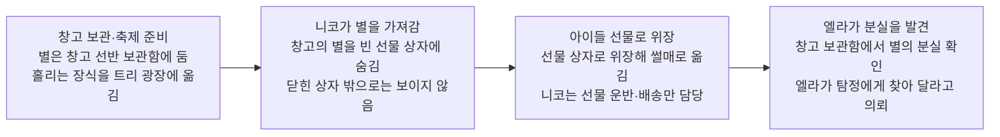
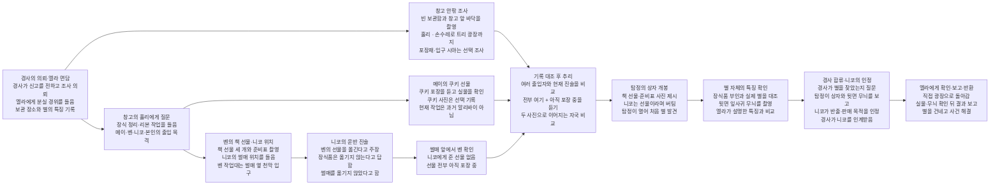

# 10 · B 사라진 크리스마스트리의 별 — 현재 시나리오

**L1-05 현재진행형 · 2단계 수정 대본 검토 대기 · 개발 미인계.** [장면별 기획](case-10-christmas-star.html)

마을의 큰 크리스마스 축제를 위해 어른들이 아이들 선물을 자원해서 준비한다. 엘라는 축제를 안내하고, 새 인물 홀리는 창고와 장식을 정리한다. 메이는 쿠키, 벤은 책 선물을 포장하고 니코는 완성된 선물을 썰매에 나르고 배송하는 역할만 맡는다. 니코는 창고에 보관한 금으로 만든 별을 선물 상자 안에 완전히 숨겨 나른다. **선물 상자 자체·상자의 출처·손잡이·종이 조각은 범행 물증으로 쓰지 않는다.**

별은 속까지 꽉 찬 실제 금으로 만든 장식 하나뿐이다. 밖으로 별 끝이나 금빛이 보이는 설정은 없다. 별 뒷면의 작은 잎사귀 음각 무늬가 실제 물건 확인에 쓰인다. 새 인물 이름·종(양 홀리)과 무늬·구체 대사는 기획자 제안이며 사용자 결정으로 적지 않는다. 새 인물·창고 보관·추가 근거를 넣는 방향은 사용자 승인 사항이다. 그림·음성 생성이나 게임 구현은 하지 않는다.

## 1. 제작자용 진실·행동 이유

1. 별은 마을이 해마다 쓰는 귀중품이며 창고 선반의 전용 보관함에 둔다. 뒷면에는 작은 잎사귀 무늬가 새겨져 있다. 몸체는 속까지 꽉 차 있고 전기 부품·빈 내부·연결 관은 없다. 순도·무게·크기·트리 고정 방식은 미정이다.
2. 엘라는 설치 준비를 위해 보관함 잠금을 풀고 별을 확인한 뒤, 광장 입구의 어린 친구들을 안내하러 잠시 나간다. 평소에는 잠가 보관한다. 돌아와 별이 없어진 것을 알고 오소리 경사에게 알린다. 경사는 신고를 전하고 탐정에게 조사를 부탁한다. 탐정은 그 자리에 함께 있는 엘라에게 경위를 듣는다. 엘라는 조사 중 안내 자리에 남는다. 경사는 광장 쪽 이야기를 들은 뒤 축제장 주변을 확인한다. 후보를 직접 지목하지 않고 위치·특징만 답한다. 사전 별 사진은 없다.
3. 홀리는 창고의 장식을 손수레로 트리 광장에 옮긴 뒤 문 앞 작업대에서 장식을 정리하고 리본을 단다. 손수레의 두 바퀴가 남긴 자국은 트리 광장 쪽으로 굽는다. 본인도 창고를 사용한다. 메이는 포장지를, 벤은 빈 선물 상자를 가지러 드나들고, 니코는 선물 운반에 쓸 상자를 가지러 들어온다. 홀리는 이 세 친구가 들어가는 것은 봤지만 선반 안쪽에서 무엇을 집었는지 계속 보지는 못했다. 출입 목격만으로 별을 가져간 사람을 알 수 없다.
4. 니코는 준비 시간에 창고 앞에서 빈 운반 상자를 썰매에 싣고 천막 옆에 다시 세웠다. 나중에 창고에 걸어서 돌아간 니코는 열린 보관함에서 별을 가져와 준비용 선물 상자 안에 넣고 뚜껑을 닫는다. 다른 선물과 함께 나르려 하며, 무엇을 옮기는지 묻자 벤의 선물이라고 둘러댄다. 정상 역할은 선물 운반·썰매 배송이며 포장을 겸하지 않는다. 닫힌 선물 상자는 숨기는 수단일 뿐 창고 출처를 입증하는 증거가 아니다.
5. 메이·벤은 천막에서 선물을 포장한다. 벤이 이번 배송을 위해 준비한 책 선물은 배송 준비표에 적힌 세 개 전부이며 모두 작업대에 남아 있다. 이미 니코에게 건넨 별도 물량은 없다. 니코는 아직 나머지 선물이 준비되지 않아 출발하지 않는다. 자동 도주·타이머는 없다.
6. 탐정은 창고의 빈 보관함을 촬영하고 홀리에게 현재 작업과 출입을 묻는다. 여러 친구가 출입했으므로 그 말만으로 특정하지 않는다. 천막에서 실제 책 선물 상태를 본 뒤, 니코의 운반 주장을 듣고 썰매 앞에서 옆 천막 입구의 벤에게 바로 묻는다. 벤은 니코에게 선물을 건네지 않았고 전부 여기에서 아직 포장 중이라고 답한다.
7. 니코는 장식품을 옮기지 않고 선물을 싣고 있다고도 말한다. 벤의 전체 선물 진술과 니코의 운반 설명이 맞지 않아 출처를 다시 묻는다. 탐정이 벤의 답변과 작업대 사진을 대조한 뒤 사진을 내밀면 니코는 그냥 선물이라고 버틴다. 누구의 선물인지 답하지 못하자 탐정은 썰매 위에 그대로 놓인 상자를 조사한다. 플레이어가 상자 열기를 선택해 탐정이 직접 연다.
8. 개봉 뒤 처음으로 별을 발견한다. 선물만 나르고 장식품은 옮기지 않는다는 진술과 실제 장식품을 대조한다. 별의 뒷면을 조사·촬영해 엘라가 설명한 작은 잎사귀 무늬를 확인하고, 창고의 빈 보관함·니코의 출처 답변을 함께 본다. 별의 실물과 뒷면을 확인하면 축제장을 살피던 경사가 썰매 앞에 도착해 별을 찾았는지 묻는다. 탐정의 발견 보고 뒤 니코가 창고 선반의 보관함에서 허락 없이 가져왔고 팔려 했다고 인정한다. 경사가 니코를 인계받고 탐정은 별을 받아 엘라에게 확인·보고·반환한다.

혼동 요소는 **여러 봉사자가 같은 창고에 드나든 사실**이다. 홀리도 출입했고 현재 장식을 정리하므로 후보에서 자동 제외하지 않는다. 현재 작업은 과거 알리바이가 아니다. 범행 물증은 별의 실물·뒷면 무늬·비어 있는 보관 위치다. 홀리와 벤·니코의 말은 진술로 기록한다. 박스 손잡이 조각·상자 모양·배송 라벨·동물 종·외형·색을 범인 증거로 쓰지 않는다.

## 2. 장면별 스토리보드

### 사건 흐름도

사건의 진실과 플레이 순서를 나눈 제작자용 흐름도다. 창고를 살피고 두 바닥 사진의 자국을 대조한다. 썰매 앞에서 벤의 진술을 듣고 니코의 운반 설명을 대조한 뒤 탐정이 상자를 연다. 별 실물·잎사귀 무늬·출처 확인은 개봉 뒤다. 선물 상자 자체는 물증으로 쓰지 않는다.

#### 01 · 사건이 벌어진 과정

제작자용 진실 · 탐정이 오기 전

#### 02 · 탐정이 해결하는 과정

플레이 순서 · 진술과 사진을 대조하고 의뢰인에게 반환

### 장면 0 · 준비

같은 엔진·같은 화면의 열쇠 카드로 현재 행동 긍정·부정·확인·행동 질문을 준비한다. 이름은 자기소개 뒤 표시하고 단서·질문 개수는 플레이 화면에 쓰지 않는다. 예습 예문은8절을 쓴다.

### 장면 1 · 트리 광장 — 경사의 의뢰와 엘라 면담

엘라와 경사가 트리 광장에 함께 있다. 광장 중앙의 크리스마스트리는 주변 건물 지붕보다 훨씬 높고, 아래에 선 엘라와 경사가 작아 보인다. 광장 안에서는 아래쪽 가지가 배경을 넓게 채우고 꼭대기는 화면 위로 넘어간다. 경사가 먼저 별 분실 신고를 전하고 탐정에게 조사를 부탁한 뒤 엘라에게 안내한다. 엘라의 인사 뒤 첫 선택지는 e0 하나다. 탐정이 엘라에게 무슨 일이 있었는지 묻고 답을 기록하면 e1·e2가 열린다. e2 기록 뒤 탐정은 창고로 갈 수 있고, 경사는 축제장 주변을 살핀다.

- **badger:hello · 경사 · 자동**
  - Detective, Ella reported the town's Christmas star missing.
  - 탐정, 엘라가 신고했어. 마을의 크리스마스 별이 사라졌대.

- **badger:request · 경사 · 자동**
  - Can you look into it? Ella can tell you what happened.
  - 조사해 줄래? 무슨 일이 있었는지는 엘라에게 들어 봐.

- **ella:hello · 엘라 · 자동**
  - Hi, I'm Ella.
  - 안녕, 난 엘라야.

#### ella:e0 · 엘라

- **질문 선택지**: What happened?
- 해석: 무슨 일이 있었어?
- **대답**: I went to show the children around the festival. When I came back, the star was missing.
- 해석: 축제에 온 아이들을 안내하러 자리를 비웠어. 돌아와 보니 별이 사라졌더라.
- **노트**: “I went to show the children around the festival. When I came back, the [star] was [missing].”
- **보기**: star · string · missing · shining
- 조건: 경사의 조사 의뢰와 엘라의 인사 뒤 첫 선택지로 표시
- 채점 뒤: 엘라가 축제에 온 아이들을 안내하고 돌아와 분실을 발견했다는 경위 기록. e1·e2 해금

#### ella:e1 · 엘라

- **질문 선택지**: What does the star look like?
- 해석: 별은 어떻게 생겼어?
- **대답**: It's real gold, with a small leaf pattern on the back.
- 해석: 진짜 금으로 만들었고 뒷면에 작은 잎사귀 무늬가 있어.
- **노트**: “It's real [gold], with a small [leaf] pattern on the [back].”
- **보기**: gold · glass · leaf · line · back · front
- 조건: e0 기록 뒤
- 채점 뒤: 금 재질·별 뒷면의 잎사귀 모양 기록. 실물 식별에 사용

#### ella:e2 · 엘라

- **질문 선택지**: Where did you leave it?
- 해석: 어디에 두었어?
- **대답**: I left it in its case on the storeroom shelf.
- 해석: 창고 선반의 보관함 안에 두었어.
- **노트**: “I left it in its [case] on the [storeroom] [shelf].”
- **보기**: case · box · storeroom · gift tent · shelf · table
- 조건: e0 기록 뒤
- 채점 뒤: 축제 창고·이름 없는 양. 보관함 관찰·c-case 촬영

- **badger:split-search · 경사 · 자동**
  - I'll look around the festival.
  - 난 축제장 주변을 확인할게.

- **det:storeroom-thought · 탐정 · 생각**
  - I should check the storeroom.
  - 창고를 확인해야겠어.

- **move:storeroom · 이동 · 이동 버튼**
  - Go to the Storeroom.
  - 축제 창고로 가기

### 장면 2 · 축제 창고 — 홀리와 빈 보관함

엘라 e2 기록으로 창고를 발견하고 직접 이동한다. 홀리는 문 앞 작업대에, 보관함은 안쪽 선반에 있다. 양의 이름은 자기소개 전에는 표시하지 않는다. 창고는 포장재·장식품을 함께 보관하는 정상 작업 공간이고, 누구나 드나들었다는 사실은 범행을 뜻하지 않는다.

#### 홀리에게 질문

홀리는 엘라와 함께 축제를 준비하는 성인 양이다. 장식을 정리하고 리본을 달지만 선물을 포장하거나 배송하지 않는다. 본인도 창고에 들어갔다고 답한다. 목격의 범위는 사람들의 출입까지이며 별을 가져가는 손동작·반출품·범행은 보지 못했다.

- **holly:hello · 홀리 · 자동**
  - Hi! I'm Holly. Come in.
  - 안녕! 난 홀리야. 들어와.

- **det:holly-intro · 탐정 · 자동**
  - I'm helping Ella find the missing star.
  - 엘라가 없어진 별을 찾는 걸 돕고 있어.

- **holly:ready · 홀리 · 자동**
  - Oh! I'll answer what I can.
  - 아! 내가 아는 건 말해 줄게.

#### holly:h1 · 홀리

- **질문 선택지**: Are you sorting decorations?
- 해석: 장식품을 정리하고 있어?
- **대답**: Yes. I'm sorting decorations for the Christmas party. I'm helping Ella.
- 해석: 응. 크리스마스 파티 장식품을 정리하고 있어. 엘라를 돕고 있어.
- **노트**: “Yes. I'm [sorting] [decorations] for the Christmas party. I'm helping Ella.”
- **보기**: sorting · carrying · decorations · gifts
- 조건: 엘라 e2 기록·창고 도착·홀리 자기소개 뒤 첫 질문
- 채점 뒤: h2·h3. 포장 천막은 h3 대답 기록 뒤 발견

#### holly:h2 · 홀리

- **질문 선택지**: Who came into the storeroom?
- 해석: 창고에는 누가 들어왔어?
- **대답**: I saw May, Ben, and Nico go in. I went in, too.
- 해석: 메이, 벤, 니코가 들어가는 걸 봤어. 나도 들어갔어.
- **노트**: “I [saw] May, Ben, and Nico go [in]. I went in, too.”
- **보기**: saw · see · in · out
- 조건: h1 기록 뒤
- 채점 뒤: 여러 사람의 창고 출입 목격. 내용물·반출·범행은 모르는 진술이며 사진 증거로 만들지 않음

#### holly:h3 · 홀리

- **질문 선택지**: What are you doing?
- 해석: 무엇을 하고 있어?
- **대답**: I'm hanging ribbons. May and Ben are in the gift tent.
- 해석: 리본을 달고 있어. 메이와 벤은 선물 포장 천막에 있어.
- **노트**: “I'm [hanging] ribbons. May and Ben are in the [gift tent].”
- **보기**: hanging · wrapping · gift tent · storeroom
- 조건: h1 기록 뒤
- 채점 뒤: 현재 장식 작업·메이/벤의 포장 천막 발견. 각 이름 표시는 본인 소개 뒤. 현재 행동을 과거 알리바이로 쓰지 않음

e2 기록 뒤 창고 선반의 빈 보관함을 c-case로 촬영할 수 있다. 홀리에게 묻기 전후 어느 쪽이든 가능하다. 관찰: **An empty case on the storeroom shelf. / 창고 선반에 빈 보관함이 있어.** 보관함 사진에 출입자·범인·사람의 목격담을 적지 않는다. 안쪽에서 공용 포장재 선반(c-supplies)과 문턱에서 본 선반의 시야(c-door-view)도 선택 촬영할 수 있다. 공용 포장재는 창고에 들어갈 일상적인 이유를, 문턱 사진은 홀리가 보지 못한 범위를 이해하는 데 쓴다. e2 기록 뒤 입구의 바닥도 c-track-yard로 촬영한다. 탐정은 바닥에 긴 자국이 보인다고만 말한다. 촬영 뒤 홀리에게 장식을 옮긴 적 있는지 묻는다. 홀리는 손수레로 트리 광장까지 옮겼다고 답한다. 이 문답은 받아쓰기 없이 기록한다. h3 기록으로 포장 천막을 발견한다.

- **det:ask-cart · 탐정 · 선택 질문**
  - Did you move any decorations today?
  - 오늘 장식품을 옮겼어?

- **holly:cart · 홀리 · 자동**
  - Yes. I took some decorations to the Tree Square in a handcart.
  - 응. 손수레로 장식품을 트리 광장에 옮겼어.

- **det:gift-thought · 탐정 · 생각**
  - I should ask the friends in the gift tent.
  - 포장 천막의 친구들에게 물어봐야겠어.

- **move:gift · 이동 · 이동 버튼**
  - Go to the Gift Tent.
  - 선물 포장 천막으로 가기

### 장면 3 · 선물 포장 천막 — 메이

메이는 쿠키 선물을 포장하고 있다. 홀리는 메이가 창고에 들어간 것을 봤지만, 포장 중인 현재 모습만으로 과거 반출을 부정하지 않는다. 탐정이 조사 이유를 밝힌 뒤 무엇을 포장하는지 묻는다.

- **mae:hello · 메이 · 자동**
  - Welcome! I'm May.
  - 어서 와! 난 메이야.

- **det:mae-intro · 탐정 · 자동**
  - I'm helping Ella find a missing star.
  - 엘라가 없어진 별을 찾는 걸 돕고 있어.

- **mae:ready · 메이 · 자동**
  - Oh! What would you like to know?
  - 아! 뭐가 궁금해?

#### mae:m1 · 메이

- **질문 선택지**: What are you wrapping?
- 해석: 무엇을 포장하고 있어?
- **대답**: I'm wrapping cookies. We're all volunteers for the Christmas party.
- 해석: 쿠키를 포장하고 있어. 우리 모두 크리스마스 파티를 돕는 자원봉사자야.
- **노트**: “I'm [wrapping] [cookies]. We're all volunteers for the Christmas party.”
- **보기**: wrapping · painting · cookies · toys
- 조건: 홀리 h3로 포장 천막 발견·메이 인사 뒤
- 채점 뒤: m3

#### mae:m3 · 메이

- **질문 선택지**: Can I see the cookies?
- 해석: 쿠키를 봐도 돼?
- **대답**: Sure. They're round, with chocolate on the top.
- 해석: 물론이지. 동그랗고 위쪽에 초콜릿이 있어.
- **노트**: “Sure. They're [round], with [chocolate] on the [top].”
- **보기**: round · flat · chocolate · paper · top · bottom
- 조건: m1 기록 뒤
- 채점 뒤: 쿠키 확인·선택 사진 c-cookies 촬영 허락. 사진은 진행 조건 아님

m3 뒤 쿠키를 직접 확인한다. 사진 c-cookies는 선택 기록이다. 사진을 찍지 않아도 추리·개봉·해결이 열린다. 메이와 벤의 최초 방문 순서는 자유다.

### 장면 4 · 같은 천막 — 벤의 책 선물

벤은 이번 배송의 자기 선물 전부를 작업대에서 포장 중이다. 첫 인사 뒤 탐정이 큰 트리의 별이 창고에서 사라졌고 엘라를 도와 찾고 있다고 설명한다. 벤의 반응 뒤에는 별을 봤는지 묻는 선택지만 먼저 뜬다. 벤이 별은 못 봤지만 아까 창고에 갔다고 답하면, 창고에 왜 갔는지 묻는 선택지가 열린다. 벤이 선물을 담을 빈 상자가 필요했다고 답하면 그 선물에 관해 b1으로 이어진다. 두 첫 문답은 받아쓰기 없이 듣고, b1을 기록하면 b3와 책 조사 선택지가 열린다. 벤의 작업대는 썰매 바로 옆 천막 입구에 있어 썰매 앞에서도 말을 걸 수 있다. b2는 니코 n2를 기록하고 그의 열린 질문을 마친 뒤 썰매 앞에서 묻는다.

- **ben:hello · 벤 · 자동**
  - Hi there! I'm Ben. Can I help?
  - 안녕! 난 벤이야. 뭐 도와줄까?

- **det:ben-intro · 탐정 · 자동**
  - The star for the big tree is missing from the storeroom. I'm helping Ella find it.
  - 큰 트리 꼭대기에 달 별이 창고에서 사라졌어. 엘라를 도와 찾고 있어.

- **ben:ready · 벤 · 자동**
  - Oh no! What do you need to know?
  - 이런! 뭘 알고 싶어?

- **det:ben-star · 탐정 · 선택 질문**
  - Did you see the star today?
  - 오늘 그 별을 봤어?

- **ben:star · 벤 · 자동**
  - No, I didn't. I was in the storeroom earlier.
  - 아니, 못 봤어. 아까 창고에 가긴 했어.

- **det:ben-storeroom · 탐정 · 선택 질문**
  - Why did you go to the storeroom?
  - 창고에는 왜 갔어?

- **ben:storeroom · 벤 · 자동**
  - I needed some empty boxes for the gifts.
  - 선물을 담을 빈 상자가 필요했어.

#### ben:b1 · 벤

- **질문 선택지**: What are you wrapping?
- 해석: 뭘 포장하고 있어?
- **대답**: I'm wrapping books. These are gifts for the children.
- 해석: 책을 포장하고 있어. 어린 친구들에게 줄 선물이야.
- **노트**: “I'm [wrapping] [books]. These are gifts for the children.”
- **보기**: wrapping · carrying · books · cookies
- 조건: 홀리 h3로 포장 천막 발견·벤이 창고에 간 이유를 답한 뒤
- 채점 뒤: b3·책을 보여 달라는 행동 선택지. b2는 니코 n2 뒤 썰매 앞에서 질문

#### ben:b3 · 벤

- **질문 선택지**: Who is helping with the deliveries?
- 해석: 배송은 누가 돕고 있어?
- **대답**: Nico is helping with deliveries. He's by his sleigh outside.
- 해석: 니코가 배송을 돕고 있어. 지금 밖에 있는 자기 썰매 옆에 있어.
- **노트**: “[Nico] is helping with deliveries. He's by his [sleigh] [outside].”
- **보기**: Nico · May · sleigh · tent · outside · inside
- 조건: b1 기록 뒤
- 채점 뒤: 썰매 앞·이름 없는 펭귄. 이름 표시는 본인 인사 뒤

- **det:books-q · 탐정 · 행동 선택지**
  - Can I look at the books?
  - 책들을 봐도 돼?

- **ben:books-a · 벤 · 자동**
  - Sure. You can take a photo.
  - 물론이지. 사진을 찍어도 돼.

책을 보는 선택지는 받거나 건네는 행동 없이 촬영 허락만 구하는, 받아쓰기 없는 행동 선택지다. 허락 뒤 아직 포장이 끝나지 않은 책 선물 세 개와 이번 배송 수량이 적힌 준비표를 한 화면에 담아 c-books로 촬영한다. 촬영 시점에는 예정된 세 개가 전부 작업대에 있다. 이후 인계 여부와 현재 위치는 썰매 앞 b2에서 다시 확인한다. b3에서 니코의 역할·썰매 위치를 기록하면 다음 장소가 열린다.

- **det:sleigh-thought · 탐정 · 생각**
  - I should ask Nico about the deliveries.
  - 니코에게 배송에 관해 물어봐야겠어.

- **move:sleigh · 이동 · 이동 버튼**
  - Go to the Delivery Sleigh.
  - 썰매 앞으로 가기

### 장면 5 · 썰매 앞 — 운반 주장과 벤 재확인

니코는 썰매 짐칸 앞에서 몸을 살짝 숙여, 이미 짐칸에 올라간 닫힌 선물 상자를 손으로 밀어 자리를 잡는다. 움직임은 정지 일러스트의 자세로 보여 준다. 대화할 때 상자는 짐칸에 그대로 둔다. 상자의 외형·손잡이·출처·포장지는 물증이 아니다. 상자를 촬영하는 단서도 없다. 별·금빛·별 끝은 개봉 전에 전혀 보이지 않는다. n3의 that box는 조금 떨어진 같은 상자를 가리킨다. 니코의 대답은 문법적으로 맞아도 내용은 거짓일 수 있다.

- **nico:hello · 니코 · 자동**
  - Hi there. I'm Nico. What brings you here?
  - 안녕. 난 니코야. 무슨 일이야?

- **det:nico-intro · 탐정 · 자동**
  - I'm helping Ella find a missing star.
  - 엘라가 없어진 별을 찾는 걸 돕고 있어.

#### nico:n1 · 니코

- **질문 선택지**: What are you doing?
- 해석: 뭐 하고 있어?
- **대답**: I'm loading the gifts. I'm not delivering yet.
- 해석: 선물을 싣고 있어. 아직 배달하러 출발하지는 않았어.
- **노트**: “I'm [loading] the gifts. I'm not [delivering] yet.”
- **보기**: loading · opening · delivering · decorating
- 조건: 썰매 앞 발견·니코 인사 뒤 첫 질문
- 채점 뒤: n2. n3·n4는 n2 기록 뒤

#### nico:n2 · 니코

- **질문 선택지**: What are you carrying?
- 해석: 무엇을 옮기고 있어?
- **대답**: I'm taking Ben's gift to the sleigh.
- 해석: 벤의 선물을 썰매로 옮기고 있어.
- **노트**: “I'm [taking] Ben's [gift] to the [sleigh].”
- **보기**: taking · opening · gift · case · sleigh · tent
- 조건: n1 기록 뒤
- 채점 뒤: n3·n4 및 썰매 앞 벤 확인 조건. 이 상자가 벤의 선물이라는 주장은 검증 전 기록

#### nico:n3 · 니코

- **질문 선택지**: Are you opening that box?
- 해석: 저 상자를 열고 있어?
- **대답**: No, I'm not opening it. I'm loading it for delivery.
- 해석: 아니, 여는 게 아니야. 배송하려고 싣고 있어.
- **노트**: “No, I'm [not] opening it. I'm [loading] it for [delivery].”
- **보기**: not · now · loading · opening · delivery · decoration
- 조건: n2 기록 뒤
- 채점 뒤: 개봉이 아니라 적재 중이라는 작업 기록. 내용물은 알 수 없음

#### nico:n4 · 니코

- **질문 선택지**: Are you moving the decorations too?
- 해석: 장식품도 나르고 있어?
- **대답**: No, I'm not moving decorations. I'm loading gifts.
- 해석: 아니, 장식품을 나르는 게 아니야. 선물을 싣고 있어.
- **노트**: “No, I'm [not] moving decorations. I'm loading [gifts].”
- **보기**: not · now · gifts · decorations
- 조건: n2 기록 뒤
- 채점 뒤: 장식품은 옮기지 않고 선물을 싣는다는 진술. 개봉 뒤 실제 별과 대조

니코는 n2에서 벤의 선물을 옮긴다고 말하고 n4에서는 장식품을 옮기지 않는다고 답한다. 아직 별이 든 사실은 알 수 없다. 열린 질문을 마치면 같은 썰매 앞에서 벤에게 말을 건다. 탐정은 선물 포장이나 배송을 돕지 않는다.

니코의 열린 면담 뒤 썰매를 옮겼는지 묻는다. 받아쓰기 없이 답을 기록하고, 썰매 앞 바닥을 c-track-sleigh로 찍는다. 같은 나무 기둥이 보이도록 구도를 잡는다.

- **det:ask-sleigh · 탐정 · 선택 질문**
  - Did you move the sleigh this morning?
  - 오늘 아침에 썰매를 옮겼어?

- **nico:sleigh-stayed · 니코 · 자동**
  - No. It stayed right here all morning.
  - 아니. 아침 내내 바로 여기 있었어.

- **det:ben-check-thought · 탐정 · 생각**
  - I can ask Ben right here.
  - 여기서 바로 벤에게 물어볼 수 있겠어.

#### 벤에게 다시 확인

니코 n2를 기록하고 니코의 열린 질문을 마치면, 썰매 앞에서 벤에게 묻는 b2를 선택할 수 있다. 벤은 바로 옆 천막 입구 작업대에서 답한다. 탐정과 니코는 썰매 앞에 머물고, 앞서 본 닫힌 상자도 썰매 위 같은 자리에 둔다.

#### ben:b2 · 벤

- **질문 선택지**: Did you give Nico any of your gifts?
- 해석: 네 선물 중에 니코에게 건넨 게 있어?
- **대답**: No. I'm still wrapping them. They're all here.
- 해석: 아니. 아직 포장 중이야. 선물은 전부 여기 있어.
- **노트**: “No. I'm [still] [wrapping] them. They're [all] here.”
- **보기**: still · already · wrapping · delivering · all · some
- 조건: ben:b1·nico:n2 기록 뒤 썰매 앞에서 니코의 열린 질문을 마치면, 옆 천막 입구 작업대의 벤에게 질문
- 채점 뒤: 벤이 니코에게 선물을 건네지 않았고 전부 아직 여기에서 포장 중이라는 진술. 니코의 운반 주장과 대조

직접 묻고 들은 No로 니코에게 건네지 않았음을 확인한다. still·wrapping·all을 받아 적어 현재 작업과 선물 전체의 위치를 기록한다. 책 선물과 배송 준비표가 함께 나온 c-books는 벤을 처음 만났을 때 촬영한다. 썰매 앞에서 묻는 동안에도 바로 옆 벤의 작업대에는 같은 세 개가 보인다.

- **det:compare-thought · 탐정 · 생각**
  - I should compare the notes and the photos.
  - 기록과 사진을 비교해 봐야겠어.

행동 선택지: **Compare the clues. / 단서 비교하기**. 전체 면담15개(벤 재확인 포함)와 개봉 전 필수 사진 c-case·c-books·c-track-yard·c-track-sleigh와 두 현장 답변(홀리 손수레·니코 썰매)이 모이면 추리를 연다. 창고 보조 사진과 쿠키 사진은 선택이다. 메이·벤 방문은 자유이며 메이의 남은 기록도 추리 직전에는 모아야 한다. 개수는 제작 조건이고 플레이 화면에는 표시하지 않는다.

### 장면 6 · 추리 — 누구에게 재확인할까

7절의 7문항을 푼다. 자국 비교 문항에서는 두 사진에 공통으로 보이는 나무 기둥을 기준으로 어느 경로가 썰매 아래까지 이어지는지 플레이어가 직접 고른다. 홀리는 여러 사람의 창고 출입을 봤으므로 그 말만으로 특정하지 않는다. 니코의 운반 주장과 배송 준비표·책 선물 세 개가 담긴 사진 및 벤의 현장 답변을 대조해 설명을 다시 확인할 사람을 고른다. 아직 별을 찾았거나 범인을 확정했다고 말하지 않는다. 완료 뒤 **Check the explanation. / 설명 확인하기**를 선택하고 썰매 앞에 머문다.

### 장면 7 · 니코의 설명 확인과 탐정의 개봉

탐정은 썰매 앞에서 니코에게 운반 대상에 관한 설명을 다시 묻고 증거를 제시한다. 이때 경사는 축제장 주변을 확인 중이다.

썰매 앞에서 들은 벤 b2 진술을 바탕으로 증거를 고른다. 정답은 책 선물 세 개와 배송 준비표를 함께 찍은 c-books다. 탐정이 그 사진을 니코에게 직접 내밀면, 사진 속 세 개가 현재도 작업대에 있다는 점을 짚는 대사가 열린다. 사진이 보여 주는 것은 이번 배송분과 그 위치이며, 닫힌 상자의 내용물은 개봉 뒤 확인한다. 오답 반응: **That doesn't show what's on Ben's table. / 그건 벤 작업대에 뭐가 있는지 보여 주지 않아.** 같은 단계에서 다시 고른다.

- **present:c-books · 행동 · 증거 제시 선택지**
  - Show the photo of Ben's gifts.
  - 벤의 책 선물 사진 내밀기

- **det:open-q1 · 탐정 · 사진 제시 뒤 선택 대사**
  - You said it was Ben's gift. All three are still on his table.
  - 벤의 선물이라고 했잖아. 세 개 다 아직 벤의 작업대에 있어.

- **nico:open-a1 · 니코 · 자동**
  - It's just a gift.
  - 그냥 선물이야.

- **det:check-claim · 탐정 · 선택 질문**
  - Then whose gift is it?
  - 그럼 누구 선물인데?

- **nico:pause · 연출 · 무음 연출**
  - Nico looks down at the box without answering.
  - 니코는 상자를 내려다보며 대답하지 않는다.

- **open:box · 행동 · 탐정 조사 행동**
  - Open the box.
  - 상자 열기

c-books 사진 제시 뒤 니코가 누구의 선물인지 답하지 못하면 썰매 위의 닫힌 상자를 조사할 수 있다. 플레이어가 상자 열기를 선택하면 탐정이 직접 열고 별이 처음 보인다. 이후 c-open을 촬영한다. 관찰: **A star inside the box. / 상자 안에 별이 있어.** 장식품은 옮기지 않는다는 n4 진술과 실제 장식품을 대조하되 금빛만으로 재질·마을 소유·범행을 확정하지 않는다.

#### 별 자체를 자세히 확인

별 전체를 촬영한 뒤 뒷면을 가까이 조사한다. 별은 조사하는 동안 상자에 둔다. 기존 확대 조사 동작으로 뒷면을 볼 수 있는지는 개발 점검 대상이며 미지원이면 엔진 추가 필요다.

- **look:star-back · 행동 · 조사 행동**
  - Look at the back of the star.
  - 별 뒷면 살펴보기

뒷면의 작은 잎사귀 무늬를 c-mark로 직접 촬영한다. 관찰: **A small leaf pattern on the back of the star. / 별 뒷면에 작은 잎사귀 모양이 있어.** 엘라 e1의 설명과 대조하는 실물 특징이다. 문자로 주인을 써 주거나 범인 이름을 알려 주지 않는다. 한 장의 사진만으로 범행을 확정하지 않고 출처·허락·목적을 더 확인한다.

### 장면 8 · 경사의 확인과 니코의 인정

c-open·c-mark 조사 뒤, 광장 쪽을 확인하고 축제장을 살피던 경사가 썰매 앞에 도착한다. 경사가 먼저 별을 찾았는지 묻고, 탐정은 상자와 잎사귀 무늬를 보고한다. 이후 탐정의 출처·허락·목적 질문이 열린다. 추가 받아쓰기는 없다.

- **badger:found-star · 경사 · 자동**
  - Detective! Did you find the star?
  - 탐정, 별은 찾았니?

- **det:found-star · 탐정 · 자동**
  - Yes. It was in this box. The leaf pattern matches.
  - 응. 이 상자 안에 있었어. 잎사귀 무늬가 엘라 설명이랑 같아.

- **det:origin-q · 탐정 · 선택 질문**
  - Where did the star come from?
  - 별은 어디서 가져온 거야?

- **nico:origin-a · 니코 · 자동**
  - From the case on the storeroom shelf.
  - 창고 선반의 보관함에서.

니코가 창고 선반의 보관함을 출처로 말한 뒤 c-case와 e2를 대조하고 허락 여부를 묻는다. 현재 보관함이 비어 있다는 사실만으로 반출자를 특정하지 않는다. 잘못 제시하면 **That doesn't match the case. / 그건 보관함과 맞지 않아.**로 같은 단계에 남는다.

- **det:permission-q · 탐정 · 증거 제시 뒤 선택 질문**
  - Did Ella ask you to take it?
  - 엘라가 가져가 달라고 부탁한 거야?

- **nico:admit · 니코 · 자동**
  - No. I took it without asking.
  - 아니. 물어보지 않고 가져왔어.

- **det:motive-q · 탐정 · 선택 질문**
  - Why do you want the star?
  - 왜 그 별을 원하는 거야?

- **nico:motive · 니코 · 자동**
  - I want to sell it.
  - 팔려고 해.

- **badger:keep · 경사 · 자동**
  - Nico, you're coming with me.
  - 니코, 나랑 같이 가자.

- **det:take-q · 탐정 · 선택 질문**
  - May I take the star back?
  - 별을 돌려주러 가져가도 돼?

- **badger:take-a · 경사 · 자동**
  - Yes. Take it back to Ella.
  - 응. 엘라에게 돌려줘.

- **take:star · 행동 · 소지품 받기**
  - Take the star.
  - 별 받기

창고 보관함에서 허락 없이 가져왔고 팔려 했다는 답변까지 듣고 범행을 확인한다. 경사 허락 뒤 별 받기를 직접 선택하면 소지품 별 장식이 생긴다. 닫힌 상자·보관함·포장재·쿠키·책을 가져가지 않는다. 경사는 니코의 인정을 들은 뒤 니코를 인계받는다.

- **det:return-thought · 탐정 · 생각**
  - I should take the star back to Ella.
  - 별을 엘라에게 돌려줘야겠어.

- **move:tree · 이동 · 이동 버튼**
  - Return to the Tree Square.
  - 트리 광장으로 돌아가기

### 장면 9 · 트리 광장 — 엘라 확인·보고·반환

탐정만 이동 버튼으로 돌아온다. 별을 소지한 상태에서 this로 물어보고 엘라가 실제 별과 뒷면의 무늬를 확인한다. 보고 선택지 뒤 직접 건네기로 끝난다.

- **ella:return · 엘라 · 자동**
  - Oh, you're back!
  - 아, 돌아왔네!

- **det:confirm-owner · 탐정 · 선택 질문**
  - Is this the town's star?
  - 이게 마을의 별이야?

- **ella:confirm-owner · 엘라 · 자동**
  - Yes. It's our gold star, with the leaf pattern on the back.
  - 응. 우리 마을의 금으로 만든 별이야. 뒷면에 작은 잎사귀 모양이 있어.

- **det:report · 탐정 · 보고 선택지**
  - Nico took it. The officer is with him now.
  - 니코가 가져갔어. 지금 경사가 함께 있어.

- **ella:thanks · 엘라 · 자동**
  - Thank you for finding it. Please give it to me.
  - 찾아줘서 고마워. 나에게 건네줘.

- **give:star · 행동 · 소지품 건네기**
  - Give the star to Ella.
  - 엘라에게 별 건네기

- **ella:end · 엘라 · 자동**
  - Now we can put it on the tree.
  - 이제 트리에 달 수 있겠어.

건네기 완료 뒤 소지품에서 빠진다. 높은 트리에 오르거나 즉석 설치하는 동작은 요구하지 않는다. 해명하지 않고 남긴 단서는 없으며 배송할 선물의 구체적인 목적지는 아직 기획 검토 항목이다.

## 3. 사진·실물·진술의 역할

### c-case · 보관함

| 항목 | 내용 |
|---|---|
| 필수/선택 | 필수 |
| 열리는 때 | 엘라 e2 기록·창고 선반의 보관함 조사 |
| 촬영 그림 | 창고 선반의 열린 보관함과 비어 있는 별 모양 받침. 인물·이름·발자국·선물 상자 식별 정보 없음. |
| 관찰 음성 | An empty case on the storeroom shelf. |
| 해석 | 창고 선반에 빈 보관함이 있어. |
| 쓰임 | 엘라 e2의 보관 위치·분실을 확인하고 개봉 후 니코가 말한 출처와 대조. 누가 열었는지는 알려 주지 않음. |

### c-supplies · 공용 포장재 선반

| 항목 | 내용 |
|---|---|
| 필수/선택 | 선택 |
| 열리는 때 | 창고 안 선반 조사 |
| 촬영 그림 | 출입문 가까운 선반에 포장지와 빈 상자를 나란히 둔다. 선반 칸에 Wrapping Paper와 Empty Boxes라고 붙어 있다. 물건에 이름이나 개별 배송 표시는 없다. |
| 관찰 음성 | Wrapping paper and empty boxes on the shelf. |
| 해석 | 선반에 포장지랑 빈 상자가 있어. |
| 쓰임 | 창고에는 별 외에 평소 꺼내 쓰는 포장재도 있다. 여러 사람이 출입했다는 말과 함께 보되, 각자가 무엇을 꺼냈는지는 알 수 없다. |

### c-door-view · 문 앞에서 본 창고

| 항목 | 내용 |
|---|---|
| 필수/선택 | 선택 |
| 열리는 때 | 창고 안 문턱에서 안쪽 보기 |
| 촬영 그림 | 문턱에서 안쪽을 찍는다. 가까운 장식 상자가 출입문 옆 작업대 방향에서 안쪽 선반 아래쪽을 가린다. 탐정이 통로로 한두 걸음 들어가면 안쪽 보관함을 볼 수 있다. |
| 관찰 음성 | The crates block part of the shelf. |
| 해석 | 장식 상자들이 선반 일부를 가리고 있어. |
| 쓰임 | 홀리가 드나드는 사람은 봤어도 안쪽에서 무얼 집었는지 못 본 이유를 현장 구조로 확인한다. 사진은 사건 당시의 행동을 보여 주지 않는다. |

### c-track-yard · 창고 앞 바닥

| 항목 | 내용 |
|---|---|
| 필수/선택 | 필수 |
| 열리는 때 | e2 기록 뒤 창고 입구 바닥 조사 |
| 촬영 그림 | 얇게 눈이 덮인 창고 앞 길을 넓게 찍는다. 평행한 자국 두 벌 중 한 벌은 트리 광장 입구 쪽으로 굽고, 다른 벌은 나무 표지 기둥을 지나 프레임 밖으로 이어진다. 광장 입구 뒤로 멀리서도 눈에 띄는 커다란 크리스마스트리의 전체 윤곽이 보인다. 트리는 두 자국과 나무 표지 기둥을 가리지 않는다. 자국에 도구명이나 정답 표시는 붙이지 않는다. |
| 관찰 음성 | There are long marks on the ground. |
| 해석 | 바닥에 긴 자국이 있어. |
| 쓰임 | 창고 앞에서 자국이 나뉘는 모습을 기록한다. 홀리의 손수레 운반 진술과 후속 사진을 대조한다. |

### c-cookies · 쿠키 선물

| 항목 | 내용 |
|---|---|
| 필수/선택 | 선택 |
| 열리는 때 | 메이 m3 기록 뒤 선택 촬영. 보지 않아도 추리·해결 진행 |
| 촬영 그림 | 열린 선물 상자에 동그란 쿠키와 초콜릿 윗면이 보임. 평범한 리본과 포장지. 사람·작업 동작·소유 이름·별 모양 쿠키나 무늬는 없음. |
| 관찰 음성 | Round cookies, with chocolate on the top. |
| 해석 | 위쪽에 초콜릿이 있는 동그란 쿠키들이야. |
| 쓰임 | 쿠키 선물의 실제 모습을 선택 기록. 현재 작업을 과거 알리바이로 만들지 않으며 필수 조건 아님. |

### c-books · 책 선물 세 개와 배송 준비표

| 항목 | 내용 |
|---|---|
| 필수/선택 | 필수 |
| 열리는 때 | 벤 b1 기록 뒤 책을 보는 행동 선택지·벤 허락 |
| 촬영 그림 | 벤의 작업대를 한 프레임으로 찍는다. 책이 든 덜 포장된 선물 상자 세 개가 서로 가리지 않게 나란히 있고, 옆에 미리 적어 둔 배송 준비표가 펼쳐져 있다. 표에는 “Gifts for This Delivery”와 “Book gifts: 3”이 읽힌다. 표의 3은 이번 배송에 넣기로 한 벤의 책 선물 전체 수량이다. |
| 관찰 음성 | Three book gifts and a delivery list. |
| 해석 | 책 선물 세 개와 배송 준비표가 있어. |
| 쓰임 | 배송 준비표의 예정 수량 세 개와 작업대에 남은 세 개를 대조한다. 사진은 촬영 당시 상태를 기록한다. 썰매 앞 벤 b2가 지금도 전부 여기 있고 니코에게 건네지 않았다고 확인한다. 개봉 전 니코에게 직접 내밀어 운반 설명을 확인한다. |

### c-track-sleigh · 나무 기둥 너머 바닥

| 항목 | 내용 |
|---|---|
| 필수/선택 | 필수 |
| 열리는 때 | 벤 b3를 기록하고 썰매 앞에 도착한 뒤 바닥 조사 |
| 촬영 그림 | 첫 사진과 같은 나무 표지 기둥, 기둥 옆 바닥, 정차한 썰매 밑부분을 한 프레임에 담는다. 기둥 옆 평행 자국 한 벌이 프레임 안에서 끊기지 않고 썰매 아래로 들어가는 모습이 보인다. |
| 관찰 음성 | The marks continue past the wooden post. |
| 해석 | 자국은 나무 기둥 너머로 이어져. |
| 쓰임 | 첫 사진과 함께 놓고 같은 기둥을 기준으로 두 구간을 잇는다. 자국을 남긴 물건이나 시각은 관찰 대사에서 확정하지 않는다. |

### c-open · 상자 안

| 항목 | 내용 |
|---|---|
| 필수/선택 | 필수 |
| 열리는 때 | 썰매 앞 벤 b2 기록·추리·c-books 사진 제시·니코의 침묵 뒤 탐정이 상자 열기를 선택 |
| 촬영 그림 | 완전히 닫혀 있던 상자를 연 뒤 별 전체를 처음 본다. 속까지 꽉 찬 금빛 별이며 별 끝이나 금빛이 개봉 전에 보이지 않는다. 소유자 이름·범인·진술 캡션 없음. |
| 관찰 음성 | A star inside the box. |
| 해석 | 상자 안에 별이 있어. |
| 쓰임 | 선물만 나르고 장식품은 옮기지 않는다는 니코 n4 진술과 실제 별 장식을 대조. 금빛만으로 재질·소유를 확정하지 않고 추가 조사·출처 확인을 진행. |

### c-mark · 별 뒷면

| 항목 | 내용 |
|---|---|
| 필수/선택 | 필수 |
| 열리는 때 | 개봉 후 c-open 촬영·뒷면 확인 선택지로 별을 가까이 조사 |
| 촬영 그림 | 별 뒷면에 원래 새겨진 작은 잎사귀 음각 무늬를 알아볼 수 있게 촬영. 글자·주인 이름·기념 날짜·범인 표시는 없다. 앞서 엘라 e1이 설명한 같은 무늬. 추가 별 소품이나 별의 파손은 없음. |
| 관찰 음성 | A small leaf pattern on the back of the star. |
| 해석 | 별 뒷면에 작은 잎사귀 모양이 있어. |
| 쓰임 | 별 자체의 식별 특징을 엘라 e1 진술과 대조하는 물증. 일반적인 다섯 끝 모양보다 구체적인 확인이며 니코의 창고 보관함 출처 답변·무허락 인정·엘라의 최종 실물 확인과 함께 쓴다. 이 무늬만으로 범인을 확정하지 않음. |

필수 사진 6장: 개봉 전 c-case·c-books·c-track-yard·c-track-sleigh, 개봉 뒤 c-open·c-mark. 선택 사진은 창고의 c-supplies·c-door-view와 천막의 c-cookies 총 3장이다. 두 창고 사진은 홀리의 진술을 이해하는 보조 단서다. 선물 상자 겉면·손잡이·찢어진 종이 조각·배송 라벨은 증거로 만들지 않는다. 상자는 숨기는 수단이다. 사진은 별의 실제 존재·무늬·보관 위치, 책 선물 세 개와 배송 준비표, 두 구간의 바닥 자국을 기록한다. 홀리의 목격·벤의 전체 물량·니코의 운반/장식품 부인은 질문→음성→받아쓰기다. 재질·소유는 엘라의 진술과 최종 실물 확인, 출처·무허락·목적은 니코의 답변으로 확인한다.

## 4. 배경과 선택 클릭 TTS

축제 창고 5개, 나머지 장소 각 2개로 총 11개다. 물건을 누르면 짧은 영어 음성 한 줄이 들린다. 아래 한국어는 기획서에서만 확인한다. 클릭은 사진·노트·추리 해금에 영향을 주지 않는다.

| ID | 장소 | 물건 | 영어 | 반말 해석 |
|---|---|---|---|---|
| tree:bell | 트리 광장 | 안내대 종 | A small bell. | 작은 종이야. |
| tree:ornaments | 트리 광장 | 낮은 가지 장식 | Round ornaments. | 둥근 장식 공들이야. |
| store:ladder | 축제 창고 | 사다리 | A ladder by the wall. | 벽 옆에 사다리가 있어. |
| store:broom | 축제 창고 | 빗자루 | A broom by the door. | 문 옆에 빗자루가 있어. |
| store:gloves | 축제 창고 | 걸이에 걸린 장갑 | A pair of gloves on the hook. | 걸이에 장갑 한 켤레가 걸려 있어. |
| store:cloth | 축제 창고 | 접어 둔 식탁보 | Folded tablecloths in a basket. | 바구니에 접어 둔 식탁보가 있어. |
| store:lantern | 축제 창고 | 창가의 랜턴 | A lantern by the window. | 창가에 랜턴이 있어. |
| gift:scissors | 선물 포장 천막 | 가위 | A pair of scissors. | 가위 한 자루야. |
| gift:ribbon | 선물 포장 천막 | 리본 바구니 | A basket of ribbon. | 리본이 든 바구니야. |
| sleigh:sack | 썰매 앞 | 큰 선물 자루 | A large gift sack. | 큰 선물 자루야. |
| sleigh:empty-box | 썰매 앞 | 빈 상자 | An empty box. | 빈 상자야. |

## 5. 한눈에·인물·장소

경사의 조사 의뢰·엘라의 경위 설명 → 창고의 빈 보관함·홀리의 출입 목격 → 천막의 메이·벤 → 썰매의 니코 → 같은 자리에서 벤 확인 → 추리 → 니코에게 책 선물·준비표 사진 제시 → 니코의 버티기 → 탐정의 개봉 → 별 전체·잎사귀 무늬 확인 → 경사의 발견 여부 질문 → 출처·허락·목적 질문과 니코 인계 → 엘라 확인·보고·반환.

| 인물 | 신규/재사용 | 현재 위치 | 제작자용 역할·아는 범위 |
|---|---|---|---|
| 엘라 · 사슴 · 성인 | 우산 인물 재사용 | 트리 광장 | 의뢰인. 별의 보관 위치·재질·소유·뒷면 무늬를 앎 |
| 홀리 · 양 · 성인 | 신규 제안 | 축제 창고 문 앞 작업대 | 엘라와 함께 축제 준비. 장식 정리·리본 달기. 본인과 메이·벤·니코의 창고 출입까지만 앎 |
| 메이 · 생쥐 · 성인 | 신규 | 포장 천막 | 쿠키 포장. 창고에 포장지를 가지러 간 정상 배경. 과거 알리바이로 자동 제외하지 않음 |
| 벤 · 비버 · 성인 | 소풍 인물 재사용 | 같은 천막의 작업대 | 빈 상자를 가지러 창고 사용. 이번 배송의 자기 선물 전부를 아직 작업대에서 포장 |
| 니코 · 펭귄 · 성인 | 신규 | 썰매 앞 | 선물 운반·배송만 담당. 운반용 상자를 가지러 창고에 드나들다 별을 숨김 |
| 오소리 경사 | 재사용 | 초반 트리 광장·후반 썰매 앞 | 엘라 신고 확인·주변 순찰·별 발견 확인·니코 인계 |

인물6명·장소4곳이다. 면담은5명이며 초반과 후반에 등장하는 경사1명을 포함해 L1 인물 기본4–5명을1명 초과한다. 새 준비 담당자를 추가하라는 사용자 요청을 반영한 예외다. 면담15개·37칸은 유지해 언어량과 장소 난도를 함께 늘리지 않는다. 경사는 받아쓰기0개다. 재사용3명·신규3명, 탐정은 기존 다람쥐다.

창고 선반 안쪽은 문 앞 장식 더미 때문에 계속 보이지 않는다. 홀리는 출입은 봤지만 손에 든 것·별 반출은 못 봤다. 창고의 물건·방문자 이름은 자기소개·답변 기록·실제 증거 발견 범위에 맞춰 공개한다. 장식 정리는 선물을 포장하는 일과 다르며 현재 행동을 과거 무죄 근거로 쓰지 않는다.

## 6. 해금·현장 확인·진행 조건

| 기록 | 조건 | 기록 뒤 |
|---|---|---|
| ella:e0 | 경사의 조사 의뢰와 엘라의 인사 뒤 첫 선택지로 표시 | 엘라가 축제에 온 아이들을 안내하고 돌아와 분실을 발견했다는 경위 기록. e1·e2 해금 |
| ella:e1 | e0 기록 뒤 | 금 재질·별 뒷면의 잎사귀 모양 기록. 실물 식별에 사용 |
| ella:e2 | e0 기록 뒤 | 축제 창고·이름 없는 양. 보관함 관찰·c-case 촬영 |
| holly:h1 | 엘라 e2 기록·창고 도착·홀리 자기소개 뒤 첫 질문 | h2·h3. 포장 천막은 h3 대답 기록 뒤 발견 |
| holly:h2 | h1 기록 뒤 | 여러 사람의 창고 출입 목격. 내용물·반출·범행은 모르는 진술이며 사진 증거로 만들지 않음 |
| holly:h3 | h1 기록 뒤 | 현재 장식 작업·메이/벤의 포장 천막 발견. 각 이름 표시는 본인 소개 뒤. 현재 행동을 과거 알리바이로 쓰지 않음 |
| mae:m1 | 홀리 h3로 포장 천막 발견·메이 인사 뒤 | m3 |
| mae:m3 | m1 기록 뒤 | 쿠키 확인·선택 사진 c-cookies 촬영 허락. 사진은 진행 조건 아님 |
| ben:b1 | 홀리 h3로 포장 천막 발견·벤이 창고에 간 이유를 답한 뒤 | b3·책을 보여 달라는 행동 선택지. b2는 니코 n2 뒤 썰매 앞에서 질문 |
| ben:b2 | ben:b1·nico:n2 기록 뒤 썰매 앞에서 니코의 열린 질문을 마치면, 옆 천막 입구 작업대의 벤에게 질문 | 벤이 니코에게 선물을 건네지 않았고 전부 아직 여기에서 포장 중이라는 진술. 니코의 운반 주장과 대조 |
| ben:b3 | b1 기록 뒤 | 썰매 앞·이름 없는 펭귄. 이름 표시는 본인 인사 뒤 |
| nico:n1 | 썰매 앞 발견·니코 인사 뒤 첫 질문 | n2. n3·n4는 n2 기록 뒤 |
| nico:n2 | n1 기록 뒤 | n3·n4 및 썰매 앞 벤 확인 조건. 이 상자가 벤의 선물이라는 주장은 검증 전 기록 |
| nico:n3 | n2 기록 뒤 | 개봉이 아니라 적재 중이라는 작업 기록. 내용물은 알 수 없음 |
| nico:n4 | n2 기록 뒤 | 장식품은 옮기지 않고 선물을 싣는다는 진술. 개봉 뒤 실제 별과 대조 |

e0→e1·e2, e2→축제 창고·홀리·c-case·c-track-yard. 창고 바닥 촬영→홀리 손수레 질문. 홀리 h1→h2·h3, h3→포장 천막, h2는 출입자 정보만 기록한다. 메이 m1→m3. 벤 첫 면담은 별 목격 여부→창고에 간 이유(두 문답은 받아쓰기 없음)→b1→b3·책 조사 행동, 벤 b3→썰매·니코·c-track-sleigh. 니코의 열린 질문을 마치면 썰매 이동 여부를 묻는다. 니코 n1→n2, n2→n3·n4·벤 b2. 벤 b2는 니코 n2를 기록하고 니코의 열린 질문을 마치면 썰매 앞에서 얻는다. 벤과의 첫 면담에서는 b1·b3를 기록하고 책 선물을 촬영한다. 메이·벤 방문 순서는 자유이며 기록은 추리 직전에 합류한다.

면담 15개·두 현장 답변·개봉 전 필수 사진 4장 → 추리 7문항 → 니코에게 c-books 사진 제시 → 니코의 부인·침묵 → 탐정이 열어 별 발견 → c-open → 뒷면 조사·c-mark → 경사 도착·발견 여부 질문·탐정의 보고 → 출처·허락·목적 질문 → 니코 인계·별 받기 → 엘라 확인·보고·건네기. 선택 사진 세 장은 해금 조건에 포함하지 않는다. 선물 상자 사진은 존재하지 않는다. 모든 이동은 생각과 버튼을 쓰며 발견·촬영 뒤 자동 이동하지 않는다.

## 7. 추리 7문항

추리는 개봉 전 설명을 다시 확인할 사람을 고르는 단계다. 사진만 보고 주인·범인을 알려 주지 않는다. 나중에 보게 되는 별 뒷면 무늬를 개봉 전 추리 정답으로 먼저 쓰지 않는다.

### deduction:q1

| 항목 | 내용 |
|---|---|
| 질문 | What do the storeroom visits tell us? |
| 해석 | 창고 출입 목격으로 무엇을 알 수 있어? |
| 완성 | Holly saw [several friends] go into the storeroom. |
| 해석 | 홀리는 여러 친구가 창고에 들어가는 걸 봤어. |
| 보기 | several friends · only Nico · only May · only Ben · only Ella · no one |
| 맞장구 | We still need to check the other information. |
| 해석 | 다른 정보도 확인해야 해. |
| 힌트 | Listen to Holly's answer about the visitors. |
| 해석 | 홀리의 창고 방문자 대답을 들어 봐. |
| 근거 | holly:h2. 메이·벤·니코 및 본인의 출입만 알며 누가 별을 가져갔는지는 모름 |

### deduction:q2

| 항목 | 내용 |
|---|---|
| 질문 | Whose gift does Nico say he is taking? |
| 해석 | 니코는 누구의 선물을 옮기고 있다고 말해? |
| 완성 | Nico says he is taking [Ben's gift]. |
| 해석 | 니코는 벤의 선물을 옮기고 있다고 말해. |
| 보기 | Ben's gift · May's gift · Ella's case · his own gift · a ribbon basket · an empty box |
| 맞장구 | That's his explanation of the box. |
| 해석 | 그 상자에 대한 니코의 설명이야. |
| 힌트 | Listen to Nico's answer about what he is carrying. |
| 해석 | 무엇을 옮기는지에 대한 니코의 대답을 들어 봐. |
| 근거 | nico:n2. 주장으로 기록하며 실제 주인으로 확정하지 않음 |

### deduction:q3

| 항목 | 내용 |
|---|---|
| 질문 | What is Ben still doing? |
| 해석 | 벤은 아직 무엇을 하고 있어? |
| 완성 | Ben is still [wrapping his gifts]. |
| 해석 | 벤은 자기 선물을 아직 포장하고 있어. |
| 보기 | wrapping his gifts · delivering his gifts · loading the sleigh · opening the case · carrying Nico's box · wrapping cookies |
| 맞장구 | The wrapping is still in progress. |
| 해석 | 포장이 아직 진행 중이야. |
| 힌트 | Listen to Ben by the sleigh. |
| 해석 | 썰매 앞에서 들은 벤의 대답을 들어 봐. |
| 근거 | ben:b2 + c-books. 과거 알리바이가 아니라 현재 물건 상태를 확인 |

### deduction:q4

| 항목 | 내용 |
|---|---|
| 질문 | Which gifts does the photo show on Ben's table? |
| 해석 | 사진 속 벤의 작업대에는 어떤 선물이 있어? |
| 완성 | The photo shows [all three book gifts]. |
| 해석 | 사진에는 책 선물 세 개가 전부 보여. |
| 보기 | all three book gifts · two book gifts · one book gift · the cookies · an empty box · the star |
| 맞장구 | The list says three, and three are on the table. |
| 해석 | 준비표에 세 개라고 적혀 있고, 작업대에도 세 개가 있어. |
| 힌트 | Compare the list with the gifts on the table. |
| 해석 | 배송 준비표에 적힌 수량과 작업대 위 선물을 비교해 봐. |
| 근거 | c-books: 이번 배송 준비표의 수량 3과 사진에 보이는 책 선물 3개가 일치한다. 촬영 뒤 인계 여부는 ben:b2의 No와 They're all here.로 확인한다. |

### deduction:q5

| 항목 | 내용 |
|---|---|
| 질문 | Does Nico's account match Ben's answer? |
| 해석 | 니코의 설명은 벤의 대답과 맞아? |
| 완성 | The two accounts [do not match]. |
| 해석 | 두 설명은 맞지 않아. |
| 보기 | do not match · mention only cookies · name Holly as the thief · prove the star is in the box · say Ben is loading gifts · say the star is back |
| 맞장구 | We need a clearer explanation. |
| 해석 | 더 분명한 설명이 필요해. |
| 힌트 | Compare Nico's claim with Ben's answer and the photo. |
| 해석 | 니코의 운반 주장을 벤의 대답과 사진에 대조해 봐. |
| 근거 | nico:n2 + ben:b2 + c-books. 준비표상 이번 배송분 세 개가 모두 작업대에 있고, 벤은 지금도 전부 여기 있으며 니코에게 건네지 않았다고 답한다. 니코의 운반 설명을 다시 물을 근거다. |

### deduction:tracks

| 항목 | 내용 |
|---|---|
| 질문 | Which marks continue under the sleigh? |
| 해석 | 어느 자국이 썰매 아래까지 이어져? |
| 완성 | [The marks by the wooden post] continue under the sleigh. |
| 해석 | 나무 기둥 옆을 지나는 자국이 썰매 아래까지 이어져. |
| 보기 | The marks by the wooden post · The marks toward the Tree Square · Both sets of marks · The marks ending at the storeroom door · The marks turning toward the gift tent · Neither set of marks |
| 맞장구 | Look at where the marks go. |
| 해석 | 자국이 어디로 이어지는지 봐. |
| 힌트 | Find the same wooden post in both photos and follow the marks from there. |
| 해석 | 두 사진에서 같은 나무 기둥을 찾고 그 자리에서 자국을 따라가 봐. |
| 근거 | c-track-yard + c-track-sleigh, holly:cart, nico:sleigh-stayed. 공통 기둥을 기준으로 이어지는 경로를 고른다. 트리 광장 쪽으로 굽는 자국은 홀리가 말한 손수레 동선과 맞는다. 현재 썰매 위치까지 이어지는 자국은 니코의 말에 의문을 주지만, 사진만으로 이동 시점·방향·별 반출을 확정하지 않는다. |

### deduction:q6

| 항목 | 내용 |
|---|---|
| 질문 | Who should we ask about the box? |
| 해석 | 누구에게 그 상자에 관해 다시 물어봐야 할까? |
| 완성 | We should ask [Nico] about the box. |
| 해석 | 니코에게 그 상자에 관해 다시 물어봐야 해. |
| 보기 | May · Ben · Nico · Holly |
| 맞장구 | Let's check the box's source. |
| 해석 | 상자의 출처를 확인하자. |
| 힌트 | Compare Nico's carrying answer with Ben's answer and the unfinished books. |
| 해석 | 니코의 운반 대답과 벤의 대답, 포장이 덜 끝난 책들을 비교해 봐. |
| 근거 | nico:n2·n4·ben:b2·c-books·holly:h2. 창고 출입만으로 특정하지 않고 현재 운반 대상 설명을 대조. 별 식별·출처 확인은 개봉 후 진행 |

공통 오답: **That doesn't match the notes. Let's listen again. / 기록과 맞지 않아. 다시 들어 보자.** 같은 문항에서 다시 고른다. 후보를 고르는 마지막 보기는 메이·벤·니코·홀리4명이다. 정답은 운반 설명을 재확인할 사람이며 창고 출입만으로 고르지 않는다.

## 8. 학습·복습·문서 집계

새 의미 대조는 현재 작업이 진행 중인지·어떤 행동을 하는지다. 벤이 니코에게 건넸는지에 대한 직접 답변으로 인계 여부를 확인하고, still wrapping과 all로 현재 작업과 선물 전체 범위를 구분한다. 사진 c-books의 예정 수량과 작업대의 실제 세 개를 대조해 설명 확인 때 니코에게 내민다. 니코의 not moving decorations 진술은 개봉 뒤 실제 별 장식과 대조한다. 현재 행동을 과거 알리바이로 만들지 않는다. 홀리의 saw·went는 출입 목격의 짧은 배경 표현이며 별도 과거 시제 숙달 목표로 확대하지 않는다.

| 들어야 하는 말 | 가능한 판단 |
|---|---|
| 홀리 h1 sorting decorations·helping Ella / h3 hanging ribbons·gift tent | 장식 준비와 선물 포장을 구별. 새 인물도 창고 사용자임을 조사 |
| 홀리 h2 I saw May, Ben, and Nico go in. I went in, too. | 여러 사람의 출입을 알지만 그중 누가 별을 가져갔는지는 모름 |
| 니코 n2 taking Ben's gift / 벤 b2 No·still wrapping·all here | 운반 대상 주장과 전부 여기에서 포장 중이라는 현재 사실을 대조 |
| 니코 n3 not opening / loading | 상자를 여는지 싣는지 구별. 내용물은 알 수 없음 |
| 니코 n4 not moving decorations / loading gifts | 선물만 나른다는 말과 개봉 뒤 실제 별 장식을 대조 |
| 엘라 e1 gold·leaf·back / e2 case·storeroom·shelf | 별의 실물 식별·원래 보관 위치를 알게 됨 |
| 니코의 storeroom shelf / without asking / sell | 무늬·빈 보관 위치와 함께 출처·허락·목적을 확인 |

### 열쇠 형태·실제 복습 발화·사건 밖 예문

#### 긍정 · be + -ing

지금 하는 일을 말한다.

실제 발화: **I'm wrapping cookies. We're all volunteers for the Christmas party.** · mae:m1

| 사건 밖 예문 | 반말 해석 |
|---|---|
| I'm reading a book. | 난 책을 읽고 있어. |
| She's washing a cup. | 그 애는 컵을 씻고 있어. |
| They're drawing maps. | 그 애들은 지도를 그리고 있어. |

#### 부정 · be not + -ing

not을 놓치면 반대 행동으로 기록한다.

실제 발화: **No, I'm not opening it. I'm loading it for delivery.** · nico:n3

| 사건 밖 예문 | 반말 해석 |
|---|---|
| I'm not sleeping. | 난 자고 있지 않아. |
| He isn't cooking. | 그 애는 요리하고 있지 않아. |
| We aren't running. | 우리는 달리고 있지 않아. |

#### 확인 · be + 주어 + -ing?

상대의 현재 행동을 확인한다. Are you로 물으면 자기 행동을 I am으로 답한다.

실제 발화: **Are you sorting decorations?** · holly:h1 질문

| 사건 밖 예문 | 반말 해석 |
|---|---|
| Are you reading? | 너 읽고 있어? |
| Is she dancing? | 그 애는 춤추고 있어? |
| Are they swimming? | 그 애들은 수영하고 있어? |

#### 행동·대상 질문 · What + be + 주어 + -ing?

지금 하는 행동이나 포장하는 대상을 묻는다.

실제 발화: **What are you carrying?** · nico:n2 질문

| 사건 밖 예문 | 반말 해석 |
|---|---|
| What are you reading? | 무엇을 읽고 있어? |
| What is he drawing? | 그 애는 무엇을 그리고 있어? |
| What are they carrying? | 그 애들은 무엇을 들고 있어? |

look for·give back·I don't know.는 표현 목록이며 문법과 구분한다. 인물 이름은 복습 단어에 넣지 않는다. 노트는 들은 문장 그대로 인용하고 빈칸에 대명사를 바꾸지 않는다.

### 복습 단어

| 단어·어구 | 뜻 | 실제 빈칸 출처 |
|---|---|---|
| gold | 금 · 여기서는 색이 아닌 재질 | ella:e1 |
| back | 뒷면 | ella:e1 |
| case | 보관함 | ella:e2 |
| wrapping | 감싸 포장하고 있는 | mae:m1·ben:b1·ben:b2 |
| cookies | 쿠키들 | mae:m1 |
| round | 동그란 | mae:m3 |
| chocolate | 초콜릿 | mae:m3 |
| books | 책들 | ben:b1 |
| sleigh | 썰매 | ben:b3 |
| all | 전부 | ben:b2 |
| still | 아직 계속 | ben:b2 |
| taking | 가져가고 있는 | nico:n2 |
| delivering | 배달하고 있는 | nico:n1 |
| loading | 싣고 있는 | nico:n3 |
| delivery | 배송 | nico:n3 |
| leaf | 잎사귀 모양 | ella:e1 |
| storeroom | 창고 | ella:e2 |
| shelf | 선반 | ella:e2 |
| sorting | 정리하고 있는 | holly:h1 |
| decorations | 장식품들 | holly:h1 |
| saw | 보았어 | holly:h2 |
| hanging | 달고 있는 | holly:h3 |
| gift tent | 선물 포장 천막 | holly:h3 |

추가 제안 어휘는 빈칸 단어와 구분한다: volunteers / 자원봉사자들(mae:m1: We're all volunteers for the Christmas party.), ribbons / 리본들(holly:h3: I'm hanging ribbons.), pattern / 무늬(ella:e1·c-mark), sell / 팔다(nico:motive: I want to sell it.).

해결 뒤 복습: **Nico took the town's gold star from the storeroom. He hid it in a gift box to sell it. The detective brought it back to Ella. / 니코가 창고에서 마을의 금으로 만든 별을 가져갔어. 팔려고 선물 상자에 숨겼어. 탐정이 엘라에게 돌려줬어.** 범인 얼굴·인정 내용은 해결 뒤 복습에서만 요약한다.

### 새 상황 확인·지연 복습

- 질문: **Are you washing the cup? / 컵을 씻고 있어?**
- 대답: **No, I'm not washing it. I'm drying it. / 아니, 씻는 게 아니야. 말리고 있어.**
- 확인: **What is the speaker doing? / 말하는 사람은 무엇을 하고 있어?**
- 보기: drying the cup · washing the cup · painting the cup · filling the cup · buying the cup · dropping the cup.
- 정답: **The speaker is drying the cup. / 말하는 사람은 컵을 말리고 있어.**
- 피드백: **Listen for “not washing” and “drying.” / “not washing”과 “drying”을 들어 봐.**
- 다른 날 질문: **Are you cutting the paper? / 종이를 자르고 있어?**
- 대답: **No, I'm not cutting it. I'm folding it. / 아니, 자르는 게 아니야. 접고 있어.**
- 확인: **What is the speaker doing? / 말하는 사람은 무엇을 하고 있어?**
- 보기: folding the paper · cutting the paper · drawing on the paper · gluing the paper · tearing the paper · carrying the paper.
- 정답: **The speaker is folding the paper. / 말하는 사람은 종이를 접고 있어.**

학생의 직접 표현은 새 그림을 보고 I'm …ing / I'm not …ing로 짧게 말하기다. 이 추가 활동의 실행·평가는 하지 않았다.

### 균형표·실제 문서 집계

| 항목 | L1 기본 | 이번 대본 |
|---|---|---|
| NPC / 장소 | 4–5 / 3–4 | 6 / 4 · 면담5명+초반·후반 경사1명. 새 준비 담당자 사용자 요청 예외 |
| 면담 / 빈칸 | 12–15 / 30–38 | 15 / 37 |
| 인물당 질문 | 2–5 | 엘라3·홀리3·메이2·벤3·니코4. 경사0 |
| 인물당 빈칸·최대 비중 | 40% 이하 | 엘라8·홀리6·메이5·벤8·니코10 · 최대27.0% |
| 질문당 빈칸 | 1–3 | 2–3 |
| 대답 길이 | 평균8–12 / 최장18 / 3문장≤3 | 평균10.0 / 최장17 / 3문장2개 |
| 사진 | 필수3–5 | 필수6(개봉 전4·뒤2) / 선택 3(창고 2·쿠키 1) · 자국을 두 구간에서 따로 찍어 대조 |
| 배경 클릭 TTS | 장소당2–3 | 창고 5 · 나머지 각 2 · 총 11. 창고 탐색에서 선택 듣기 추가 |
| 추리 / 결말 차례 | 5–7 / 2–3 | 7 / 3(개봉·무늬 확인, 경사 합류·출처·수령, 엘라 보고·반환) |
| 열쇠 형태 | 각3회 이상·Q/A최소1 | 면담 긍정11 / 부정3 / Are질문3 / What진행질문5 |
| 추가 행동 선택 질문 | 별도 공개 | 벤에게 별 목격과 창고 방문 이유 확인·책 조사 허락·손수레와 썰매 이동 확인·반출 허락 확인 등. 받아쓰기 질문은 아님 |

긍정은 실제 답변의 현재진행형(벤의 still 포함), 부정은 not + -ing, 확인은 Are you + -ing, 행동 질문은 What are you + -ing를 센다. 명사 wrapping이나 missing 형용사, 보기·예습·힌트·나레이션·이동·추리 완성문장·복습·다시 듣기는 기본 횟수에서 제외한다. 열쇠 반복 횟수가 학습 효과 검증은 아니다.

| 비교 | 소풍 · 인계 MD | 우산 · 인계 MD | 이번 사건 |
|---|---|---|---|
| NPC / 장소 | 6 / 5 | 4 / 3 | 6 / 4 |
| 면담 / 빈칸 | 15 / 39 | 14 / 33 | 15 / 37 |
| 사진 | 필수2 | 필수5·선택1 | 필수6·선택3 |
| 추리 | 9 | 5 | 7 |

기준 사건 수치는 인계 설계서를 읽어 센 문서 비교이며 실제 학생 난도·소요 시간 비교가 아니다. 인계 설계서는 수정하지 않는다.

## 9. 제작 범위·남은 확인

같은 엔진·같은 화면의 질문과 받아쓰기·첫 질문 제한·행동 선택지·사진·확대 조사·증거 제시·추리·심문·소지품 받기/건네기를 쓴다. 사건 전용 화면·CSS·코드 구현 방식은 정하지 않는다.

| 장면 | 새 그림·녹음 | 재사용 | 동작·확인 |
|---|---|---|---|
| 광장 | 겨울 광장·주변 지붕보다 훨씬 높은 대형 크리스마스트리·엘라 질문/답·보고 음성 | 엘라·경사·탐정 외형 | 의뢰와 반환에 같은 광장 배경을 쓴다. 가까이서는 트리 꼭대기가 화면 위로 잘리고, 창고 앞 사진에서는 멀리 있는 트리의 전체 윤곽이 보인다. |
| 창고 | 홀리 전신·문 앞 장식 작업대·안쪽 선반·빈 보관함·공용 포장재 선반·시야를 가리는 장식 상자·바닥 자국·클릭 소품·목격/작업 음성 | 기존 대화·현장 촬영 화면 | 입구에서는 장식 상자 때문에 안쪽 손동작이 가려지고, 통로에 들어가면 보관함이 보이는 구도 |
| 포장 천막 | 메이 전신·쿠키/책 작업대·책 선물 세 개와 배송 준비표 사진·선택 쿠키 사진·질문 음성 | 벤 외형·질문/사진 화면 | 썰매 옆 천막 입구에 벤 작업대를 배치하고 책 선물을 첫 면담 때 촬영 |
| 썰매 | 니코 전신·썰매 짐칸과 바닥 자국·완전히 닫힌 상자/개봉 장면·별 뒷면 잎사귀 무늬·관련 음성 | 경사 외형·추리/심문/확대 UI | 벤 현장 확인·자국 사진 대조·c-books 사진 제시·탐정의 직접 개봉·개봉 뒤 사진 2장·허락 뒤 별 받기 |
| 반환/복습 | 별 소지품·보고/확인/감사·복습 예문 음성 | 엘라·광장·복습 화면 | 최종 실물 확인·직접 건네기 |

### 인물 일러스트 · 작업 중과 대화 중

인물마다 하던 일이 보이는 전신 작업 자세를 기본 원화로 잡는다. 몸과 손이 보이도록 작업대는 인물 옆에 비스듬히 둔다. 말을 걸면 그 자리에서 손을 멈추거나 시선을 드는 자세를 제안한다. 앉아서 일하던 메이는 앉은 채 답한다. 대화 전후 자세 전환 지원은 개발 점검 항목이며, 한 컷만 쓰는 경우에는 작업 자세에서 얼굴을 탐정 쪽으로 조금 열어 둔다. 몸짓과 소품은 현재 작업을 보여 주는 연출이고 범행이나 알리바이의 증거로 세지 않는다.

| 장면 | 인물 | 처음 보이는 자세 | 말을 걸거나 보고할 때 |
|---|---|---|---|
| 1 | 엘라 | 광장 안내대에서 펼쳐진 축제 안내지를 접는 중이야. | 안내지를 내려놓고 탐정을 바라봐. |
| 1 | 오소리 경사 | 안내대 옆에서 신고를 적던 수첩을 덮어. | 엘라 쪽을 손바닥으로 가리키며 탐정에게 안내해. |
| 2 | 홀리 | 작업대 모서리에서 장식에 리본을 묶고 있어. | 리본 끝을 내려놓고 같은 자리에서 고개를 들어. |
| 3 | 메이 | 낮은 의자에 앉아 쿠키 선물의 포장지를 접고 있어. | 포장지 위에서 손을 멈추고 앉은 채 탐정을 바라봐. |
| 4 | 벤 | 천막 입구 작업대에서 책 한 권의 포장지를 눌러 접고 있어. | 한 손으로 종이를 눌러 둔 채 고개를 들어. 썰매 앞에서 다시 말을 걸 때도 같은 자리에서 답해. |
| 5 | 니코 | 썰매 짐칸에 몸을 살짝 숙이고 닫힌 선물 상자를 밀어 자리를 잡고 있어. | 상자는 짐칸에 두고 고개를 들어. 포장하거나 뚜껑을 여는 손동작은 없어. |
| 8 | 오소리 경사 | 썰매 곁에 도착해 탐정 쪽으로 몸을 돌려. | 별을 찾았는지 묻고 탐정의 보고를 들어. |
| 9 | 엘라 | 안내대에서 탐정이 보여 주는 별 쪽으로 몸을 조금 기울여. | 뒷면을 살펴본 뒤 별을 받아. |

기존 동작 조합으로 설계하되 **한 장소에서 다른 인물 기록 뒤 벤 질문 해금**, **추리 뒤 사진 추가·별 뒷면 확대·후속 심문 조건 갱신**, **경사의 첫 의뢰 동석 및 후반 조사 완료 뒤 합류**는 실제 지원 미확인이며 미지원이면 엔진 추가 필요다. 그림·녹음 생성과 게임 실행은 하지 않았다.

사용자 결정: 니코는 선물 운반·썰매 배송만 담당, 새 준비 인물 추가, 별을 창고에 보관, 벤 진술 외의 근거 보강, 선물 상자 자체는 범행 물증으로 쓰지 않음, 속까지 꽉 찬 실제 금으로 만든 별 하나, 이전안 백업 삭제.

기획자 구체화: 성인 양 홀리, 문 앞 장식 작업대의 목격 범위, 별 뒷면 잎사귀 음각 무늬, 니코의 장식품 운반 부인과 실물 대조, 반복 질문을 줄여 면담15·37칸 유지, 필수 사진 6장·선택 3장과 창고 선택 음성 5개 구성이다. 이를 사용자 지정 세부사항으로 적지 않는다.

남은 검토: 창고 문 앞에서의 시야, 별 뒷면 무늬가 실제 그림에서 보이는지, 축제 선물의 구체 배송 목적지, 엔진의 썰매 앞 벤 호출·추리 뒤 탐정 개봉 지원이다.

검증 안 함: 실제 플레이·소요 시간·학습 효과·학생 청취·녹음 속도·실제 원화·엔진 실행. 문서의 문장 길이·원문 노트·보기·조건·대사·사진·흐름도는 대조하지만 사용자 승인 뒤 정식3단계 규칙별 점검을 대신하지 않는다.

## 10. 다음 단계

현재 수정 대본을 사용자와 검토한다. 대본 승인 뒤 규칙별 지킴/어김/판단 필요·근거 대사·실제 균형표로 정식3단계 점검을 진행한다. 개발 인계는 별도 사용자 지시 때만 기록한다. 지금 작업 중인 시나리오만 유지하며 이전안 백업은 다시 만들지 않는다.
