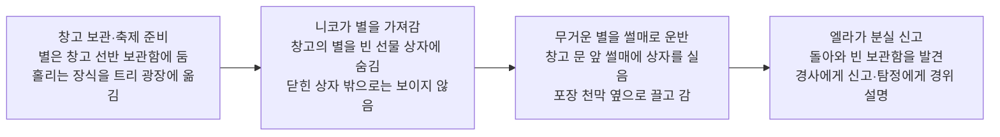
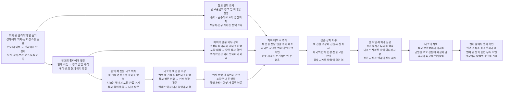

# 10 · B 사라진 크리스마스트리의 별 — 현재 시나리오

**L1-05 현재진행형 · 2단계 수정 대본 검토 대기 · 개발 미인계.** [장면별 기획](case-10-christmas-star.html)

마을의 큰 크리스마스 축제를 위해 어른들이 아이들 선물을 자원해서 준비한다. 엘라는 축제를 안내하고, 새 인물 홀리는 창고와 장식을 정리한다. 메이는 쿠키, 벤은 책 선물을 포장하고 니코는 완성된 선물을 썰매에 나르고 배송하는 역할만 맡는다. 니코는 창고에 보관한 금으로 만든 별을 선물 상자 안에 완전히 숨겨 나른다. **선물 상자 자체·상자의 출처·손잡이·종이 조각은 범행 물증으로 쓰지 않는다.**

별은 속까지 꽉 찬 실제 금으로 만든 장식 하나뿐이다. 밖으로 별 끝이나 금빛이 보이는 설정은 없다. 별 뒷면의 작은 잎사귀 음각 무늬가 실제 물건 확인에 쓰인다. 새 인물 이름·종(양 홀리)과 무늬·구체 대사는 기획자 제안이며 사용자 결정으로 적지 않는다. 새 인물·창고 보관·추가 근거를 넣는 방향은 사용자 승인 사항이다. 그림·음성 생성이나 게임 구현은 하지 않는다.

## 1. 제작자용 진실·행동 이유

1. 별은 마을이 해마다 쓰는 귀중품이며 창고 선반의 전용 보관함에 둔다. 뒷면에는 작은 잎사귀 무늬가 새겨져 있다. 몸체는 속까지 꽉 차 있고 전기 부품·빈 내부·연결 관은 없다. 가까운 곳까지 잠깐 들어 옮길 수는 있지만, 계속 들고 마을길을 걷기에는 무겁다. 순도·정확한 무게·크기·트리 고정 방식은 미정이다.
2. 엘라는 설치 준비를 위해 보관함 잠금을 풀고 별을 확인한 뒤, 광장 입구의 어린 친구들을 안내하러 잠시 나간다. 평소에는 잠가 보관한다. 돌아와 별이 없어진 것을 알고 오소리 경사에게 알린다. 경사는 신고를 전하고 탐정에게 조사를 부탁한다. 안내대에서 신고가 들어왔으니 그곳에서 자세한 이야기를 들어 보라고 말한다. 경사가 주변 순찰을 시작하면 탐정은 안내대에서 물어보기로 하고 직접 다가간다. 탐정이 사라진 별을 조사한다고 말을 걸면 엘라가 자기 이름과 신고한 사람임을 밝힌다. 탐정은 이어 경위를 묻는다. 엘라는 축제 준비 담당자로서 별을 찾는 데 필요한 축제 물품의 확인도 경사와 탐정에게 맡기고, 조사 중에는 안내 자리에 남는다. 경사는 의뢰 직후 축제장 주변을 확인한다. 후반 합류 때 탐정에게 엘라의 물품 확인 요청을 전달받는다. 후보를 직접 지목하지 않고 위치·특징만 답한다. 사전 별 사진은 없다.
3. 홀리는 창고의 장식을 손수레로 트리 광장에 옮긴 뒤 문 앞 작업대에서 장식을 정리하고 리본을 단다. 손수레의 두 바퀴가 남긴 자국은 트리 광장 쪽으로 굽는다. 본인도 창고를 사용한다. 메이는 포장지를, 벤은 빈 선물 상자를 가지러 드나들고, 니코는 선물 운반에 쓸 상자를 가지러 들어온다. 홀리는 이 세 친구가 들어가는 것은 봤지만 선반 안쪽에서 무엇을 집었는지 계속 보지는 못했다. 출입 목격만으로 별을 가져간 사람을 알 수 없다.
4. 니코는 창고 문 앞에 축제 배송용 썰매를 세워 둔다. 창고 안의 열린 보관함에서 무거운 별을 꺼내 준비용 선물 상자에 숨기고, 문 앞까지 짧게 들어 썰매에 싣는다. 그 썰매를 포장 천막 옆까지 끌어다 세운다. 창고 앞에서 썰매 아래까지 이어지는 자국은 이때 생겼다. 다른 선물과 함께 나르려 하며, 무엇을 옮기는지 묻자 벤의 선물이라고 둘러댄다. 정상 역할은 선물 운반·썰매 배송이며 포장을 겸하지 않는다. 닫힌 선물 상자는 숨기는 수단일 뿐 창고 출처를 입증하는 증거가 아니다.
5. 메이·벤은 천막에서 선물을 포장한다. 벤이 이번 배송을 위해 준비한 책 선물은 배송 준비표에 적힌 여섯 개 전부이며 모두 작업대에 남아 있다. 촬영 시점에는 포장 완료, 포장 중, 포장 전이 두 개씩이다. 이미 니코에게 건넨 별도 물량은 없다. 니코는 아직 나머지 선물이 준비되지 않아 출발하지 않는다. 자동 도주·타이머는 없다.
6. 탐정은 창고의 빈 보관함을 촬영하고 홀리에게 현재 작업과 출입을 묻는다. 여러 친구가 출입했으므로 그 말만으로 특정하지 않는다. 천막에서 벤의 선물을 전부 포장하면 니코가 한꺼번에 가져간다는 말을 듣는다. 니코의 운반 주장을 들은 뒤 썰매 자리에서 보이는 작업대에 여섯 개가 그대로 남아 있다.
7. 니코는 장식품을 옮기지 않고 선물을 싣고 있다고도 말한다. 추리를 마치면 탐정이 설명에 맞지 않는 부분이 있다고 짚는다. 니코는 벤이 포장한 책 선물을 받아 그 상자를 썰매에 싣고 있다고 주장한다. 탐정은 벤의 진술과 작업대 사진을 내민다. 니코가 썰매를 옮기지 않았다고 주장하자 두 바닥 자국 사진을 대조해 보여 준다. 탐정은 사진으로 이동 시점을 알 수 없음을 인정하고, 벤의 책 선물이라는 설명과 남아 있는 전량의 불일치에 집중한다. 니코가 설명을 굽히지 않자 순찰하던 경사가 도착한다. 탐정은 벤의 답과 사진을 보여 준다. 니코는 축제 선물이라며 개봉을 거부한다. 경사는 이 상자가 엘라가 확인을 맡긴 축제 배송 물품에 해당하고 선물이라는 설명이 벤의 답과 맞지 않는다고 판단한다. 이 상자를 현장에서 확인하도록 탐정에게 지시한다. 플레이어가 상자 열기를 선택해 탐정이 직접 연다.
8. 개봉 뒤 처음으로 별을 발견한다. 선물만 나르고 장식품은 옮기지 않는다는 진술과 실제 장식품을 대조한다. 별의 뒷면을 조사·촬영해 엘라가 설명한 작은 잎사귀 무늬를 확인하고, 창고의 빈 보관함·니코의 출처 답변을 함께 본다. 니코가 사라진 별이 아니라고 버티면 탐정은 뒷면 사진과 엘라의 진술을 대조해 경사에게도 들려준다. 이후 니코가 열린 보관함에서 금별을 보고 욕심이 나 허락 없이 가져갔으며, 별을 팔면 큰돈이 될 줄 알았다고 인정한다. 경사가 니코를 인계받는다. 별을 찾았다는 소식을 듣고 엘라가 썰매 앞으로 와서 실물을 확인하고 탐정의 보고를 듣는다.

여러 봉사자가 같은 창고에 드나든다. 메이의 닫힌 쿠키 상자도 니코의 상자와 비슷해 보이지만, 메이가 그 상자를 열면 내용물을 확인할 수 있다. 홀리도 출입했고 현재 장식을 정리하므로 후보에서 자동 제외하지 않는다. 현재 작업은 과거 알리바이가 아니다. 범행 물증은 별의 실물·뒷면 무늬·비어 있는 보관 위치다. 홀리와 벤·니코의 말은 진술로 기록한다. 박스 손잡이 조각·상자 모양·배송 라벨·동물 종·외형·색을 범인 증거로 쓰지 않는다.

## 2. 장면별 스토리보드

### 사건 흐름도

사건의 진실과 플레이 순서를 나눈 제작자용 흐름도다. 창고를 살피고 두 바닥 사진의 자국을 대조한다. 자국은 경로만 보여 주며 발생 시점이나 운전자를 입증하지 않는다. 상자 확인의 핵심 근거는 벤의 책 선물 전량과 니코의 주장이 맞지 않는 점이다. 썰매 자리에서 현재 작업대를 살핀다. 탐정은 니코의 주장에 벤의 진술과 선물 사진, 두 바닥 자국 사진을 제시한다. 순찰 중 경사가 도착한다. 니코가 개봉을 거부해도 경사가 엘라가 맡긴 축제 물품 확인을 지시하면 탐정이 상자를 연다. 별 실물·잎사귀 무늬·출처 확인은 개봉 뒤다. 선물 상자 자체는 물증으로 쓰지 않는다.

#### 01 · 사건이 벌어진 과정

제작자용 진실 · 탐정이 오기 전

#### 02 · 탐정이 해결하는 과정

플레이 순서 · 진술과 사진을 대조하고 의뢰인에게 반환

### 장면 0 · 준비

같은 엔진·같은 화면의 열쇠 카드로 현재 행동 긍정·부정·확인·행동 질문을 준비한다. 이름은 자기소개 뒤 표시하고 단서·질문 개수는 플레이 화면에 쓰지 않는다. 예습 예문은8절을 쓴다.

### 장면 1 · 트리 광장 — 경사의 의뢰와 엘라 면담

경사는 트리 광장 입구에 있고 엘라는 같은 광장의 안내대에서 일한다. 광장 중앙의 크리스마스트리는 주변 건물 지붕보다 훨씬 높고, 아래에 선 엘라와 경사가 작아 보인다. 광장 안에서는 아래쪽 가지가 배경을 넓게 채우고 꼭대기는 화면 위로 넘어간다. 경사는 별 분실과 조사 의뢰를 전한 뒤, 안내대에서 신고가 들어왔으니 거기서 자세한 이야기를 들어 보라고 말한다. 그 말을 들으면 안내대 접근이 열린다. 경사는 순찰하러 가고 탐정은 안내대에서 물어보겠다고 생각한다. 플레이어가 안내대로 가기를 선택한 뒤 이름 없는 사슴에게 직접 말을 건다. 엘라가 자기소개하며 신고한 사람이라고 밝히면 첫 질문 e0만 열린다. 안내대는 같은 광장 안의 접근 지점이며 별도 장소를 추가하지 않는다. 경사는 신고 장소만 알려 준다. 엘라를 직접 소개하거나 함께 데려가는 장면은 없다. 탐정이 엘라에게 무슨 일이 있었는지 묻고 답을 기록하면 e1·e2가 열린다. e2 기록 뒤 탐정은 창고로 갈 수 있다. 경사는 이미 주변을 순찰 중이다.

- **badger:hello · 경사 · 자동**
  - Detective, the town's Christmas star is missing.
  - 탐정, 마을의 크리스마스 별이 사라졌대.

- **badger:request · 경사 · 자동**
  - Can you look into it?
  - 조사해 줄래?

- **badger:desk-lead · 경사 · 자동**
  - The report came from the information desk. Ask there for more details.
  - 안내대에서 신고가 들어왔어. 자세한 이야기는 거기서 들어 봐.

- **badger:split-search · 경사 · 자동**
  - I'll look around the festival.
  - 난 축제장 주변을 확인할게.

- **det:information-desk-thought · 탐정 · 생각**
  - I'll ask at the information desk.
  - 안내대에서 물어봐야겠어.

- **move:information-desk · 이동 · 이동 버튼**
  - Go to the information desk.
  - 안내대로 가기

- **det:ella-greeting · 탐정 · 말 걸기 선택지**
  - Hi. I'm looking into the missing star.
  - 안녕. 사라진 별에 대해 조사하고 있어.

- **ella:hello · 엘라 · 자동**
  - Hi, I'm Ella. I reported it.
  - 안녕, 난 엘라야. 내가 신고했어.

#### ella:e0 · 엘라

- **질문 선택지**: What happened?
- 해석: 무슨 일이 있었어?
- **대답**: I went to show the children around the festival. When I came back, the star was missing.
- 해석: 축제에 온 아이들을 안내하러 자리를 비웠어. 돌아와 보니 별이 사라졌더라.
- **노트**: “I went to show the children around the festival. When I came back, the [star] was [missing].”
- **보기**: star · string · missing · shining
- 조건: 경사의 의뢰·안내대 신고 정보 뒤 직접 이동·탐정의 말 걸기·엘라 자기소개 뒤 첫 질문으로 표시
- 채점 뒤: 엘라가 축제에 온 아이들을 안내하고 돌아와 분실을 발견했다는 경위 기록. e1·e2 해금

#### ella:e1 · 엘라

- **질문 선택지**: What does the star look like?
- 해석: 별은 어떻게 생겼어?
- **대답**: It's real gold, with a small leaf pattern on the back.
- 해석: 진짜 금으로 만들었고 뒷면에 작은 잎사귀 무늬가 있어.
- **노트**: “It's real [gold], with a small [leaf] pattern on the [back].”
- **보기**: gold · glass · leaf · line · back · front
- 조건: e0 기록 뒤
- 채점 뒤: 금 재질·별 뒷면의 잎사귀 모양 기록. 실물 식별에 사용

#### ella:e2 · 엘라

- **질문 선택지**: Where did you leave it?
- 해석: 어디에 두었어?
- **대답**: I left it in its case on the storeroom shelf.
- 해석: 창고 선반의 보관함 안에 두었어.
- **노트**: “I left it in its [case] on the [storeroom] [shelf].”
- **보기**: case · box · storeroom · gift tent · shelf · table
- 조건: e0 기록 뒤
- 채점 뒤: 축제 창고·이름 없는 양. 보관함 관찰·c-case 촬영

- **ella:check-supplies · 엘라 · 자동**
  - You can check the festival supplies if it helps you find the star.
  - 별을 찾는 데 필요하면 축제 물품도 확인해 줘.

- **det:storeroom-thought · 탐정 · 생각**
  - I should check the storeroom.
  - 창고를 확인해야겠어.

- **move:storeroom · 이동 · 이동 버튼**
  - Go to the Storeroom.
  - 축제 창고로 가기

### 장면 2 · 축제 창고 — 홀리와 빈 보관함

엘라 e2 기록으로 창고를 발견하고 직접 이동한다. 홀리는 문 앞 작업대에, 보관함은 안쪽 선반에 있다. 양의 이름은 자기소개 전에는 표시하지 않는다. 창고는 포장재·장식품을 함께 보관하는 정상 작업 공간이고, 누구나 드나들었다는 사실은 범행을 뜻하지 않는다.

#### 홀리에게 질문

홀리는 엘라와 함께 축제를 준비하는 성인 양이다. 장식을 정리하고 리본을 달지만 선물을 포장하거나 배송하지 않는다. 본인도 창고에 들어갔다고 답한다. 목격의 범위는 사람들의 출입까지이며 별을 가져가는 손동작·반출품·범행은 보지 못했다.

- **holly:hello · 홀리 · 자동**
  - Hi! I'm Holly. Come in.
  - 안녕! 난 홀리야. 들어와.

- **det:holly-intro · 탐정 · 자동**
  - I'm helping Ella find the missing star.
  - 엘라가 없어진 별을 찾는 걸 돕고 있어.

- **holly:ready · 홀리 · 자동**
  - Oh! I'll answer what I can.
  - 아! 내가 아는 건 말해 줄게.

#### holly:h1 · 홀리

- **질문 선택지**: Are you sorting decorations?
- 해석: 장식품을 정리하고 있어?
- **대답**: Yes. I'm sorting decorations for the Christmas party. I'm helping Ella.
- 해석: 응. 크리스마스 파티 장식품을 정리하고 있어. 엘라를 돕고 있어.
- **노트**: “Yes. I'm [sorting] [decorations] for the Christmas party. I'm helping Ella.”
- **보기**: sorting · carrying · decorations · gifts
- 조건: 엘라 e2 기록·창고 도착·홀리 자기소개 뒤 첫 질문
- 채점 뒤: h2. 출입 목격을 기록하면 h3가 열린다.

#### holly:h2 · 홀리

- **질문 선택지**: Who came into the storeroom?
- 해석: 창고에는 누가 들어왔어?
- **대답**: I saw May, Ben, and Nico go in. I went in, too.
- 해석: 메이, 벤, 니코가 들어가는 걸 봤어. 나도 들어갔어.
- **노트**: “I [saw] May, Ben, and Nico go [in]. I went in, too.”
- **보기**: saw · see · in · out
- 조건: h1 기록 뒤
- 채점 뒤: 여러 사람의 창고 출입 목격 기록·h3 해금. 목격은 출입 범위까지

#### holly:h3 · 홀리

- **질문 선택지**: Where are May and Ben now?
- 해석: 메이와 벤은 지금 어디 있어?
- **대답**: They're wrapping gifts in the gift tent.
- 해석: 선물 포장 천막에서 선물을 포장하고 있어.
- **노트**: “They're [wrapping] gifts in the [gift tent].”
- **보기**: wrapping · carrying · gift tent · storeroom
- 조건: h2의 출입 목격 기록 뒤
- 채점 뒤: 포장 천막·메이·벤 면담. 이름 표시는 본인 소개 뒤

e2 기록 뒤 창고 선반의 빈 보관함을 c-case로 촬영할 수 있다. 홀리에게 묻기 전후 어느 쪽이든 가능하다. 관찰: **An empty case on the storeroom shelf. / 창고 선반에 빈 보관함이 있어.** 보관함 사진에 출입자·범인·사람의 목격담을 적지 않는다. 안쪽에서 공용 포장재 선반(c-supplies)과 문턱에서 본 선반의 시야(c-door-view)도 선택 촬영할 수 있다. 공용 포장재는 창고에 들어갈 일상적인 이유를, 문턱 사진은 홀리가 보지 못한 범위를 이해하는 데 쓴다. e2 기록 뒤 입구의 바닥도 c-track-yard로 촬영한다. 탐정은 바닥에 긴 자국이 보인다고만 말한다. 촬영 뒤 홀리에게 장식을 옮긴 적 있는지 묻는다. 홀리는 손수레로 트리 광장까지 옮겼다고 답한다. 이 문답은 받아쓰기 없이 기록한다. h2의 출입 목격 뒤 h3에서 메이와 벤의 현재 위치를 묻고 포장 천막을 발견한다.

- **det:ask-cart · 탐정 · 선택 질문**
  - Did you move any decorations today?
  - 오늘 장식품을 옮겼어?

- **holly:cart · 홀리 · 자동**
  - Yes. I took some decorations to the Tree Square in a handcart.
  - 응. 손수레로 장식품을 트리 광장에 옮겼어.

- **det:gift-thought · 탐정 · 생각**
  - I should ask the friends in the gift tent.
  - 포장 천막의 친구들에게 물어봐야겠어.

- **move:gift · 이동 · 이동 버튼**
  - Go to the Gift Tent.
  - 선물 포장 천막으로 가기

### 장면 3 · 선물 포장 천막 — 메이

메이는 쿠키 선물을 포장하고 있다. 홀리는 메이가 창고에 들어간 것을 봤지만, 포장 중인 현재 모습만으로 과거 반출을 부정하지 않는다. 탐정은 출입 목격을 근거로 창고에 간 이유부터 묻는다. 상자에 쓸 포장지가 필요했다는 답을 듣고 무엇을 포장하는지 묻는다. 닫힌 상자를 가리켜 안을 확인한다. 현재 쿠키가 든 상자를 확인한 사실만으로 과거의 모든 행동을 무죄로 단정하지 않는다.

- **mae:hello · 메이 · 자동**
  - Welcome! I'm May.
  - 어서 와! 난 메이야.

- **det:mae-intro · 탐정 · 자동**
  - I'm helping Ella find a missing star.
  - 엘라가 없어진 별을 찾는 걸 돕고 있어.

- **mae:ready · 메이 · 자동**
  - Oh! What would you like to know?
  - 아! 뭐가 궁금해?

#### mae:m0 · 메이

- **질문 선택지**: I heard you went into the storeroom. Why did you go in?
- 해석: 창고에 들어갔다고 들었어. 왜 갔어?
- **대답**: I needed wrapping paper for these boxes.
- 해석: 이 상자들에 쓸 포장지가 필요했어.
- **노트**: “I needed [wrapping paper] for these [boxes].”
- **보기**: wrapping paper · drawing paper · boxes · books
- 조건: 홀리 h2·h3 기록·메이 자기소개와 조사 목적 설명 뒤 첫 질문
- 채점 뒤: 메이가 창고에 간 이유 기록·m1 해금. 과거 무죄를 확정하지 않음

#### mae:m1 · 메이

- **질문 선택지**: What are you wrapping?
- 해석: 무엇을 포장하고 있어?
- **대답**: I'm wrapping cookies. We're all volunteers for the Christmas party.
- 해석: 쿠키를 포장하고 있어. 우리 모두 크리스마스 파티를 돕는 자원봉사자야.
- **노트**: “I'm [wrapping] [cookies]. We're all volunteers for the Christmas party.”
- **보기**: wrapping · painting · cookies · toys
- 조건: m0에서 상자에 쓸 포장지를 가지러 갔다고 답한 뒤
- 채점 뒤: m3

#### mae:m3 · 메이

- **질문 선택지**: Can I look inside that box?
- 해석: 저 상자 안을 봐도 돼?
- **대답**: Sure. There are cookies inside. I'm still wrapping the other box.
- 해석: 물론이지. 안에는 쿠키가 있어. 다른 상자는 아직 포장 중이야.
- **노트**: “Sure. There are [cookies] [inside]. I'm [still] wrapping the other box.”
- **보기**: cookies · books · inside · outside · still · already
- 조건: m1 기록 뒤
- 채점 뒤: 작업대에 있던 상자를 열어 쿠키 확인. 선택 사진 c-cookies 촬영 허락

메이 작업대에는 포장 중인 상자 하나와 뚜껑이 닫힌 상자 하나가 있다. 닫힌 상자는 니코가 싣는 상자와 같은 축제 공용 포장지와 리본을 쓴다. m3 뒤 메이가 바로 그 상자 뚜껑을 들어 쿠키를 보여 준다. 상자 겉모습만으로 내용물을 판단하기 어려운 혼동 요소다. 사진 c-cookies는 선택 기록이다. 사진을 찍지 않아도 추리·개봉·해결이 열린다. 메이와 벤의 최초 방문 순서는 자유다.

### 장면 4 · 같은 천막 — 벤의 책 선물

벤은 작업대에서 이번 배송분 책 선물의 포장을 하고 있다. 이미 포장을 끝낸 선물도 같은 작업대에 모아 둔다. 홀리 h2의 창고 출입 목격과 h3의 천막 위치를 모두 기록한 뒤 벤과 면담할 수 있다. 첫 인사 뒤 탐정은 큰 트리의 별이 창고에서 사라졌다고 설명한다. 벤이 별을 못 봤다고 답하면 탐정은 창고에 들어갔다는 말을 들었다며 그 이유를 묻는다. 빈 상자가 필요했다는 답을 듣고 무엇을 포장하는지 묻는다(b1). 앞선 두 문답은 받아쓰기 없이 듣고, b1을 기록하면 포장한 선물이 어디로 가는지 묻는 b3와 책 조사 선택지가 열린다. 벤의 작업대는 포장 천막 안에 있으며 썰매 쪽 열린 옆면 너머로 작업대가 보인다.

- **ben:hello · 벤 · 자동**
  - Hi there! I'm Ben. Can I help?
  - 안녕! 난 벤이야. 뭐 도와줄까?

- **det:ben-intro · 탐정 · 자동**
  - The star for the big tree is missing from the storeroom. I'm helping Ella find it.
  - 큰 트리 꼭대기에 달 별이 창고에서 사라졌어. 엘라를 도와 찾고 있어.

- **ben:ready · 벤 · 자동**
  - Oh no! This is really bad!
  - 이런! 정말 큰일이네!

- **det:ben-star · 탐정 · 선택 질문**
  - Did you see the star today?
  - 오늘 그 별을 봤어?

- **ben:star · 벤 · 자동**
  - No, I didn't.
  - 아니, 못 봤어.

- **det:ben-storeroom · 탐정 · 선택 질문**
  - I heard you went into the storeroom. Why did you go in?
  - 창고에 들어갔다고 들었어. 왜 갔어?

- **ben:storeroom · 벤 · 자동**
  - I needed some empty boxes for the gifts.
  - 선물을 담을 빈 상자가 필요했어.

#### ben:b1 · 벤

- **질문 선택지**: What are you wrapping?
- 해석: 뭘 포장하고 있어?
- **대답**: I'm wrapping books. These are gifts for the children.
- 해석: 책을 포장하고 있어. 어린 친구들에게 줄 선물이야.
- **노트**: “I'm [wrapping] [books]. These are gifts for the children.”
- **보기**: wrapping · carrying · books · cookies
- 조건: 홀리 h3로 포장 천막 발견·벤이 창고에 간 이유를 답한 뒤
- 채점 뒤: b3와 책을 보여 달라는 행동 선택지

#### ben:b3 · 벤

- **질문 선택지**: Where do the gifts go after you wrap them?
- 해석: 그 선물들은 포장이 끝나면 어디로 가?
- **대답**: Nico is outside by the sleigh. I'm still wrapping some. He'll take them all together.
- 해석: 니코는 밖에서 썰매 옆에 있어. 아직 몇 개를 포장 중이야. 다 끝나면 한꺼번에 가져갈 거야.
- **노트**: “Nico is outside by the [sleigh]. I'm [still] wrapping some. He'll take them [all] together.”
- **보기**: sleigh · tent · still · already · all · some
- 조건: b1 기록 뒤
- 채점 뒤: 썰매 앞 발견과 책 선물 일괄 수거 방식. 니코 이름 표시는 본인 인사 뒤

- **det:books-q · 탐정 · 행동 선택지**
  - Can I look at the books?
  - 책들을 봐도 돼?

- **ben:books-a · 벤 · 자동**
  - Sure. You can take a photo.
  - 물론이지. 사진을 찍어도 돼.

책을 보는 선택지는 받거나 건네는 행동 없이 촬영 허락만 구하는, 받아쓰기 없는 행동 선택지다. 허락 뒤 포장 완료 두 개, 포장 중 두 개, 포장 전 두 개와 이번 배송 수량이 적힌 준비표를 한 화면에 담아 c-books로 촬영한다. 촬영 시점에는 예정된 책 선물 여섯 개가 전부 작업대에 있다. 포장 상태는 진행돼도 썰매 자리에서 보이는 작업대의 전체 수량은 여섯 개다. 홀리 h2의 창고 출입 목격이 니코에게 말을 걸 이유다. 벤 b3에서는 포장이 끝나면 니코가 선물을 한꺼번에 가져갈 예정이며 지금은 밖에 있다는 말을 듣는다. 답을 기록하면 썰매 앞으로 갈 수 있다.

- **det:sleigh-thought · 탐정 · 생각**
  - Holly saw Nico go into the storeroom, too. I should talk to him.
  - 홀리는 니코도 창고에 들어가는 걸 봤어. 니코한테도 물어봐야겠어.

- **move:sleigh · 이동 · 이동 버튼**
  - Go to the Delivery Sleigh.
  - 썰매 앞으로 가기

### 장면 5 · 썰매 앞 — 운반 주장과 작업대 관찰

니코는 썰매 짐칸 앞에서 몸을 살짝 숙여, 이미 짐칸에 올라간 닫힌 선물 상자를 손으로 밀어 자리를 잡는다. 움직임은 정지 일러스트의 자세로 보여 준다. 대화할 때 상자는 짐칸에 그대로 둔다. 상자의 외형·손잡이·출처·포장지는 물증이 아니다. 상자를 촬영하는 단서도 없다. 별·금빛·별 끝은 개봉 전에 전혀 보이지 않는다. n2의 loading은 이미 짐칸에 올린 상자의 자리를 잡는 작업까지 포함한다. 상자를 들고 썰매까지 걷는 장면이나 taking ... to the sleigh 대사는 쓰지 않는다. 후속 확인에서 that box는 조금 떨어진 같은 상자를 가리킨다. 니코의 대답은 문법적으로 맞아도 내용은 거짓일 수 있다.

- **nico:hello · 니코 · 자동**
  - Hi there. I'm Nico. What brings you here?
  - 안녕. 난 니코야. 무슨 일이야?

- **det:nico-intro · 탐정 · 자동**
  - I'm helping Ella find a missing star.
  - 엘라가 없어진 별을 찾는 걸 돕고 있어.

- **nico:ready · 니코 · 자동**
  - The star for the tree? I'll help if I can.
  - 트리에 달 별 말이야? 도울 일이 있으면 말해 줘.

니코는 처음 만났을 때 다른 봉사자처럼 평소 말투로 답한다. 탐정은 썰매 짐칸에서 일하던 모습을 보고 무엇을 하고 있는지 묻는다.

#### nico:n1 · 니코

- **질문 선택지**: What are you doing?
- 해석: 뭐 하고 있어?
- **대답**: I'm loading the gifts. I'm not delivering yet.
- 해석: 선물을 싣고 있어. 아직 배달하러 출발하지는 않았어.
- **노트**: “I'm [loading] the gifts. I'm not [delivering] yet.”
- **보기**: loading · opening · delivering · decorating
- 조건: 썰매 앞 발견·니코 인사 뒤 첫 질문
- 채점 뒤: n2. 지금 싣는 물건부터 확인한다.

#### nico:n2 · 니코

- **질문 선택지**: What are you loading?
- 해석: 무엇을 싣고 있어?
- **대답**: I'm loading one of Ben's book gifts.
- 해석: 벤의 책 선물 하나를 싣고 있어.
- **노트**: “I'm [loading] one of Ben's [book] [gifts].”
- **보기**: loading · opening · book · cookie · gifts · boxes
- 조건: n1 기록 뒤
- 채점 뒤: 벤의 책 선물이라는 주장 기록. 창고 방문 이유를 묻는 선택 질문이 열린다.

- **det:nico-storeroom · 탐정 · 선택 질문**
  - Holly saw you go into the storeroom. Why did you go in?
  - 홀리가 네가 창고에 들어가는 걸 봤대. 왜 갔어?

- **nico:storeroom-reason · 니코 · 자동**
  - I needed empty boxes to carry the gifts.
  - 선물을 나를 빈 상자가 필요했어.

#### nico:n3 · 니코

- **질문 선택지**: Are you wrapping gifts too?
- 해석: 선물 포장도 하고 있어?
- **대답**: No, I'm not wrapping gifts. May and Ben are doing that.
- 해석: 아니, 나는 선물을 포장하지 않아. 그건 메이와 벤이 하고 있어.
- **노트**: “No, I'm [not] [wrapping] [gifts]. May and Ben are doing that.”
- **보기**: not · now · wrapping · loading · gifts · decorations
- 조건: n2 기록·창고 방문 이유에 대한 현장 답변 뒤
- 채점 뒤: 포장은 메이·벤이 맡는다는 니코의 역할 설명 기록·n4 해금

#### nico:n4 · 니코

- **질문 선택지**: Are you moving the decorations too?
- 해석: 장식품도 나르고 있어?
- **대답**: No, I'm not moving decorations. I'm loading gifts.
- 해석: 아니, 장식품을 나르는 게 아니야. 선물을 싣고 있어.
- **노트**: “No, I'm [not] moving decorations. I'm loading [gifts].”
- **보기**: not · now · gifts · decorations
- 조건: n3 기록 뒤
- 채점 뒤: 장식품은 옮기지 않고 선물을 싣는다는 진술. 개봉 뒤 실제 별과 대조

니코는 n2에서 벤의 책 선물 하나를 싣고 있다고 주장한다. 탐정은 홀리의 출입 목격을 짚고 과거에 창고로 간 이유를 별도 선택 질문으로 묻는다. 니코가 운반에 쓸 빈 상자가 필요했다고 답하면 n3에서 포장도 맡는지 확인한다. 니코는 포장은 메이와 벤이 한다며 부정하고 n4에서는 장식품을 나르지 않는다고 답한다. 아직 별이 든 사실은 알 수 없다. 열린 질문을 마치면 천막 쪽 작업대를 볼 수 있다. 탐정은 선물 포장이나 배송을 돕지 않는다.

니코의 열린 면담 뒤 썰매를 옮겼는지 묻는다. 받아쓰기 없이 답을 기록하고, 썰매 앞 바닥을 c-track-sleigh로 찍는다. 같은 나무 기둥이 보이도록 구도를 잡는다.

- **det:ask-sleigh · 탐정 · 선택 질문**
  - Did you move the sleigh this morning?
  - 오늘 아침에 썰매를 옮겼어?

- **nico:sleigh-stayed · 니코 · 자동**
  - No. It stayed right here all morning.
  - 아니. 아침 내내 바로 여기 있었어.

#### 천막 쪽 작업대 관찰

썰매 자리에서 천막의 열린 옆면 너머 벤의 작업대를 볼 수 있다. 카메라 구도 예시에서는 포장 완료 4개, 포장 중 1개, 포장 전 1개가 보이며 클립보드에도 네 개가 체크되어 있다. 증거 노트의 c-books는 첫 방문 때 찍은 사진이다. 관찰 장면에서는 상자 수를 대사나 정답 문구로 알려 주지 않는다. 플레이어가 현재 보이는 상자와 처음 기록한 배송 준비표, 벤의 일괄 수거 설명을 대조한다.

- **det:compare-thought · 탐정 · 생각**
  - I should compare the notes and the photos.
  - 기록과 사진을 비교해 봐야겠어.

행동 선택지: **Compare the clues. / 단서 비교하기**. 전체 면담 15개와 개봉 전 필수 사진 c-case·c-books·c-track-yard·c-track-sleigh와 두 현장 답변(홀리 손수레·니코 썰매)이 모이면 추리를 연다. 창고 보조 사진과 쿠키 사진은 선택이다. 메이·벤 방문은 자유이며 메이의 남은 기록도 추리 직전에는 모아야 한다. 개수는 제작 조건이고 플레이 화면에는 표시하지 않는다.

### 장면 6 · 추리 — 누구에게 재확인할까

7절의 7문항을 푼다. 자국 비교 문항에서는 두 사진에 공통으로 보이는 나무 기둥을 기준으로 어느 경로가 썰매 아래까지 이어지는지 플레이어가 직접 고른다. 홀리는 여러 사람의 창고 출입을 봤으므로 그 말만으로 특정하지 않는다. 니코의 운반 주장과 배송 준비표·책 선물 여섯 개가 담긴 사진 및 벤의 현장 답변을 대조해 설명을 다시 확인할 사람을 고른다. 아직 별을 찾았거나 범인을 확정했다고 말하지 않는다. 완료 뒤 **Check the explanation. / 설명 확인하기**를 선택하고 썰매 앞에 머문다.

### 장면 7 · 상자 개봉·심문

대질은 도서관 사건처럼 니코가 먼저 주장하고 플레이어가 증거를 고르는 방식이다. 니코의 주장 아래에는 증거 내밀기만 열리며, 질문 선택지나 받아쓰기는 없다. 탐정의 짧은 선택 대사로 설명의 불일치를 짚으면 니코가 첫 주장을 한다. 경사는 축제장 주변을 확인 중이다.

- **det:challenge · 탐정 · 선택 대사**
  - Nico, something doesn't match your story.
  - 니코, 네 설명과 맞지 않는 부분이 있어.

- **nico:claim-gift · 니코 · 심문 주장**
  - This isn't fair! Ben gave me a wrapped book gift. It's in that box.
  - 억울해! 벤이 포장한 책 선물을 줬어. 저 상자에 들어 있어.

- **present:ben-statement · 행동 · 증거 제시 선택지**
  - Present Ben's statement about the pickup.
  - 벤의 선물 수거 방식 진술 내밀기

- **present:c-books · 행동 · 진술 제시 뒤 함께 보여 주는 사진**
  - Show the photo of Ben's gifts.
  - 벤의 책 선물 사진 내밀기

- **det:open-q1 · 탐정 · 사진 제시 뒤 선택 대사**
  - Ben said his gifts go together. All six are still on his table.
  - 벤은 선물을 한꺼번에 보낸다고 했어. 여섯 개 다 아직 작업대에 있어.

첫 주장은 빈 상자의 출처가 아니라 벤이 포장한 책 선물을 받았다는 주장이다. 대응하는 정답은 진술 탭의 벤 b3다. 그 진술을 내밀면 작업대와 준비표를 찍은 c-books를 함께 보여 준다. 탐정은 벤의 선물은 한꺼번에 나가는데, 현재도 여섯 개가 작업대에 남아 있다는 점을 짚는다. 촬영 당시 수량은 준비표 사진으로, 현재 남은 수량은 천막 쪽을 보고 판단한다. 오답 반응: **That doesn't show Ben's book gifts. / 그건 벤의 책 선물을 보여 주지 않잖아.** 같은 주장에 머물며 다시 고른다.

- **nico:claim-sleigh · 니코 · 심문 주장**
  - I didn't move the sleigh. It was right here all morning.
  - 썰매는 안 옮겼어. 아침 내내 여기 있었어.

- **present:c-tracks · 행동 · 증거 제시 선택지**
  - Show the photos of the marks.
  - 바닥 자국 사진 두 장 내밀기

- **det:show-tracks · 탐정 · 사진 제시 뒤 선택 대사**
  - These photos show marks between the storeroom and your sleigh. They go right under it.
  - 이 사진들에 창고 앞과 네 썰매 사이의 자국이 보여. 썰매 바로 아래까지 이어져.

- **nico:tracks-reply · 니코 · 자동**
  - I don't know when those marks got there. I only took empty boxes from the storeroom.
  - 그 자국이 언제 생겼는지는 몰라. 창고에선 빈 상자만 챙겼어.

- **det:track-limit · 탐정 · 자동**
  - The photos don't tell us when. But your story about Ben's gift still doesn't match.
  - 사진으로 언제 생긴 자국인지는 알 수 없어. 하지만 벤의 선물이라는 설명은 여전히 맞지 않아.

두 번째 주장에 대응하려면 사진 탭에서 썰매 앞 바닥(c-track-sleigh)을 고른다. 같은 기둥이 보이는 창고 앞 사진(c-track-yard)도 함께 제시한다. 두 사진은 창고 앞에서 현재 썰매 아래까지 이어지는 자국을 보여 준다. 사진에 시각이나 자국을 남긴 사람이 나오지 않으므로, 이 단계는 창고와 썰매의 연결을 확인하는 보조 조사다. 정답 선택은 두 사진의 경로를 연결했다는 뜻이며 니코의 시간 진술을 반박했다는 뜻이 아니다. 탐정도 시점은 모른다고 말한 뒤 해결되지 않은 책 선물 주장의 모순으로 돌아온다. 오답 반응: **That doesn't show the ground by the sleigh. / 그 사진에는 썰매 옆 바닥이 안 보여.** 같은 주장에 머물며 다시 고른다.

니코가 자국의 시각을 모르며 창고에서는 빈 상자만 챙겼다고 버티면 순찰 중인 경사가 도착한다. 경사는 탐정에게 별을 찾았는지 묻고, 탐정은 벤의 책 선물 진술과 전량이 남은 작업대를 근거로 보고한다. 자국 사진은 경로만 보이는 보조 자료로 함께 보여 준다. 경사는 책 선물이라는 설명이 맞지 않아 내용물을 확인해야 한다고 말한다. 니코는 축제 선물이라며 개봉에 반대한다. 경사는 탐정에게 엘라의 물품 확인 요청도 전해 듣고 그 확인의 일부로 이 상자를 열어 보라고 탐정에게 지시하고 썰매 곁에서 지켜본다.

- **badger:found-star · 경사 · 자동**
  - Detective! Did you find the star?
  - 탐정, 별은 찾았니?

- **det:brief-badger · 탐정 · 자동**
  - Not yet. Nico says Ben gave him a book gift. All six are still on Ben's table.
  - 아직. 니코는 벤에게 책 선물을 받았대. 여섯 개 다 아직 벤의 작업대에 있어.

- **det:check-permission · 탐정 · 자동**
  - Ella asked me to check the festival supplies.
  - 엘라가 나한테 축제 물품도 확인해 달라고 했어.

- **badger:reason-to-check · 경사 · 자동**
  - Then we need to check what's inside.
  - 그럼 안에 무엇이 있는지 확인해야겠네.

- **nico:refuse-open · 니코 · 자동**
  - It's a festival gift. Don't open it.
  - 축제 선물이야. 열지 마.

- **badger:open-order · 경사 · 자동**
  - We'll check this festival box here. Detective, open it.
  - 이 축제 물품 상자를 여기서 확인하자. 탐정, 열어 봐.

- **open:box · 행동 · 탐정 조사 행동**
  - Open the box.
  - 상자 열기

경사가 현장 확인을 지시한 뒤 썰매 위의 닫힌 상자를 조사할 수 있다. 플레이어가 상자 열기를 선택하면 탐정이 직접 열고 별이 처음 보인다. 이후 c-open을 촬영한다. 관찰: **A star inside the box. / 상자 안에 별이 있어.** 장식품은 옮기지 않는다는 n4 진술과 실제 장식품을 대조하되 금빛만으로 재질·마을 소유·범행을 확정하지 않는다.

#### 별 자체를 자세히 확인

별 전체를 촬영한 뒤 뒷면을 가까이 조사한다. 별은 조사하는 동안 상자에 둔다. 기존 확대 조사 동작으로 뒷면을 볼 수 있는지는 개발 점검 대상이며 미지원이면 엔진 추가 필요다.

- **look:star-back · 행동 · 조사 행동**
  - Look at the back of the star.
  - 별 뒷면 살펴보기

뒷면의 작은 잎사귀 무늬를 c-mark로 직접 촬영한다. 관찰: **A small leaf pattern on the back of the star. / 별 뒷면에 작은 잎사귀 모양이 있어.** 엘라 e1의 설명과 대조하는 실물 특징이다. 문자로 주인을 써 주거나 범인 이름을 알려 주지 않는다. 한 장의 사진만으로 범행을 확정하지 않고 출처·허락·목적을 더 확인한다.

#### 마지막 심문 · 별의 정체

c-open·c-mark 조사 뒤 니코가 상자 속 장식은 사라진 별이 아니라고 주장한다. 사진 탭에서 별 뒷면 사진(c-mark)을 내밀면, 탐정이 엘라 e1의 설명과 뒷면 무늬를 대조해 경사에게도 들려준다. 오답 반응: **That doesn't show the back of the star. / 그건 별 뒷면이 안 보이잖아.** 같은 주장에 머물며 다시 고른다. 반박이 끝나면 자백으로 이어진다.

- **nico:claim-star · 니코 · 심문 주장**
  - It isn't the missing star.
  - 사라진 그 별은 아니야.

- **present:c-mark · 행동 · 증거 제시 선택지**
  - Show the photo of the leaf pattern.
  - 별 뒷면의 잎사귀 무늬 사진 내밀기

- **det:found-star · 탐정 · 자동**
  - Look at the back. The leaf pattern matches Ella's description.
  - 뒷면을 봐. 잎사귀 무늬가 엘라 설명이랑 같아.

### 장면 8 · 니코의 자백 — 별의 출처와 목적

심문이 끝난 뒤 니코는 별을 가져온 곳과 허락 여부를 스스로 말한다. 열린 보관함의 금별을 보고 욕심이 났고, 별을 팔아 큰돈을 벌 생각이었다고 털어놓는다. 무거운 별을 썰매에 실은 이유도 이어서 밝힌다.

- **nico:admit · 니코 · 자동**
  - I took it from the case on the storeroom shelf. I didn't ask.
  - 창고 선반에 있는 보관함에서 가져왔어. 허락은 안 받았어.

- **nico:motive · 니코 · 자동**
  - I saw the open case and got greedy. I thought the gold would sell for a lot.
  - 보관함이 열려 있는 걸 보고 욕심이 났어. 금별을 팔면 큰돈을 받을 수 있을 줄 알았어.

- **nico:weight · 니코 · 자동**
  - It was too heavy to carry far. I put it on the sleigh.
  - 들고 멀리 가기엔 너무 무거웠어. 그래서 썰매에 실었어.

- **badger:keep · 경사 · 자동**
  - Nico, stay here with me.
  - 니코, 나와 여기서 기다려.

- **badger:stay-with-nico · 경사 · 자동**
  - Detective, let Ella know we've found the star.
  - 탐정, 엘라에게 별을 찾았다고 알려 줘.

탐정은 니코의 보관함 진술을 엘라 e2와 빈 보관함 사진 c-case에 대조한다. 경사는 니코와 썰매 쪽에 남는다. 플레이어가 엘라에게 알리기를 고르면, 탐정은 근처 축제 안내 봉사자를 통해 광장에 있는 엘라에게 발견 소식을 전한다. 봉사자는 별도 대화 장면 없이 소식만 전한다. 별은 발견한 상자 안에 그대로 둔다.

- **notify:ella · 행동 · 행동 선택지**
  - Let Ella know we found the star.
  - 엘라에게 별을 찾았다고 알리기

### 장면 9 · 썰매 앞 — 엘라 확인·보고

소식을 들은 엘라가 잠시 뒤 썰매 앞으로 온다. 탐정은 썰매 옆에서 this로 열린 상자 안의 별을 가리킨다. 엘라는 그 자리에서 별을 살짝 기울여 뒷면의 잎사귀 무늬를 직접 확인한다. 이어 탐정에게 사건 결과를 듣고 현장에서 별을 맡는다.

- **ella:return · 엘라 · 자동**
  - I heard you found the star.
  - 별을 찾았다고 들었어.

- **det:confirm-owner · 탐정 · 선택 질문**
  - Is this the town's star?
  - 이게 마을의 별이야?

- **ella:confirm-owner · 엘라 · 자동**
  - Yes. It's our gold star, with the leaf pattern on the back.
  - 응. 우리 마을의 금으로 만든 별이야. 뒷면에 작은 잎사귀 모양이 있어.

- **det:report · 탐정 · 보고 선택지**
  - Nico took it. The officer is with him now.
  - 니코가 가져갔어. 지금 경사가 함께 있어.

- **ella:thanks · 엘라 · 자동**
  - Thank you for finding it. I'll take care of it from here.
  - 찾아줘서 고마워. 이제 여기서 내가 맡을게.

- **ella:end · 엘라 · 자동**
  - I'll ask the festival team to help move it.
  - 축제 준비팀에게 옮기는 걸 도와 달라고 할게.

별과 썰매는 발견한 자리에 있다. 엘라는 축제 준비팀과 별을 옮기겠다고 말한다. 실제 운반은 사건이 끝난 뒤의 일이다. 배송받을 아이는 준비표에서 확인하며 배송 경로와 각 집의 위치는 미정이다.

## 3. 사진·실물·진술의 역할

### c-case · 보관함

| 항목 | 내용 |
|---|---|
| 필수/선택 | 필수 |
| 열리는 때 | 엘라 e2 기록·창고 선반의 보관함 조사 |
| 촬영 그림 | 창고 선반의 열린 보관함과 비어 있는 별 모양 받침. 인물·이름·발자국·선물 상자 식별 정보 없음. |
| 관찰 음성 | An empty case on the storeroom shelf. |
| 해석 | 창고 선반에 빈 보관함이 있어. |
| 쓰임 | 엘라 e2의 보관 위치·분실을 확인하고 개봉 후 니코가 말한 출처와 대조. 누가 열었는지는 알려 주지 않음. |

### c-supplies · 공용 포장재 선반

| 항목 | 내용 |
|---|---|
| 필수/선택 | 선택 |
| 열리는 때 | 창고 안 선반 조사 |
| 촬영 그림 | 출입문 가까운 선반에 포장지와 빈 상자를 나란히 둔다. 선반 칸에 Wrapping Paper와 Empty Boxes라고 붙어 있다. 물건에 이름이나 개별 배송 표시는 없다. |
| 관찰 음성 | Wrapping paper and empty boxes on the shelf. |
| 해석 | 선반에 포장지랑 빈 상자가 있어. |
| 쓰임 | 창고에는 별 외에 평소 꺼내 쓰는 포장재도 있다. 여러 사람이 출입했다는 말과 함께 보되, 각자가 무엇을 꺼냈는지는 알 수 없다. |

### c-door-view · 문 앞에서 본 창고

| 항목 | 내용 |
|---|---|
| 필수/선택 | 선택 |
| 열리는 때 | 창고 안 문턱에서 안쪽 보기 |
| 촬영 그림 | 문턱에서 안쪽을 찍는다. 가까운 장식 상자가 출입문 옆 작업대 방향에서 안쪽 선반 아래쪽을 가린다. 탐정이 통로로 한두 걸음 들어가면 안쪽 보관함을 볼 수 있다. |
| 관찰 음성 | The crates block part of the shelf. |
| 해석 | 장식 상자들이 선반 일부를 가리고 있어. |
| 쓰임 | 홀리가 드나드는 사람은 봤어도 안쪽에서 무얼 집었는지 못 본 이유를 현장 구조로 확인한다. 사진은 사건 당시의 행동을 보여 주지 않는다. |

### c-track-yard · 창고 앞 바닥

| 항목 | 내용 |
|---|---|
| 필수/선택 | 필수 |
| 열리는 때 | e2 기록 뒤 창고 입구 바닥 조사 |
| 촬영 그림 | 얇게 눈이 덮인 창고 앞 길을 넓게 찍는다. 평행한 자국 두 벌 중 한 벌은 트리 광장 입구 쪽으로 굽고, 다른 벌은 나무 표지 기둥을 지나 프레임 밖으로 이어진다. 광장 입구 뒤로 멀리서도 눈에 띄는 커다란 크리스마스트리의 전체 윤곽이 보인다. 트리는 두 자국과 나무 표지 기둥을 가리지 않는다. 자국에 도구명이나 정답 표시는 붙이지 않는다. |
| 관찰 음성 | There are long marks on the ground. |
| 해석 | 바닥에 긴 자국이 있어. |
| 쓰임 | 창고 앞에서 자국이 나뉘는 모습을 기록한다. 홀리의 손수레 운반 진술과 후속 사진을 대조한다. 개봉 전 니코에게 두 바닥 사진을 함께 내민다. |

### c-cookies · 쿠키 선물

| 항목 | 내용 |
|---|---|
| 필수/선택 | 선택 |
| 열리는 때 | 메이 m3로 닫힌 상자 안을 확인한 뒤 선택 촬영. 사진을 찍지 않아도 진행 |
| 촬영 그림 | 메이의 작업대에 닫힌 채 놓여 있던 상자와 같은 상자를 연 모습. 동그란 쿠키와 초콜릿 윗면이 보인다. 축제 공용 포장지와 리본이 놓여 있다. |
| 관찰 음성 | Round cookies, with chocolate on the top. |
| 해석 | 위쪽에 초콜릿이 있는 동그란 쿠키들이야. |
| 쓰임 | 니코의 상자와 비슷해 보였던 메이 작업대의 상자에 실제로 쿠키가 든 것을 확인한다. 이 확인을 과거 알리바이로 쓰지 않으며 사진은 진행 조건이 아니다. |

### c-books · 책 선물 여섯 개와 배송 준비표

| 항목 | 내용 |
|---|---|
| 필수/선택 | 필수 |
| 열리는 때 | 벤 b1 기록 뒤 책을 보는 행동 선택지·벤 허락 |
| 촬영 그림 | 작업대를 비스듬히 내려다보며 선물 상자 여섯 개와 배송 준비표를 한 프레임에 담는다. 포장을 마친 상자 두 개는 벤이 손을 뻗기 쉬운 옆쪽에 내려놓았고, 포장 중인 두 개는 작업대 가운데에 종이가 반쯤 접힌 채 놓여 있다. 포장 전 두 개는 가까운 빈 자리로 밀어 두어 안에 든 책이 보인다. 상자는 같은 줄에 맞추지 않고 간격과 각도를 달리한다. 서로 가려져 상자 수를 세기 어려워지지 않게 한다. 준비표는 작업대 오른쪽 클립보드에 살짝 비스듬히 놓고 짧은 연필을 곁에 둔다. 제목은 “Gifts for This Delivery”다. 전체 수량 “Book gifts: 6” 아래에 Lumi, Tilly, Bo, Nori, Kit, Poppy를 한 명씩 적고, Lumi와 Tilly의 Packed 칸에만 체크한다. 한 명당 책 선물 한 상자다. 명단의 아이들은 이 장면에 등장하지 않는다. |
| 관찰 음성 | Six gift boxes and a delivery list. |
| 해석 | 선물 상자 여섯 개와 배송 준비표가 있어. |
| 쓰임 | 준비표에 있는 여섯 명과 첫 사진의 여섯 상자를 대조한다. 썰매 앞에서 현재 작업대의 여섯 상자와 벤의 일괄 수거 진술 b3를 함께 확인할 수 있다. 심문에서 벤의 진술을 고르면 이 사진을 함께 보여 준다. |

### c-track-sleigh · 나무 기둥 너머 바닥

| 항목 | 내용 |
|---|---|
| 필수/선택 | 필수 |
| 열리는 때 | 벤 b3를 기록하고 썰매 앞에 도착한 뒤 바닥 조사 |
| 촬영 그림 | 첫 사진과 같은 나무 표지 기둥, 기둥 옆 바닥, 정차한 썰매 밑부분을 한 프레임에 담는다. 기둥 옆 평행 자국 한 벌이 프레임 안에서 끊기지 않고 썰매 아래로 들어가는 모습이 보인다. |
| 관찰 음성 | The marks continue past the wooden post. |
| 해석 | 자국은 나무 기둥 너머로 이어져. |
| 쓰임 | 같은 기둥으로 첫 사진과 연결해 창고 앞에서 썰매 아래까지 이어진 경로를 확인한다. 심문에서 두 사진을 제시하지만 이동 시점이나 운전자를 입증하지 않는다. 상자 확인의 핵심 근거는 니코의 책 선물 주장과 벤의 진술·전량이 남은 작업대의 불일치다. |

### c-open · 상자 안

| 항목 | 내용 |
|---|---|
| 필수/선택 | 필수 |
| 열리는 때 | 추리 뒤 벤 b3·책 선물 사진으로 주장 불일치 확인·두 자국 사진과 한계 확인·경사의 현장 확인 지시 뒤 상자 열기 선택 |
| 촬영 그림 | 완전히 닫혀 있던 상자를 연 뒤 별 전체를 처음 본다. 속까지 꽉 찬 금빛 별이며 별 끝이나 금빛이 개봉 전에 보이지 않는다. 소유자 이름·범인·진술 캡션 없음. |
| 관찰 음성 | A star inside the box. |
| 해석 | 상자 안에 별이 있어. |
| 쓰임 | 선물만 나르고 장식품은 옮기지 않는다는 니코 n4 진술과 실제 별 장식을 대조. 금빛만으로 재질·소유를 확정하지 않고 추가 조사·출처 확인을 진행. |

### c-mark · 별 뒷면

| 항목 | 내용 |
|---|---|
| 필수/선택 | 필수 |
| 열리는 때 | 개봉 후 c-open 촬영·뒷면 확인 선택지로 별을 가까이 조사 |
| 촬영 그림 | 별 뒷면에 원래 새겨진 작은 잎사귀 음각 무늬를 알아볼 수 있게 촬영. 글자·주인 이름·기념 날짜·범인 표시는 없다. 앞서 엘라 e1이 설명한 같은 무늬. 추가 별 소품이나 별의 파손은 없음. |
| 관찰 음성 | A small leaf pattern on the back of the star. |
| 해석 | 별 뒷면에 작은 잎사귀 모양이 있어. |
| 쓰임 | 개봉 뒤 니코가 사라진 별이 아니라고 주장하면 뒷면 사진을 내민다. 엘라 e1의 잎사귀 무늬 진술을 함께 확인한다. 출처와 무허락 반출, 판매 목적은 이어지는 니코의 인정으로 듣는다. |

필수 사진 6장: 개봉 전 c-case·c-books·c-track-yard·c-track-sleigh, 개봉 뒤 c-open·c-mark. 선택 사진은 창고의 c-supplies·c-door-view와 천막의 c-cookies 총 3장이다. 두 창고 사진은 홀리의 진술을 이해하는 보조 단서다. 선물 상자 겉면·손잡이·찢어진 종이 조각·배송 라벨은 증거로 만들지 않는다. 상자는 숨기는 수단이다. 사진은 별의 실제 존재·무늬·보관 위치, 책 선물 여섯 개와 배송 준비표, 두 구간의 바닥 자국을 기록한다. 홀리의 목격·벤의 전체 물량·니코의 운반/장식품 부인은 질문→음성→받아쓰기다. 재질·소유는 엘라의 진술과 최종 실물 확인, 출처·무허락·목적은 니코의 답변으로 확인한다.

## 4. 배경과 선택 클릭 TTS

축제 창고 5개, 나머지 장소 각 2개로 총 11개다. 물건을 누르면 짧은 영어 음성 한 줄이 들린다. 아래 한국어는 기획서에서만 확인한다. 클릭은 사진·노트·추리 해금에 영향을 주지 않는다.

| ID | 장소 | 물건 | 영어 | 반말 해석 |
|---|---|---|---|---|
| tree:bell | 트리 광장 | 안내대 종 | A small bell. | 작은 종이야. |
| tree:ornaments | 트리 광장 | 낮은 가지 장식 | Round ornaments. | 둥근 장식 공들이야. |
| store:ladder | 축제 창고 | 사다리 | A ladder by the wall. | 벽 옆에 사다리가 있어. |
| store:broom | 축제 창고 | 빗자루 | A broom by the door. | 문 옆에 빗자루가 있어. |
| store:gloves | 축제 창고 | 걸이에 걸린 장갑 | A pair of gloves on the hook. | 걸이에 장갑 한 켤레가 걸려 있어. |
| store:cloth | 축제 창고 | 접어 둔 식탁보 | Folded tablecloths in a basket. | 바구니에 접어 둔 식탁보가 있어. |
| store:lantern | 축제 창고 | 창가의 랜턴 | A lantern by the window. | 창가에 랜턴이 있어. |
| gift:scissors | 선물 포장 천막 | 가위 | A pair of scissors. | 가위 한 자루야. |
| gift:ribbon | 선물 포장 천막 | 리본 바구니 | A basket of ribbon. | 리본이 든 바구니야. |
| sleigh:sack | 썰매 앞 | 큰 선물 자루 | A large gift sack. | 큰 선물 자루야. |
| sleigh:empty-box | 썰매 앞 | 빈 상자 | An empty box. | 빈 상자야. |

## 5. 한눈에·인물·장소

경사의 조사 의뢰·신고 장소 안내 → 탐정이 안내대로 이동해 직접 말 걸기·엘라의 경위 설명 → 창고의 빈 보관함·홀리의 출입 목격 → 천막의 메이·벤 → 썰매의 니코 → 천막 쪽 작업대 관찰·추리 → 니코의 선물·썰매 주장에 벤 진술·선물 사진·자국 사진 제시 → 니코의 버티기 → 순찰 중 경사 도착·상황 보고·개봉 지시 → 탐정의 개봉 → 별 전체·잎사귀 무늬 확인과 보고 → 별이 아니라는 주장에 뒷면 사진·엘라 진술 제시 → 니코의 인정과 인계 → 엘라에게 발견 소식 전달 → 엘라가 썰매 앞에 도착해 실물 확인·보고·인수.

| 인물 | 신규/재사용 | 현재 위치 | 제작자용 역할·아는 범위 |
|---|---|---|---|
| 엘라 · 사슴 · 성인 | 우산 인물 재사용 | 트리 광장 | 의뢰인. 별의 보관 위치·재질·소유·뒷면 무늬를 앎 |
| 홀리 · 양 · 성인 | 신규 제안 | 축제 창고 문 앞 작업대 | 엘라와 함께 축제 준비. 장식 정리·리본 달기. 본인과 메이·벤·니코의 창고 출입까지만 앎 |
| 메이 · 생쥐 · 성인 | 신규 | 포장 천막 | 쿠키 포장. 창고에 포장지를 가지러 간 정상 배경. 과거 알리바이로 자동 제외하지 않음 |
| 벤 · 비버 · 성인 | 소풍 인물 재사용 | 같은 천막의 작업대 | 빈 상자를 가지러 창고 사용. 작업대에서 책 선물을 포장하고 완료한 선물도 그 자리에 둠 |
| 니코 · 펭귄 · 성인 | 신규 | 썰매 앞 | 선물 운반·배송만 담당. 운반용 상자를 가지러 창고에 드나들다 별을 숨김 |
| 오소리 경사 | 재사용 | 초반 트리 광장·후반 썰매 앞 | 엘라 신고 확인·주변 순찰·별 발견 확인·니코 인계 |

인물6명·장소4곳이다. 면담은5명이며 초반과 후반에 등장하는 경사1명을 포함해 L1 인물 기본4–5명을1명 초과한다. 새 준비 담당자를 추가하라는 사용자 요청을 반영한 예외다. 벤 재방문 없이 메이의 창고 방문 이유를 포함해 면담은 15개·36칸이다. 경사는 받아쓰기0개다. 재사용3명·신규3명, 탐정은 기존 다람쥐다.

창고 선반 안쪽은 문 앞 장식 더미 때문에 계속 보이지 않는다. 홀리는 출입은 봤지만 손에 든 것·별 반출은 못 봤다. 창고의 물건·방문자 이름은 자기소개·답변 기록·실제 증거 발견 범위에 맞춰 공개한다. 장식 정리는 선물을 포장하는 일과 다르며 현재 행동을 과거 무죄 근거로 쓰지 않는다.

### 축제장 지도 제작 기획

사용자 승인 방향이다. 기존 게임의 지도 화면에 쓰는 원화 기획이며, 이미지는 Claude Code가 개발 과정에서 준비한다. 이번 작업에서는 지도 그림·현장 원화·음성을 생성하지 않는다.

**범위와 시점**: 사건이 일어나는 작은 축제장 전체를 살짝 위에서 내려다본다. 기존 사건 일러스트와 어울리는 동화책 화풍을 유지한다. 마을 전체를 축소해 넣지 않고, 네 방문 지점의 관계를 알아볼 수 있는 범위로 잡는다.

| 지도상 위치 | 장소와 눈에 띄는 형태 | 연결되는 장면 |
|---|---|---|
| 중앙 아래 | 큰 크리스마스트리와 광장. 작은 안내대가 같은 광장 안에 있다. | 입구에서 경사 의뢰 → 안내대로 직접 다가가 엘라 면담 |
| 왼쪽 위 | 눈 쌓인 지붕의 축제 창고. 출입문과 앞길이 보인다. | 홀리·빈 보관함·창고 앞 바닥 조사 |
| 오른쪽 위 | 따뜻한 색의 선물 포장 천막. 썰매 쪽 옆면이 열려 있다. | 메이·벤 면담과 최초 책 선물 사진 |
| 포장 천막 바로 옆 | 열린 옆면에서 가까운 배송용 썰매 자리. 짐칸과 접근 공간이 보인다. | 니코 면담·현재 작업대 관찰·심문·엘라의 최종 확인 |

안내대는 광장 안의 접근 지점이며 별도 지도 장소로 늘리지 않는다. 썰매 자리는 천막과 가깝지만 별도의 방문 지점이다. 장소는 트리 광장·축제 창고·선물 포장 천막·썰매 앞의 네 곳을 유지한다. 위의 상하좌우는 원화 구성 기준이며 실제 방위·거리·축척은 아직 확정하지 않았다.

#### 이동 경로와 현장 그림의 연결

| 연결 | 반드시 맞춰야 할 공간 관계 |
|---|---|
| 광장 안 입구 → 안내대 | 경사에게 안내대 신고 정보를 들은 뒤 탐정이 직접 다가갈 수 있다. 경사가 엘라를 데리고 오거나 함께 안내하지 않는다. |
| 창고 → 트리 광장 | 홀리가 장식을 옮긴 손수레 경로. 창고 앞에서 광장 쪽으로 갈라지는 길이 있다. |
| 창고 → 천막 옆 썰매 | 창고 문 앞부터 썰매 자리까지 물건을 끌고 이동할 수 있는 눈길. 중간의 나무 기둥이 두 현장 사진에 같은 모습으로 등장한다. |
| 썰매 자리 → 천막 작업대 시야 | 천막의 열린 옆면이 썰매를 향한다. 가까운 작업대에서 여섯 상자가 각각 보이고, 포장이 진행된 상태를 비교할 수 있다. 멀리 떨어진 클립보드의 작은 글자를 읽어야만 풀리게 하지 않는다. 명단·예정 수량은 이미 촬영한 사진에서 확인한다. |
| 광장 → 썰매 앞 | 별 발견 소식을 받은 엘라가 걸어와 확인할 수 있는 짧은 동선. 무거운 별은 썰매 위 상자에 그대로 둔다. |

창고 출입문 방향, 천막의 열린 옆면, 벤 작업대, 썰매 방향을 먼저 맞춘 뒤 지도와 현장 배경을 제작한다. 창고 앞 사진의 갈림길과 두 사진에 공통으로 보이는 나무 기둥도 같은 배치를 따른다. 도구를 끌고 이동한 흔적은 현장 촬영에서 발견하며, 지도 원화에 정답 경로나 증거 자국을 강조해 넣지 않는다.

#### 그림의 강조와 정보 공개

- 큰 트리가 먼저 눈에 들어오도록 그린다. 주변 지붕보다 훨씬 크되 창고·천막·썰매와 통로를 가리지 않는다.
- 눈은 푸른 그림자, 천막과 건물은 따뜻한 조명으로 표현한다. 작은 장식을 빽빽하게 채우지 않고 건물 형태와 위치가 구별되게 한다.
- 장소 이름은 원화에 새기지 않는다. 기존 지도 방식에 따라 발견한 장소부터 이름과 이동 대상을 표시한다. 자기소개 전 인물 이름이나 범인·알리바이를 지도에 노출하지 않는다.
- 창고는 엘라 e2, 포장 천막은 홀리 h3, 썰매 앞은 벤 b3를 기록한 뒤 방문 가능하다. 이동은 플레이어가 선택한다.
- 지도는 길과 장소의 관계를 보여 준다. 두 자국이 무엇인지, 언제 생겼는지, 누가 남겼는지는 지도에서 알려 주지 않는다.

**제작 순서**: 위 배치 기준 확인 → 각 현장 배경의 방향·거리·시야 맞추기 → 개발 단계에서 지도 일러스트 제작. 실제 원화 구도와 게임 지도 동작은 검증 안 함. 이 절의 추가는 개발 인계가 아니다.

## 6. 해금·현장 확인·진행 조건

| 기록 | 조건 | 기록 뒤 |
|---|---|---|
| ella:e0 | 경사의 의뢰·안내대 신고 정보 뒤 직접 이동·탐정의 말 걸기·엘라 자기소개 뒤 첫 질문으로 표시 | 엘라가 축제에 온 아이들을 안내하고 돌아와 분실을 발견했다는 경위 기록. e1·e2 해금 |
| ella:e1 | e0 기록 뒤 | 금 재질·별 뒷면의 잎사귀 모양 기록. 실물 식별에 사용 |
| ella:e2 | e0 기록 뒤 | 축제 창고·이름 없는 양. 보관함 관찰·c-case 촬영 |
| holly:h1 | 엘라 e2 기록·창고 도착·홀리 자기소개 뒤 첫 질문 | h2. 출입 목격을 기록하면 h3가 열린다. |
| holly:h2 | h1 기록 뒤 | 여러 사람의 창고 출입 목격 기록·h3 해금. 목격은 출입 범위까지 |
| holly:h3 | h2의 출입 목격 기록 뒤 | 포장 천막·메이·벤 면담. 이름 표시는 본인 소개 뒤 |
| mae:m0 | 홀리 h2·h3 기록·메이 자기소개와 조사 목적 설명 뒤 첫 질문 | 메이가 창고에 간 이유 기록·m1 해금. 과거 무죄를 확정하지 않음 |
| mae:m1 | m0에서 상자에 쓸 포장지를 가지러 갔다고 답한 뒤 | m3 |
| mae:m3 | m1 기록 뒤 | 작업대에 있던 상자를 열어 쿠키 확인. 선택 사진 c-cookies 촬영 허락 |
| ben:b1 | 홀리 h3로 포장 천막 발견·벤이 창고에 간 이유를 답한 뒤 | b3와 책을 보여 달라는 행동 선택지 |
| ben:b3 | b1 기록 뒤 | 썰매 앞 발견과 책 선물 일괄 수거 방식. 니코 이름 표시는 본인 인사 뒤 |
| nico:n1 | 썰매 앞 발견·니코 인사 뒤 첫 질문 | n2. 지금 싣는 물건부터 확인한다. |
| nico:n2 | n1 기록 뒤 | 벤의 책 선물이라는 주장 기록. 창고 방문 이유를 묻는 선택 질문이 열린다. |
| nico:n3 | n2 기록·창고 방문 이유에 대한 현장 답변 뒤 | 포장은 메이·벤이 맡는다는 니코의 역할 설명 기록·n4 해금 |
| nico:n4 | n3 기록 뒤 | 장식품은 옮기지 않고 선물을 싣는다는 진술. 개봉 뒤 실제 별과 대조 |

경사의 안내대 신고 정보→안내대 접근·탐정의 말 걸기→엘라 자기소개→e0→e1·e2, e2→축제 창고·홀리·c-case·c-track-yard. 창고 바닥 촬영→홀리 손수레 질문. 홀리 h1→h2→h3→포장 천막·메이·벤 면담. 메이 m0 창고 방문 이유→m1 포장 대상→m3 닫힌 상자 확인. 벤 첫 면담은 별 목격 여부→창고에 간 이유(두 문답은 받아쓰기 없음)→b1→b3·책 조사 행동, 벤 b3→썰매·니코·c-track-sleigh. 니코의 열린 질문을 마치면 썰매 이동 여부를 묻는다. 니코 n1→n2→창고 방문 이유 선택 질문(받아쓰기 없음)→n3 포장 역할 확인→n4 장식 운반 확인. 니코의 면담을 마치면 썰매 자리에서 천막 쪽 작업대를 볼 수 있다. 벤 면담에서는 b1·b3를 기록하고 책 선물을 촬영한다. 두 면담이 열리면 메이·벤 방문 순서는 자유이며 기록은 추리 직전에 합류한다.

면담 15개·두 현장 답변·개봉 전 필수 사진 4장 → 추리 7문항 → 니코의 주장에 벤 b3·c-books와 두 바닥 자국 사진 제시·이동 시점은 모름을 확인 → 책 선물 설명의 모순 유지 → 경사 도착·니코의 거부·경사의 개봉 지시 → 탐정이 열어 별 발견 → c-open → 뒷면 조사·c-mark → 니코의 부인에 c-mark·엘라 e1 대조 → 니코의 인정 → 경사의 니코 인계 → 엘라에게 발견 소식 전달 → 엘라가 썰매 앞에 도착해 실물 확인·보고·인수. 선택 사진 세 장은 해금 조건에 포함하지 않는다. 선물 상자 사진은 존재하지 않는다. 모든 이동은 생각과 버튼을 쓰며 발견·촬영 뒤 자동 이동하지 않는다.

## 7. 추리 7문항

추리는 개봉 전 설명을 다시 확인할 사람을 고르는 단계다. 사진만 보고 주인·범인을 알려 주지 않는다. 나중에 보게 되는 별 뒷면 무늬를 개봉 전 추리 정답으로 먼저 쓰지 않는다.

### deduction:q1

| 항목 | 내용 |
|---|---|
| 질문 | What do the storeroom visits tell us? |
| 해석 | 창고 출입 목격으로 무엇을 알 수 있어? |
| 완성 | Holly saw [several friends] go into the storeroom. |
| 해석 | 홀리는 여러 친구가 창고에 들어가는 걸 봤어. |
| 보기 | several friends · only Nico · only May · only Ben · only Ella · no one |
| 맞장구 | We still need to check the other information. |
| 해석 | 다른 정보도 확인해야 해. |
| 힌트 | Listen to Holly's answer about the visitors. |
| 해석 | 홀리의 창고 방문자 대답을 들어 봐. |
| 근거 | holly:h2. 메이·벤·니코 및 본인의 출입만 알며 누가 별을 가져갔는지는 모름 |

### deduction:q2

| 항목 | 내용 |
|---|---|
| 질문 | What does Nico say he is loading? |
| 해석 | 니코는 무엇을 싣고 있다고 말해? |
| 완성 | Nico says he is loading [one of Ben's book gifts]. |
| 해석 | 니코는 벤의 책 선물 하나를 싣고 있다고 말해. |
| 보기 | one of Ben's book gifts · one of May's cookie gifts · Ella's empty case · his own clothes · a ribbon basket · an empty box |
| 맞장구 | That's his explanation of the box. |
| 해석 | 그 상자에 대한 니코의 설명이야. |
| 힌트 | Listen to Nico's answer about what he is loading. |
| 해석 | 무엇을 싣는지에 대한 니코의 대답을 들어 봐. |
| 근거 | nico:n2. 주장으로 기록하며 실제 주인으로 확정하지 않음 |

### deduction:q3

| 항목 | 내용 |
|---|---|
| 질문 | What is Ben still doing? |
| 해석 | 벤은 아직 무엇을 하고 있어? |
| 완성 | Ben is still [wrapping some of his gifts]. |
| 해석 | 벤은 자기 선물 몇 개를 아직 포장하고 있어. |
| 보기 | wrapping some of his gifts · delivering his gifts · loading the sleigh · opening the case · carrying Nico's box · wrapping cookies |
| 맞장구 | The wrapping is still in progress. |
| 해석 | 포장이 아직 진행 중이야. |
| 힌트 | Listen to Ben's answer about where the gifts go. |
| 해석 | 포장이 끝난 선물이 어디로 가는지에 대한 벤의 대답을 다시 들어 봐. |
| 근거 | ben:b3 + 천막 쪽 작업대 관찰. 아직 포장 중인 선물이 보인다. |

### deduction:q4

| 항목 | 내용 |
|---|---|
| 질문 | Which gifts does the photo show on Ben's table? |
| 해석 | 사진 속 벤의 작업대에는 어떤 선물이 있어? |
| 완성 | The photo shows [all six book gifts]. |
| 해석 | 사진에는 책 선물 여섯 개가 전부 보여. |
| 보기 | all six book gifts · four book gifts · two book gifts · the cookies · an empty box · the star |
| 맞장구 | The list says six, and six are on the table. |
| 해석 | 준비표에 여섯 개라고 적혀 있고, 작업대에도 여섯 개가 있어. |
| 힌트 | Compare the list with the gifts on the table. |
| 해석 | 배송 준비표에 적힌 수량과 작업대 위 선물을 비교해 봐. |
| 근거 | c-books의 배송 준비표에 여섯 명이 있고 첫 사진에 상자가 여섯 개다. 포장이 진행된 현재 작업대에서도 여섯 개가 모두 보인다. |

### deduction:q5

| 항목 | 내용 |
|---|---|
| 질문 | Does Nico's account match Ben's answer? |
| 해석 | 니코의 설명은 벤의 대답과 맞아? |
| 완성 | The two accounts [do not match]. |
| 해석 | 두 설명은 맞지 않아. |
| 보기 | do not match · mention only cookies · name Holly as the thief · prove the star is in the box · say Ben is loading gifts · say the star is back |
| 맞장구 | We need a clearer explanation. |
| 해석 | 더 분명한 설명이 필요해. |
| 힌트 | Compare what Nico says with how Ben sends out his gifts and what is still on the table. |
| 해석 | 니코의 말과 벤이 선물을 보내는 방식, 작업대에 남은 상자를 대조해 봐. |
| 근거 | nico:n2 + ben:b3 + c-books + 썰매 앞에서 보이는 현재 작업대. 벤의 선물은 포장이 다 끝나면 한꺼번에 나가는데, 포장 중인 상자가 있고 여섯 개 모두 아직 작업대에 있다. |

### deduction:tracks

| 항목 | 내용 |
|---|---|
| 질문 | Which marks continue under the sleigh? |
| 해석 | 어느 자국이 썰매 아래까지 이어져? |
| 완성 | [The marks by the wooden post] continue under the sleigh. |
| 해석 | 나무 기둥 옆을 지나는 자국이 썰매 아래까지 이어져. |
| 보기 | The marks by the wooden post · The marks toward the Tree Square · Both sets of marks · The marks ending at the storeroom door · The marks stopping at the wooden post · Neither set of marks |
| 맞장구 | Look at where the marks go. |
| 해석 | 자국이 어디로 이어지는지 봐. |
| 힌트 | Find the same wooden post in both photos and follow the marks from there. |
| 해석 | 두 사진에서 같은 나무 기둥을 찾고 그 자리에서 자국을 따라가 봐. |
| 근거 | c-track-yard + c-track-sleigh, holly:cart, nico:sleigh-stayed. 공통 기둥으로 두 구간을 잇는다. 광장 쪽 경로는 홀리의 손수레 진술과 맞는다. 썰매 아래까지 이어지는 다른 경로는 창고와 썰매의 연결을 살피는 보조 근거다. 이동 시점·운전자·별 반출은 증명하지 않으며 아침 내내 제자리였다는 말을 반박한 것으로 채점하지 않는다. |

### deduction:q6

| 항목 | 내용 |
|---|---|
| 질문 | Who should we ask about the box? |
| 해석 | 누구에게 그 상자에 관해 다시 물어봐야 할까? |
| 완성 | We should ask [Nico] about the box. |
| 해석 | 니코에게 그 상자에 관해 다시 물어봐야 해. |
| 보기 | May · Ben · Nico · Holly |
| 맞장구 | Let's check Nico's explanation. |
| 해석 | 니코의 설명을 확인하자. |
| 힌트 | Compare Nico's loading answer with Ben's answer and the unfinished books. |
| 해석 | 니코가 싣는다는 물건과 벤의 대답, 포장이 덜 끝난 책들을 비교해 봐. |
| 근거 | nico:n2·n4·ben:b3와 현재 작업대·c-books·holly:h2. 창고 출입만으로 특정하지 않고 현재 운반 대상 설명을 대조. 별 식별·출처 확인은 개봉 후 진행 |

공통 오답: **That doesn't match the notes. Let's listen again. / 기록과 맞지 않아. 다시 들어 보자.** 같은 문항에서 다시 고른다. 후보를 고르는 마지막 보기는 메이·벤·니코·홀리4명이다. 정답은 운반 설명을 재확인할 사람이며 창고 출입만으로 고르지 않는다.

## 8. 학습·복습·문서 집계

새 의미 대조는 현재 작업이 진행 중인지·어떤 행동을 하는지다. 벤의 still wrapping과 all together를 듣고, 포장 상태와 선물 전체를 한꺼번에 나르는 방식을 구분한다. 사진 c-books의 예정 수량과 작업대의 실제 여섯 개를 대조해 설명 확인 때 니코에게 내민다. 니코의 not moving decorations 진술은 개봉 뒤 실제 별 장식과 대조한다. 현재 행동을 과거 알리바이로 만들지 않는다. 홀리의 saw·went는 출입 목격의 짧은 배경 표현이며 별도 과거 시제 숙달 목표로 확대하지 않는다.

| 들어야 하는 말 | 가능한 판단 |
|---|---|
| 홀리 h1 sorting decorations·helping Ella / h3 wrapping·gift tent | 장식 준비와 선물 포장을 구별. 새 인물도 창고 사용자임을 조사 |
| 홀리 h2 I saw May, Ben, and Nico go in. I went in, too. | 여러 사람의 출입을 알지만 그중 누가 별을 가져갔는지는 모름 |
| 니코 n2 loading one of Ben's book gifts / 벤 b3 still wrapping·all together | 운반 주장과 일괄 수거 방식, 아직 포장 중이며 전량이 남은 작업대를 대조 |
| 니코의 창고 방문 이유 / n3 not wrapping gifts | 과거의 빈 상자 수거 설명과 현재 포장 역할 부인을 구분. 닫힌 상자의 내용은 아직 모름 |
| 니코 n4 not moving decorations / loading gifts | 선물만 나른다는 말과 개봉 뒤 실제 별 장식을 대조 |
| 엘라 e1 gold·leaf·back / e2 case·storeroom·shelf | 별의 실물 식별·원래 보관 위치를 알게 됨 |
| 니코의 storeroom shelf / without asking / sell | 무늬·빈 보관 위치와 함께 출처·허락·목적을 확인 |

### 열쇠 형태·실제 복습 발화·사건 밖 예문

#### 긍정 · be + -ing

지금 하는 일을 말한다.

실제 발화: **I'm wrapping cookies. We're all volunteers for the Christmas party.** · mae:m1

| 사건 밖 예문 | 반말 해석 |
|---|---|
| I'm reading a book. | 난 책을 읽고 있어. |
| She's washing a cup. | 그 애는 컵을 씻고 있어. |
| They're drawing maps. | 그 애들은 지도를 그리고 있어. |

#### 부정 · be not + -ing

not을 놓치면 반대 행동으로 기록한다.

실제 발화: **No, I'm not moving decorations. I'm loading gifts.** · nico:n4

| 사건 밖 예문 | 반말 해석 |
|---|---|
| I'm not sleeping. | 난 자고 있지 않아. |
| He isn't cooking. | 그 애는 요리하고 있지 않아. |
| We aren't running. | 우리는 달리고 있지 않아. |

#### 확인 · be + 주어 + -ing?

상대의 현재 행동을 확인한다. Are you로 물으면 자기 행동을 I am으로 답한다.

실제 발화: **Are you sorting decorations?** · holly:h1 질문

| 사건 밖 예문 | 반말 해석 |
|---|---|
| Are you reading? | 너 읽고 있어? |
| Is she dancing? | 그 애는 춤추고 있어? |
| Are they swimming? | 그 애들은 수영하고 있어? |

#### 행동·대상 질문 · What + be + 주어 + -ing?

지금 하는 행동이나 포장하는 대상을 묻는다.

실제 발화: **What are you loading?** · nico:n2 질문

| 사건 밖 예문 | 반말 해석 |
|---|---|
| What are you reading? | 무엇을 읽고 있어? |
| What is he drawing? | 그 애는 무엇을 그리고 있어? |
| What are they carrying? | 그 애들은 무엇을 들고 있어? |

look for·give back·I don't know.는 표현 목록이며 문법과 구분한다. 인물 이름은 복습 단어에 넣지 않는다. 노트는 들은 문장 그대로 인용하고 빈칸에 대명사를 바꾸지 않는다.

### 복습 단어

| 단어·어구 | 뜻 | 실제 빈칸 출처 |
|---|---|---|
| gold | 금 · 여기서는 색이 아닌 재질 | ella:e1 |
| back | 뒷면 | ella:e1 |
| case | 보관함 | ella:e2 |
| wrapping | 감싸 포장하고 있는 | holly:h3·mae:m1·ben:b1·nico:n3 |
| cookies | 쿠키들 | mae:m1 |
| books | 책들 | ben:b1 |
| sleigh | 썰매 | ben:b3 |
| all | 전부 | ben:b3 |
| still | 아직 계속 | mae:m3·ben:b3 |
| delivering | 배달하고 있는 | nico:n1 |
| loading | 싣고 있는 | nico:n1·nico:n2 |
| leaf | 잎사귀 모양 | ella:e1 |
| storeroom | 창고 | ella:e2 |
| shelf | 선반 | ella:e2 |
| sorting | 정리하고 있는 | holly:h1 |
| decorations | 장식품들 | holly:h1 |
| saw | 보았어 | holly:h2 |
| gift tent | 선물 포장 천막 | holly:h3 |
| wrapping paper | 포장지 | mae:m0 |
| boxes | 상자들 | mae:m0 |
| inside | 안에 | mae:m3 |
| book | 책 · book gifts에서 선물 종류 | nico:n2 |
| gifts | 선물들 | nico:n2·nico:n3·nico:n4 |

추가 제안 어휘는 빈칸 단어와 구분한다: volunteers / 자원봉사자들(mae:m1: We're all volunteers for the Christmas party.), empty boxes / 빈 상자들(nico:storeroom-reason: I needed empty boxes to carry the gifts.), pattern / 무늬(ella:e1·c-mark), sell / 팔다(nico:motive: I thought the gold would sell for a lot.).

해결 뒤 복습: **Nico took the town's gold star from the storeroom. He hid it in a gift box. He saw the open case and got greedy. He thought the gold would sell for a lot. Ella came to the sleigh to check the star. / 니코가 창고에서 마을의 금별을 가져가 선물 상자에 숨겼어. 열린 보관함을 보고 욕심이 났고, 금별을 팔면 큰돈을 받을 수 있을 줄 알았어. 엘라가 썰매 앞으로 와서 별을 확인했어.** 범인 얼굴·인정 내용은 해결 뒤 복습에서만 요약한다.

### 새 상황 확인·지연 복습

- 질문: **Are you washing the cup? / 컵을 씻고 있어?**
- 대답: **No, I'm not washing it. I'm drying it. / 아니, 씻는 게 아니야. 말리고 있어.**
- 확인: **What is the speaker doing? / 말하는 사람은 무엇을 하고 있어?**
- 보기: drying the cup · washing the cup · painting the cup · filling the cup · buying the cup · dropping the cup.
- 정답: **The speaker is drying the cup. / 말하는 사람은 컵을 말리고 있어.**
- 피드백: **Listen for “not washing” and “drying.” / “not washing”과 “drying”을 들어 봐.**
- 다른 날 질문: **Are you cutting the paper? / 종이를 자르고 있어?**
- 대답: **No, I'm not cutting it. I'm folding it. / 아니, 자르는 게 아니야. 접고 있어.**
- 확인: **What is the speaker doing? / 말하는 사람은 무엇을 하고 있어?**
- 보기: folding the paper · cutting the paper · drawing on the paper · gluing the paper · tearing the paper · carrying the paper.
- 정답: **The speaker is folding the paper. / 말하는 사람은 종이를 접고 있어.**

학생의 직접 표현은 새 그림을 보고 I'm …ing / I'm not …ing로 짧게 말하기다. 이 추가 활동의 실행·평가는 하지 않았다.

### 균형표·실제 문서 집계

| 항목 | L1 기본 | 이번 대본 |
|---|---|---|
| NPC / 장소 | 4–5 / 3–4 | 6 / 4 · 면담5명+초반·후반 경사1명. 새 준비 담당자 사용자 요청 예외 |
| 면담 / 빈칸 | 12–15 / 30–38 | 15 / 36 |
| 인물당 질문 | 2–5 | 엘라3·홀리3·메이3·벤2·니코4. 경사0 |
| 인물당 빈칸·최대 비중 | 40% 이하 | 엘라8·홀리6·메이7·벤5·니코10 · 최대27.8% |
| 질문당 빈칸 | 1–3 | 2–3 |
| 대답 길이 | 평균8–12 / 최장18 / 3문장≤3 | 평균10.3 / 최장17 / 3문장3개 |
| 사진 | 필수3–5 | 필수6(개봉 전4·뒤2) / 선택 3(창고 2·쿠키 1) · 자국을 두 구간에서 따로 찍어 대조 |
| 배경 클릭 TTS | 장소당2–3 | 창고 5 · 나머지 각 2 · 총 11. 창고 탐색에서 선택 듣기 추가 |
| 추리 / 결말 차례 | 5–7 / 2–3 | 7 / 3(경사 합류·개봉·무늬 확인, 출처 확인·발견 알림, 현장 실물 확인·엘라 보고) |
| 열쇠 형태 | 각3회 이상·Q/A최소1 | 면담 긍정11 / 부정3 / Are질문3 / What진행질문4 |
| 추가 행동 선택 질문 | 별도 공개 | 벤에게 별 목격과 창고 방문 이유 확인·니코에게 창고 방문 이유 확인·책 조사 허락·손수레와 썰매 이동 확인 등. 받아쓰기 질문은 아님 |

긍정은 실제 답변의 현재진행형(벤의 still 포함), 부정은 not + -ing, 확인은 Are you + -ing, 행동 질문은 What are you + -ing를 센다. 명사 wrapping이나 missing 형용사, 보기·예습·힌트·나레이션·이동·추리 완성문장·복습·다시 듣기는 기본 횟수에서 제외한다. 열쇠 반복 횟수가 학습 효과 검증은 아니다.

| 비교 | 소풍 · 인계 MD | 우산 · 인계 MD | 이번 사건 |
|---|---|---|---|
| NPC / 장소 | 6 / 5 | 4 / 3 | 6 / 4 |
| 면담 / 빈칸 | 15 / 39 | 14 / 33 | 15 / 36 |
| 사진 | 필수2 | 필수5·선택1 | 필수6·선택3 |
| 추리 | 9 | 5 | 7 |

기준 사건 수치는 인계 설계서를 읽어 센 문서 비교이며 실제 학생 난도·소요 시간 비교가 아니다. 인계 설계서는 수정하지 않는다.

## 9. 제작 범위·남은 확인

같은 엔진·같은 화면의 질문과 받아쓰기·첫 질문 제한·행동 선택지·사진·확대 조사·증거 제시·추리·심문·소지품 받기/건네기를 쓴다. 사건 전용 화면·CSS·코드 구현 방식은 정하지 않는다.

| 장면 | 새 그림·녹음 | 재사용 | 동작·확인 |
|---|---|---|---|
| 광장 | 겨울 광장·주변 지붕보다 훨씬 높은 대형 크리스마스트리·엘라 질문/답·보고 음성 | 엘라·경사·탐정 외형 | 의뢰에 광장 배경을 쓴다. 결말은 엘라가 썰매 앞으로 와서 확인하는 장면이다. 가까이서는 트리 꼭대기가 화면 위로 잘리고, 창고 앞 사진에서는 멀리 있는 트리의 전체 윤곽이 보인다. |
| 창고 | 홀리 전신·문 앞 장식 작업대·안쪽 선반·빈 보관함·공용 포장재 선반·시야를 가리는 장식 상자·바닥 자국·클릭 소품·목격/작업 음성 | 기존 대화·현장 촬영 화면 | 입구에서는 장식 상자 때문에 안쪽 손동작이 가려지고, 통로에 들어가면 보관함이 보이는 구도 |
| 포장 천막 | 메이 전신·쿠키/책 작업대·책 선물 여섯 개와 배송 준비표 사진·선택 쿠키 사진·질문 음성 | 벤 외형·질문/사진 화면 | 첫 방문 사진과 썰매 쪽에서 바라본 포장이 진행된 작업대 구도 |
| 썰매 | 니코 전신·썰매 짐칸과 바닥 자국·완전히 닫힌 상자/개봉 장면·별 뒷면 잎사귀 무늬·관련 음성 | 경사 외형·추리/심문/확대 UI | 작업대 관찰·c-books와 자국 사진 두 장 제시·탐정의 직접 개봉·개봉 뒤 사진 2장·별을 같은 썰매에 둠 |
| 반환/복습 | 엘라의 썰매 앞 합류 자세·보고/확인/감사·복습 예문 음성 | 엘라·썰매 앞 배경·복습 화면 | 엘라가 썰매 위 실물을 확인하고 탐정에게 보고를 들음 |

### 인물 일러스트 · 작업 중과 대화 중

인물마다 하던 일이 보이는 전신 작업 자세를 기본 원화로 잡는다. 몸과 손이 보이도록 작업대는 인물 옆에 비스듬히 둔다. 말을 걸면 그 자리에서 손을 멈추거나 시선을 드는 자세를 제안한다. 앉아서 일하던 메이는 앉은 채 답한다. 대화 전후 자세 전환 지원은 개발 점검 항목이며, 한 컷만 쓰는 경우에는 작업 자세에서 얼굴을 탐정 쪽으로 조금 열어 둔다. 몸짓과 소품은 현재 작업을 보여 주는 연출이고 범행이나 알리바이의 증거로 세지 않는다.

| 장면 | 인물 | 처음 보이는 자세 | 말을 걸거나 보고할 때 |
|---|---|---|---|
| 1 | 엘라 | 광장 안내대에서 펼쳐진 축제 안내지를 접는 중이야. | 안내지를 내려놓고 탐정을 바라봐. |
| 1 | 오소리 경사 | 광장 입구에서 신고를 적던 수첩을 덮어. | 탐정에게 조사 의뢰를 전하고 순찰하러 떠나. |
| 2 | 홀리 | 작업대 모서리에서 장식에 리본을 묶고 있어. | 리본 끝을 내려놓고 같은 자리에서 고개를 들어. |
| 3 | 메이 | 낮은 의자에 앉아 쿠키 선물을 포장해. 옆에는 니코의 상자와 닮은 닫힌 상자가 있고, 쿠키를 보여 줄 때 그 상자의 뚜껑을 들어. | 포장지 위에서 손을 멈추고 앉은 채 탐정을 바라봐. |
| 4 | 벤 | 천막 작업대에서 책 한 권의 포장지를 눌러 접고 있어. | 한 손으로 종이를 눌러 둔 채 고개를 들어. 탐정이 썰매를 조사하는 동안에도 이 자리에서 계속 포장해. |
| 5 | 니코 | 썰매 짐칸에 몸을 살짝 숙이고 닫힌 선물 상자를 밀어 자리를 잡고 있어. | 상자는 짐칸에 두고 고개를 들어. 포장하거나 뚜껑을 여는 손동작은 없어. |
| 8 | 오소리 경사 | 썰매 곁에서 열린 상자와 별의 뒷면을 확인해. | 탐정의 보고와 니코의 답을 들어. |
| 9 | 엘라 | 소식을 듣고 썰매 앞으로 와서 짐칸의 열린 상자로 몸을 기울여. | 별을 들어 올리지 않고 상자 안에서 살짝 기울여 뒷면 무늬를 확인해. |
| 7 | 오소리 경사 | 순찰 중 썰매 곁에 도착해. | 별을 찾았는지 묻고 탐정이 보여 주는 사진을 살펴봐. |

기존 동작 조합으로 설계하되 **썰매에서 진행된 포장 배경 확인**, **현장에서 대질을 시작해 개봉·촬영을 거친 뒤 재개**, **두 자국 사진 또는 진술과 사진을 함께 제시**, **발견 알림 뒤 엘라가 썰매 앞에 합류**, **추리 뒤 사진 추가·별 뒷면 확대·후속 심문 조건 갱신**, **경사의 의뢰 뒤 순찰 이탈·같은 광장 안내대로 접근해 엘라에게 말 걸기·후반 조사 완료 뒤 합류**는 실제 지원 미확인이며 미지원이면 엔진 추가 필요다. 그림·녹음 생성과 게임 실행은 하지 않았다.

사용자 결정: 니코는 선물 운반·썰매 배송만 담당, 새 준비 인물 추가, 별을 창고에 보관, 벤 진술 외의 근거 보강, 선물 상자 자체는 범행 물증으로 쓰지 않음, 속까지 꽉 찬 실제 금으로 만든 별 하나, 이전안 백업 삭제.

기획자 구체화: 성인 양 홀리, 문 앞 장식 작업대의 목격 범위, 별 뒷면 잎사귀 음각 무늬, 니코의 장식품 운반 부인과 실물 대조, 메이의 창고 방문 질문을 포함해 면담 15개·36칸으로 조정, 필수 사진 6장·선택 3장과 창고 선택 음성 5개 구성이다. 이를 사용자 지정 세부사항으로 적지 않는다.

남은 검토: 창고 문 앞에서의 시야, 별 뒷면 무늬가 실제 그림에서 보이는지, 배송 경로와 각 집의 위치, 엔진의 썰매 쪽 작업대 구도·두 자국 사진 제시·탐정 개봉 지원이다.

검증 안 함: 실제 플레이·소요 시간·학습 효과·학생 청취·녹음 속도·실제 원화·엔진 실행. 문서의 문장 길이·원문 노트·보기·조건·대사·사진·흐름도는 대조하지만 사용자 승인 뒤 정식3단계 규칙별 점검을 대신하지 않는다.

## 10. 다음 단계

현재 수정 대본을 사용자와 검토한다. 대본 승인 뒤 규칙별 지킴/어김/판단 필요·근거 대사·실제 균형표로 정식3단계 점검을 진행한다. 개발 인계는 별도 사용자 지시 때만 기록한다. 지금 작업 중인 시나리오만 유지하며 이전안 백업은 다시 만들지 않는다.
