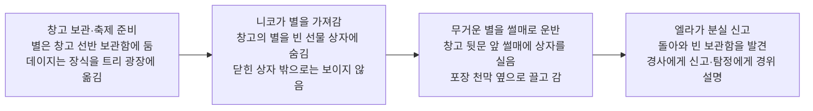
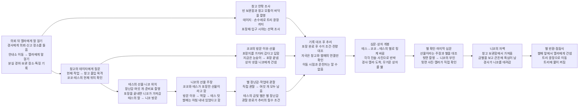

# 10 · B 사라진 크리스마스트리의 별 — 현재 시나리오

**L1-05 현재진행형 · 2026-11-09 Claude Code 개발 인계 · 개발 점검·2차 수정 반영(사용자 합의, §9 끝) · 그림·음성 계획 대기.** [장면별 기획](case-10-christmas-star.html)

마을의 큰 크리스마스 축제를 위해 어른들이 아이들 선물을 자원해서 준비한다. 엘라는 축제를 안내하고, 새 인물 데이지는 창고와 장식을 정리한다. 코코는 털장갑, 테스는 장난감 선물을 포장하고 니코는 완성된 선물을 썰매에 나르고 배송하는 역할만 맡는다. 니코는 창고에 보관한 금으로 만든 별을 선물 상자 안에 완전히 숨겨 나른다. **선물 상자 자체·상자의 출처·손잡이·종이 조각은 범행 물증으로 쓰지 않는다.** 썰매 위 상자의 수(c-boxes)와 무게(저울)는 플레이어가 쓰는 단서다.

별은 속까지 꽉 찬 실제 금으로 만든 장식 하나뿐이다. 밖으로 별 끝이나 금빛이 보이는 설정은 없다. 별 뒷면의 작은 잎사귀 음각 무늬가 실제 물건 확인에 쓰인다. 새 인물 이름·종(양 데이지)과 무늬·구체 대사는 기획자 제안이며 사용자 결정으로 적지 않는다. 새 인물·창고 보관·추가 근거를 넣는 방향은 사용자 승인 사항이다. 그림·음성 생성이나 게임 구현은 하지 않는다.

노트는 탐정이 들은 사실을 정리하는 짧은 메모다. NPC의 대답 전체를 따옴표로 옮기지 않는다. 빈칸의 ID·정답·순서는 유지하며, 대명사·장소 표현의 원형이 빈칸인 경우에만 화자를 명시하고 해당 표현을 짧게 인용한다. 실제 대답과 음성은 지문 보기에서 그대로 확인한다.

## 1. 제작자용 진실·행동 이유

1. 별은 마을이 해마다 쓰는 귀중품이며 창고 선반의 전용 보관함에 둔다. 뒷면에는 작은 잎사귀 무늬가 새겨져 있다. 몸체는 속까지 꽉 차 있고 전기 부품·빈 내부·연결 관은 없다. 가까운 곳까지 잠깐 들어 옮길 수는 있지만, 계속 들고 마을길을 걷기에는 무겁다. 순도·정확한 무게·크기·트리 고정 방식은 미정이다.
2. 엘라는 설치 준비를 위해 보관함 잠금을 풀고 별을 확인한 뒤, 뚜껑만 닫아 두고 광장 입구의 어린 친구들을 안내하러 잠시 나간다. 평소에는 잠가 보관한다. 돌아와 별이 없어진 것을 알고 오소리 경사에게 알린다. 경사는 탐정에게 없어진 물건의 조사를 부탁하고, 무엇이 없어졌는지 묻자 마을의 크리스마스 별이라며 안내소의 엘라에게 자세히 들어 보라고 한다. 경사가 주변 순찰을 떠나면 같은 광장의 안내소 자리에 있는 엘라에게 탐정이 말을 건다. 엘라와 테스는 우산 사건에서 탐정을 만났으므로 다시 만난 인사를 하고, 엘라는 자기가 신고했다고 밝힌다. 탐정은 이어 경위를 묻는다. 엘라는 축제 준비 담당자로서 별을 찾는 데 필요한 탐정이 축제 물품을 확인해도 된다고 허락하고, 조사 중에는 안내 자리에 남는다. 경사는 의뢰 직후 축제장 주변을 확인한다. 후반 합류 때 탐정에게 엘라의 물품 확인 허락을 전달받는다. 후보를 직접 지목하지 않고 위치·특징만 답한다. 사전 별 사진은 없다.
3. 창고에는 앞문과 짐을 싣는 뒷문이 있다. 별 보관함이 있는 선반은 뒷문 가까운 안쪽이다. 데이지는 창고의 장식을 큰 장식 상자에 담아 손수레로 트리 광장에 옮긴 뒤 앞문 옆 작업대에서 장식을 정리하고 리본을 단다. 손수레의 두 바퀴가 남긴 자국은 트리 광장 쪽으로 굽는다. 본인도 창고를 사용한다. 코코는 포장지를, 테스는 빈 선물 상자를 가지러 드나들고(테스는 니코보다 먼저 들렀고 보관함 뚜껑이 닫혀 있어 별을 보지 못했다. 니코는 별을 꺼낸 뒤 뚜껑을 열어 둔 채 갔다. 사용자 결정), 니코는 포장 천막에 가져다줄 빈 상자를 가지러 짐 싣는 뒷문으로만 드나든다. 데이지는 코코와 테스가 앞문으로 들어가는 것은 봤지만 선반 안쪽에서 무엇을 집었는지 계속 보지는 못했고, 뒷문을 쓴 니코는 보지 못했다(사용자 결정). 출입 목격만으로 별을 가져간 사람을 알 수 없다. 데이지는 장식을 손수레에 싣고 트리 광장을 오가며 트리를 꾸민다. 코코와 테스가 포장 재료를 가지러 다녀간 뒤 데이지가 광장에 가 있는 동안 창고가 비고, 그때 니코가 뒷문으로 들어온다. 엘라는 아이들을 안내하며 광장에서 트리를 꾸미는 데이지를 본다(2026-11-16 사용자 요청: 데이지는 창고에 내내 있지 않음).
4. 니코는 앞문의 데이지에게 보이지 않는 창고 뒷문에 축제 배송용 썰매를 세우고, 포장 천막에 가져다줄 빈 상자를 가지러 뒷문으로 들어간다. 창고 안의 열린 보관함에서 무거운 별을 꺼내 준비용 선물 상자에 숨기고, 뒷문 앞까지 짧게 들어 썰매에 싣는다. 그 썰매를 포장 천막 옆까지 끌어다 세운다. 창고 뒷문에서 썰매 아래까지 이어지는 자국은 이때 생겼다(개발 점검 사용자 결정). 데이지의 손수레 자국과 이 썰매 자국은 모두 눈이 오기 전에 생겼다. 그 뒤 눈이 조금 내려 두 자국 모두 흐릿해졌지만 끊기지 않아 따라갈 수는 있다(사용자 결정: 두 자국 모두 흐릿하게). 코코는 니코가 가져다준 빈 상자에 아이들 털장갑을 넣어 축제 공용 포장지와 리본으로 싸고, 포장을 끝낸 상자 넷을 니코에게 건넸다(테스의 말처럼 포장을 끝내면 니코가 가져간다). 니코는 별을 숨긴 상자도 같은 포장지와 리본으로 싸서 그 사이에 실었으므로 썰매의 상자 다섯은 겉으로 똑같다(사용자 결정: 코코가 건넨 상자 4개·썰매 5개). 털장갑 상자는 아주 가볍고 별 상자는 아주 무겁다. 니코는 별이 든 무거운 상자를 다른 상자들과 함께 나르려 하며, 무엇을 싣는지 묻자 코코와 테스가 포장한 선물이라고 둘러대고(2026-11-16 사용자 요청: 포장 봉사자는 둘뿐이라 이름을 댐. 테스는 하나도 주지 않았으므로 거짓), 심문에서 몰리면 테스의 선물 → 모두 코코의 선물이라는 말로 좁혀 간다(사용자 결정). 정상 역할은 선물 운반·썰매 배송이며 포장을 겸하지 않는다. 닫힌 선물 상자는 숨기는 수단일 뿐 창고 출처를 입증하는 증거가 아니다.
5. 코코·테스는 천막에서 선물을 포장한다. 코코는 털장갑 상자 넷을 끝내 니코에게 건넸고, 지금은 데이지를 도와 트리에 달 종이 눈송이를 만든다(사용자 결정). 테스가 이번 배송을 위해 준비한 장난감 선물은 배송 준비표에 적힌 여섯 개 전부이며 모두 작업대에 남아 있다. 촬영 시점에는 포장 완료, 포장 중, 포장 전이 두 개씩이다. 포장 전 둘 가운데 하나는 토이 네스트의 금빛 플라스틱 별 장난감이다. 테스가 아침에 가게에서 들고 왔다. 가볍고 뒷면에 무늬가 없다(사용자 결정: 테스의 별 장난감). 이미 니코에게 건넨 별도 물량은 없다. 니코는 아직 나머지 선물이 준비되지 않아 출발하지 않는다. 자동 도주·타이머는 없다.
6. 탐정은 창고의 빈 보관함을 촬영하고 데이지에게 현재 작업과 출입을 묻는다. 여러 친구가 출입했으므로 그 말만으로 특정하지 않는다. 천막에서 테스의 선물을 전부 포장하면 니코가 가져간다는 말을 듣는다. 니코의 운반 주장을 들은 뒤 썰매 자리에서 보이는 작업대에 여섯 개가 그대로 남아 있다.
7. 니코는 별을 봤는지 묻자(코코·테스와 같은 질문) 못 봤다면서, 테스가 별을 가져가는 걸 본 것 같다고 혐의를 돌린다(반쯤 사실: 테스는 아침에 토이 네스트의 금빛 별 장난감을 들고 창고에 들렀다가 작업대로 왔고, 니코는 뒷문 쪽에서 그 모습을 언뜻 봤다). 탐정은 천막으로 돌아가 그 별이 가벼운 별 장난감이고 뒷면에 무늬가 없음을 확인한다. 추리를 마치면 탐정이 설명에 맞지 않는 부분이 있다고 짚는다. 니코는 테스의 선물 → 모두 코코의 선물 → 테스의 별 탓 → 테스가 트리의 별을 숨겼다는 말로 핑계를 바꾸고, 플레이어는 테스 t3·c-toys, 코코 m3, 테스 t4·c-toy-star를 내밀어 하나씩 반박한다. 경사는 엘라와 함께 진행 상황을 들으러 온다. 니코는 축제 선물이라며 개봉을 거부하지만, 엘라가 축제 물건이니 확인해도 된다고 허락하고 경사가 탐정에게 열라고 한다. 썰매의 상자 다섯은 똑같아 보이므로, 플레이어가 창고 구석에 있던 양팔 저울을 가져와 상자 둘씩 달아 보는 등 지금까지의 단서로 별이 든 상자를 직접 골라 탐정이 연다.
8. 개봉 뒤 처음으로 별을 발견한다. 선물이라는 니코의 주장과 실제 별 실물이 다름을 확인한다. 별의 뒷면을 조사·촬영해 엘라가 설명한 작은 잎사귀 무늬를 확인한다. 니코가 사라진 별이 아니라고 버티면 탐정이 뒷면 사진을 내밀고, 그 자리의 엘라가 자기 별이라고 직접 확인한다. 이후 니코가 열린 보관함에서 금별을 보고 욕심이 나 허락 없이 가져갔으며, 별을 팔면 큰돈이 될 줄 알았고 테스 탓은 거짓이었다고 인정한다. 경사가 니코를 데려가고, 탐정은 썰매 앞에서 엘라에게 별을 건넨다. 별은 트리 꼭대기에 다시 달리고, 해가 진 트리 광장의 점등식에서 트리에 불이 켜지며 사건이 끝난다.

여러 봉사자가 같은 창고에 드나든다. 코코가 포장한 털장갑 상자는 별 상자와 겉이 똑같아, 상자 수와 무게로만 구별된다. 데이지도 출입했고 현재 장식을 정리하므로 후보에서 자동 제외하지 않는다. 현재 작업은 과거 알리바이가 아니다. 범행 물증은 별의 실물·뒷면 무늬·비어 있는 보관 위치다. 데이지와 테스·니코의 말은 진술로 기록한다. 테스의 별 장난감은 금빛이라 처음에는 의심스럽지만 가볍고 뒷면에 무늬가 없다. 박스 손잡이 조각·상자 모양·배송 라벨·동물 종·외형·색을 범인 증거로 쓰지 않는다.

## 2. 장면별 스토리보드

### 사건 흐름도

전반부 장면 1–5의 선택 소품 반응은 각 탐색 장면 안에서만 제공하며 흐름도의 다음 장면을 여는 조건이 아니다. 추리 이후에는 추가하지 않는다.

사건의 진실과 플레이 순서를 나눈 제작자용 흐름도다. 창고를 살피고 두 바닥 사진의 자국을 대조한다. 자국은 경로만 보여 주며 발생 시점이나 운전자를 입증하지 않는다. 상자 확인의 핵심 근거는 테스의 장난감 선물 전량이 아직 작업대에 있다는 점과, 코코가 건넨 상자 넷보다 썰매의 상자가 하나 많다는 점이다. 썰매 자리에서 현재 작업대를 살핀다. 니코는 테스가 별을 가져가는 걸 본 것 같다고 혐의를 돌리지만, 천막에 돌아가 보면 테스의 별은 가벼운 별 장난감이다. 심문에서 니코는 테스의 선물 → 모두 코코의 선물 → 테스의 별로 핑계를 바꾸고, 플레이어가 각각 테스·코코의 진술이나 사진으로 반박한다. 경사와 엘라가 함께 진행 상황을 들으러 온다. 니코가 개봉을 거부해도 엘라가 허락하고 경사가 지시하면, 플레이어가 썰매의 똑같은 상자 다섯을 창고 구석의 저울로 달아 보고 골라 탐정이 연다. 별 실물·잎사귀 무늬·출처 확인은 개봉 뒤다. 선물 상자 자체는 물증으로 쓰지 않는다. 별은 엘라에게 돌려주고 트리 광장의 점등식으로 끝난다.

#### 01 · 사건이 벌어진 과정

제작자용 진실 · 탐정이 오기 전

#### 02 · 탐정이 해결하는 과정

플레이 순서 · 진술과 사진을 대조하고 의뢰인에게 반환

### 장면 0 · 준비

같은 엔진·같은 화면의 열쇠 카드로 현재 행동 긍정·부정·확인·행동 질문을 준비한다. 이름은 자기소개 뒤 표시하고 단서·질문 개수는 플레이 화면에 쓰지 않는다. 예습 예문은8절을 쓴다.

### 장면 1 · 트리 광장 — 경사의 의뢰와 엘라 면담

경사는 트리 광장 입구에 있고 엘라는 같은 광장의 안내소에서 일한다. 광장 중앙의 크리스마스트리는 주변 건물 지붕보다 훨씬 높고, 아래에 선 엘라와 경사가 작아 보인다. 광장 안에서는 아래쪽 가지가 배경을 넓게 채우고 꼭대기는 화면 위로 넘어간다. 경사는 없어진 물건을 조사해 달라고 하고, 탐정이 무엇이 없어졌는지 물으면 마을의 크리스마스 별이 사라졌다며 안내소의 엘라에게 자세히 들어 보라고 말한다(사용자 결정). 탐정이 경사의 대답을 노트에 바르게 받아 적으면(badger:b0) 경사는 순찰하러 떠나 광장 화면에서 사라지고, 같은 광장 그림의 안내소 자리에 사슴이 나타난다. 장소 안에서 자리를 옮기는 이동 버튼은 없다(개발 점검 사용자 결정). 사슴을 누르면 탐정이 엘라의 이름을 부르며 인사하고, 엘라가 다시 만나 반갑다며 신고한 사람이라고 밝히면 첫 질문 e0만 열린다. 엘라는 우산 사건에서 탐정을 만났다(사용자 결정: 다시 만난 인사). 이름은 이 인사 뒤부터 표시한다. 안내소는 같은 광장 안의 자리이며 별도 장소를 추가하지 않는다. 경사는 신고 장소만 알려 준다. 엘라를 직접 소개하거나 함께 데려가는 장면은 없다. 탐정이 엘라에게 무슨 일이 있었는지 묻고 답을 기록하면 e1·e2가 열린다. e2 기록 뒤 탐정은 창고로 갈 수 있다. 경사는 이미 주변을 순찰 중이다.

- **badger:hello · 경사 · 자동**
  - Detective, I'd like you to look into a missing item.
  - 탐정, 이번 사건은 없어진 물건을 조사해 줬으면 좋겠어.

#### badger:b0 · 경사 (받아 적기, 사용자 결정 2026-11-11: 의뢰도 노트에 받아 적는다)

- **질문 선택지**: What's missing?
- 해석: 뭐가 없어졌는데?
- **대답**: The town's Christmas star is missing. Ask Ella at the information desk for more details.
- 해석: 마을의 크리스마스 별이 사라졌대. 자세한 내용은 안내소의 엘라에게 들어 봐.
- **노트**: • the town's Christmas star is missing / • ask [Ella] at the [information desk]
- **보기**: Ella · Ellie · Emma · information desk · gift shop · front door
- 빈칸은 누구·어디만 둔다. star·missing은 바로 뒤 ella:e0의 빈칸이라 겹치지 않게 했다(사용자 결정).
- 조건: 경사의 인사 뒤 첫 질문
- 채점 뒤: 노트를 닫으면 광장 화면으로 돌아가고, 경사는 순찰을 떠나 없고 안내소에 사슴(엘라)이 나타난다. 탐정의 생각 대사(information-desk-thought)는 없앴다(사용자 결정 2026-11-11: 노트에 이미 갈 곳이 적혀 있고, 경사 앞에서 말하면 함께 가는 것처럼 보임).

- **det:ella-greeting · 탐정 · 말 걸기 선택지**
  - Hi, Ella! I'm looking into the missing star.
  - 안녕, 엘라! 사라진 별을 조사하고 있어.

- **ella:hello · 엘라 · 자동**
  - Detective! Nice to see you again. I reported it.
  - 탐정! 다시 만나서 반가워. 내가 신고했어.

#### ella:e0 · 엘라

- **질문 선택지**: What happened?
- 해석: 무슨 일이 있었어?
- **대답**: I went to show the children around the festival. When I came back, the star was missing.
- 해석: 축제에 온 아이들을 안내하러 자리를 비웠어. 돌아와 보니 별이 사라졌더라.
- **노트**: • showed the children around the festival / • came back → the [star] was [missing]
- **보기**: star · string · start · missing · shining · moving
- 조건: 경사가 떠난 뒤 안내소에 나타난 엘라에게 탐정이 인사하고 엘라가 답한 뒤 첫 질문으로 표시
- 채점 뒤: 엘라가 축제에 온 아이들을 안내하고 돌아와 분실을 발견했다는 경위 기록. e1·e2 해금

#### ella:e1 · 엘라

- **질문 선택지**: What does the star look like?
- 해석: 별은 어떻게 생겼어?
- **대답**: It's real gold, so it's very heavy. It has a small leaf pattern on the back.
- 해석: 진짜 금으로 만들어서 아주 무거워. 뒷면에 작은 잎사귀 무늬가 있어.
- **노트**: • real [gold], very [heavy] / • small [leaf] pattern on the back
- **보기**: gold · glass · silver · heavy · light · leaf · line
- 조건: e0 기록 뒤
- 채점 뒤: 금 재질·아주 무겁다는 점·별 뒷면의 잎사귀 모양 기록. 실물 식별과 상자 고르기에 사용

#### ella:e2 · 엘라

- **질문 선택지**: Where did you leave it?
- 해석: 어디에 두었어?
- **대답**: I left it in its case on the storeroom shelf.
- 해석: 창고 선반의 보관함 안에 두었어.
- **노트**: • left it in its [case] / • on the [storeroom] [shelf]
- **보기**: case · box · storeroom · gift tent · shelf · table · floor
- 조건: e0 기록 뒤
- 채점 뒤: 축제 창고·이름 없는 양. 보관함 관찰·c-case 촬영

#### ella:e3 · 엘라

- **질문 선택지**: Did you see Daisy this morning?
- 해석: 오늘 아침에 데이지를 봤어?
- **대답**: Yes. She was decorating the tree while I was with the children.
- 해석: 응. 내가 아이들과 있는 동안 트리를 꾸미고 있었어.
- **노트**: • Daisy was [decorating] the [tree] / • while Ella was with the children
- **보기**: decorating · sorting · wrapping · tree · storeroom · sleigh
- 조건: 데이지 h4(손수레로 트리 광장에 장식을 옮김) 기록 뒤(2026-11-16 사용자 요청: 데이지의 결백을 엘라의 말로)
- 채점 뒤: 엘라가 자리를 비운 동안 데이지는 트리 광장에서 트리를 꾸몄다는 진술 기록. 그동안 창고가 비어 있었다(니코가 뒷문으로 들어갈 틈)
- **det:ella-daisy-thought · 탐정 · 생각**(데이지 h4를 기록하고 e3를 아직 묻지 않았을 때, 2026-11-16 점검: 엘라에게 돌아갈 안내가 없었음): **I should ask Ella about Daisy. / 엘라에게 데이지에 대해 물어봐야겠어.**

- **ella:check-supplies · 엘라 · 자동**
  - You can check the festival supplies if it helps you find the star.
  - 별을 찾는 데 필요하면 축제 물품도 확인해도 돼.
  - 조건: 엘라의 질문 e0·e1·e2를 모두 받아 적은 뒤, 노트를 닫으면(사용자 요청). 나중에 열리는 e3는 기다리지 않는다

#### 장면 1 · 선택 소품 반응

탐정의 짧은 영어 반응. 누른 소품만 말하며 진행 필수 조건은 아니다.

| 대상 | 영어 음성 | 해석 | 조건·연출 |
|---|---|---|---|
| 거대한 크리스마스트리 | What a tall tree! | 정말 큰 트리네! | 장면 1 광장 탐색. 트리는 꼭대기가 화면 위로 넘어갈 만큼 크게 보인다. |
| 낮은 가지의 작은 종 장식 | A tiny bell! | 작은 종이네! | 장면 1 광장 탐색. 낮은 가지에 작은 종을 그린다. 종을 실제로 울리는 동작은 없다. |
| 트리의 지팡이 사탕 장식 | A candy cane! | 지팡이 사탕이네! | 장면 1 광장 탐색. 사건 단서 아님(사용자 추가, 장식한 트리 그림). |
| 트리의 장난감 기차 장식 | A little toy train! | 작은 장난감 기차네! | 장면 1 광장 탐색. 사건 단서 아님(사용자 추가, 장식한 트리 그림). |
| 트리의 빨간 공 장식 | A shiny red ball! | 반짝이는 빨간 공이네! | 장면 1 광장 탐색. 사건 단서 아님(사용자 추가, 장식한 트리 그림). |
| 왼쪽 집 문의 화환 | There's a wreath on the door. | 문에 화환이 걸려 있네. | 장면 1 광장 탐색. 사건 단서 아님(사용자 추가, 장식한 트리 그림). |
| 안내소 선반의 축제 안내지 | Festival leaflets! | 축제 안내지네! | 장면 1 광장 탐색. 사건 단서 아님(사용자 추가, 장식한 트리 그림). |
| 눈 덮인 언덕길 | The path goes up the hill. | 길이 언덕 위로 이어지네. | 장면 1 광장 탐색. 사건 단서 아님(사용자 추가, 장식한 트리 그림). |

- **det:storeroom-thought · 탐정 · 생각** (뺌, 2026-11-16 사용자 요청: 엘라 e2에서 창고를 듣고 받아 적었고 지도에 나타나므로)
  - ~~I should check the storeroom.~~
  - ~~창고를 확인해야겠어.~~

- **move:storeroom · 이동 · 이동 버튼**
  - Go to the Storeroom.
  - 축제 창고로 가기

### 장면 2 · 축제 창고 — 데이지와 빈 보관함

엘라 e2 기록으로 창고를 발견하고 직접 이동한다. 데이지는 앞문 옆 작업대에, 보관함은 뒷문 가까운 안쪽 선반에 있다. 양의 이름은 자기소개 전에는 표시하지 않는다. 창고는 포장재·장식품을 함께 보관하는 정상 작업 공간이고, 축제 물건이 여기저기 쌓여 있다. 앞문 반대편 구석에는 접시 둘 달린 중간 크기의 양팔 저울(탐정이 들고 다닐 수 있는 크기)이 다른 물건들 사이에 놓여 있다. 저울은 눈에 띄지 않게 평범한 창고 물건으로 그리고, 소품 반응도 다른 물건과 같은 무게로 둔다(사용자 결정: 창고 구석의 저울). 누구나 드나들었다는 사실은 범행을 뜻하지 않는다.

#### 데이지에게 질문

데이지는 엘라와 함께 축제를 준비하는 성인 양이다. 장식을 정리하고 리본을 달지만 선물을 포장하거나 배송하지 않는다. 본인도 창고에 들어갔다고 답한다. 목격의 범위는 사람들의 출입까지이며 별을 가져가는 손동작·반출품·범행은 보지 못했다.

- **holly:hello · 데이지 · 자동**
  - Hi! I'm Daisy. Come in.
  - 안녕! 난 데이지야. 들어와.

- **det:holly-intro · 탐정 · 자동**
  - I'm helping Ella find the missing star.
  - 엘라가 없어진 별을 찾는 걸 돕고 있어.

- **holly:ready · 데이지 · 자동**
  - Oh! I'll answer what I can.
  - 아! 내가 아는 건 말해 줄게.

#### holly:h1 · 데이지

- **질문 선택지**: What are you doing?
- 해석: 무엇을 하고 있어?
- **대답**: I'm sorting decorations for the Christmas festival. I'm helping Ella.
- 해석: 크리스마스 축제 장식품을 정리하고 있어. 엘라를 돕고 있어.
- **노트**: • [sorting] [decorations] for the festival / • helping Ella
- **보기**: sorting · carrying · selling · decorations · gifts · mittens
- 조건: 엘라 e2 기록·창고 도착·데이지 자기소개 뒤 첫 질문
- 채점 뒤: h2. 출입 목격을 기록하면 h3가 열린다.

#### holly:h2 · 데이지

- **질문 선택지**: Who came into the storeroom?
- 해석: 창고에는 누가 들어왔어?
- **대답**: Coco and Tess came in together for wrapping supplies. Then they left.(2026-11-16 사용자 결정 A안: 둘이 같이 들어왔다가 나감. 같은 날 사용자 요청: 포장 재료를 가지러 왔다는 말로 코코·테스를 보강하고, 트리를 꾸미러 오가는 데이지에게 맞지 않는 "I was here, too"는 뺌)
- 해석: 코코와 테스가 포장 재료를 가지러 같이 들어왔어. 그러고 나서 나갔어.
- **노트**: • Coco and Tess [came] in [together] / • for wrapping [supplies] / • then they [left]
- **보기**: came · come · together · alone · supplies · snacks · left · leave
- 조건: h1 기록 뒤
- 채점 뒤: 여러 사람의 창고 출입 목격 기록·h3 해금. 목격은 출입 범위까지

#### holly:h3 · 데이지

- **질문 선택지**: Where are Coco and Tess now?
- 해석: 코코와 테스는 지금 어디 있어?
- **대답**: They're working in the gift tent.
- 해석: 선물 포장 천막에서 일하고 있어.
- **노트**: • Coco, Tess: [working] in the [gift tent]
- **보기**: working · wrapping · sleeping · gift tent · storeroom · Tree Square
- 조건: h2의 출입 목격 기록 뒤
- 채점 뒤: 포장 천막·코코·테스 면담. 이름 표시는 본인 소개 뒤

e2 기록 뒤 창고 선반의 빈 보관함을 c-case로 살펴볼 수 있다(사진 없음, 2026-11-16 사용자 결정: 사진은 심문 증거만. 이 장면의 c-track-yard는 같은 날 사용자 결정으로 다시 사진: 심문에서 c-track-sleigh와 함께 내민다). 데이지에게 묻기 전후 어느 쪽이든 가능하다. 관찰: **The case is empty. / 보관함이 비어 있어.** 보관함 사진에 출입자·범인·사람의 목격담을 적지 않는다. 안쪽에서 공용 포장재 선반(c-supplies)과 문턱에서 본 선반의 시야(c-door-view)도 선택 촬영할 수 있다. 공용 포장재는 창고에 들어갈 일상적인 이유를, 문턱 사진은 데이지가 보지 못한 범위를 이해하는 데 쓴다. e2 기록 뒤 창고 안의 뒷문으로 나가 창고 모퉁이에서 앞문과 뒷문 쪽 바닥을 c-track-yard로 촬영한다. 탐정은 바닥에 자국이 보인다고만 말한다. 촬영 뒤 데이지에게 장식을 옮긴 적 있는지 묻는 h4가 열린다(개발 점검 사용자 결정: 받아쓰기로). h2의 출입 목격 뒤 h3에서 코코와 테스의 현재 위치를 묻고 포장 천막을 발견한다.

#### holly:h4 · 데이지

- **질문 선택지**: Are you moving any decorations today?(2026-11-17 점검, 사용자 결정: 대답의 현재진행형과 시제를 맞춤)
- 해석: 오늘 장식품을 옮기고 있어?
- **대답**: Yes. I'm taking decorations to the Tree Square in a handcart.(점검 6, 사용자 결정: 손수레가 장식을 실은 채 창고 문 앞에 있으므로 옮기는 중)
- 해석: 응. 손수레로 장식품을 트리 광장에 옮겼어.
- **노트**: • taking decorations to the [Tree Square] / • in a [handcart]
- **보기**: Tree Square · gift tent · storeroom · handcart · sleigh · basket
- 조건: h1 기록·c-track-yard 촬영 뒤
- 채점 뒤: 광장 쪽 자국은 데이지의 손수레라는 진술 기록. 자국 추리(tracks)의 근거

#### 장면 2 · 선택 소품 반응

탐정의 짧은 영어 반응. 누른 소품만 말하며 진행 필수 조건은 아니다.

| 대상 | 영어 음성 | 해석 | 조건·연출 |
|---|---|---|---|
| 벽에 세워 둔 사다리 | That's a tall ladder. | 저 사다리 높네. | 장면 2 창고 진입 뒤. 사다리는 벽에 세워져 있고 타거나 옮기지 않는다. |
| 바구니에 접어 둔 식탁보 | They're neatly folded. | 가지런히 접혀 있네. | 장면 2 창고 진입 뒤. 바구니 안 식탁보들이 가지런히 접힌 모습만 관찰한다. |
| 구석의 양팔 저울 | There's a scale in the corner. | 구석에 저울이 있네. | 장면 2 창고 진입 뒤. 앞문 반대편 구석 바닥에 접시 둘 달린 중간 크기의 양팔 저울이 의자 더미 옆에 놓여 있다. 다른 물건처럼 평범하게 그린다. 개봉 지시 뒤에는 이 자리에서 가져갈 수 있다(사용자 결정: 창고 구석의 저울). |
| 상자에 엉켜 있는 전구 줄 | The lights are all tangled. | 전구 줄이 다 엉켜 있네. | 장면 2 창고 진입 뒤. 열린 상자 안에 트리용 전구 줄이 엉켜 있다. 단서가 아니다(사용자 요청: 창고 물건 늘리기). |
| 벽에 건 큰 화환 | What a big wreath! | 화환이 정말 크네! | 장면 2 창고 진입 뒤. 벽에 축제용 큰 화환이 걸려 있다. 단서가 아니다(사용자 요청: 창고 물건 늘리기). |

- **det:gift-thought · 탐정 · 생각**
  - I should ask the friends in the gift tent.
  - 포장 천막의 친구들에게 물어봐야겠어.

- **move:gift · 이동 · 이동 버튼**
  - Go to the Gift Tent.
  - 선물 포장 천막으로 가기

### 장면 3 · 선물 포장 천막 — 코코

코코는 털장갑 선물 상자 넷의 포장을 끝내 니코에게 건넸고, 지금은 데이지를 도와 트리에 달 종이 눈송이를 만든다(사용자 결정). 데이지는 코코가 창고에 들어간 것을 봤지만, 지금 하는 일만으로 과거 반출을 부정하지 않는다. 탐정은 출입 목격을 근거로 창고에 간 이유부터 묻는다. 선물에 쓸 포장지가 필요했다는 답을 듣고 지금 무엇을 하는지 묻는다. 아직 포장 중인지 물으면 코코는 다 끝내 털장갑 상자 넷을 니코에게 건넸다고 답한다. 상자 수를 썰매와 비교하는 것은 플레이어다. 지금 하는 일만으로 과거의 모든 행동을 무죄로 단정하지 않는다. 데이지 h3는 코코와 테스가 천막에서 일하고 있다고만 말한다(코코는 이미 포장을 끝냈으므로 wrapping이라고 하지 않는다).

- **mae:hello · 코코 · 자동**
  - Welcome! I'm Coco.
  - 어서 와! 난 코코야.

- **det:mae-intro · 탐정 · 자동**
  - I'm helping Ella find the missing star.
  - 엘라가 없어진 별을 찾는 걸 돕고 있어.

- **mae:ready · 코코 · 자동**
  - Oh! What would you like to know?
  - 아! 뭐가 궁금해?

#### mae:star · 코코

- **질문 선택지**: Did you see the star today?
- 해석: 오늘 그 별을 봤어?
- **대답**: No, I didn't.
- 해석: 아니, 못 봤어.
- **노트**: • [didn't] see the star
- **보기**: didn't · did · don't · do
- 조건: 코코 자기소개와 조사 목적 설명 뒤 첫 질문(2026-11-16 사용자 요청: 창고에 들어간 코코에게도 별을 봤는지 묻기, 테스와 같은 순서)
- 채점 뒤: m0 해금

#### mae:m0 · 코코

- **질문 선택지**: I heard you went into the storeroom. Why did you go in?
- 해석: 창고에 들어갔다고 들었어. 왜 갔어?
- **대답**: I needed wrapping paper for the children's gifts.
- 해석: 아이들 선물에 쓸 포장지가 필요했어.
- **노트**: • needed [wrapping paper] / • for the children's [gifts]
- **보기**: wrapping paper · drawing paper · ribbons · gifts · toys · bags
- 조건: mae:star 기록 뒤
- 채점 뒤: 코코가 창고에 간 이유 기록·m1 해금. 과거 무죄를 확정하지 않음

#### mae:m1 · 코코

- **질문 선택지**: What are you doing now?
- 해석: 지금 뭐 하고 있어?
- **대답**: I'm making snowflakes for the tree. I'm helping Daisy.
- 해석: 트리에 달 눈송이를 만들고 있어. 데이지를 돕고 있어.
- **노트**: • [making] [snowflakes] for the tree / • helping Daisy
- **보기**: making · wrapping · cutting · snowflakes · mittens · stars
- 조건: m0에서 선물에 쓸 포장지를 가지러 갔다고 답한 뒤
- 채점 뒤: m3

#### mae:m3 · 코코

- **질문 선택지**: Are you still wrapping gifts?
- 해석: 아직 선물을 포장하고 있어?
- **대답**: No, I'm not wrapping now. I wrapped mittens in four boxes, and Nico took them.
- 해석: 아니, 지금은 포장 안 해. 털장갑을 상자 넷에 포장했고, 니코가 가져갔어.
- **노트**: • [not] wrapping now / • wrapped mittens in [four] boxes / • [Nico] took them
- **보기**: not · now · four · five · Nico · Tess
- 조건: m1 기록 뒤
- 채점 뒤: 코코가 털장갑 상자 넷을 끝내 니코에게 건넸다는 진술 기록. 상자 수 추리(추리 7)와 심문의 코코 핑계 반박에 쓴다. m4가 열린다

#### mae:m4 · 코코

- **질문 선택지**: Who is Nico?
- 해석: 니코가 누구야?
- **대답**: He's a volunteer, too. He's taking the gifts to the sleigh.
- 해석: 니코도 자원봉사자야. 선물을 썰매로 가져가고 있어.
- **노트**: • Nico: a [volunteer], too / • [taking] the gifts to the [sleigh]
- **보기**: volunteer · visitor · taking · making · sleigh · tent
- 조건: m3 기록 뒤(사용자 요청: m3에서 이름이 나온 니코를 한 번 더 묻기)
- 채점 뒤: 니코와 썰매가 나타난다(테스 t3로도 나타남, 먼저 들은 쪽으로)

코코 작업대에는 포장을 끝낸 상자가 없다. 트리에 달 종이 눈송이 더미와 가위, 포장하고 남은 리본이 있다. 코코의 털장갑 상자 넷은 이미 니코가 썰매에 실었다. 코코와 테스의 최초 방문 순서는 자유다.

#### 장면 3 · 선택 소품 반응

탐정의 짧은 영어 반응. 누른 소품만 말하며 진행 필수 조건은 아니다.

| 대상 | 영어 음성 | 해석 | 조건·연출 |
|---|---|---|---|
| 길게 풀린 리본 | What a long ribbon! | 리본이 정말 기네! | 장면 3 코코 작업대 탐색. 상자 밖에 풀린 리본만 본다. |
| 종이 눈송이 더미 | So many snowflakes! | 눈송이가 정말 많네! | 장면 3 코코 작업대 탐색. 트리에 달 종이 눈송이와 가위가 놓여 있다. 단서가 아니다. |

### 장면 4 · 같은 천막 — 테스의 장난감 선물

테스는 우산 사건에 등장한 거북이며 장난감 가게 토이 네스트의 직원이다(우산 사건 데이터와 같게, 사용자 결정). 탐정과는 우산 사건에서 만났다. 이번 축제에서는 아이들을 위한 자원봉사자로 참여한다. 테스는 작업대에서 이번 배송분 장난감 선물의 포장을 하고 있다. 이미 포장을 끝낸 선물도 같은 작업대에 모아 둔다. 데이지 h2의 창고 출입 목격과 h3의 천막 위치를 모두 기록한 뒤 테스와 면담할 수 있다. 첫 인사 뒤 탐정은 큰 트리의 별이 창고에서 사라졌다고 설명한다. 테스가 별을 못 봤다고 답하면 탐정은 창고에 들어갔다는 말을 들었다며 그 이유를 묻는다. 빈 상자가 필요했다는 답을 듣고 무엇을 포장하는지 묻는다(t1). 앞선 두 문답은 받아쓰기 없이 듣고, t1을 기록하면 선물의 배송 준비가 끝났는지 묻는 t3와 장난감 조사 선택지가 열린다. 테스의 작업대는 포장 천막 안에 있으며 썰매 쪽 열린 옆면 너머로 작업대가 보인다. 포장 전 선물 둘 가운데 하나는 금빛 별 장난감이며, 처음 방문 때는 아무도 이 별을 말하지 않는다(사용자 결정: 가짜 용의자는 테스의 별 장난감).

- **tess:hello · 테스 · 자동**
  - Detective! Nice to see you again. I'm a volunteer today.
  - 탐정! 다시 만나서 반가워. 오늘은 자원봉사를 해.

- **det:tess-intro · 탐정 · 자동**
  - I'm helping Ella find the missing star.(2026-11-16 사용자 요청: 짧게, 데이지·코코·니코와 같은 문장)
  - 엘라가 없어진 별을 찾는 걸 돕고 있어.

- **tess:ready · 테스 · 자동**
  - Oh, I hope you find it!(2026-11-16 사용자 요청: 탐정의 "엘라를 도와 찾고 있어"에 맞는 대답)
  - 오, 꼭 찾길 바랄게!

#### tess:star · 테스

- **질문 선택지**: Did you see the star today?
- 해석: 오늘 그 별을 봤어?
- **대답**: No, I didn't.
- 해석: 아니, 못 봤어.
- **노트**: • [didn't] see the star
- **보기**: didn't · did · don't · do
- 조건: 테스 첫 인사 뒤 첫 질문(사용자 결정: 예전에는 받아쓰기 없는 선택 질문)

#### tess:storeroom · 테스

- **질문 선택지**: I heard you went into the storeroom. Why did you go in?
- 해석: 창고에 들어갔다고 들었어. 왜 갔어?
- **대답**: I needed some empty boxes for the gifts.
- 해석: 선물을 담을 빈 상자가 필요했어.
- **노트**: • [needed] some [empty] [boxes] / • for the gifts
- **보기**: needed · wanted · empty · full · boxes · bags · ribbons
- 조건: tess:star 기록 뒤(사용자 결정: 예전에는 받아쓰기 없는 선택 질문)

#### tess:t5 · 테스

- **질문 선택지**: Where were you after you went to the storeroom?
- 해석: 창고에 다녀온 뒤에는 어디 있었어?
- **대답**: I went there with Coco. Then we stayed here all morning.
- 해석: 코코랑 같이 다녀왔어. 그 뒤로는 둘이 아침 내내 여기 있었어.
- **노트**: • went with [Coco] / • Tess and Coco [stayed] in the tent all [morning]
- **보기**: Coco · Nico · Daisy · stayed · left · morning · night
- 조건: tess:storeroom 기록 뒤(2026-11-16 사용자 요청: 테스가 창고에 다녀온 뒤 계속 천막에 있었다는 결백 근거. 데이지 h2와 맞음)

#### tess:t1 · 테스

- **질문 선택지**: What are you wrapping?
- 해석: 뭘 포장하고 있어?
- **대답**: I'm wrapping toys. These are gifts for the children.
- 해석: 장난감을 포장하고 있어. 어린 친구들에게 줄 선물이야.
- **노트**: • [wrapping] [toys] / • gifts for the children
- **보기**: wrapping · carrying · fixing · toys · mittens · books
- 조건: 데이지 h3로 포장 천막 발견·테스가 창고에 간 이유를 답한 뒤
- 채점 뒤: t3와 장난감을 보여 달라는 행동 선택지

#### tess:t3 · 테스

- **질문 선택지**: Are these gifts ready for delivery?
- 해석: 이 선물들은 배송할 준비가 됐어?
- **대답**: No, I'm still wrapping. They're not ready yet.
- 해석: 아니, 아직 포장 중이야. 아직 준비가 안 됐어.
- **노트**: • [still] wrapping / • [not] ready yet
- **보기**: still · already · not · now
- 조건: t1 기록 뒤
- 채점 뒤: 아직 포장 중이고 선물이 준비되지 않았다는 기록(니코는 코코 m4로만 나타남)

(2026-11-16 사용자 결정, 가안: 예전의 행동 선택지 "Can I look at the toys? / Sure. You can take a photo."는 뺐다. t1 기록 뒤 천막 그림 속 테스의 작업대를 직접 누르면 탐정이 "Some boxes are still open."이라고만 말한다. 확대 화면은 없다.)

(2026-11-16 사용자 결정: 테스 작업대의 열린 상자 속 금빛 별은 처음부터 따로 누를 수 있다. 누르면 별 확대가 열려 앞뒷면을 플레이어가 뒤집어 본다(아래 c-toy-star, 같은 날 바꿈: 처음의 한 줄 독백 "There's a gold star in that box."은 뺌). 장난감이라는 판단은 추리 2번에서 플레이어가 하고, 테스에게 별을 묻는 t4는 지금처럼 니코 n4 뒤에 열린다.)

작업대 확대에서 포장 완료 두 개, 포장 중 두 개, 포장 전 두 개(장난감 자동차·금빛 별 장난감)와 이번 배송 수량이 적힌 준비표를 한 화면에 담아 c-toys로 촬영한다. 촬영 시점에는 예정된 장난감 선물 여섯 개가 전부 작업대에 있다. 포장 상태는 진행돼도 썰매 자리에서 보이는 작업대의 전체 수량은 여섯 개다. 테스 t3에서 포장이 끝나면 니코가 선물을 가져갈 예정이며 지금은 썰매 옆에 있다는 말을 듣는다(사용자 결정: 니코는 데이지의 목격에 나오지 않음). 니코와 썰매는 코코 m4(Who is Nico?)를 기록해야만 나타난다(사용자 결정 2026-11-12: 니코는 코코와의 대화 뒤에만). (예전에 t3·m4 뒤 나오던 썰매 생각 대사는 뺌, 2026-11-16 사용자 요청.)

#### 장면 4 · 선택 소품 반응

탐정의 짧은 영어 반응. 누른 소품만 말하며 진행 필수 조건은 아니다.

| 대상 | 영어 음성 | 해석 | 조건·연출 |
|---|---|---|---|
| 포장 전 장난감 자동차 | A little toy car! | 작은 장난감 자동차네! | 장면 4 테스의 장난감 조사 허락 뒤. 기존 여섯 선물 중 포장 전 상자 하나에 자동차가 보인다. 일곱 번째 선물을 추가하지 않는다. |
| 선물에 붙일 리본 장식 | That one looks nice. | 저거 예쁘네! | 장면 4 작업대 탐색. 눈앞 탁자의 리본을 가리키며 손에 들지 않으므로 that을 쓴다. |

- ~~**det:sleigh-thought · 탐정 · 생각**~~ 뺌(2026-11-16 사용자 요청: 테스가 니코를 언급하는 생각 대사 삭제). 니코와 썰매는 코코 m4의 발견 알림으로 나타난다.
  - ~~Tess said Nico is by the sleigh. I should talk to him.~~

- **move:sleigh · 이동 · 이동 버튼**
  - Go to the Delivery Sleigh.
  - 썰매 앞으로 가기

### 장면 5 · 썰매 앞 — 운반 주장·별 장난감·작업대 관찰

썰매 짐칸에는 같은 축제 공용 포장지와 리본을 두른 닫힌 상자 다섯이 실려 있다. 넷은 코코가 포장을 끝내 건넨 털장갑 선물이고 하나에 별이 들어 있지만 겉으로는 똑같다(사용자 결정: 똑같은 선물 상자 맞히기, 코코가 건넨 상자 4개·썰매 5개). 니코는 짐칸 앞에서 몸을 숙여 그중 한 상자를 두 손으로 힘겹게 밀어 자리를 잡는다. 그 상자 자리만 짐칸 바닥판이 살짝 눌려 보인다(대사로 말하지 않음). 움직임은 정지 일러스트의 자세로 보여 준다. 대화할 때 상자는 짐칸에 그대로 둔다. 상자의 외형·손잡이·출처·포장지는 물증이 아니다. 썰매 앞에 오면 짐칸의 상자 다섯을 c-boxes로 한 장에 찍는다. 관찰: **The boxes look the same. / 상자들이 똑같아 보여.** 개수는 탐정이 말하지 않고 플레이어가 센다(사용자 결정: 풀이는 모두 플레이어가). 별·금빛·별 끝은 개봉 전에 전혀 보이지 않는다. n2의 loading은 이미 짐칸에 올린 상자의 자리를 잡는 작업까지 포함한다. 상자를 들고 썰매까지 걷는 장면이나 taking ... to the sleigh 대사는 쓰지 않는다. 니코의 대답은 문법적으로 맞아도 내용은 거짓일 수 있다.

- **nico:hello · 니코 · 자동**
  - Hi there. I'm Nico. What brings you here?
  - 안녕. 난 니코야. 무슨 일이야?

- **det:nico-intro · 탐정 · 자동**
  - I'm helping Ella find the missing star.
  - 엘라가 없어진 별을 찾는 걸 돕고 있어.

- **nico:ready · 니코 · 자동**
  - The star for the tree? I'll help if I can.
  - 트리에 달 별 말이야? 도울 일이 있으면 말해 줘.

니코는 처음 만났을 때 다른 봉사자처럼 평소 말투로 답한다. 탐정은 썰매 짐칸에서 일하던 모습을 보고 무엇을 하고 있는지 묻는다.

#### nico:n1 · 니코

- **질문 선택지**: What are you doing?
- 해석: 뭐 하고 있어?
- **대답**: I'm getting ready for the delivery. I'm not delivering yet.(점검 4, 사용자 결정: n2 What are you loading?과 겹치지 않게)
- 해석: 선물을 싣고 있어. 아직 배달하러 출발하지는 않았어.
- **노트**: • [getting ready] for the delivery / • not [delivering] yet
- **보기**: loading · opening · reading · delivering · decorating · wrapping
- 조건: 썰매 앞 발견·니코 인사 뒤 첫 질문
- 채점 뒤: n2. 지금 싣는 물건부터 확인한다.

#### nico:n2 · 니코

- **질문 선택지**: What are you loading?
- 해석: 무엇을 싣고 있어?
- **대답**: I'm loading some gifts. Coco and Tess wrapped them.
- 해석: 선물 몇 개를 싣고 있어. 코코와 테스가 포장한 거야.
- **노트**: • loading some [gifts] / • [Coco] and [Tess] [wrapped] them
- **보기**: gifts · mittens · Coco · Tess · Daisy · wrapped · opened
- 조건: n1 기록 뒤
- 채점 뒤: 코코와 테스가 포장한 선물이라는 니코의 주장 기록(테스는 아직 하나도 주지 않았고, 코코는 상자 넷만 줬음). 창고에 들어갔는지 묻는 질문(nico:storeroom)이 열린다.

#### nico:storeroom · 니코

- **질문 선택지**: Did you go into the storeroom today?
- 해석: 오늘 창고에 들어갔어?
- **대답**: No. I was waiting for all the gifts to be wrapped.
- 해석: 아니. 선물이 다 포장되길 기다리고 있었어.
- **노트**: • Nico denies entering the storeroom / • [waiting] for all the gifts to be [wrapped]
- **보기**: waiting · wanting · working · wrapped · opened · sold
- 거짓말(사용자 결정 2026-11-12): 실제로는 짐 싣는 뒷문으로 창고에 들어갔다. 창고 뒷문에서 나온 썰매 자국이 나무 기둥 옆을 지나 썰매 밑까지 이어진다(c-track-yard·c-track-sleigh). 단, 추리 문항에는 쓰지 않고 받아 적기만 한다(점검 1 사용자 결정: 자국 사진이 직접 반박하는 n5 "썰매는 아침 내내 여기 있었어"를 추리 8번에 씀).
- 조건: n2 기록 뒤(사용자 결정: 예전에는 받아쓰기 없는 선택 질문)

#### nico:n3 · 니코

- **질문 선택지**: Are you wrapping gifts too?
- 해석: 선물 포장도 하고 있어?
- **대답**: No, I'm not wrapping gifts. I only deliver them.
- 해석: 아니, 나는 선물을 포장하지 않아. 배달만 해.
- **노트**: • [not] [wrapping] [gifts] / • only delivers them
- **보기**: not · now · wrapping · loading · gifts · decorations · mittens
- 조건: n2 기록·창고 방문 이유에 대한 현장 답변 뒤
- 채점 뒤: 자기는 포장하지 않고 배달만 한다는 니코의 역할 설명 기록·n4 해금

#### nico:n4 · 니코

- **질문 선택지**: Did you see the star today?
- 해석: 오늘 그 별을 봤어?
- **대답**: I'm not sure. But I think I saw Tess taking a star.(2026-11-17 점검, 사용자 결정: 못 봤다면서 봤다고 하는 모순을 없앰)
- 해석: 잘 모르겠어. 그런데 테스가 별을 가져가는 걸 본 것 같아.
- **노트**: • not [sure] / • thinks he saw [Tess] taking a [star]
- **보기**: sorry · sure · happy · Tess · Coco · Daisy · star · box
- 조건: n3 기록 뒤
- 채점 뒤: 테스가 별을 가져가는 걸 본 것 같다며 혐의를 돌리는 니코의 말 기록. 반쯤 사실(테스는 아침에 금빛 별 장난감을 들고 작업대로 왔음)이며 천막으로 돌아가 상자 속 별 뒷면(c-toy-star)으로 확인한다. 심문에서 니코가 다시 꺼낸다

니코는 n2에서 코코와 테스가 포장한 선물을 싣고 있다고 말한다(테스는 아직 하나도 주지 않았으므로 거짓). 탐정은 오늘 창고에 들어갔는지 별도 선택 질문으로 묻는다. 데이지는 코코와 테스만 봤으므로, 니코가 들어갔다고 답하면 앞문의 데이지에게 보이지 않는 뒷문을 썼다는 뜻이 된다. 이 점은 추리 문항으로 만들지 않고 자국 문항을 뒷받침하는 정도로 둔다(사용자 결정). 니코가 포장 천막에서 쓸 빈 상자를 가져왔다고 답하면n3에서 포장도 맡는지 확인한다. 니코는 자기는 배달만 한다며 부정하고 n4에서 코코·테스에게처럼 별을 봤는지 묻자 못 봤다고 하면서(2026-11-16 사용자 요청: 니코에게만 이상한 것을 묻던 질문을 세 사람 같은 질문으로), 테스가 별을 가져가는 걸 본 것 같다고 혐의를 돌린다(사용자 결정: 남 탓하는 거짓 목격, 가짜 용의자는 테스의 별 장난감). 테스가 실제로 금빛 별 장난감을 들고 작업대로 왔으므로 반쯤 사실인 말이다. 탐정은 특정 상자를 가리키지 않는다. 아직 별이 든 사실은 알 수 없다. 열린 질문을 마치면 천막 쪽 작업대를 볼 수 있다. 탐정은 선물 포장이나 배송을 돕지 않는다.

썰매 앞에 오면 바닥을 c-track-sleigh로 촬영한다(2026-11-16 사용자 결정: 심문에서 c-track-yard와 함께 내미는 사진; 상자 속 별 c-open은 살펴보기). 같은 나무 기둥이 보이도록 구도를 잡는다. 찍은 뒤 니코에게 썰매를 옮겼는지 묻는 n5가 열린다(개발 점검 사용자 결정: 먼저 찍고 묻기, 받아쓰기로). 창고 자국을 찍은 뒤 데이지 h4를 묻는 것과 같은 순서다.

#### nico:n5 · 니코

- **질문 선택지**: Did you move the sleigh this morning?
- 해석: 오늘 아침에 썰매를 옮겼어?
- **대답**: No. It stayed right here all morning.
- 해석: 아니. 아침 내내 바로 여기 있었어.
- **노트**: • Nico says the sleigh [stayed] in the same place / • all [morning]
- **보기**: stayed · moved · started · morning · evening · night
- 조건: n1 기록·c-track-sleigh 촬영 뒤
- 채점 뒤: 썰매를 옮기지 않았다는 니코의 주장 기록. 자국 추리의 근거이며 이동 시점은 증명하지 않음

#### 천막으로 돌아가 — 테스의 별 장난감

니코 n4를 기록하면 탐정은 테스를 확인하러 천막으로 돌아갈 생각을 한다. 테스의 작업대에는 처음부터 금빛 별 장난감이 놓여 있었다(사용자 결정: 가짜 용의자는 테스의 별 장난감). 천막에서 테스 상자 속 별을 눌러 확대하고, 플레이어가 뒤집어 뒷면에 무늬가 없는 것을 c-toy-star로 찍는다(2026-11-16 사용자 결정: 테스에게 묻는 t4는 뺌. 잎사귀 무늬가 없다는 사진이면 충분). 별 장난감은 테스의 작업대에 그대로 둔다. 엘라 e1의 진짜 금별(뒷면 잎사귀 무늬)과 대조해 니코의 말이 반쯤만 사실임을 플레이어가 안다.

- **det:toy-star-thought · 탐정 · 생각**
  - Tess took the star? I should go back and check.
  - 테스가 별을 가져갔다고? 돌아가서 확인해 봐야겠어.

- **move:tent-back · 이동 · 이동 버튼**
  - Go to the Gift Tent.
  - 선물 포장 천막으로 가기

#### ~~tess:t4 · 테스~~ 뺌(2026-11-16 사용자 결정: 별 뒷면 사진 c-toy-star로 충분)

- **질문 선택지**: Is that the star from the storeroom?
- 해석: 저게 창고에 있던 별이야?
- **대답**: No, it's a toy star from Toy Nest. It's very light.
- 해석: 아니, 토이 네스트의 별 장난감이야. 아주 가벼워.
- **노트**: “No, it's a [toy] star from Toy Nest. It's very [light].”
- **보기**: toy · real · gold · light · heavy · long
- 조건: 니코 n4 기록 뒤 천막으로 돌아와 테스에게
- 채점 뒤: 금빛 별은 가벼운 별 장난감이라는 테스의 진술 기록

(2026-11-16 사용자 결정: 테스에게 뒷면을 봐도 되는지 묻는 행동 선택지 "Can I look at the back? / Sure. Take a look."은 뺐다. 천막에서 테스 상자 속 별을 언제든 누르면 확대 화면이 열리고 앞면이 먼저 보인다. 플레이어가 아래 `뒤집기` 버튼(우산 확대의 펼치기·접기 버튼과 같은 모양·자리)으로 앞뒷면을 직접 넘겨 본다. 앞면을 누르면 탐정이 **It's covered in glitter. / 반짝이로 덮여 있어.**라고만 말한다(살펴보기, 사진 없음).)

뒷면을 c-toy-star로 촬영한다. 관찰: **There's no pattern on the back. / 뒷면에 무늬가 없어.**(2026-11-16 사용자 결정: "It's a toy star."는 결론이라 뺌) 증거 카드 이름은 **Back of Tess's star**(테스의 별 뒷면; 선물 목록·인수증처럼 누구의 것인지 적고, 결론인 toy는 뺌, 사용자 요청).(점검 10, 사용자 결정: 금가루 단서를 뺀 뒤 벗겨진 가장자리는 의미가 없어 본 것만 말함. 그림도 벗겨지지 않은 매끈한 금빛으로 고침) 잎사귀 무늬와 비교하는 것은 플레이어가 한다(사용자 결정: 결론은 플레이어가).

- **det:back-to-sleigh-thought · 탐정 · 생각**(니코 n4를 기록한 뒤에만. 2026-11-16 점검: 니코를 만나기 전에 별을 찍어도 아직 모르는 썰매로 가라고 했음)
  - I should go back to the sleigh.
  - 썰매로 돌아가 봐야겠어.

#### 장면 5 · 선택 소품 반응

탐정의 짧은 영어 반응. 누른 소품만 말하며 진행 필수 조건은 아니다.

| 대상 | 영어 음성 | 해석 | 조건·연출 |
|---|---|---|---|
| 큰 선물 자루 | That's a big sack! | 정말 큰 자루네! | 장면 5 썰매 앞 탐색. 자루는 입구를 끈으로 묶어 안이 보이지 않는다(점검 2, 사용자 결정: 상자 세기가 헷갈리지 않게). 내용물은 추측하지 않는다. |
| 옆에 놓인 열린 빈 상자 | Nothing in this one. | 이 상자는 비었네. | 장면 5에서 열린 빈 상자 내부를 가까이 살펴볼 때. 니코가 천막에 빈 상자를 가져다주고 남은 하나다. 썰매 짐칸의 닫힌 상자 다섯과 떨어뜨려 배치한다. 짐칸의 상자는 심문 전에는 들거나 열지 않는다. |
| 멀리 보이는 창고 | I can see the storeroom far away. | 저 멀리 창고가 보여. | 장면 5 썰매 앞 탐색. 그림 왼쪽 위 멀리 보이는 창고를 누를 때(사용자 요청). 창고에서 이어지는 자국은 따로 찍는 단서(c-track-sleigh)다. |

#### 천막 쪽 작업대 관찰

관찰 시작 음성: **I can see Tess's table. / 테스의 탁자가 보여.** 테스 자기소개와 t3 기록, 니코 면담 뒤 작업대 살펴보기를 선택했을 때만 들린다. 수량·포장 상태의 비교 결과는 말하지 않는다.

이 관찰은 추리 전에 반드시 완료한다. 테스 t3·c-toys와 니코 면담이 끝나면 작업대를 살펴보는 선택지가 열린다. 선택하면 아래의 현재 작업대 구도를 보여 주고 관찰 완료를 기록한다. 완료 전에는 단서 비교하기가 열리지 않는다. 테스에게 다시 질문하거나 새 사진을 찍을 필요는 없다.

- **look:current-table · 행동 · 필수 관찰 선택지**
  - Look at Tess's table.
  - 테스의 작업대 살펴보기

- **det:current-table-observation · 탐정 · 관찰 음성**
  - I can see Tess's table.
  - 테스의 탁자가 보여.

썰매 자리에서 천막의 열린 옆면 너머 테스의 작업대를 볼 수 있다. (점검 3, 사용자 결정: 썰매 그림 속 작업대를 천막 안 그림처럼 크라프트지 선물·열린 상자·클립보드로 고침.) 카메라 구도 예시에서는 포장 완료 4개, 포장 중 1개, 포장 전 1개(금빛 별 장난감)가 보이며 클립보드에도 네 개가 체크되어 있다. 증거 노트의 c-toys는 첫 방문 때 찍은 사진이다. 관찰 장면에서는 상자 수를 대사나 정답 문구로 알려 주지 않는다. 플레이어가 현재 보이는 상자와 처음 기록한 배송 준비표, 테스의 포장 완료 후 수거 설명을 대조한다. 관찰을 마친 뒤에는 천막 안 배경도 같은 진행 상태(포장 완료 4·포장 중 1·포장 전 1, 준비표 체크 4)로 바뀐다. 썰매에서 보는 작업대 그림은 이 그림에서 잘라 쓴다(개발 점검 사용자 결정: 천막에 다시 가도 수량이 어긋나지 않게).

- **det:compare-thought · 탐정 · 생각**
  - I should compare the notes and the photos.
  - 기록과 사진을 비교해 봐야겠어.

행동 선택지: **Compare the clues. / 단서 비교하기**. 전체 면담 24개(데이지 h4·니코 n5·테스 t5·코코 star 포함)와 개봉 전 필수 사진 c-toys·c-toy-star·코코의 인수증, c-boxes(사진), 살펴보기 c-case·c-track-yard·c-track-sleigh(사진 없음, 2026-11-16 사용자 결정), 현재 작업대 관찰 완료가 모두 갖춰지면 추리를 연다. 창고 보조 사진은 선택이다. 코코·테스 방문은 자유이며 코코의 남은 기록도 추리 직전에는 모아야 한다. 개수는 제작 조건이고 플레이 화면에는 표시하지 않는다.

### 장면 6 · 추리 — 누구에게 재확인할까

7절의 10문항을 푼다. 니코의 창고 이야기 O·X에서는 두 사진에 공통으로 보이는 나무 기둥을 기준으로 창고에서 나온 자국이 썰매 아래까지 이어지는 것을 플레이어가 직접 확인한다. 데이지는 여러 사람의 창고 출입을 봤으므로 그 말만으로 특정하지 않는다. 니코의 운반 주장과 배송 준비표·장난감 선물 여섯 개가 담긴 사진 및 테스의 현장 답변을 대조해 설명을 다시 확인할 사람을 고른다. 아직 별을 찾았거나 범인을 확정했다고 말하지 않는다. 현재 작업대 관찰을 완료해야 시작할 수 있다. 완료 뒤 **Check the explanation. / 설명 확인하기**를 선택하고 썰매 앞에 머문다.

### 장면 7 · 심문·상자 개봉

대질은 도서관·바이올린 사건처럼 니코가 먼저 주장하고 플레이어가 증거를 고르는 방식이다. 니코는 핑계를 다섯 번 바꾼다: 테스의 선물 → 테스의 별 장난감 → 테스가 트리의 별을 숨겼다 → 창고 근처에도 안 갔다 → 모두 코코의 선물(2026-11-16 사용자 결정: 상자가 하나 남는다는 반박을 맨 끝에 두어 곧바로 경사의 상자 열기로 이어지게 함). 각 주장에는 내밀면 정답인 증거가 있다(테스의 선물은 선물 목록 사진과 t3 진술을 함께, 테스의 별은 사진, 코코의 선물은 c-boxes와 코코의 인수증 두 장을 함께, 2026-11-16 사용자 요청). 주장 여섯(테스의 선물·테스의 별·숨긴 별·창고·코코·별 뒷면)이 게이지를 채운다. 니코의 주장 아래에는 증거 내밀기만 열리며 질문 선택지나 받아쓰기는 없다. 탐정의 짧은 선택 대사로 설명의 불일치를 짚으면 니코가 첫 주장을 한다.

- **det:challenge · 탐정 · 선택 대사**
  - Nico, where did the boxes on your sleigh come from?
  - 니코, 썰매 위 상자들은 어디서 났어?

- **nico:claim-gift · 니코 · 심문 주장**
  - Tess gave me some of them. I'm just loading them.
  - 테스가 그중 몇 개를 줬어. 난 싣고 있을 뿐이야.

- **present:tess-statement · 행동 · 증거 제시 선택지 · 정답**
  - Present Tess's statement about the pickup.
  - 테스의 선물 수거 방식 진술 내밀기

- **present:c-list · 행동 · 증거 제시 선택지 · t3 대신 내밀어도 정답**(2026-11-16: 장난감 사진 대신 선물 목록 사진)
  - Show the photo of Tess's gifts.
  - 테스의 장난감 선물 사진 내밀기

- **det:open-q1 · 탐정 · 정답을 내민 뒤 대사**
  - Tess is still wrapping. All six gifts are still on his table.
  - 테스는 아직 포장 중이야. 선물 여섯 개 다 아직 작업대에 있어.

- **nico:claim-tess-star · 니코 · 심문 주장**(2026-11-16 사용자 결정: 테스의 선물 바로 뒤로 옮김)
  - Forget the gifts! I saw Tess taking the star. Ask him!
  - 선물 얘기는 됐고! 테스가 별을 가져가는 걸 봤다니까. 테스한테 물어봐!

- **present:c-toy-star · 행동 · 증거 제시 선택지 · 정답**(t4는 뺌)
  - Show the photo of the toy star.
  - 별 장난감 사진 내밀기

- **det:tess-had-star · 탐정 · 정답을 내민 뒤 대사**(2026-11-16 사용자 요청: 누구의 별인지 먼저)
  - This is the star Tess had.
  - 이게 테스가 가지고 있던 별이야.

- **det:toy-star · 탐정 · 이어서**
  - Look. There's no leaf pattern on the back.
  - 봐. 뒷면에 잎사귀 무늬가 없어.

- **nico:claim-tess-hid · 니코 · 심문 주장**(2026-11-16 사용자 요청: 세 번째 핑계로 옮김)
  - Not that star! I saw him take the tree's star. He hid it somewhere!
  - 그 별 말고! 테스가 트리의 별을 가져가는 걸 봤어. 어딘가 숨겼겠지!

- **present:holly-h2+tess-t5 · 행동 · 증거 제시 선택지 · 정답**(2026-11-16 사용자 결정: 두 진술을 같이 내민다)
  - Present Daisy's answer about who came into the storeroom and Tess's answer about where he was after.
  - 데이지의 창고 출입 진술과 테스의 "그 뒤로는 둘이 아침 내내 여기 있었어" 진술을 같이 내밀기

- **det:together · 탐정 · 정답을 내민 뒤 대사**
  - Daisy said Coco and Tess came in together and left together.
  - 데이지는 코코와 테스가 같이 들어왔다가 같이 나갔다고 했어.

- **det:tess-stayed · 탐정 · 자동**
  - And Tess said he stayed here with Coco all morning.
  - 그리고 테스는 아침 내내 코코와 여기 있었다고 했어.

- **nico:claim-storeroom · 니코 · 심문 주장**(2026-11-16 사용자 결정: 네 번째 핑계)
  - So what? I didn't even go near the storeroom!
  - 그래서 뭐? 난 창고 근처에도 안 갔어!

- **present:c-track-yard+c-track-sleigh · 행동 · 증거 제시 선택지 · 정답**(두 사진을 함께)
  - Present the photo of the marks behind the storeroom and the photo of the marks by the sleigh.
  - 창고 뒤 자국 사진과 썰매 옆 자국 사진을 함께 내밀기

- **det:marks-door · 탐정 · 정답을 내민 뒤 대사**
  - These marks come out of the storeroom's back door.
  - 이 자국은 창고 뒷문에서 나와.

- **det:marks-sleigh · 탐정 · 이어서**
  - And these marks go under your sleigh.
  - 그리고 이 자국은 네 썰매 밑으로 이어져.

- **nico:toy-reply · 니코 · 자동**
  - Well... I still didn't take anything.
  - 그래도… 난 아무것도 안 가져갔어.

- **det:boxes-again · 탐정 · 자동**(2026-11-16 사용자 결정: 상자 이야기로 돌아옴)
  - So where did the boxes on your sleigh come from?
  - 그럼 썰매 위 상자들은 어디서 났어?

두 번째 핑계로 니코는 "선물 얘기는 됐고!"라며 n4에서 했던 말을 다시 꺼내 테스에게 혐의를 돌린다. 테스가 실제로 금빛 별 장난감을 들고 작업대로 왔으므로 반쯤 사실인 말이다. 정답은 사진 탭의 c-toy-star다(t4는 뺌). 탐정은 뒷면에 잎사귀 무늬가 없다는 사진의 사실만 다시 말한다. 바닥 자국 사진(c-track-yard·c-track-sleigh)은 네 번째 핑계에서 함께 내민다(2026-11-16 사용자 결정). 데이지 h4·니코 n5는 추리의 자국 문항에서만 쓴다. 오답 반응: **That doesn't show Tess's star. / 그건 테스의 별을 보여 주지 않잖아.** 같은 주장에 머물며 다시 고른다.

세 번째 핑계로 니코는 그 별 말고 트리의 별을 테스가 가져가 어딘가 숨겼다고 우긴다(2026-11-16 사용자 요청, A안: 새 면담 없이 있는 증거로). 정답은 진술 탭의 데이지 h2와 테스 t5를 함께 내미는 것이다(2026-11-16 사용자 결정). 탐정은 데이지가 코코와 테스가 같이 들어왔다가 같이 나갔다고 했다는 사실과, 테스가 아침 내내 코코와 여기 있었다고 했다는 사실만 다시 말한다. 테스가 창고에 혼자 있지 않았다는 판단은 플레이어가 한다. 오답 반응: **That doesn't show who Tess was with. / 그건 테스가 누구와 있었는지 보여 주지 않잖아.** 같은 주장에 머물며 다시 고른다. 반박당하면 니코는 창고 근처에도 안 갔다고 우긴다.

네 번째 핑계(2026-11-16 사용자 결정)의 정답은 창고 뒤 자국 사진(c-track-yard)과 썰매 옆 자국 사진(c-track-sleigh)을 **함께** 내미는 것이다. 탐정은 사진마다 보이는 사실만 말한다(이 자국은 창고 뒷문에서 나와 / 이 자국은 네 썰매 밑으로 이어져). 같은 나무 기둥으로 두 자국이 이어진다는 판단은 플레이어가 두 장을 함께 내미는 것으로 한다. 오답 반응: **That doesn't show where you went. / 그건 네가 어디 갔는지 보여 주지 않잖아.** 반박당하면 니코가 "그래도… 난 아무것도 안 가져갔어."라고 하고, 탐정이 상자가 어디서 났는지 다시 묻는다.

- **nico:claim-may · 니코 · 심문 주장**(2026-11-16 사용자 결정: 마지막 핑계로 옮기며 "Oh, I mean"을 뺌)
  - They're all Coco's gifts. She gave them to me.
  - 다 코코의 선물이야. 코코가 나한테 줬어.

- **present:may-statement · 행동 · 증거 제시 선택지 · 정답**
  - Present the boxes on the sleigh and Coco's slip together.
  - 썰매 위 상자 사진과 코코의 인수증을 함께 내밀기(2026-11-16 사용자 요청: 두 장을 동시에)

- **det:may-boxes · 탐정 · 정답을 내민 뒤 대사**(2026-11-16 점검: 내민 것은 인수증이라 인수증의 사실만)
  - Coco's slip says you took four boxes.
  - 코코의 인수증에는 네가 상자 넷을 받았다고 되어 있어.

- **det:one-more-box · 탐정 · 이어서**(2026-11-16 사용자 요청: 남는 상자를 니코에게 직접 물음)
  - But there's one more box on your sleigh. What's that box?
  - 그런데 네 썰매 위에 상자가 하나 더 있어. 저 상자는 뭐야?

- **nico:dont-know · 니코 · 자동**(2026-11-16 사용자 결정: "저 상자는 뭐야?"에 대한 대답)
  - I... I don't know.
  - 나… 나도 몰라.

- **det:story-changing · 탐정 · 자동**(2026-11-16 사용자 결정: 심문의 맨 끝, 경사가 오기 직전)
  - Your story keeps changing, Nico.
  - 니코, 네 설명이 자꾸 바뀌어.

탐정이 썰매 위 상자들이 어디서 났는지 묻고(2026-11-16 사용자 요청: 다짜고짜 핑계가 나오지 않게), 니코는 먼저 테스가 그중 몇 개를 줬다고 답한다(2026-11-16 사용자 요청: 이 단계의 증거는 모두 테스의 것이라 테스만 말함). 정답은 테스의 선물 목록 사진과 테스 t3 진술 두 장을 **함께** 내미는 것이다(사용자 요청, 코코 핑계와 같은 빈 칸 두 개). 탐정은 테스가 아직 포장 중이고 여섯 개가 작업대에 있다는 증거의 사실만 다시 말한다. 오답 반응: **That doesn't show Tess's toy gifts. / 그건 테스의 장난감 선물을 보여 주지 않잖아.** 니코는 테스의 별 이야기, 숨긴 별 이야기, 창고 이야기를 거친 뒤, 탐정이 상자가 어디서 났는지 다시 묻자 썰매의 상자가 모두 코코의 선물이라고 한다(마지막 핑계). 코코가 실제로 상자 넷을 건넸으므로 반쯤 사실인 핑계다. 정답은 썰매 위 상자 사진(c-boxes)과 코코의 인수증 두 장을 **함께** 내미는 것이다(2026-11-16 사용자 요청: 상자가 다섯인 썰매와 넷을 받았다는 서명을 동시에). 증거 서랍 위에 빈 칸 둘이 생기고, 카드를 눌러 칸을 채운 뒤 내밀기를 누른다(사용자 선택). 두 칸이 이 둘이 아니면 오답이다. 탐정은 코코가 상자 넷을 줬다고 했다는 사실을 다시 말하고, 썰매에 상자가 하나 더 있으니 그 상자는 무엇이냐고 니코에게 묻는다(2026-11-16 사용자 요청; 상자가 하나 많다는 비교는 플레이어가 추리 7번과 두 장 내밀기로 이미 했다). 니코가 "나… 나도 몰라."라고 하고, 탐정이 "니코, 네 설명이 자꾸 바뀌어."라고 한 뒤 경사가 온다. 오답 반응: **That doesn't show Coco's gifts. / 그건 코코의 선물을 보여 주지 않잖아.** 같은 주장에 머물며 다시 고른다.

니코가 버티는 사이, 경사가 엘라와 함께 진행 상황을 들으러 온다(사용자 결정: 확인하러 온 것이 아니라 조사가 어디까지 왔는지 의논하러 옴). 탐정은 테스·코코의 선물이 모두 그대로이고 니코가 테스 탓까지 했다고 설명한다. 경사는 상자 안을 확인해야 한다고 한다. 니코는 축제 선물이라며 거부하고, 엘라가 축제 물품이니 확인해도 된다고 허락하자 경사가 탐정에게 열라고 한다. 둘은 심문 화면에서 얼굴·이름이 있는 말풍선으로 말하고, 썰매 현장에는 서 있는 그림(기존 그림)으로 나타난다.

- **badger:check-in · 경사 · 자동**
  - Detective, how is it going?
  - 탐정, 어떻게 돼 가니?

- **ella:check-in · 엘라 · 자동**
  - Did you find anything?
  - 뭐라도 찾았어?

- **det:brief-badger · 탐정 · 자동**
  - Nico said Tess gave him some gifts. Then he blamed Tess. Then he said they were all Coco's.
  - 니코는 테스가 선물을 줬다고 했어. 그다음엔 테스 탓을 했고. 그러고는 다 코코 거라고 했어.

- **badger:suspicious · 경사 · 자동**(2026-11-16 사용자 요청: 보고를 듣고 바로 열자고 하지 않게)
  - Hmm, that's a little suspicious.
  - 흠, 그거 좀 수상한걸.

- **det:five-boxes · 탐정 · 자동**(추리 7번에서 플레이어가 이미 센 사실만 말함)
  - Something is bothering me. There are five gift boxes on the sleigh.
  - 마음에 걸리는 게 있어. 썰매 위 선물 상자가 다섯 개야.

- **badger:reason-to-check · 경사 · 자동**
  - Then we need to check what's inside.
  - 그럼 안에 무엇이 있는지 확인해야겠네.

- **nico:refuse-open · 니코 · 자동**
  - They're festival gifts. Don't open them.
  - 축제 선물들이야. 열지 마.

- **badger:open-order · 경사 · 자동**
  - Detective, open the boxes.
  - 탐정, 상자들을 열어 봐.

- **nico:any-box · 니코 · 자동**
  - Fine! Open them. They're just mittens!
  - 좋아! 열어 봐. 다 장갑이야!

- **det:which-box · 탐정 · 생각**
  - They all look the same. I need a way to check them.
  - 다 똑같아 보여. 확인할 방법이 필요해.

- **ella:weigh-hint · 엘라 · 자동**(저울로 이끄는 힌트, 사용자 요청 2026-11-16: 예전 "It's for the festival. You can check it." 자리를 대신함)
  - There must be a way to check them by weight.
  - 무게를 재서 확인할 방법이 있을 거야.

- **take:scale · 행동 · 창고 구석 · 개봉 지시 뒤**
  - Take the scale.
  - 저울 가져가기

- **item:scale · 탐정 · 소지품 설명**
  - A scale with two plates.
  - 접시 두 개 달린 저울이야.

- **weigh:boxes · 행동 · 저울 비교(소지품에 저울이 있을 때)**
  - Weigh two boxes.
  - 상자 둘 달아 보기

- **open:box · 행동 · 탐정 조사 행동**
  - Open the box.
  - 상자 열기

- **det:mitten-box · 탐정 · 장갑 상자를 골랐을 때**
  - Just mittens in this one.
  - 이 상자엔 장갑뿐이네.

경사의 지시 뒤 심문 화면이 잠시 닫히고 썰매 현장으로 돌아간다(개발 점검 사용자 결정: 심문 멈춤·재개). 상자 열기·c-open·뒷면 확대·c-mark는 현장 조사·확대 조사 화면 그대로 한다. 다 찍으면 심문이 멈춘 곳(nico:claim-star)부터 다시 열린다. 썰매 위에는 똑같아 보이는 닫힌 상자 다섯이 있다(사용자 결정: 똑같은 선물 상자 맞히기, 코코가 건넨 넷과 별 상자 하나). 니코는 다 장갑이라며 아무거나 열어 보라고 하고, 플레이어가 다섯 가운데 하나를 직접 고른다(사용자 결정: 결론은 플레이어가). 탐정은 상자의 무게나 정답을 말하지 않는다. 단서는 코코 m3의 털장갑(가벼운 선물), 엘라 e1의 very heavy(진짜 금별), 테스 t4의 very light(별 장난감), 처음 썰매에 왔을 때 니코가 두 손으로 힘겹게 밀던 상자, 썰매 그림에서 그 상자 자리만 짐칸 바닥판이 살짝 눌린 모습이다. 탐정은 다 똑같아 보이니 확인할 방법이 필요하다는 생각만 하고, 저울·무게·창고를 먼저 말하지 않는다. 플레이어는 바로 고르거나, 장면 2에서 본 창고 구석의 양팔 저울을 떠올려 가져올 수 있다(사용자 결정: 창고 구석의 저울). 심문이 멈춘 동안 썰매를 떠나 창고에 다녀올 수 있고, 니코·경사·엘라는 썰매 앞에 그대로 있다. 개봉 지시 뒤에만 창고 구석의 저울 자리에 "Take the scale." 행동이 열린다(그 전에는 소품 반응만). 엘라가 축제 물건을 확인해도 된다고 허락했으므로 가져가는 데 따로 대사는 없다. 저울이 소지품으로 들어오고, 썰매로 돌아오면 상자 둘 달아 보기가 열린다. 사건 뒤 저울을 돌려놓는 장면은 없다. 상자 둘을 골라 양쪽 접시에 하나씩 올리면 무거운 쪽으로 기울고 무게가 같으면 수평이다. 접시에 올린 상자 아래에는 '열기' 버튼이 뜨고, 누르면 썰매로 돌아가 그 상자를 연다(2026-11-16 사용자 요청: 저울 화면에서도 고를 수 있게, 저울에서 열면 저울을 쓴 것으로 침). 횟수 제한·벌점은 없고, 탐정은 결과를 말하지 않으며 저울 그림으로만 보인다. 저울은 선택이며 쓰지 않고 바로 열어도 된다. 장갑 상자를 고르면 탐정이 Just mittens in this one.이라고 말하고 다시 닫는다(벌점 없음). 플레이어는 다시 고른다. 플레이어가 상자 열기를 선택하면 탐정이 직접 열고 별이 처음 보인다. 이후 c-open을 촬영한다. 관찰: **A star inside the box. / 상자 안에 별이 있어.** 선물이라는 니코의 주장(n2·심문)과 실제 별의 불일치를 짚는다. 금빛만으로 재질·마을 소유·범행을 확정하지 않는다.

#### 별 자체를 자세히 확인

별 전체를 촬영한 뒤 뒷면을 가까이 조사한다. 별은 조사하는 동안 상자에 둔다. 뒷면 사진(c-mark)을 찍는 순간 별이 소지품에 들어가고, 썰매로 돌아오면 상자는 비어 있다(2026-11-16 사용자 요청: 별을 확인하면 바로 습득, 꺼낸 뒤 빈 상자) (2026-11-16 사용자 결정: 상자가 열리는 대사를 넘기면 곧바로 금별 확대가 앞면부터 열리고 플레이어가 `뒤집기`로 뒷면을 본다(테스의 별과 같은 방식; 앞면을 누르면 "A heavy gold star."). 뒷면을 찍으면 노트를 거치지 않고 바로 심문이 이어진다. 썰매로 돌아가 상자 속 별을 살펴보는 단계와 "Nico said this was a gift…" 생각은 뺐다.). 뒷면은 기존 확대 조사(우산 사건의 우산처럼 지도에 없는 장소)로 본다.

- **det:box-contents · 탐정 · 생각**(2026-11-16 점검: 생각이라 니코에게 말하듯 You라고 하지 않음)
  - Nico said this was a gift. There's a star inside.
  - 니코는 선물이라고 했지. 안에는 별이 있어.

- **look:star-back · 행동 · 조사 행동**
  - Look at the back of the star.
  - 별 뒷면 살펴보기

뒷면의 작은 잎사귀 무늬를 c-mark로 직접 촬영한다. 관찰: **A small leaf pattern on the back of the star. / 별 뒷면에 작은 잎사귀 모양이 있어.** 엘라 e1의 설명과 대조하는 실물 특징이다. 문자로 주인을 써 주거나 범인 이름을 알려 주지 않는다. 한 장의 사진만으로 범행을 확정하지 않고 출처·허락·목적을 더 확인한다.

#### 마지막 심문 · 별의 정체

c-open·c-mark 조사 뒤 심문이 다시 열리고 니코가 상자 속 장식은 사라진 별이 아니라고 주장한다. 사진 탭에서 별 뒷면 사진(c-mark)을 내밀면 탐정이 무늬를 짚고, 그 자리에 있는 엘라가 e1에서 말한 자기 별의 무늬라고 직접 확인한다. 오답 반응: **That doesn't show the back of the star. / 그건 별 뒷면이 안 보이잖아.** 같은 주장에 머물며 다시 고른다. 반박이 끝나면 자백으로 이어진다.

- **nico:claim-star · 니코 · 심문 주장**
  - It isn't the missing star.
  - 사라진 그 별은 아니야.

- **present:c-mark · 행동 · 증거 제시 선택지**
  - Show the photo of the leaf pattern.
  - 별 뒷면의 잎사귀 무늬 사진 내밀기

- **det:found-star · 탐정 · 정답을 내민 뒤 대사**
  - Look at the back. There's a leaf pattern.
  - 뒷면을 봐. 잎사귀 무늬가 있어.

- **ella:confirm-owner · 엘라 · 자동**
  - That's our star. It has the leaf pattern on the back.
  - 우리 별이야. 뒷면에 잎사귀 무늬가 있어.

### 장면 8 · 니코의 자백 — 별의 출처와 목적

심문이 끝난 뒤 니코는 먼저 훔쳤다고 인정하고, 별이 있던 곳을 말한다(2026-11-16 사용자 요청: 한꺼번에 다 털어놓는 느낌이라 인정 → 장소 → 탐정이 이유를 묻고 → 이유 순서로). 탐정이 왜 가져갔는지 묻자 열린 보관함의 금별을 보고 욕심이 났고, 별을 팔아 큰돈을 벌 생각이었다고 털어놓는다. 무거운 별을 썰매에 실은 이유와 테스 탓이 거짓이었다는 것도 이어서 밝힌다.

- **nico:stole · 니코 · 자동**(2026-11-16 사용자 요청: 자백의 첫마디)
  - Okay... I stole it.
  - 그래… 내가 훔쳤어.

- **nico:admit · 니코 · 자동**
  - It was in the case on the storeroom shelf.
  - 창고 선반 보관함에 있었어.

- **det:why-take · 탐정 · 자동**(2026-11-16 사용자 요청: 이유는 묻는 말의 대답으로)
  - Why did you take it?
  - 왜 가져갔어?

- **nico:motive · 니코 · 자동**
  - I saw the open case and got greedy. I thought the gold would sell for a lot.
  - 보관함이 열려 있는 걸 보고 욕심이 났어. 금별을 팔면 큰돈을 받을 수 있을 줄 알았어.

- **nico:weight · 니코 · 자동**(점검 8, 사용자 결정: 가져감 → 욕심 → 썰매에 실음 → 테스 탓 사과 순서)
  - It was too heavy to carry far. I put it on the sleigh.
  - 들고 멀리 가기엔 너무 무거웠어. 그래서 썰매에 실었어.

- **nico:blame · 니코 · 자동**
  - I said Tess had the star. That wasn't true.
  - 테스한테 별이 있다고 했지만 사실이 아니었어.

- **badger:take · 경사 · 자동**
  - Nico, come with me.
  - 니코, 나와 같이 가자.

탐정은 니코의 보관함 진술을 엘라 e2와 빈 보관함 사진 c-case에 대조한다. 경사는 니코를 데리고 떠난다(사용자 결정: 니코는 점등식에 나오지 않음). 엘라는 이미 썰매 앞에 있으므로 소식을 전하는 단계(봉사자·알리기)는 없다(사용자 결정: 경사와 엘라가 함께 옴). 별은 발견한 상자 안에 그대로 둔다.

### 장면 9 · 썰매 앞과 트리 광장 — 별 반환과 점등식

엘라는 심문 중 경사와 함께 와서 개봉과 뒷면 무늬를 직접 봤다. 탐정은 썰매 옆에서 엘라에게 별을 건넨다(엔진: 이동 없는 반환). 엘라는 곧 점등식이 시작된다며 트리 광장으로 오라고 한다. 탐정이 트리 광장으로 가면 해가 진 광장의 트리 꼭대기에 별이 달려 있고, 엘라가 혼자 셋을 센다. 트리에 불이 켜지고(같은 장소의 배경 전환) 카메라가 별까지 올라갔다가 넓게 내려오면, 데이지·코코·테스가 엘라 곁에 서 있고 엘라를 포함한 넷이 모두 뒷모습으로 트리를 보며 Merry Christmas!라고 말한다(2026-11-16 사용자 요청: 처음부터 모두 서 있는 것이 이상했음). 탐정의 마지막 생각 뒤 사건이 해결된다(사용자 결정: 점등식으로 마무리). 엘라는 우산 사건의 서 있는 그림을 쓴다.

- **det:give-star · 탐정 · 자동**
  - Ella, here's your star.
  - 엘라, 여기 별이야.

- **ella:thanks · 엘라 · 자동**
  - Thank you for finding it!
  - 찾아줘서 고마워!

- **ella:lighting-invite · 엘라 · 자동**
  - The lighting starts soon. Come to the Tree Square!
  - 곧 점등식이 시작돼. 트리 광장으로 와!

- **det:tree-thought · 탐정 · 생각**
  - Let's go to the Tree Square.
  - 트리 광장으로 가 보자.

- **move:tree-lighting · 이동 · 이동 버튼**
  - Go to the Tree Square.
  - Tree Square로 가기

#### 트리 광장 · 점등식

- **ella:countdown · 엘라 · 자동**
  - Everyone, the star is back! Three, two, one!
  - 여러분, 별이 돌아왔어요! 셋, 둘, 하나!

- **all:merry · 모두 · 자동**
  - Merry Christmas!
  - 메리 크리스마스!

- **det:star-shining · 탐정 · 생각**
  - The star is shining on the tree!
  - 트리 위에서 별이 빛나고 있어!

별은 데이지가 손수레로 트리 광장에 옮겨 꼭대기에 단다(장면 밖, 화면에는 결과만). 니코와 경사는 점등식에 나오지 않는다(사용자 결정). 배송받을 아이는 준비표에서 확인하며 배송 경로와 각 집의 위치는 미정이다.

## 3. 사진·실물·진술의 역할

### c-case · 보관함

| 항목 | 내용 |
|---|---|
| 필수/선택 | 필수 |
| 열리는 때 | 엘라 e2 기록·창고 선반의 보관함 조사 |
| 촬영 그림 | 창고 선반의 열린 보관함과 비어 있는 별 모양 받침. 인물·이름·발자국·선물 상자 식별 정보 없음. |
| 관찰 음성 | The case is empty. |
| 해석 | 보관함이 비어 있어. |
| 쓰임 | 엘라 e2의 보관 위치·분실을 확인하고 개봉 후 니코가 말한 출처와 대조. 누가 열었는지는 알려 주지 않음. |

### c-supplies · 공용 포장재 선반

점검 7(사용자 결정): 사진으로 찍지 않고 멘트만 나오는 물건이다(사진이 추리·심문 어디에도 쓰이지 않음).

| 항목 | 내용 |
|---|---|
| 필수/선택 | 멘트만 나오는 물건 |
| 열리는 때 | 창고 안 선반 조사 |
| 촬영 그림 | 출입문 가까운 선반에 포장지와 빈 상자를 나란히 둔다. 선반 칸에 Wrapping Paper와 Empty Boxes라고 붙어 있다. 물건에 이름이나 개별 배송 표시는 없다. |
| 관찰 음성 | Wrapping paper and empty boxes on the shelf. |
| 해석 | 선반에 포장지랑 빈 상자가 있어. |
| 쓰임 | 창고에는 별 외에 평소 꺼내 쓰는 포장재도 있다. 여러 사람이 출입했다는 말과 함께 보되, 각자가 무엇을 꺼냈는지는 알 수 없다. |

### c-door-view · 문 앞에서 본 창고

| 항목 | 내용 |
|---|---|
| 필수/선택 | 선택 |
| 열리는 때 | 창고 안 문턱에서 안쪽 보기 |
| 촬영 그림 | 문턱에서 안쪽을 찍는다. 가까운 장식 상자가 출입문 옆 작업대 방향에서 안쪽 선반 아래쪽을 가린다. 탐정이 통로로 한두 걸음 들어가면 안쪽 보관함을 볼 수 있다. |
| 관찰 음성 | So many crates!(점검 7, 사용자 결정: 그림에서 상자가 선반을 가리지 않고 사진도 쓰이지 않아 멘트만 나오는 물건으로) |
| 해석 | 장식 상자가 정말 많네! |
| 쓰임 | 데이지가 드나드는 사람은 봤어도 안쪽에서 무얼 집었는지 못 본 이유를 현장 구조로 확인한다. 사진은 사건 당시의 행동을 보여 주지 않는다. |

### c-track-yard · 창고 모퉁이 바닥

> 개발·사용자 결정(2026-11-12): 창고 안 뒷문을 누르면 창고 뒤 눈밭 확대 화면이 열리고, 그 화면에서 자국을 눌러 찍는다(창고 안에서 바깥 사진이 찍히던 어색함을 고침). 창고 안 뒷문 위에는 통통 튀는 둥근 화살표가 떠서 나갈 수 있음을 보여 준다(사용자가 시안 C 고름). 그림에는 문 옆에 트리 장식(공 장식·갈랜드·화환·전구 줄·종)을 가득 실은 데이지의 손수레가 서 있고, 손수레 바퀴 자국은 창고에서 시작해 트리까지 굽어 이어진다(사용자 요청: 손수레 자국이 창고에서 나와야 하고 손수레가 보여야 함).

| 항목 | 내용 |
|---|---|
| 필수/선택 | 필수 |
| 열리는 때 | e2 기록 뒤 창고 안의 뒷문으로 나가 모퉁이 바닥 조사 |
| 촬영 그림 | 얇게 눈이 덮인 창고 모퉁이에서 앞문과 뒷문 쪽 바닥을 한 프레임에 넓게 찍는다. 두 자국 모두 새로 내린 눈에 덮여 흐릿하지만 끊기지 않는다. 앞문에서 나온 평행 자국 한 벌은 트리 광장 입구 쪽으로 굽고, 뒷문에서 나온 다른 한 벌은 나무 표지 기둥을 지나 프레임 밖으로 이어진다(개발 점검 사용자 결정). 광장 입구 뒤로 멀리서도 눈에 띄는 커다란 크리스마스트리의 전체 윤곽이 보인다. 트리는 두 자국과 나무 표지 기둥을 가리지 않는다. 자국에 도구명이나 정답 표시는 붙이지 않는다. |
| 관찰 음성 | There are marks in the snow. |
| 해석 | 눈 위에 자국이 있어. |
| 쓰임 | 창고의 두 문에서 자국이 서로 다른 쪽으로 가는 모습을 기록한다. 데이지의 손수레 운반 진술과 후속 사진을 대조한다. |
| 손수레 살펴보기 | 같은 화면의 손수레를 누르면 **Just decorations in the handcart. / 손수레에는 장식품뿐이야.**(선택 살펴보기, 사진 없음, 2026-11-16 사용자 요청) |

### c-boxes · 썰매 위 상자

| 항목 | 내용 |
|---|---|
| 필수/선택 | 필수 |
| 열리는 때 | 썰매 앞 도착·니코 인사 뒤 썰매 짐칸 조사 |
| 촬영 그림 | 썰매 짐칸에 같은 축제 공용 포장지와 리본을 두른 닫힌 상자 다섯이 한 프레임에 모두 보인다. 상자끼리 겹치지 않아 하나씩 셀 수 있다. 이름표·배송 라벨·내용물 표시는 없다. 별·금빛은 보이지 않는다. |
| 관찰 음성 | The boxes look the same. |
| 해석 | 상자들이 똑같아 보여. |
| 쓰임 | 코코 m3(상자 넷을 니코에게 건넴)와 대조해 플레이어가 추리 7번에서 상자가 하나 더 있다는 결론을 낸다. 개수는 탐정이 말하지 않는다. 어느 상자가 더 들어간 것인지는 알려 주지 않으며, 개봉 지시 뒤 창고 구석의 저울로 플레이어가 찾을 수 있다. 사진으로 남겨 심문에서 코코의 인수증과 함께 내민다(2026-11-16 사용자 요청, 살펴보기에서 사진으로 되돌림). |

### c-toys · 장난감 선물 여섯 개와 배송 준비표

(2026-11-16 사용자 결정: 심문 증거 사진은 테스의 **선물 목록**(c-list: 천막 클립보드를 눌러 연 확대에서 촬영, 관찰 "It's Tess's list for the delivery." / 테스의 배송 목록이야.)이다. 장난감 작업대(c-toys)는 사진 없이 살펴보기다. 확대 화면도 없다(사용자 결정 2026-11-16): 테스 t1 뒤 천막의 테스 작업대를 누르면 탐정이 "Some boxes are still open." / 아직 열린 상자들이 있네.라고만 말하고 살펴봄으로 기록한다. 장난감은 천막 그림에서 직접 본다(장난감 자동차 한 줄은 확대와 함께 빠짐). 첫 주장에는 tess:t3 또는 c-list를 내민다.)

| 항목 | 내용 |
|---|---|
| 필수/선택 | 필수 |
| 열리는 때 | 테스 t1 기록 뒤 장난감을 보는 행동 선택지·테스 허락 |
| 촬영 그림 | 작업대를 비스듬히 내려다보며 선물 상자 여섯 개와 배송 준비표를 한 프레임에 담는다. 포장을 마친 상자 두 개는 테스가 손을 뻗기 쉬운 옆쪽에 내려놓았고, 포장 중인 두 개는 작업대 가운데에 종이가 반쯤 접힌 채 놓여 있다. 포장 전 두 개는 가까운 빈 자리로 밀어 두어 안에 든 장난감이 보인다. 하나는 장난감 자동차, 하나는 토이 네스트의 금빛 플라스틱 별 장난감이다(사용자 결정: 테스의 별 장난감). 상자는 같은 줄에 맞추지 않고 간격과 각도를 달리한다. 서로 가려져 상자 수를 세기 어려워지지 않게 한다. 준비표는 작업대 오른쪽 클립보드에 살짝 비스듬히 놓고 짧은 연필을 곁에 둔다. 제목은 “Gifts for This Delivery”다. 전체 수량 “Toy gifts: 6” 아래에 Lumi, Tilly, Bo, Nori, Kit, Poppy를 한 명씩 적고, Lumi와 Tilly의 Packed 칸에만 체크한다. 한 명당 장난감 선물 한 상자다. 명단의 아이들은 이 장면에 등장하지 않는다. 장난감 자동차와 블록 등은 원화 제작 예시이며 종류·색으로 범인을 특정하지 않는다. 미리보기의 자동차 도형은 배치 설명용이며 실제 게임 원화가 아니다. |
| 관찰 음성 | Some boxes are still open. |
| 해석 | 아직 열린 상자들이 있네. |
| 쓰임 | 준비표에 있는 여섯 명과 첫 사진의 여섯 상자를 대조한다. 썰매 앞에서 현재 작업대의 여섯 상자와 테스의 포장 완료 후 수거 진술 t3를 함께 확인할 수 있다. 심문에서는 테스의 진술 대신 이 사진을 내밀어도 정답이다. |

### c-slip · 코코의 장갑 인수증

사용자 결정(개발 점검 뒤): 썰매의 상자가 다섯이라 코코의 "상자 넷"과 니코의 말 중 누가 맞는지 증명할 단서가 필요했다.

| 항목 | 내용 |
|---|---|
| 필수/선택 | 필수(추리 전) |
| 열리는 때 | 처음부터, 천막의 코코 눈송이 작업대 위 접힌 종이(사용자 요청 2026-11-16: 늘 그 자리에 접혀 있고 언제든 누를 수 있음. 코코 m3 뒤에만 열리게 했더니 보이는 종이가 반응이 없었음) |
| 확대 | 접힌 종이를 누르면 확대 화면 `cocoslip`에서 펼친 정면(흐린 천막 위, 테스의 선물 목록과 같은 방식). 거기서 종이를 눌러 촬영. |
| 촬영 그림 | 펼친 인수증: 제목 Hand-over Slip, 연필로 Mittens · wrapped by Coco, 체크한 아이 넷 Ivy · Toby · Wren · Hugo, 4 boxes, Taken by: 그 옆 파란 잉크로 니코의 서명 Nico(사용자 요청: 누구의 선물인지 목록). |
| 관찰 음성 | Nico signed for four boxes. |
| 해석 | 니코가 상자 넷을 받았다고 서명했어. |
| 쓰임 | 추리 5번(코코 O)의 근거. 테스 0개(c-toys)와 합쳐 썰매의 다섯째 상자는 니코가 실었음을 플레이어가 셈한다. 심문에서 "다 코코의 선물"이라는 주장에 c-boxes와 함께 두 장을 내민다(2026-11-16 사용자 요청; 코코 m3로는 반박하지 않음). |

### c-toy-star · 테스의 별 장난감 뒷면

| 항목 | 내용 |
|---|---|
| 필수/선택 | 필수 |
| 열리는 때 | 처음부터: 천막에서 테스 상자 속 별을 눌러 확대 → 뒤집기로 뒷면(2026-11-16 사용자 결정, 테스 허락 없음) |
| 촬영 그림 | 테스의 작업대에서 금빛 플라스틱 별 장난감을 뒤집어 뒷면을 가까이 찍는다. 매끈한 금빛 반짝이 뒷면에 무늬가 없다. 진짜 별보다 작고 얇다. 글자·주인 이름·범인 표시는 없다. |
| 관찰 음성 | There's no pattern on the back. |
| 해석 | 뒷면에 무늬가 없어. |
| 쓰임 | 니코가 n4·심문에서 테스가 별을 가져갔다고 하면 테스 t4 대신 내밀어도 정답이다. 엘라 e1의 잎사귀 무늬와 대조해 사라진 별이 아님을 확인하고, 마지막의 진짜 별 뒷면 확인(c-mark)을 한 번 먼저 해 본다. |

### c-track-sleigh · 나무 기둥 너머 바닥

> 개발·사용자 결정(2026-11-12): 썰매는 천막 앞이 아니라 천막 옆 한적한 곳에 있다(천막 앞은 몰래 옮기기엔 너무 눈에 띔). 썰매 장소 그림 왼쪽 위로 멀리 창고가 보이고, 창고 뒷문에서 나온 자국이 나무 기둥 옆을 지나 썰매 밑까지 이어진다. 이 사진은 먼 창고·자국·기둥·썰매 뒤쪽을 한 장에 담는다.

| 항목 | 내용 |
|---|---|
| 필수/선택 | 필수 |
| 열리는 때 | 테스 t3를 기록하고 썰매 앞에 도착한 뒤 바닥 조사. 찍은 뒤 니코 n5가 열린다 |
| 촬영 그림 | 첫 사진과 같은 나무 표지 기둥, 기둥 옆 바닥, 정차한 썰매 밑부분을 한 프레임에 담는다. 기둥 옆의 흐릿한 평행 자국 한 벌이 눈에 반쯤 덮였지만 프레임 안에서 끊기지 않고 썰매 아래로 들어가는 모습이 보인다. |
| 관찰 음성 | More marks over here. |
| 해석 | 이쪽에도 자국이 있네. |
| 쓰임 | 같은 기둥으로 첫 사진과 연결해 창고 뒷문에서 썰매 아래까지 이어진 경로를 확인한다. 이동 시점이나 운전자는 입증하지 않는다. 상자 확인의 핵심 근거는 니코의 선물 주장과 테스의 진술·전량이 남은 작업대, 코코가 건넨 상자 수의 불일치다. |

### c-open · 상자 안

| 항목 | 내용 |
|---|---|
| 필수/선택 | 필수 |
| 열리는 때 | 현재 작업대 필수 관찰·추리 뒤 테스 t3·장난감 선물 사진으로 주장 불일치 확인·테스의 별 장난감 반박·경사의 현장 확인 지시 뒤 똑같은 상자 다섯 가운데 무거운 상자를 골라 상자 열기 선택 |
| 촬영 그림 | 완전히 닫혀 있던 상자를 연 뒤 별 전체를 처음 본다. 속까지 꽉 찬 금빛 별이며 별 끝이나 금빛이 개봉 전에 보이지 않는다. 소유자 이름·범인·진술 캡션 없음. |
| 관찰 음성 | A star inside the box. |
| 해석 | 상자 안에 별이 있어. |
| 쓰임 | 선물이라는 니코의 주장(n2·심문)과 상자 속 별 실물을 대조. 금빛만으로 재질·소유를 확정하지 않고 뒷면 무늬·엘라 진술·출처 확인을 진행. |

### c-mark · 별 뒷면

| 항목 | 내용 |
|---|---|
| 필수/선택 | 필수 |
| 열리는 때 | 개봉 후 c-open 촬영·뒷면 확인 선택지로 별을 가까이 조사 |
| 촬영 그림 | 별 뒷면에 원래 새겨진 작은 잎사귀 음각 무늬를 알아볼 수 있게 촬영. 글자·주인 이름·기념 날짜·범인 표시는 없다. 앞서 엘라 e1이 설명한 같은 무늬. 추가 별 소품이나 별의 파손은 없음. |
| 관찰 음성 | A small leaf pattern on the back of the star. |
| 해석 | 별 뒷면에 작은 잎사귀 모양이 있어. |
| 쓰임 | 개봉 뒤 니코가 사라진 별이 아니라고 주장하면 뒷면 사진을 내민다. 그 자리의 엘라가 e1에서 말한 무늬를 직접 확인한다. 출처와 무허락 반출, 판매 목적은 이어지는 니코의 인정으로 듣는다. |

**사진은 심문 증거만(사용자 결정 2026-11-16)**: 찍히는 사진은 심문에서 내미는 7장(테스의 선물 목록 c-list·c-boxes·코코의 인수증·c-toy-star·c-track-yard·c-track-sleigh·c-mark)뿐이다(c-toys는 살펴보기; c-boxes는 2026-11-16 사용자 요청으로 코코의 인수증과 함께, 두 자국은 같은 날 사용자 결정으로 니코의 "창고 근처에도 안 갔어"에 함께 내미는 사진이 됨). c-case·c-open은 누르면 탐정이 관찰 한 줄만 말하고 사진을 남기지 않는 **살펴보기**다(살펴본 것은 해금·추리 조건으로 센다). 추리 8번(같은 나무 기둥)은 플레이어가 두 자국 사진을 보고 푼다. 아래 문단의 "사진·촬영"은 c-case·c-open에 대해서는 "살펴보기"로 읽는다.

(이전) 필수 사진 8장: 개봉 전 c-case·c-toys·c-boxes·c-toy-star·c-track-yard·c-track-sleigh, 개봉 뒤 c-open·c-mark. 선택 사진은 창고의 c-supplies·c-door-view 2장이다. 두 창고 사진은 데이지의 진술을 이해하는 보조 단서다. 선물 상자 겉면·손잡이·찢어진 종이 조각·배송 라벨은 증거로 만들지 않는다. 상자는 숨기는 수단이며, 썰매 위 상자의 수(c-boxes)만 사진으로 기록한다. 사진은 별의 실제 존재·무늬·보관 위치, 장난감 선물 여섯 개와 배송 준비표, 테스의 별 장난감 뒷면, 썰매 위 상자 다섯, 두 구간의 바닥 자국을 기록한다. 데이지의 목격·테스의 전체 물량·니코의 선물 주장·코코가 건넨 상자 수·니코의 테스 탓은 질문→음성→받아쓰기다. 재질·소유는 엘라의 진술과 최종 실물 확인, 출처·무허락·목적은 니코의 답변으로 확인한다.

## 4. 배경과 선택 클릭 TTS

사용자 결정: 전반부 장면 1–5에만 탐정의 선택 소품 반응을 둔다. 장면마다 2개가 기본이고 창고만 5개, 총 13개다. 장소 기준으로 광장 2·창고 5·포장 천막 4(코코 2·테스 2)·썰매 앞 2이며 천막은 두 작업대를 조사하므로 기준보다 1개 많다. 창고는 구석의 저울이 눈에 띄지 않도록 물건을 늘렸다(사용자 요청). 장면 6–9의 추리·심문·자백·결말에는 새 소품 반응을 추가하지 않는다. 후반의 기존 증거 조사와 사건 대사는 유지한다. 선택 반응은 받아쓰기·증거 수집·추리 해금의 조건이 아니며 열쇠 표현의 필수 반복 횟수에 넣지 않는다. 사진 관찰 음성은 §3의 문장을 그대로 쓰고 같은 조사에서 두 번 재생하지 않는다. 아래 해석과 해금 메모는 기획용이며 게임에서는 해석을 요청할 때만 보여 준다. 선택 소품 자체는 새 증거가 아니다.

| ID | 장소 | 물건 | 영어 | 반말 해석 | 나오는 조건·그림 메모 |
|---|---|---|---|---|---|
| tree:tree | 트리 광장 | 거대한 크리스마스트리 | What a tall tree! | 정말 큰 트리네! | 장면 1 광장 탐색. 트리는 꼭대기가 화면 위로 넘어갈 만큼 크게 보인다. |
| tree:bell | 트리 광장 | 낮은 가지의 작은 종 장식 | A tiny bell! | 작은 종이네! | 장면 1 광장 탐색. 낮은 가지에 작은 종을 그린다. 종을 실제로 울리는 동작은 없다. |
| tree:cane | 트리 광장 | 트리의 지팡이 사탕 장식 | A candy cane! | 지팡이 사탕이네! | 장면 1 광장 탐색. 사건 단서 아님(사용자 추가, 장식한 트리 그림). |
| tree:train | 트리 광장 | 트리의 장난감 기차 장식 | A little toy train! | 작은 장난감 기차네! | 장면 1 광장 탐색. 사건 단서 아님(사용자 추가, 장식한 트리 그림). |
| tree:ball | 트리 광장 | 트리의 빨간 공 장식 | A shiny red ball! | 반짝이는 빨간 공이네! | 장면 1 광장 탐색. 사건 단서 아님(사용자 추가, 장식한 트리 그림). |
| tree:wreath | 트리 광장 | 왼쪽 집 문의 화환 | There's a wreath on the door. | 문에 화환이 걸려 있네. | 장면 1 광장 탐색. 사건 단서 아님(사용자 추가, 장식한 트리 그림). |
| tree:leaflets | 트리 광장 | 안내소 선반의 축제 안내지 | Festival leaflets! | 축제 안내지네! | 장면 1 광장 탐색. 사건 단서 아님(사용자 추가, 장식한 트리 그림). |
| tree:path | 트리 광장 | 눈 덮인 언덕길 | The path goes up the hill. | 길이 언덕 위로 이어지네. | 장면 1 광장 탐색. 사건 단서 아님(사용자 추가, 장식한 트리 그림). |
| store:ladder | 축제 창고 | 벽에 세워 둔 사다리 | That's a tall ladder. | 저 사다리 높네. | 장면 2 창고 진입 뒤. 사다리는 벽에 세워져 있고 타거나 옮기지 않는다. |
| store:cloth | 축제 창고 | 바구니에 접어 둔 식탁보 | They're neatly folded. | 가지런히 접혀 있네. | 장면 2 창고 진입 뒤. 바구니 안 식탁보들이 가지런히 접힌 모습만 관찰한다. |
| store:scale | 축제 창고 | 구석의 양팔 저울 | There's a scale in the corner. | 구석에 저울이 있네. | 장면 2 창고 진입 뒤. 앞문 반대편 구석 바닥에 접시 둘 달린 중간 크기의 양팔 저울이 의자 더미 옆에 놓여 있다. 다른 물건처럼 평범하게 그린다. 개봉 지시 뒤에는 이 자리에서 가져갈 수 있다(사용자 결정: 창고 구석의 저울). |
| store:lights | 축제 창고 | 상자에 엉켜 있는 전구 줄 | The lights are all tangled. | 전구 줄이 다 엉켜 있네. | 장면 2 창고 진입 뒤. 열린 상자 안에 트리용 전구 줄이 엉켜 있다. 단서가 아니다(사용자 요청: 창고 물건 늘리기). |
| store:wreath | 축제 창고 | 벽에 건 큰 화환 | What a big wreath! | 화환이 정말 크네! | 장면 2 창고 진입 뒤. 벽에 축제용 큰 화환이 걸려 있다. 단서가 아니다(사용자 요청: 창고 물건 늘리기). |
| may:ribbon | 포장 천막 · 코코 | 길게 풀린 리본 | What a long ribbon! | 리본이 정말 기네! | 장면 3 코코 작업대 탐색. 상자 밖에 풀린 리본만 본다. |
| may:snowflakes | 포장 천막 · 코코 | 종이 눈송이 더미 | So many snowflakes! | 눈송이가 정말 많네! | 장면 3 코코 작업대 탐색. 트리에 달 종이 눈송이와 가위가 놓여 있다. 단서가 아니다. |
| tess:car | 포장 천막 · 테스 | 포장 전 장난감 자동차 | A little toy car! | 작은 장난감 자동차네! | 장면 4 테스의 장난감 조사 허락 뒤. 기존 여섯 선물 중 포장 전 상자 하나에 자동차가 보인다. 일곱 번째 선물을 추가하지 않는다. |
| tess:bow | 포장 천막 · 테스 | 선물에 붙일 리본 장식 | That one looks nice. | 저거 예쁘네! | 장면 4 작업대 탐색. 눈앞 탁자의 리본을 가리키며 손에 들지 않으므로 that을 쓴다. |
| sleigh:sack | 썰매 앞 | 큰 선물 자루 | That's a big sack! | 정말 큰 자루네! | 장면 5 썰매 앞 탐색. 자루는 입구를 끈으로 묶어 안이 보이지 않는다(점검 2, 사용자 결정: 상자 세기가 헷갈리지 않게). 내용물은 추측하지 않는다. |
| sleigh:empty-box | 썰매 앞 | 옆에 놓인 열린 빈 상자 | Nothing in this one. | 이 상자는 비었네. | 장면 5에서 열린 빈 상자 내부를 가까이 살펴볼 때. 니코가 천막에 빈 상자를 가져다주고 남은 하나다. 썰매 짐칸의 닫힌 상자 다섯과 떨어뜨려 배치한다. 짐칸의 상자는 심문 전에는 들거나 열지 않는다. |
| sleigh:storeroom | 썰매 앞 | 멀리 보이는 창고 | I can see the storeroom far away. | 저 멀리 창고가 보여. | 장면 5 썰매 앞 탐색. 그림 왼쪽 위 멀리 보이는 창고를 누를 때(사용자 요청). 창고에서 이어지는 자국은 따로 찍는 단서(c-track-sleigh)다. |

## 5. 한눈에·인물·장소

경사의 조사 의뢰·안내소의 엘라 안내 → 경사가 떠난 뒤 안내소의 엘라에게 말 걸기·엘라의 경위 설명 → 창고의 빈 보관함·데이지의 출입 목격(코코·테스) → 천막의 코코(포장을 끝내 상자 넷을 니코에게 건넴)·테스 → 테스의 말로 썰매의 니코(테스 탓) → 천막으로 돌아가 테스의 별 장난감 확인 → 천막 쪽 작업대 관찰·추리 → 니코의 핑계 셋(테스의 선물·코코·테스의 별)에 진술·사진 제시 → 경사와 엘라 도착·상황 설명·엘라의 허락과 경사의 개봉 지시 → 똑같은 상자 다섯을 (선택) 창고 구석의 저울로 달아 보고 플레이어가 별이 든 상자를 골라 탐정이 엶 → 별 전체·잎사귀 무늬 확인 → 별이 아니라는 주장에 뒷면 사진·엘라가 직접 확인 → 니코의 인정·경사가 니코를 데려감 → 썰매 앞에서 엘라에게 별을 건넴 → 트리 광장의 점등식.

| 인물 | 신규/재사용 | 현재 위치 | 제작자용 역할·아는 범위 |
|---|---|---|---|
| 엘라 · 사슴 · 성인 | 우산 인물 재사용 | 트리 광장 | 의뢰인. 별의 보관 위치·재질·소유·뒷면 무늬를 앎 |
| 데이지 · 양 · 성인 | 신규 제안 | 축제 창고 앞문 옆 작업대 | 엘라와 함께 축제 준비. 장식 정리·리본 달기. 본인과 코코·테스의 창고 출입까지만 앎(뒷문을 쓴 니코는 못 봄) |
| 코코 · 코알라 · 성인 | 신규 | 포장 천막 | 털장갑 포장을 끝내 상자 넷을 니코에게 건넸고 지금은 데이지를 도와 종이 눈송이를 만든다. 창고에 포장지를 가지러 간 정상 배경. 과거 알리바이로 자동 제외하지 않음 |
| 테스 · 거북 · 성인 | 우산 인물 재사용 | 같은 천막의 작업대 | 토이 네스트 직원. 빈 상자를 가지러 창고 사용. 축제 봉사자로 장난감 선물을 포장하고 완료한 선물도 그 자리에 둠. 포장 전 선물 가운데 금빛 플라스틱 별 장난감이 있음 |
| 니코 · 펭귄 · 성인 | 신규 | 썰매 앞 | 선물 운반·배송만 담당(천막에 빈 상자도 날라 줌). 빈 상자를 가지러 창고 뒷문으로 드나들다 별을 숨김 |
| 오소리 경사 | 재사용 | 초반 트리 광장·후반 썰매 앞 | 엘라 신고 확인·주변 순찰·별 발견 확인·니코를 데려감 |

인물6명·장소4곳이다. 면담은5명이며 초반과 후반에 등장하는 경사1명을 포함해 L1 인물 기본4–5명을1명 초과한다. 새 준비 담당자를 추가하라는 사용자 요청을 반영한 예외다. 코코의 창고 방문 이유와 테스의 별 장난감(t4)을 포함해 면담은 18개·43칸이다(개발 점검 사용자 결정: 데이지 h4·니코 n5를 받아쓰기로, 재미 보강으로 테스 t4). 경사는 받아쓰기0개다. 재사용3명·신규3명, 탐정은 기존 다람쥐다.

뒷문 가까운 창고 선반 안쪽은 앞문 옆 장식 더미 때문에 계속 보이지 않고, 뒷문 밖의 썰매도 앞문에서는 보이지 않는다. 데이지는 출입은 봤지만 손에 든 것·별 반출은 못 봤다. 창고의 물건·방문자 이름은 자기소개·답변 기록·실제 증거 발견 범위에 맞춰 공개한다. 장식 정리는 선물을 포장하는 일과 다르며 현재 행동을 과거 무죄 근거로 쓰지 않는다.

### 축제장 지도 제작 기획

사용자 승인 방향이다. 기존 게임의 지도 화면에 쓰는 원화 기획이며, 이미지는 Claude Code가 개발 과정에서 준비한다. 이번 작업에서는 지도 그림·현장 원화·음성을 생성하지 않는다.

**범위와 시점**: 사건이 일어나는 작은 축제장 전체를 살짝 위에서 내려다본다. 기존 사건 일러스트와 어울리는 동화책 화풍을 유지한다. 마을 전체를 축소해 넣지 않고, 네 방문 지점의 관계를 알아볼 수 있는 범위로 잡는다.

| 지도상 위치 | 장소와 눈에 띄는 형태 | 연결되는 장면 |
|---|---|---|
| 중앙 아래 | 큰 크리스마스트리와 광장. 작은 안내소가 같은 광장 안에 있다. | 입구에서 경사 의뢰 → 경사가 떠나면 안내소의 엘라 면담 · 결말의 점등식 |
| 왼쪽 위 | 눈 쌓인 지붕의 축제 창고. 앞문과 앞길, 천막 쪽으로 난 짐 싣는 뒷문이 보인다. | 데이지·빈 보관함·창고 모퉁이 바닥 조사 |
| 오른쪽 위 | 따뜻한 색의 선물 포장 천막. 썰매 쪽 옆면이 열려 있다. | 코코·테스 면담과 최초 장난감 선물 사진 |
| 포장 천막 바로 옆 | 열린 옆면에서 가까운 배송용 썰매 자리. 짐칸과 접근 공간이 보인다. | 니코 면담·현재 작업대 관찰·심문·엘라의 최종 확인·별 반환 |

안내소는 광장 안의 접근 지점이며 별도 지도 장소로 늘리지 않는다. 썰매 자리는 천막과 가깝지만 별도의 방문 지점이다. 장소는 트리 광장·축제 창고·선물 포장 천막·썰매 앞의 네 곳을 유지한다. 위의 상하좌우는 원화 구성 기준이며 실제 방위·거리·축척은 아직 확정하지 않았다.

#### 이동 경로와 현장 그림의 연결

| 연결 | 반드시 맞춰야 할 공간 관계 |
|---|---|
| 광장 안 입구 → 안내소 | 경사와의 대화가 끝나 경사가 떠나면 같은 광장 그림의 안내소 자리에 엘라가 나타난다. 장소 안 이동 버튼은 없다. 경사가 엘라를 데리고 오거나 함께 안내하지 않는다. |
| 창고 앞문 → 트리 광장 | 데이지가 장식을 옮긴 손수레 경로. 앞문에서 광장 쪽으로 굽는 길이 있다. |
| 창고 뒷문 → 천막 옆 썰매 | 창고 뒷문 앞부터 썰매 자리까지 물건을 끌고 이동할 수 있는 눈길. 중간의 나무 기둥이 두 현장 사진에 같은 모습으로 등장한다. |
| 썰매 자리 → 천막 작업대 시야 | 천막의 열린 옆면이 썰매를 향한다. 가까운 작업대에서 여섯 상자가 각각 보이고, 포장이 진행된 상태를 비교할 수 있다. 멀리 떨어진 클립보드의 작은 글자를 읽어야만 풀리게 하지 않는다. 명단·예정 수량은 이미 촬영한 사진에서 확인한다. |
| 광장 → 썰매 앞 | 경사와 엘라가 진행 상황을 들으러 걸어오는 짧은 동선. 무거운 별은 썰매 위 상자에 그대로 둔다. |

창고 앞문·뒷문 방향, 천막의 열린 옆면, 테스 작업대, 썰매 방향을 먼저 맞춘 뒤 지도와 현장 배경을 제작한다. 창고 모퉁이 사진의 두 길과 두 사진에 공통으로 보이는 나무 기둥도 같은 배치를 따른다. 도구를 끌고 이동한 흔적은 현장 촬영에서 발견하며, 지도 원화에 정답 경로나 증거 자국을 강조해 넣지 않는다.

#### 장면 배치표

장면 그림을 만들기 전에 정한 배치다(2026-11-10). 창고의 앞문은 남쪽(광장 쪽), 뒷문은 동쪽(썰매 쪽)이다. 썰매는 창고와 천막 사이, 천막의 열린 서쪽 옆면 바로 앞에 선다. 나무 기둥은 창고 뒷문과 썰매 사이 길에 있다. 트리 광장은 창고의 남동쪽 아래에 있어 창고 모퉁이에서 멀리 트리가 보인다. 각 장면 그림의 왼쪽·가운데·오른쪽은 아래 표를 따른다. 그림 배치도는 HTML 기획 페이지의 같은 절에 있다.

| 그림 | 카메라 | 화면 왼쪽 | 가운데 | 화면 오른쪽 |
|---|---|---|---|---|
| 1 트리 광장 | 광장 입구(남)에서 북쪽 | 경사(입구 쪽), 창고로 가는 길(왼쪽 위) | 큰 트리(꼭대기는 화면 밖, 별 없음) | 안내소(엘라), 천막·썰매로 가는 길(오른쪽 위) |
| 2 창고 안 | 앞문(남)에서 북쪽 | 데이지 작업대(앞), 시야를 가리는 장식 상자, 왼쪽 벽의 화환·사다리, 왼쪽 안 구석의 저울과 의자 더미 | 통로, 전구 줄 상자, 식탁보 바구니 | 오른쪽 벽 안쪽의 뒷문과 바로 옆 별 보관함 선반(빈 보관함), 앞쪽의 포장재 선반 |
| 3 창고 모퉁이(c-track-yard) | 창고 남동쪽 모퉁이 바깥에서 남동쪽 | 뒷문에서 나온 자국 → 나무 기둥 → 프레임 밖(동쪽) | 두 자국이 갈라지는 눈 바닥 | 앞문에서 나온 손수레 자국이 광장 쪽으로 굽음, 멀리 큰 트리 윤곽 |
| 4 포장 천막 | 천막 남쪽 입구에서 북쪽 | 열린 서쪽 옆면 바로 안쪽의 테스 작업대(상자 여섯·클립보드), 옆면 너머로 썰매가 살짝 보임 | 통로 | 코코의 낮은 의자와 눈송이 작업대 |
| 5 썰매 앞 | 썰매 남쪽에서 북쪽 | 나무 기둥과 기둥에서 썰매 밑으로 들어가는 흐릿한 자국 | 썰매 짐칸의 똑같은 상자 다섯, 옆의 열린 빈 상자·큰 자루 | 천막의 열린 옆면과 그 안의 테스 작업대 |
| 10 축제장 지도 | 위에서, 북쪽이 위 | 왼쪽 위 창고 | 가운데 위 썰매, 아래 가운데 트리 광장 | 오른쪽 위 천막 |

#### 그림의 강조와 정보 공개

- 큰 트리가 먼저 눈에 들어오도록 그린다. 주변 지붕보다 훨씬 크되 창고·천막·썰매와 통로를 가리지 않는다.
- 눈은 푸른 그림자, 천막과 건물은 따뜻한 조명으로 표현한다. 작은 장식을 빽빽하게 채우지 않고 건물 형태와 위치가 구별되게 한다.
- 장소 이름은 원화에 새기지 않는다. 기존 지도 방식에 따라 발견한 장소부터 이름과 이동 대상을 표시한다. 자기소개 전 인물 이름이나 범인·알리바이를 지도에 노출하지 않는다.
- 창고는 엘라 e2, 포장 천막은 데이지 h3, 썰매 앞은 테스 t3를 기록한 뒤 방문 가능하다. 이동은 플레이어가 선택한다.
- 지도는 길과 장소의 관계를 보여 준다. 두 자국이 무엇인지, 언제 생겼는지, 누가 남겼는지는 지도에서 알려 주지 않는다.

**제작 순서**: 위 배치 기준 확인 → 각 현장 배경의 방향·거리·시야 맞추기 → 개발 단계에서 지도 일러스트 제작. 실제 원화 구도와 게임 지도 동작은 검증 안 함. 지도 계획 추가 당시에는 미인계였으며, 현재 인계 상태는 §10을 따른다.

## 6. 해금·현장 확인·진행 조건

| 기록 | 조건 | 기록 뒤 |
|---|---|---|
| badger:b0 | 경사의 인사 뒤 첫 질문 | 엘라·안내소 기록. 경사 퇴장, 안내소에 엘라 등장 |
| ella:e0 | 경사가 떠난 뒤 안내소에 나타난 엘라에게 탐정이 인사하고 엘라가 답한 뒤 첫 질문으로 표시 | 엘라가 축제에 온 아이들을 안내하고 돌아와 분실을 발견했다는 경위 기록. e1·e2 해금 |
| ella:e1 | e0 기록 뒤 | 금 재질·아주 무겁다는 점·별 뒷면의 잎사귀 모양 기록. 실물 식별과 상자 고르기에 사용 |
| ella:e2 | e0 기록 뒤 | 축제 창고·이름 없는 양. 보관함 관찰·c-case 촬영 |
| ella:e3 | 데이지 h4 기록 뒤 | 엘라가 아이들과 있는 동안 데이지는 트리를 꾸몄다는 진술 기록(데이지의 결백) |
| holly:h1 | 엘라 e2 기록·창고 도착·데이지 자기소개 뒤 첫 질문 | h2. 출입 목격을 기록하면 h3가 열린다. |
| holly:h2 | h1 기록 뒤 | 여러 사람의 창고 출입 목격 기록·h3 해금. 목격은 출입 범위까지 |
| holly:h3 | h2의 출입 목격 기록 뒤 | 포장 천막·코코·테스 면담. 이름 표시는 본인 소개 뒤 |
| holly:h4 | h1 기록·c-track-yard 촬영 뒤 | 광장 쪽 자국은 데이지의 손수레라는 진술 기록. 자국 추리의 근거 |
| mae:star | 코코 자기소개와 조사 목적 설명 뒤 첫 질문(2026-11-16 사용자 요청) | 별을 못 봤다는 대답 기록·m0 해금 |
| mae:m0 | mae:star 기록 뒤 | 코코가 창고에 간 이유 기록·m1 해금. 과거 무죄를 확정하지 않음 |
| mae:m1 | m0에서 선물에 쓸 포장지를 가지러 갔다고 답한 뒤 | m3 |
| mae:m3 | m1 기록 뒤 | 코코가 털장갑 상자 넷을 끝내 니코에게 건넸다는 진술 기록. 상자 수 추리(추리 7)와 심문의 코코 핑계 반박에 쓴다 |
| mae:m4 | m3 기록 뒤 | 니코가 자원봉사자이고 선물을 썰매로 가져가고 있다는 진술 기록. 니코·썰매 등장(테스 t3와 같음, 사용자 요청) |
| tess:t1 | 데이지 h3로 포장 천막 발견·테스가 창고에 간 이유를 답한 뒤 | t3와 장난감을 보여 달라는 행동 선택지 |
| tess:t3 | t1 기록 뒤 | 썰매 앞 발견·포장을 끝낸 뒤 니코가 가져간다는 조건 기록. 니코 이름 표시는 본인 인사 뒤 |
| nico:n1 | 썰매 앞 발견·니코 인사 뒤 첫 질문 | n2. 지금 싣는 물건부터 확인한다. |
| nico:n2 | n1 기록 뒤 | 코코와 테스가 포장한 선물이라는 니코의 주장 기록(테스는 아직 하나도 주지 않았고, 코코는 상자 넷만 줬음). 창고에 들어갔는지 묻는 질문(nico:storeroom)이 열린다. |
| nico:n3 | n2 기록·창고 방문 이유에 대한 현장 답변 뒤 | 자기는 포장하지 않고 배달만 한다는 니코의 역할 설명 기록·n4 해금 |
| nico:n4 | n3 기록 뒤 | 테스가 별을 가져가는 걸 본 것 같다며 혐의를 돌리는 니코의 말 기록. 반쯤 사실(테스는 아침에 금빛 별 장난감을 들고 작업대로 왔음)이며 천막으로 돌아가 상자 속 별 뒷면(c-toy-star)으로 확인한다. 심문에서 니코가 다시 꺼낸다 |
| nico:n5 | n1 기록·c-track-sleigh 촬영 뒤 | 썰매를 옮기지 않았다는 주장 기록. 자국 추리의 근거이며 이동 시점은 증명하지 않음 |
| ~~tess:t4~~ 뺌(2026-11-16 사용자 결정) | ~~니코 n4 기록 뒤 천막으로 돌아와 테스에게~~ | 금빛 별은 가벼운 별 장난감이라는 테스의 진술 기록. 뒷면을 봐도 되는지 묻는 행동 선택지가 열린다 |
| 현재 작업대 관찰 | 테스 t3·c-toys·니코 면담 뒤 작업대 살펴보기 선택 | 현재 작업대 구도 확인·관찰 완료 기록. 다른 필수 기록과 함께 추리 해금 |
| 상자 고르기 | 경사의 개봉 지시·니코의 "아무거나 열어 봐" 뒤 썰매 현장 | 플레이어가 상자 다섯 가운데 하나를 고름. 그 전에 창고 구석의 양팔 저울을 가져와(소지품) 상자 둘씩 달아 볼 수 있음(선택, 횟수 제한 없음). 심문이 멈춘 동안 창고에 다녀올 수 있음. 장갑 상자는 Just mittens in this one.(벌점 없음) 뒤 다시 고름. 탐정은 무게·정답을 말하지 않음 |

경사의 의뢰·안내소 신고 정보→경사 퇴장·안내소에 엘라 등장→탐정의 인사→엘라의 인사→e0→e1·e2, e2→축제 창고·데이지·c-case·c-track-yard. 창고 모퉁이 바닥 촬영(c-track-yard)→데이지 h4(손수레). 데이지 h1→h2→h3→포장 천막·코코·테스 면담. 코코 m0 창고 방문 이유→m1 지금 하는 일→m3 포장을 끝내 니코에게 건넨 상자 수. 테스 첫 면담은 별 목격 여부→창고에 간 이유(둘 다 받아쓰기)→t1→t3·장난감 조사 행동, 테스 t3→썰매·니코·c-boxes·c-track-sleigh. c-track-sleigh 촬영→니코 n5(썰매 이동). 니코 n1→n2→창고에 들어갔는지(받아쓰기)→n3 포장 역할 확인→n4 별을 봤는지 확인(테스 탓). 니코 n4 뒤 천막으로 돌아가 테스 t4(별 장난감)→뒷면 보기 허락→c-toy-star. 니코의 면담을 마치면 썰매 자리에서 천막 쪽 작업대를 볼 수 있다. 테스 면담에서는 t1·t3를 기록하고 장난감 선물을 촬영한다. 두 면담이 열리면 코코·테스 방문 순서는 자유이며 기록은 추리 직전에 합류한다.

면담 24개(t4 뺌, 엘라 e3·테스 t5 더함)·개봉 전 필수 사진 3장과 살펴보기 4곳(2026-11-16 사용자 결정: 사진은 심문 증거만)·현재 작업대 필수 관찰 완료 → 추리 10문항 → 니코의 핑계에 테스 t3·c-toys → 코코 m3 → 테스의 별에 테스 t4·c-toy-star 제시 → 경사와 엘라 도착·니코의 거부·엘라의 허락·경사의 개봉 지시 → 심문 멈춤·썰매 현장에서 플레이어가 (선택) 창고 구석의 저울을 가져와 상자 다섯을 달아 보고 하나를 골라 탐정이 열어 별 발견 → c-open → 뒷면 조사·c-mark → 심문 재개·니코의 부인에 c-mark·엘라가 직접 확인 → 니코의 인정 → 경사가 니코를 데려감 → 썰매 앞에서 엘라에게 별을 건넴 → 트리 광장으로 이동·점등식. 선택 사진 두 장은 해금 조건에 포함하지 않는다. 선물 상자 사진은 썰매 위 상자 수를 찍는 c-boxes 하나뿐이며 상자 겉모습은 증거가 아니다. 모든 이동은 생각과 버튼을 쓰며 발견·촬영 뒤 자동 이동하지 않는다.

## 7. 추리 10문항

추리는 탐정의 생각 흐름을 따라간다(사용자 결정 2026-11-12): 별이 무엇인지(진짜 금·무거움) → 축제장에서 찾은 별은 장난감뿐 → 별에 일어났을 수 있는 일(도둑맞음) → 각 인물의 진술을 곱씹어 플레이어가 O·X를 고름(니코의 거짓말 둘: 운반 주장과 창고 출입) → 수상한 사람 → 다음에 확인할 것(썰매 위 상자). 누가 범인인지는 이 단계에서 정하지 않으므로 얼굴에 X·동그라미를 저절로 긋지 않는다. 정답 보기의 자리는 문항마다 다르고, 답이 긴 문항은 보기를 3–4개로 둔다.

### deduction:q1

| 항목 | 내용 |
|---|---|
| 질문 | What did Ella say about the star? |
| 해석 | 엘라가 별에 대해 뭐라고 했어? |
| 완성 | The star is made of [real gold], so it's very [heavy]. |
| 해석 | 별은 진짜 금으로 만들어서 아주 무거워. |
| 보기 | 앞 칸 glass · wood · real gold · paper · plastic · silver / 뒤 칸 light · soft · small · heavy · big · thin |
| 맞장구 | That's what Ella told us. |
| 해석 | 엘라가 그렇게 말했어. |
| 힌트 | Listen to Ella's answer about the star again. |
| 해석 | 엘라의 별 설명을 다시 들어 봐. |
| 근거 | ella:e1. |

### deduction:q2

| 항목 | 내용 |
|---|---|
| 질문 | What star did we find at the festival? |
| 해석 | 축제장에서 어떤 별을 찾았어? |
| 완성 | We only found [a toy star] at the festival. |
| 해석 | 축제장에서는 장난감 별만 찾았어. |
| 보기 | the gold star · no star · a paper star · a toy star |
| 맞장구 | Tess's star has no leaf pattern on the back. |
| 해석 | 테스의 별은 뒷면에 잎사귀 무늬가 없어. |
| 힌트 | Look at the photo of the back of Tess's star. |
| 해석 | 테스의 별 뒷면 사진을 봐. |
| 근거 | c-toy-star(t4는 뺌). |

### deduction:q3

| 항목 | 내용 |
|---|---|
| 질문 | It is real gold. What could have happened to it? |
| 해석 | 진짜 금이야. 별에 무슨 일이 있었을까? |
| 완성 | The star may have been [stolen]. |
| 해석 | 누가 별을 훔쳐 갔을 수도 있어. |
| 보기 | melted · stolen · blown away · broken |
| 맞장구 | Let's check everyone's stories. |
| 해석 | 모두의 말을 하나씩 확인해 보자. |
| 힌트 | Real gold is heavy, and it costs a lot. |
| 해석 | 진짜 금은 무겁고 아주 비싸. |
| 근거 | ella:e1(진짜 금·무거움). 저절로 사라질 수 없는 물건이라는 가능성을 플레이어가 연다. |

### deduction:ox-daisy

| 항목 | 내용 |
|---|---|
| 질문 | Does Daisy's story match the clues? O or X? |
| 해석 | 데이지의 말이 단서와 맞아? O일까 X일까? |
| 완성 | Daisy: "Coco and Tess went into the storeroom." [O] |
| 해석 | 데이지: "코코와 테스가 창고에 들어갔어." O |
| 보기 | O · X |
| 맞장구 | Coco and Tess both said they went in. |
| 해석 | 코코와 테스 둘 다 창고에 들어갔다고 했어. |
| 힌트 | Listen to Coco's and Tess's answers about the storeroom. |
| 해석 | 코코와 테스의 창고 대답을 들어 봐. |
| 근거 | holly:h2, mae:m0, tess:storeroom. |

### deduction:ox-coco

| 항목 | 내용 |
|---|---|
| 질문 | Does Coco's story match the clues? O or X? |
| 해석 | 코코의 말이 단서와 맞아? O일까 X일까? |
| 완성 | Coco: "I gave Nico four boxes." [O] |
| 해석 | 코코: "니코에게 상자 넷을 줬어." O |
| 보기 | O · X |
| 맞장구 | Nico signed for four boxes on Coco's slip. |
| 해석 | 니코가 코코의 인수증에 상자 넷을 받았다고 서명했어. |
| 힌트 | Look at the photo of Coco's slip. |
| 해석 | 코코의 인수증 사진을 봐. |
| 근거 | mae:m3, c-slip(사용자 결정: 예전 근거 "다르게 말하는 단서가 없다"로는 코코와 니코 중 누가 맞는지 증명할 수 없었음). |

### deduction:ox-tess

| 항목 | 내용 |
|---|---|
| 질문 | Does Tess's story match the clues? O or X? |
| 해석 | 테스의 말이 단서와 맞아? O일까 X일까? |
| 완성 | Tess: "My gifts aren't ready yet." [O] |
| 해석 | 테스: "내 선물은 아직 준비가 안 됐어." O |
| 보기 | O · X |
| 맞장구 | All six toy gifts are still on his table. |
| 해석 | 장난감 선물 여섯 개가 다 작업대에 있어. |
| 힌트 | Look at the photo of Tess's gift list.(2026-11-16: 목록 사진이 증거) |
| 해석 | 테스의 선물 목록 사진을 봐. |
| 근거 | tess:t3, c-toys·현재 작업대. |

### deduction:ox-nico-gifts

| 항목 | 내용 |
|---|---|
| 질문 | Does Nico's story match the clues? O or X? |
| 해석 | 니코의 말이 단서와 맞아? O일까 X일까? |
| 완성 | Nico: "Coco and Tess wrapped these gifts." [X] |
| 해석 | 니코: "코코와 테스가 이 선물들을 포장했어." X |
| 보기 | O · X |
| 맞장구 | Coco gave him four boxes, and Tess gave him none. There are five boxes on the sleigh. |
| 해석 | 코코는 상자 넷을 줬고, 테스는 하나도 안 줬어. 썰매에는 상자가 다섯 개 있어. |
| 힌트 | Count the boxes on the sleigh. Then listen to Coco's and Tess's answers again. |
| 해석 | 썰매 위 상자를 세어 보고, 코코와 테스의 대답을 다시 들어 봐. |
| 근거 | nico:n2·n3, mae:m3, tess:t3·c-toys, c-boxes. 가장 중요한 사실(넷 + 0 ≠ 다섯). |

### deduction:ox-nico-sleigh

점검 1(사용자 결정): 자국 사진 두 장이 직접 반박하는 말은 n5 "썰매는 아침 내내 여기 있었어"라서 이 문항을 n5로 바꿨다. 니코의 창고 대답(storeroom)은 받아 적기만 하고 추리 문항에는 쓰지 않는다.

| 항목 | 내용 |
|---|---|
| 질문 | What about Nico's sleigh story? O or X? |
| 해석 | 니코의 썰매 이야기는? O일까 X일까? |
| 완성 | Nico: "The sleigh stayed right here all morning." [X] |
| 해석 | 니코: "썰매는 아침 내내 바로 여기 있었어." X |
| 보기 | O · X |
| 맞장구 | The sleigh marks go from the storeroom past the post to his sleigh. |
| 해석 | 썰매 자국이 창고에서 기둥 옆을 지나 니코의 썰매까지 이어져. |
| 힌트 | Look at the two photos of the marks. Find the same wooden post.(2026-11-16 사용자 결정: 자국이 다시 사진이 됨) |
| 해석 | 자국 사진 두 장을 보고 같은 나무 기둥을 찾아 봐. |
| 근거 | nico:storeroom, c-track-yard·c-track-sleigh(같은 나무 기둥). |

### deduction:suspicious

| 항목 | 내용 |
|---|---|
| 질문 | Who looks suspicious? |
| 해석 | 누가 수상해 보여? |
| 완성 | [Nico] looks suspicious. |
| 해석 | 니코가 수상해 보여. |
| 보기 | Coco · Tess · Daisy · Nico |
| 맞장구 | Nico said Coco and Tess wrapped the gifts. He also said his sleigh never moved. |
| 해석 | 니코는 코코와 테스가 선물을 포장했다고 했어. 썰매도 한 번도 안 움직였다고 했지. |
| 힌트 | Which stories got an X? |
| 해석 | 어느 말에 X를 골랐지? |
| 근거 | 앞의 O·X(플레이어가 고른 X 둘). 범인 확정이 아니라 수상한 사람. |

### deduction:check-next

| 항목 | 내용 |
|---|---|
| 질문 | What should we check next? |
| 해석 | 다음에 무엇을 확인해야 할까? |
| 완성 | We should check [the boxes on the sleigh]. |
| 해석 | 썰매 위 상자들을 확인해야 해. |
| 보기 | the Christmas tree · the boxes on the sleigh · the gift tent · the storeroom shelf |
| 맞장구 | Let's ask Nico about the boxes. |
| 해석 | 니코에게 상자에 관해 물어보자. |
| 힌트 | There is one box too many on the sleigh. |
| 해석 | 썰매에는 상자가 하나 더 있어. |
| 근거 | c-boxes. 상자를 여는 것은 심문에서 한다. |

공통 오답: **That doesn't match the notes. Let's listen again. / 기록과 맞지 않아. 다시 들어 보자.** 같은 문항에서 다시 고른다. O·X 문항은 보기가 O·X 둘이고, 보드를 연 뒤 모두 합쳐 다섯 번 틀리면 보드가 닫히고 탐정이 “I need to think a little more.”라고 혼잣말한다.

## 8. 학습·복습·문서 집계

새 의미 대조는 현재 작업이 진행 중인지·어떤 행동을 하는지다. 코코의 I'm not wrapping now와 테스의 I'm still wrapping은 끝난 일과 진행 중인 일의 대비다. 테스의 still wrapping과 not ready yet을 듣고, 포장 상태와 선물 전체를 포장이 끝난 뒤 나르는 조건을 구분한다. 사진 c-toys의 예정 수량과 작업대의 실제 여섯 개를 대조해 설명 확인 때 니코에게 내민다. 니코의 loading some gifts·Coco and Tess wrapped them(n2)은 두 사람이 포장했다는 주장이다. 두 사람의 작업대와 대답으로 확인하고, 개봉 뒤 별 실물과 대조한다. n3의 I'm not wrapping gifts는 부정형 표현이다. n4의 I didn't(별을 못 봤다) 뒤에 이어지는 I think I saw Tess taking the star는 니코가 테스 탓을 하는 말이며(saw + 사람 + -ing), 천막으로 돌아가 상자 속 별 뒷면(c-toy-star)으로 확인한다. 테스의 very light와 엘라의 very heavy는 썰매의 상자를 고르는 대조어다. 현재 행동을 과거 알리바이로 만들지 않는다. 데이지의 came·left는 출입 목격의 짧은 배경 표현이며 별도 과거 시제 숙달 목표로 확대하지 않는다.

| 들어야 하는 말 | 가능한 판단 |
|---|---|
| 데이지 h1 sorting decorations·helping Ella / h3 working·gift tent | 장식 준비와 선물 포장을 구별. 새 인물도 창고 사용자임을 조사 |
| 데이지 h2 Coco and Tess came in together for wrapping supplies. Then they left. | 여러 사람의 출입을 알지만 그중 누가 별을 가져갔는지는 모름 |
| 데이지 h4 Tree Square·handcart / 니코 n5 stayed·all morning | 광장 쪽 자국은 손수레, 썰매는 옮기지 않았다는 주장을 기록하고 두 자국 사진과 대조. 시점은 알 수 없음 |
| 니코 n2 loading some gifts·Coco and Tess wrapped / 테스 t3 still wrapping·not ready yet / 코코 m3 not wrapping now·four boxes | 니코의 운반 주장과 포장 완료 후 수거 방식, 아직 포장 중이며 전량이 남은 테스의 작업대, 코코가 건넨 상자 수와 썰매의 상자 수를 대조 |
| 니코의 창고 방문 이유 / n3 not wrapping gifts | 천막에 가져다줄 빈 상자를 가져왔다는 설명과 현재 포장 역할 부인을 구분. 닫힌 상자의 내용은 아직 모름 |
| 니코 n4 not sure / saw Tess taking a star | sure를 듣고 니코의 얼버무림을, Tess·star를 듣고 혐의를 돌리는 말을 기록. 천막으로 돌아가 테스 t4와 별 장난감 뒷면으로 확인 |
| 엘라 e1 gold·heavy·leaf·back / e2 case·storeroom·shelf | 별의 실물 식별·무게·원래 보관 위치를 알게 됨 |
| 니코의 storeroom shelf / without asking / sell | 무늬·빈 보관 위치와 함께 출처·허락·목적을 확인 |

### 열쇠 형태·실제 복습 발화·사건 밖 예문

#### 긍정 · be + -ing

지금 하는 일을 말한다.

실제 발화: **I'm making snowflakes for the tree. I'm helping Daisy.** · mae:m1

| 사건 밖 예문 | 반말 해석 |
|---|---|
| I'm reading a book. | 난 책을 읽고 있어. |
| She's washing a cup. | 그 애는 컵을 씻고 있어. |
| They're drawing maps. | 그 애들은 지도를 그리고 있어. |

#### 부정 · be not + -ing

not을 놓치면 반대 행동으로 기록한다.

실제 발화: **No, I'm not wrapping gifts. I only deliver them.** · nico:n3

| 사건 밖 예문 | 반말 해석 |
|---|---|
| I'm not sleeping. | 난 자고 있지 않아. |
| He isn't cooking. | 그 애는 요리하고 있지 않아. |
| We aren't running. | 우리는 달리고 있지 않아. |

#### 확인 · be + 주어 + -ing?

상대의 현재 행동을 확인한다. Are you로 물으면 자기 행동을 I am으로 답한다.

실제 발화: **Are you still wrapping gifts?** · mae:m3 질문

| 사건 밖 예문 | 반말 해석 |
|---|---|
| Are you reading? | 너 읽고 있어? |
| Is she dancing? | 그 애는 춤추고 있어? |
| Are they swimming? | 그 애들은 수영하고 있어? |

#### 행동·대상 질문 · What + be + 주어 + -ing?

지금 하는 행동이나 포장하는 대상을 묻는다.

실제 발화: **What are you loading?** · nico:n2 질문

| 사건 밖 예문 | 반말 해석 |
|---|---|
| What are you reading? | 무엇을 읽고 있어? |
| What is he drawing? | 그 애는 무엇을 그리고 있어? |
| What are they carrying? | 그 애들은 무엇을 들고 있어? |

look for·give back·I don't know.는 표현 목록이며 문법과 구분한다. 인물 이름은 복습 단어에 넣지 않는다. 노트는 들은 문장 그대로 인용하고 빈칸에 대명사를 바꾸지 않는다.

### 복습 단어

| 단어·어구 | 뜻 | 실제 빈칸 출처 |
|---|---|---|
| gold | 금 · 여기서는 색이 아닌 재질 | ella:e1 |
| case | 보관함 | ella:e2 |
| wrapping | 감싸 포장하고 있는 | tess:t1·nico:n3 |
| working | 일하고 있는 | holly:h3 |
| making | 만들고 있는 | mae:m1 |
| snowflakes | 눈송이들 | mae:m1 |
| toys | 장난감들 | tess:t1 |
| sleigh | 썰매 | tess:t3 |
| still | 아직 계속 | tess:t3 |
| delivering | 배달하고 있는 | nico:n1 |
| loading | 싣고 있는 | nico:n1 |
| leaf | 잎사귀 모양 | ella:e1 |
| heavy | 무거운 | ella:e1 |
| storeroom | 창고 | ella:e2 |
| shelf | 선반 | ella:e2 |
| sorting | 정리하고 있는 | holly:h1 |
| decorations | 장식품들 | holly:h1 |
| came | 왔어 | holly:h2 |
| together | 함께 | holly:h2 |
| left | 나갔어 | holly:h2 |
| gift tent | 선물 포장 천막 | holly:h3 |
| wrapping paper | 포장지 | mae:m0 |
| four | 넷 | mae:m3 |
| gifts | 선물들 | mae:m0·nico:n2·nico:n3 |
| wrapped | 포장했어 | nico:n2 |
| finish | 끝내다 | tess:t3 |
| Tree Square | 트리 광장 | holly:h4 |
| handcart | 손수레 | holly:h4 |
| stayed | 그대로 있었어 | nico:n5 |
| morning | 아침 · all morning: 아침 내내 | nico:n5 |

추가 제안 어휘는 빈칸 단어와 구분한다: empty boxes / 빈 상자들(예전 nico:storeroom 대답: Yes. I got some empty boxes for the gift tent.), pattern / 무늬(ella:e1·c-mark), sell / 팔다(nico:motive: I thought the gold would sell for a lot.).

해결 뒤 복습: **Nico took the town's gold star from the storeroom. He hid it in a gift box. He saw the open case and got greedy. He thought the gold would sell for a lot. Ella came to the sleigh to check the star. / 니코가 창고에서 마을의 금별을 가져가 선물 상자에 숨겼어. 열린 보관함을 보고 욕심이 났고, 금별을 팔면 큰돈을 받을 수 있을 줄 알았어. 엘라가 썰매 앞으로 와서 별을 확인했어.** 범인 얼굴·인정 내용은 해결 뒤 복습에서만 요약한다.

### 새 상황 확인·지연 복습

- 질문: **Are you washing the cup? / 컵을 씻고 있어?**
- 대답: **No, I'm not washing it. I'm drying it. / 아니, 씻는 게 아니야. 말리고 있어.**
- 확인: **What is the speaker doing? / 말하는 사람은 무엇을 하고 있어?**
- 보기: drying the cup · washing the cup · painting the cup · filling the cup · buying the cup · dropping the cup.
- 정답: **The speaker is drying the cup. / 말하는 사람은 컵을 말리고 있어.**
- 피드백: **Listen for “not washing” and “drying.” / “not washing”과 “drying”을 들어 봐.**
- 다른 날 질문: **Are you cutting the paper? / 종이를 자르고 있어?**
- 대답: **No, I'm not cutting it. I'm folding it. / 아니, 자르는 게 아니야. 접고 있어.**
- 확인: **What is the speaker doing? / 말하는 사람은 무엇을 하고 있어?**
- 보기: folding the paper · cutting the paper · drawing on the paper · gluing the paper · tearing the paper · carrying the paper.
- 정답: **The speaker is folding the paper. / 말하는 사람은 종이를 접고 있어.**

학생의 직접 표현은 새 그림을 보고 I'm …ing / I'm not …ing로 짧게 말하기다. 이 추가 활동의 실행·평가는 하지 않았다.

### 균형표·실제 문서 집계

| 항목 | L1 기본 | 이번 대본 |
|---|---|---|
| NPC / 장소 | 4–5 / 3–4 | 6 / 4 · 면담5명+초반·후반 경사1명. 새 준비 담당자 사용자 요청 예외 |
| 면담 / 빈칸 | 12–15 / 30–38 | 22 / 52 · 테스 star·storeroom, 니코 storeroom을 받아 적는 질문으로(사용자 요청) · 니코는 코코 m4 뒤에만(사용자 요청) · 코코 m4 추가(사용자 요청) · 개발 점검 사용자 결정: 현장 진술 둘(h4·n5)을 받아쓰기로, 재미 보강으로 테스 t4를 더해 기준을 넘음(줄이기는 개발 뒤 다시 보기로 사용자 결정) |
| 인물당 질문 | 2–5 | 엘라3·데이지4·코코3·테스3·니코5. 경사0 |
| 인물당 빈칸·최대 비중 | 40% 이하 | 엘라8·데이지8·코코7·테스7·니코13 · 최대30% |
| 질문당 빈칸 | 1–3 | 2–3 |
| 대답 길이 | 평균8–12 / 최장18 / 3문장≤3 | 평균10.9 / 최장17 / 3문장3개 |
| 사진 | 필수3–5 | 필수8(개봉 전6·뒤2) / 선택 2(창고 2) · 자국을 두 구간에서 따로 찍어 대조, 별 장난감 뒷면, 썰매 위 상자 다섯 |
| 배경 클릭 TTS | 장소당2–3 | 광장2·창고5·천막4(코코2·테스2)·썰매2 = 총13. 전반부 다섯 장면에만 배치; 두 작업대인 천막은 1개, 저울을 숨기려 물건을 늘린 창고는 2개 초과 |
| 추리 / 결말 차례 | 5–7 / 2–3 | 9 / 3(경사·엘라 도착·상자 고르기·개봉·무늬 확인, 자백, 별 반환과 트리 광장 점등식) |
| 열쇠 형태 | 각3회 이상·Q/A최소1 | 면담 긍정9 / 부정3 / Are질문3 / What진행질문4 |
| 추가 행동 선택 질문 | 별도 공개 | 테스에게 별 목격과 창고 방문 이유 확인·니코에게 창고 방문 이유 확인·장난감 조사 허락 등. 받아쓰기 질문은 아님 |

긍정은 실제 답변의 현재진행형(테스의 still 포함), 부정은 not + -ing, 확인은 Are you + -ing, 행동 질문은 What are you + -ing를 센다. 명사 wrapping이나 missing 형용사, 보기·예습·힌트·나레이션·이동·추리 완성문장·복습·다시 듣기는 기본 횟수에서 제외한다. 열쇠 반복 횟수가 학습 효과 검증은 아니다.

| 비교 | 소풍 · 인계 MD | 우산 · 인계 MD | 이번 사건 |
|---|---|---|---|
| NPC / 장소 | 6 / 5 | 4 / 3 | 6 / 4 |
| 면담 / 빈칸 | 15 / 39 | 14 / 33 | 22 / 53 |
| 사진 | 필수2 | 필수5·선택1 | 필수8·선택2 |
| 추리 | 9 | 5 | 9 |

기준 사건 수치는 인계 설계서를 읽어 센 문서 비교이며 실제 학생 난도·소요 시간 비교가 아니다. 인계 설계서는 수정하지 않는다.

## 9. 제작 범위·남은 확인

같은 엔진·같은 화면의 질문과 받아쓰기·첫 질문 제한·행동 선택지·사진·확대 조사·증거 제시·추리·심문·소지품 받기/건네기를 쓴다. 사건 전용 화면·CSS·코드 구현 방식은 정하지 않는다.

| 장면 | 새 그림·녹음 | 재사용 | 동작·확인 |
|---|---|---|---|
| 광장 | 겨울 광장·주변 지붕보다 훨씬 높은 대형 크리스마스트리·엘라 질문/답·보고 음성 | 엘라·경사·탐정 외형 | 의뢰에 광장 배경을 쓴다. 결말은 썰매 앞에서 별을 돌려준 뒤 이 광장의 점등식이다(해가 진 광장, 불이 꺼진 트리 → 켜진 트리 두 장, 엘라·데이지·코코·테스). 가까이서는 트리 꼭대기가 화면 위로 잘리고, 창고 모퉁이 사진에서는 멀리 있는 트리의 전체 윤곽이 보인다. |
| 창고 | 데이지 전신·앞문 옆 장식 작업대·짐 싣는 뒷문·뒷문 가까운 안쪽 선반·빈 보관함·공용 포장재 선반·시야를 가리는 장식 상자·구석의 양팔 저울·엉킨 전구 줄 상자·벽의 큰 화환·배경 물건(눈삽·빗자루·접이식 의자 더미·페인트 통)·바닥 자국·클릭 소품·목격/작업 음성 | 기존 대화·현장 촬영 화면 | 입구에서는 장식 상자 때문에 안쪽 손동작이 가려지고, 통로에 들어가면 보관함이 보이는 구도 |
| 포장 천막 | 코코 전신·눈송이/장난감 작업대·장난감 선물 여섯 개(금빛 별 장난감 포함)와 배송 준비표 사진·별 장난감 뒷면 사진(가장자리 반짝이가 벗겨짐)·질문 음성 | 테스 외형·질문/사진 화면 | 첫 방문 사진과, 관찰 뒤 바뀌는 포장이 진행된 천막 배경(썰매 쪽에서 본 작업대는 여기서 잘라 씀) |
| 썰매 | 니코 전신·썰매 짐칸과 흐릿한 바닥 자국·똑같은 닫힌 상자 다섯(c-boxes)/창고에서 가져온 양팔 저울에 상자 둘을 올린 모습(수평·왼쪽·오른쪽으로 기욺)/장갑 상자를 연 모습/개봉 장면·별 뒷면 잎사귀 무늬·관련 음성 | 경사 외형·추리/심문/확대 UI | 작업대 관찰·c-toys 또는 t3, 테스의 별에 t4 또는 c-toy-star 제시·무거운 상자 고르기·탐정의 직접 개봉·개봉 뒤 사진 2장·별을 같은 썰매에 둠 |
| 반환/복습 | 보고/확인/감사·복습 예문 음성 | 엘라(우산 사건의 서 있는 그림)·썰매 앞 배경·복습 화면 | 썰매 앞에서 별을 건넨 뒤 트리 광장 점등식(불 꺼진 트리 → 켜진 트리 배경 전환) |

### 그림·음성 제작 계획

2026-11-10 사용자와 짠 그림 계획(아낀 버전)이다. 아직 만들지 않았다. 음성은 그림·엔진 뒤 대사를 확정하고 나중에 만든다(사용자 결정). 그림은 새로·수정 10장 약 19크레딧(+ 배경 제거 3번, 장당 소량)이고 처음 계획(약 29–30)보다 약 10 적다. 니코 표정은 당황 1개, 더 아끼는 안은 적용하지 않고 약 19로 간다(사용자 결정).

| 순서 | 그림 | 담을 것 | 방식 | 크레딧 |
|---|---|---|---|---|
| 0 | 장면 배치 맞추기 | 창고 앞문·뒷문 방향, 천막의 열린 옆면, 썰매 위치, 나무 기둥, 트리 광장 방향을 한 장의 배치표로 먼저 정한다. 아래 그림의 프롬프트가 모두 이 배치를 따른다. | — | 0 |
| 1 | 트리 광장(낮) | 큰 트리(꼭대기에 별 없음)·광장 입구·한쪽의 작은 안내소. 인물이 설 가운데를 비움. 우산 사건 장소 그림을 화풍 참조. | 3:4 2K 새로 | 2 |
| 2 | 축제 창고 안 | 왼쪽 앞문과 데이지의 장식 작업대, 시야를 가리는 장식 상자, 안쪽 뒷문 가까이 열린 빈 보관함 선반, 포장재 선반(포장지·빈 상자), 구석의 중간 크기 양팔 저울과 의자 더미, 엉킨 전구 줄 상자, 벽의 화환, 사다리, 식탁보 바구니, 눈삽·빗자루·페인트 통. c-case·c-supplies·c-door-view는 여기서 잘라 쓴다. | 3:4 2K 새로 | 2 |
| 3 | 창고 모퉁이 바닥(c-track-yard) | 얇은 눈 위 흐릿한 평행 자국 두 벌: 앞문 쪽은 트리 광장으로 굽고(멀리 트리 윤곽), 뒷문 쪽은 나무 표지 기둥을 지나 이어짐. | 4:3 1K 새로 | 1.5 |
| 4 | 포장 천막 | 코코의 낮은 의자와 눈송이 작업대, 테스의 작업대(상자 여섯: 포장 완료 둘·포장 중 둘·열린 둘 = 장난감 자동차·금빛 별 장난감), 빈 클립보드, 썰매 쪽으로 열린 옆면. c-toys는 여기서 잘라 쓰고 준비표 글씨는 직접 얹는다. | 3:4 2K 새로 | 2 |
| 5 | 썰매 앞 | 썰매 짐칸에 똑같이 포장된 상자 다섯(한 자리만 바닥판이 살짝 눌림), 옆의 열린 빈 상자, 큰 선물 자루, 나무 기둥과 썰매 아래로 들어가는 흐릿한 자국, 뒤로 천막의 열린 옆면. c-boxes·c-track-sleigh는 여기서 잘라 쓴다. | 3:4 2K 새로 | 2 |
| 6 | 새 인물 시트 | 데이지(양, 리본 묶는 자세)·코코(코알라, 앉아서 가위질; 생쥐에서 바꿈, 사용자 결정)·니코(펭귄, 몸을 숙여 상자를 미는 자세) 세 명을 한 장에. 엘라·테스 그림을 화풍 참조. 잘라서 얼굴 아이콘·말하는 입은 스크립트로. | 16:9 새로 + 배경 제거 | 2 |
| 7 | 니코 당황 표정 | 6의 니코를 참조로 심문용 당황한 표정 하나(사용자 결정: 1개). | 수정 + 배경 제거 | 2 |
| 8 | 물건 시트 | 별 장난감 뒷면(가장자리 반짝이 벗겨짐)·열린 상자 속 금별·금별 뒷면 잎사귀 무늬·털장갑이 든 열린 상자·닫힌 포장 상자 하나·포장된 장난감 상자 하나·양팔 저울(수평) 하나를 한 장에. | 새로 + 배경 제거 | 2 |
| 9 | 켜진 트리 | 어둡게 처리한 광장(아래 0크레딧 작업)을 참조로 트리에 불이 켜지고 꼭대기에 별이 달린 그림 1장(사용자 결정). | 수정 | 2 |
| 10 | 축제장 지도 | 광장·창고·천막·썰매 네 곳을 살짝 위에서 본 지도. 1의 배치표를 따른다. | 9:16 1K 새로 | 1.5 |
| | **합계** | | | **약 19** |

크레딧 없이 직접 만드는 것:

| 그림 | 방법 |
|---|---|
| 밤 광장(불 꺼진 트리) | 1을 어둡게 처리하고 8의 금별을 트리 꼭대기에 얹음(사용자 결정) |
| 진행된 천막(4·1·1, 체크 4) | 4 위에 8의 포장된 상자를 합성하고 클립보드 체크를 그려 넣음 |
| c-toys 준비표 글씨 | 4에서 자른 클립보드에 "Gifts for This Delivery"·"Toy gifts: 6"·이름 6개·체크 2개를 직접 얹음 |
| 저울 세 모습 | 8의 저울에서 막대를 기울여 왼쪽·오른쪽 기울기를 만들고 상자를 얹음 |
| 점등식 단체 | 엘라·데이지·코코·테스 그림을 9 위에 배치 |
| 얼굴 아이콘·말하는 입·바닥 | 기존 스크립트로 잘라 만듦 |

더 아끼는 안(적용하지 않음, 사용자 결정):

| 안 | 내용 | 절약 |
|---|---|---|
| 켜진 트리를 직접 그림 | 9 대신 어둡게 한 광장 위에 불빛을 직접 그려 넣음 | -2 |
| 지도 재사용 | 10 대신 기존 낮 마을 지도에 축제장 핀만 추가 | -1.5 |
| 니코 표정 없음 | 7 대신 기본 그림에 흔들림 효과 | -2 |

### 인물 일러스트 · 작업 중과 대화 중

인물마다 하던 일이 보이는 전신 작업 자세를 기본 원화로 잡는다. 몸과 손이 보이도록 작업대는 인물 옆에 비스듬히 둔다. 말을 걸면 그 자리에서 손을 멈추거나 시선을 드는 자세를 제안한다. 앉아서 일하던 코코는 앉은 채 답한다. 대화 전후 자세 전환 지원은 개발 점검 항목이며, 한 컷만 쓰는 경우에는 작업 자세에서 얼굴을 탐정 쪽으로 조금 열어 둔다. 몸짓과 소품은 현재 작업을 보여 주는 연출이고 범행이나 알리바이의 증거로 세지 않는다.

| 장면 | 인물 | 처음 보이는 자세 | 말을 걸거나 보고할 때 |
|---|---|---|---|
| 1 | 엘라 | 광장 안내소에서 펼쳐진 축제 안내지를 접는 중이야. | 안내지를 내려놓고 탐정을 바라봐. |
| 1 | 오소리 경사 | 광장 입구에서 신고를 적던 수첩을 덮어. | 탐정에게 조사 의뢰를 전하고 순찰하러 떠나. |
| 2 | 데이지 | 작업대 모서리에서 장식에 리본을 묶고 있어. | 리본 끝을 내려놓고 같은 자리에서 고개를 들어. |
| 3 | 코코 | 낮은 의자에 앉아 가위로 종이 눈송이를 오려. 작업대에는 다 만든 눈송이 더미와 남은 리본이 있어. | 가위를 내려놓고 앉은 채 탐정을 바라봐. |
| 4 | 테스 | 천막 작업대에서 장난감 하나의 포장지를 눌러 접고 있어. | 한 손으로 종이를 눌러 둔 채 고개를 들어. 탐정이 썰매를 조사하는 동안에도 이 자리에서 계속 포장해. |
| 5 | 니코 | 썰매 짐칸에 몸을 숙이고 똑같은 상자 다섯 가운데 하나를 두 손으로 힘겹게 밀어 자리를 잡고 있어. | 상자는 짐칸에 두고 고개를 들어. 포장하거나 뚜껑을 여는 손동작은 없어. |
| 8 | 오소리 경사 | 썰매 곁에서 열린 상자와 별의 뒷면을 확인해. | 니코의 자백을 듣고 니코를 데리고 떠나. |
| 9 | 엘라 | 경사와 함께 썰매 앞에 와서 진행 상황을 물어. 상자를 열면 짐칸의 열린 상자로 몸을 기울여. | 별을 들어 올리지 않고 상자 안에서 살짝 기울여 뒷면 무늬를 확인해. 그림은 우산 사건의 서 있는 엘라를 다시 쓴다(사용자 결정). |
| 9 | 엘라·데이지·코코·테스 | 해가 진 트리 광장에서 별이 달린 트리 앞에 모여 있어. | 엘라가 셋을 세면 트리에 불이 켜지고 모두 손을 들어 Merry Christmas!라고 말해. |
| 7 | 오소리 경사 | 엘라와 함께 썰매 곁에 와. | 조사가 어떻게 돼 가는지 묻고 탐정의 설명을 들어. |

기존 동작 조합으로 설계하되 **썰매에서 진행된 포장 배경 확인**, **현장에서 대질을 시작해 개봉·촬영을 거친 뒤 재개**, **두 자국 사진 또는 진술과 사진을 함께 제시**, **발견 알림 뒤 엘라가 썰매 앞에 합류**, **추리 뒤 사진 추가·별 뒷면 확대·후속 심문 조건 갱신**, **경사의 의뢰 뒤 순찰 이탈·같은 광장 안내소로 접근해 엘라에게 말 걸기·후반 조사 완료 뒤 합류**는 개발 점검에서 엔진과 대조해 방식을 정했다(아래 "개발 점검·2차 수정"). 그림·녹음 생성과 게임 실행은 하지 않았다.

사용자 결정: 벤 대신 우산 사건의 거북 테스를 재사용하고 책 선물 여섯 개를 장난감 선물 여섯 개로 대체한다. 니코는 선물 운반·썰매 배송만 담당, 새 준비 인물 추가, 별을 창고에 보관, 테스 진술 외의 근거 보강, 선물 상자 자체는 범행 물증으로 쓰지 않음, 속까지 꽉 찬 실제 금으로 만든 별 하나, 이전안 백업 삭제.

기획자 구체화: 성인 양 데이지, 문 앞 장식 작업대의 목격 범위, 별 뒷면 잎사귀 음각 무늬, 니코의 선물 주장과 별 실물 대조, 코코의 창고 방문 질문을 포함해 면담 15개·36칸으로 조정(개발 점검에서 18개·46칸, 빈칸 4개 질문 정리로 43칸), 필수 사진 8장·선택 2장 구성이다. 전반부 다섯 장면의 선택 음성 10개는 사용자 승인 제안을 반영했다(이후 창고에 3개를 더해 13개, 사용자 요청). 이를 사용자 지정 세부사항으로 적지 않는다.

남은 검토: 별 뒷면 무늬가 실제 그림에서 보이는지, 배송 경로와 각 집의 위치. 창고 시야(뒷문)와 엔진 지원은 아래 "개발 점검·2차 수정"에서 정했다.

검증 안 함: 실제 플레이·소요 시간·학습 효과·학생 청취·녹음 속도·실제 원화·엔진 실행. 문서의 문장 길이·원문 노트·보기·조건·대사·사진·흐름도는 대조하지만 사용자 승인 뒤 정식3단계 규칙별 점검을 대신하지 않는다.

### 최종 문서 점검 · 2026-11-09

최종 표현 조정: 엘라의 You can check는 확인 허락이며 탐정도 Ella said I could check로 전달한다. 한국어도 “확인해도 돼 / 확인해도 된다고 했어”로 일치시켰다. 경사의 개봉 지시는 “We need to check it. Detective, open the box.”로 간결하게 정리했다.

후속 사용자 승인으로 테스의 배송 준비 질문, 니코의 차분한 첫 주장·상자 행선지 질문, 식탁보 관찰 음성을 반영했다. n4는 배송 목적 확인으로 제한하고 개봉 뒤에는 n2의 장난감 선물 주장과 실제 별을 대조한다. 이전의 장식품 운반 부인 근거는 사용하지 않는다.

사용자 요청으로 전반부 관찰 음성·선택 소품 반응을 반영한 뒤 사건 시작부터 보고까지 문서로 대조했다. 이 점검 당시에는 미인계였으며, 이후 인계 상태는 §10을 따른다. 기존 대본의 심문·자백·결말에는 새 소품 대사를 추가하지 않았다.

| 점검 항목 | 판정 | 근거·남은 사항 |
|---|---|---|
| 의뢰·분실 이유·의뢰인 보고 | 지킴 | badger:hello → badger:b0(받아 적기) → 안내소의 엘라 → ella:e0. 아이들을 안내한 사이 별이 없어짐. 엘라가 심문 중 경사와 함께 와서 개봉과 뒷면 무늬를 직접 확인(ella:confirm-owner). |
| 인물의 지식·정보 공개 순서 | 지킴 | holly:h2는 출입만 목격. 가려진 선반은 c-door-view로 설명. 자기소개 뒤 이름 표시, 질문 기록·증거로 다음 장소 해금. |
| 선택 반응의 범위 | 지킴 | 장면 1·3·4·5 각 2개, 장면 2 창고 5개(사용자 요청: 저울이 눈에 띄지 않게 창고 물건을 늘림). 장면 6–9에는 추가 없음. 진행과 학습 반복의 필수 횟수에 넣지 않음. |
| 소품 때문에 단서가 미리 드러나는 문제 | 지킴 | 눈송이 반응은 단서가 아니다. 자동차는 기존 여섯 선물 중 하나. 열린 빈 상자는 썰매의 닫힌 상자 다섯과 별개. 별은 심문 개봉 전 보이지 않음. |
| 관찰과 추측 구분 | 지킴 | “There are marks in the snow.” / “More marks over here.”만 말함. 자국의 도구·운전자·시각은 대조 전에 말하지 않음. 추리 tracks 문항에서 사진으로 시점은 모름을 밝힘. |
| 현재 행동을 과거 알리바이로 쓰지 않기 | 지킴 | 코코의 눈송이·데이지의 장식 작업으로 과거 무죄를 단정하지 않음. 니코의 현재 운반 주장과 테스의 진행 상태·전량을 비교. |
| 사진과 진술의 결합 | 지킴 | nico:n2 + tess:t3 + c-toys + 현재 작업대 필수 관찰. 자국은 보조 경로 확인이며 그 자체로 절도를 입증하지 않음. |
| 이 사건의 해결 방식 | 지킴 · 사용자 결정 | 다른 후보의 무죄를 모두 입증하는 소거식이 아니라, 니코의 설명 모순을 좁혀 현장을 확인하는 방식이다. 진술·작업대 대조 → 니코 설명 재확인 → 상자 속 별 발견·특징 대조 → 자백·엘라 확인으로 해결한다. 개봉 전 추리는 조사할 대상을 고르는 단계이며 범인 확정이 아니다. 후보별 완전 제외 근거의 부재를 이 사건의 결함이나 추가 수정 과제로 보지 않는다. |
| 상자 개봉·별 확인·자백·보고 | 지킴 | 니코의 핑계 셋(테스의 선물·코코·테스의 별) 반박 → 경사·엘라 도착 → 엘라 허락·경사 지시 → 똑같은 상자 다섯을 (선택) 창고 구석의 저울로 달아 보고 무거운 상자를 골라 플레이어 개봉 → 실물과 뒷면 사진 → 엘라가 직접 확인 → 니코 자백 → 썰매 앞에서 엘라에게 건넴 → 트리 광장 점등식. 무거운 별을 탐정이 들고 돌아가지 않음. |
| 영어·지시어·해석 | 지킴 | 테스 관련 오답의 his를 her로 수정. unfinished toys를 gifts that are still being wrapped로 바꿔 장난감 자체가 미완성이라는 오해 제거. 손에 들지 않는 리본은 That one. 열린 상자를 가까이 살필 때만 this one. 한국어는 반말. |
| 원문 노트·보기 | 지킴 | 18개 질문의 답과 빈칸을 복원한 노트가 일치, 46개 빈칸 정답이 보기에 있음. 보기는 모두 6장 이상·오답 4장 이상(개발 규칙). 의미상 오답의 학생 혼동 정도는 검증 안 함. |
| 열쇠 표현 | 지킴 | 질문·대답에서 긍정9·부정3·Are 진행 질문3·What 진행 질문4. tess:t3의 Are these gifts ready는 상태 질문이며 현재진행형 횟수에 넣지 않는다. 새 선택 소품 음성은 이 수치에 포함하지 않음. 사건 밖 예문과 설명은 §8 유지. |
| 분량 기준 | 어김 · 사용자 결정: 유지 | NPC 6명(기준4–5), 필수 사진8장(기준3–5), 포장 천막 소품4개·창고 소품5개(기준2–3). 경사·재사용 인물, 두 구간 자국과 개봉 뒤 실물, 천막의 두 작업대 때문에 초과. 면담18·빈칸43은 현장 진술 둘과 테스 t4를 받아쓰기로 더해 기준(12–15 / 30–38)을 넘고, 추리는 8문항이다. 분량 줄이기는 개발한 뒤 다시 본다(사용자 결정). 세 축의 초과를 숨기지 않고 실제 부담 검증 대상으로 남긴다. |
| 중요한 진술의 받아쓰기 | 지킴 · 개발 점검 사용자 결정 | 데이지의 손수레·니코의 썰매 진술을 holly:h4·nico:n5 받아쓰기로 바꿨다. 받아쓰기 없는 문답은 테스·니코의 창고 방문 이유와 별 목격 여부 같은 보조 문답뿐이다. |
| 미리보기·그림·엔진 | 판단 필요 | 두 작업대 상태의 상자 수·자국 경로를 실제 원화에서 읽을 수 있는지, 두 사진 동시 제시·개봉 뒤 조사·선택 반응 조건을 엔진이 지원하는지는 개발 점검 대상. 새로운 그림·음성은 생성하지 않음. |

**사용자 결정**: 현재 해결 흐름을 유지한다. 다른 후보 전원의 무죄 입증은 추가하지 않으며, 니코의 설명 모순에서 실물 확인·자백으로 이어지는 이 사건의 해결 방식으로 정리한다.

**사용자 결정(개발 점검)**: 분량 초과는 유지하고, 현장 진술 두 개는 받아쓰기(h4·n5)로 바꾼다.

**기획자가 구체화한 것**: 소품별 활성 시점, 기존 장난감 상자 안의 자동차, 빈 상자와 의심 상자의 구분 배치. 물건을 집거나 새 애니메이션을 재생하는 동작은 요구하지 않는다.

**확인하지 못한 것**: 실제 플레이·소요 시간·학습 효과·학생 청취·녹음 속도·실제 원화의 가독성·엔진 실행은 검증 안 함. 순도·무게·크기·트리 고정 방식도 제작 전 구체화가 필요하다.

### 개발 점검·2차 수정 · 2026-11-09 (Claude Code + 사용자)

인계 뒤 Claude Code가 설계서를 엔진(바이올린 사건까지의 조건·행동·심문 대본·반환)과 대조하고, 이야기의 앞뒤를 다시 읽었다. 아래는 사용자와 정해 이 설계서에 반영한 것이다.

| 항목 | 결정 |
|---|---|
| 경사의 퇴장 | 인물이 조건에 따라 사라지는 기능을 엔진에 더한다. 경사는 광장 대화를 마치면 사라진다. 엘라와 함께 진행 상황을 들으러 썰매에 오면 다시 서 있는 그림으로 나온다(심문 화면에서는 말풍선). |
| 안내소 | 경사가 떠나면 같은 광장 그림의 안내소 자리에 엘라가 나타난다. 장소 안 이동 버튼(Go to the information desk.)은 뺐다. 탐정 생각은 남긴다. |
| 심문 중 개봉 | 경사의 개봉 지시 뒤 심문을 멈추고 썰매 현장에서 상자 열기·c-open·뒷면 확대·c-mark를 한 뒤, 멈춘 곳(nico:claim-star)부터 심문을 재개한다. 엔진에 심문 멈춤·재개를 더한다. |
| 증거 두 개 | 테스 핑계에는 테스의 선물 목록 사진과 tess:t3를 함께(2026-11-16 사용자 요청), 코코 핑계에는 c-boxes와 코코의 인수증 두 장을 함께(2026-11-16 사용자 요청), 테스의 별 탓에는 c-toy-star(t4는 뺌)를 내밀면 정답(바이올린 심문의 방식). 탐정은 고른 증거의 사실만 다시 말한다(사용자 결정: 풀이는 모두 플레이어가). |
| 결말 | 엘라는 심문 중 경사와 함께 와서 개봉을 직접 본다. 알리기·봉사자 단계는 없고 썰매 앞에서 그대로 별을 건넨다(엔진에 이동 없는 반환을 더함). 그 뒤 트리 광장의 점등식으로 끝난다(아래 "점등식"). 엘라는 우산 사건의 서 있는 그림을 다시 쓴다. |
| 테스 | 우산 사건 데이터와 같이 토이 네스트 직원. I run Toy Nest.는 뺐다. |
| 다시 만난 인사 | 엘라·테스는 우산 사건에서 탐정을 만났으므로 Nice to see you again으로 인사한다. 탐정도 엘라의 이름을 부른다. |
| 썰매는 창고 뒷문 | 앞문 옆 작업대의 데이지가 썰매를 보지 못하도록 니코는 짐 싣는 뒷문에 썰매를 세웠다. 니코는 뒷문으로만 드나들어 데이지는 니코를 보지 못했다. 보관함 선반은 뒷문 가까운 안쪽이다. c-track-yard는 창고 모퉁이에서 앞문(손수레 → 광장)과 뒷문(→ 나무 기둥 → 썰매) 자국을 한 장에 담는다. |
| 썰매 자국 순서 | 썰매 앞에 오면 c-track-sleigh를 찍을 수 있고, 찍은 뒤 니코 n5가 열린다(창고 자국 → 데이지 h4와 같은 순서). |
| 두 자국 모두 흐릿하게 | 데이지가 손수레로 장식을 옮기고 니코가 썰매를 옮긴 뒤 눈이 조금 내려, 앞문 → 광장 손수레 자국과 뒷문 → 나무 기둥 → 썰매 자국이 모두 흐릿하다(끊기지 않아 따라갈 수는 있다). 한쪽만 흐리면 쓰이지 않는 시간 단서처럼 보이므로 같게 둔다. 흐릿함은 시점으로 채점하지 않는다. |
| 천막 작업대 | 썰매에서 작업대를 관찰한 뒤에는 천막 배경도 포장이 진행된 그림으로 바뀐다. 썰매에서 보는 작업대는 이 그림에서 잘라 쓴다. |
| 분량 | 인물 6명·필수 사진 8장·천막 소품 4개·창고 소품 5개의 초과는 유지한다. 면담·추리 분량 줄이기는 개발한 뒤 다시 생각한다(사용자 결정). |
| 현장 진술의 받아쓰기 | 데이지의 손수레(h4)·니코의 썰매(n5) 진술을 받아쓰기로 바꿨다. 테스 t4를 더해 면담은 18개·빈칸 44개. |
| 보기 | 모든 노트 보기를 6장 이상·오답 4장 이상으로 늘렸다(개발 규칙, 동음어 없음). |
| 니코의 핑계 | 니코는 테스의 선물 → 모두 코코의 선물 → 테스의 별 탓으로 핑계를 바꾼다(두 단계 말 바꾸기·남 탓하는 거짓 목격). n4에서 테스가 별을 가져가는 걸 본 것 같다고 미리 말해 두며, 테스가 실제로 금빛 별 장난감을 들고 왔으므로 반쯤 사실이다. 자백에서 거짓이었다고 인정한다. 바닥 자국과 데이지 h4·니코 n5는 추리의 자국 문항에서만 쓴다. |
| 경사·엘라의 도착 | 심문 중 경사와 엘라가 함께 와서 진행 상황을 묻는다(확인하러 온 것이 아니라 의논하러 옴). 의뢰 때의 약속 대사는 사용자 결정으로 우선 넣지 않았다. 개봉은 엘라가 허락하고 경사가 지시한다. |
| 데이지의 목격 | 데이지 h2에서 니코를 뺐다(코코·테스만 봄). 니코는 짐 싣는 뒷문으로만 드나들어 앞문의 데이지가 보지 못했고, 탐정은 테스 t3에서 니코를 처음 알게 된다. 니코에게는 오늘 창고에 들어갔는지 그냥 묻는다. 추리 1번 정답은 Coco and Tess. |
| 가짜 용의자 | 테스의 별 장난감(사용자 결정). 테스 작업대의 포장 전 선물 가운데 토이 네스트의 금빛 플라스틱 별이 있다. 니코가 n4에서 테스가 별을 가져가는 걸 본 것 같다고 하면 탐정은 천막으로 돌아가 테스 t4를 듣고 뒷면을 찍는다(c-toy-star). 무늬가 없다는 판단은 탐정이 말하지 않고 플레이어가 추리 2번에서 한다. |
| 헷갈리는 물건 단서 | 뺐다(2026-11-12 사용자 결정). 선반 아래 금빛 반짝이(c-glitter)와 그 추리 문항(deduction:glitter)을 없앴다. 선물로 보낼 별 장난감의 뒷면이 까져 있는 것과, 상자만 가지러 간 테스가 별 장난감을 들고 창고에 간 것이 어색했기 때문이다. 창고 그림의 반짝이도 지웠다. 추리는 다시 8문항이다. |
| 니코의 흐린 첫 주장 | 니코 n2를 "I'm loading some gifts. Coco and Tess wrapped them."으로 바꿨다(사용자 결정). 처음에는 누가 포장했는지 흐리게 말하고, n3의 Coco and Tess를 들은 플레이어가 두 사람의 작업대를 확인한다. 심문에서 몰리면 테스의 선물 → 모두 코코의 선물이라는 말로 좁혀 간다. 빈칸 3 → 4(전체 45), 추리 4번 정답과 보기, 추리 7·9번 근거에 mae:m3. |
| 저울 퍼즐 | 창고 구석에 있던 양팔 저울로 상자 둘씩 무게를 비교한다(사용자 결정: 방탈출식 조작 퍼즐 가운데 저울만. 눈을 쓸어 자국을 잇는 안은 탐정이 억지로 단서를 만드는 것 같아 뺐다). 썰매 옆 배송 저울은 이야기에서 소개되지 않아 뜬금없으므로, 장면 2 창고 구석에 평범한 물건으로 두고 플레이어가 떠올려 가져오는 소지품으로 바꿨다(사용자 결정). 저울이 눈에 띄지 않도록 창고에 전구 줄·화환 소품과 배경 물건을 더했다(사용자 요청). 상자 고르기에서 탐정은 "확인할 방법이 필요해"까지만 생각한다. 엘라의 허락이 있으므로 가져가는 대사 없음, 돌려놓는 장면 없음. 횟수 제한·벌점 없음, 결과는 그림으로만, 쓰지 않고 바로 열어도 된다. 엔진에 소지품을 현장 물건(썰매의 상자)에 쓰는 저울 비교 동작과 심문 멈춤 중 다른 장소 다녀오기를 더한다. |
| 코코의 털장갑 상자 | 코코는 쿠키 대신 아이들 털장갑을 포장하고, 포장을 끝낸 상자 넷을 니코에게 건넸다. 썰매에는 상자 다섯(사용자 결정). 코코는 지금 데이지를 도와 트리에 달 종이 눈송이를 만든다(사용자 결정). m0·m1·m3를 새로 쓰고 c-cookies·코코의 닫힌 상자 혼동·쿠키 저울을 뺐다. 새 필수 사진 c-boxes, 추리 7번을 상자 수 문항(deduction:count)으로, 심문 두 번째 핑계 "Oh, I mean they're all Coco's gifts.", 개봉 반응 "They're just mittens!"·"Just mittens in this one.", 경사 보고는 니코가 한 말만. 데이지 h3는 데이지가 아는 지난 정보로 그대로 둔다. |
| 똑같은 상자 | 썰매에는 겉이 똑같은 닫힌 상자 다섯이 있다(코코가 건넨 털장갑 상자 넷·별 하나, 사용자 결정). 개봉 지시 뒤 니코가 아무거나 열어 보라고 하고, 플레이어가 하나를 직접 고른다(사용자 결정: 결론은 플레이어가). 단서는 코코 m3의 상자 넷과 c-boxes의 다섯(추리 7), 엘라 e1의 very heavy, 테스 t4의 very light, 창고 구석의 저울, 니코가 힘겹게 밀던 상자와 그 자리만 눌린 짐칸. 장갑 상자는 Just mittens in this one. 뒤 다시 고른다. 단, 저울로 무거운 상자를 다른 상자와 달아 저울이 기운 것을 보기 전에는 상자가 열리지 않고, 누르면 탐정이 They all look the same. I need a way to check them.이라고만 말한다(2026-11-16 사용자 요청: 저울로 확인하지 않고 상자가 열렸음). |
| 점등식 | 결말을 트리 광장의 점등식으로 바꿨다(사용자 결정). 썰매 앞에서 별을 건넨 뒤 엘라가 트리 광장으로 부르고, 해가 진 광장에서 엘라가 셋을 세면 트리에 불이 켜지며 모두 Merry Christmas!라고 말한다. 니코는 경사가 데려가 점등식에 나오지 않는다(사용자 결정). 엔진에 반환 뒤 마무리 장면(같은 장소의 배경 전환)을 더한다. 새 그림: 해 진 트리 광장(불 꺼진·켜진 트리)과 모인 인물. |

그림·음성은 장면별 계획(새로 만들기·재사용, 크레딧)을 사용자와 정한 뒤 만든다: 새 인물 데이지·코코·니코와 니코의 심문 표정, 장소 4곳(창고 앞문·뒷문, 진행된 천막, 해 진 트리 광장의 점등식 포함), 증거 사진(테스의 별 장난감 뒷면 포함), 썰매의 똑같은 상자 다섯·저울에 상자를 올린 모습, 창고 구석의 양팔 저울과 새 창고 소품(전구 줄·화환), 저울 소지품 카드, 상자 속 별·별 뒷면, 축제장 지도, 새 인물과 탐정의 음성.

## 10. 다음 단계

2026-11-09 Codex가 Claude Code에 개발 인계했다. Claude Code가 점검하고 사용자와 2차 수정을 합의해 이 설계서에 반영했다(§9 끝 "개발 점검·2차 수정"). 재미 보강(테스의 별 장난감·똑같은 상자 넷·점등식)도 사용자와 정해 반영했다. 다음은 그림·음성의 장면별 계획을 사용자와 정한 뒤 엔진 추가(조건으로 사라지고 나타나는 인물, 심문 멈춤·재개, 이동 없는 반환, 반환 뒤 마무리 장면)와 사건 데이터 개발이다. 분량 줄이기는 개발한 뒤 다시 본다. 이후 대본·설계서 수정은 Claude Code가 사용자와 한다.
