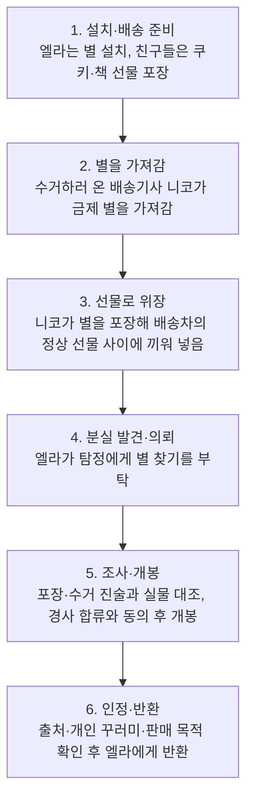

# 10 · B 사라진 크리스마스트리의 별 — 금제 별 절도안 전체 대본

**L1-05 현재진행형 · 2단계 대본 사용자 검토 대기 · 개발 미인계.** [장면별 기획](case-10-christmas-star.html) · [수리 A안 백업](case-10-christmas-star-repair.html) · [포장 B안 백업](case-10-christmas-star-outline.html#plan-b)

사용자 요청으로 진짜 금으로 만든 별을 훔쳐 선물처럼 포장해 반출하려는 사건을 작성한다. **별 모양 물건은 도난당한 실제 금제 별 장식 하나만 나온다. 전구·전선·배터리는 없다.** 금색 칠을 한 물건이나 조명이 아니다. 메이는 쿠키, 벤은 책 선물을 포장하고, 배송기사 니코는 정상적인 선물을 수거하면서 금제 별을 자기 선물처럼 위장한다. 기존 수리 A안과 포장 착오 B안은 백업으로 보존한다.

사용자 결정은 여러 동물이 크리스마스 선물을 포장하고 그 사이의 마을 배송기사가 금제 별을 선물인 척 포장해 훔쳐가는 설정이다. 기존 니코를 그 배송기사로 배정한 것과 개별 대사·단서·장소 구성은 기획자 제안이다. 그림·음성은 생성하지 않았고 앱 사건 번호는 지정하지 않는다.

## 1. 제작자용 진실·행동 이유

### 사건 흐름도

제작자용 진상 요약이다. 플레이어는 조사와 심문을 거쳐 아래 사실을 알게 된다.

조사 시점의 작업: **엘라 — 입구 안내 / 메이 — 쿠키 포장·리본 묶기 / 벤 — 책 포장·배송 라벨 부착 / 니코 — 선물 수거·금제 별을 개인 선물로 위장.**

의뢰인은 엘라다. 해결할 의문은 **어느 꾸러미를 확인해야 하며, 별을 누가 어떤 목적으로 가져갔는가**다. 처음부터 절도나 후보를 확정하지 않는다.

1. 별은 마을이 해마다 쓰는 귀중한 금제 장식이다. 아래에 나무 꼭대기에 끼우는 짧은 관과 둥근 구멍이 있다. 속이 빈 금제 장식으로 디자인하며 전기 부품은 넣지 않는다. 평소에는 잠가 보관한다.
2. 엘라가 설치 직전에 천막 옆 준비대에서 보관함을 연다. 입구의 어린 관람객을 잠깐 돕는 사이 별이 사라진다. 평소에 금제 별을 공공 탁자에 방치하는 설정은 아니다. 엘라는 재질·마을 소유·형태를 알고 있지만 별 사진을 미리 찍지 않는다. 준비 과정에서 알게 된 메이의 앞쪽 포장대는 입구에서도 보이나 천막 안쪽의 벤과 배송차 적재함은 보이지 않는다.
3. 공동 선물 포장 천막에서 메이는 쿠키 선물에 리본을 묶고, 벤은 책을 포장해 배송 라벨을 붙인다. 둘은 자신이 준비하는 물건과 지금 보이는 수거 작업만 알고 별이 사라지는 순간은 보지 못했다.
4. 니코는 마을 곳곳에 선물을 배송하는 기사다. 정상적인 수거를 위해 천막에 드나들던 중 열린 보관함에서 별을 가져간다. 팔 목적으로 보관함 옆의 공용 포장지로 별을 자기 선물처럼 싼다. 보관함 뚜껑을 닫고 꾸러미를 배송차의 정상적인 선물들 사이에 둔다. 공용 포장지 조각이 보관함 뚜껑 틈에 남지만 여러 친구가 쓰는 종이여서 그것만으로 특정인을 지목할 수 없다.
5. 니코는 차의 열린 적재함 앞에서 마지막 포장을 봉하면서 나머지 선물을 수거한다. 아직 천막의 선물이 모두 준비되지 않아 출발하지 않는다. 긴 꾸러미의 한쪽 끝은 덜 감겨 관 일부가 보인다. 탐정이 오는 순간 범행을 중단하고 도주하는 설정이나 자동 출발·시간제한은 없다. 별을 새로 만드는 인물도 없다.
6. 엘라가 보관함을 다시 열어 별이 없음을 확인하고 탐정에게 부탁한다. 어린 친구들을 안내 중이어서 직접 여러 장소를 돌 수 없다. 탐정이 현장에 있어 도움을 부탁하는 규모이며 연락 수단이 전부 불가능하다고 설정하지 않는다.
7. 탐정은 현재 작업·내용물 주장과 보관함·꾸러미를 비교해 확인할 상자를 좁힌다. 귀중품 관련 꾸러미 확인을 돕도록 경사를 부른 뒤 니코에게 개봉 동의를 구한다. 이때 절도 확정·체포를 선언하지 않는다.
8. 실제 물건과 장난감 주장을 대조하고 탐정이 출처·허락·목적을 묻는다. 니코가 보관함에서 가져갔고 팔려고 숨긴다고 인정한다. 경사는 현장 보존·동석·후속 처리를 맡고 탐정은 별을 엘라에게 반환한다.

유일한 혼동 장치는 **비슷해 보이는 선물 포장**이다. 종·성격·옷 색은 정답 근거가 아니다. 메이의 쿠키와 벤의 책은 현재 조사 물건을 구분할 뿐 과거 행동 전체의 알리바이가 아니다. 배송기사가 남의 선물을 운반하는 것은 정상 업무이므로 배송차에 물건이 있다는 사실만으로 범인이 되지 않는다. 니코가 자기 것이라고 한 긴 꾸러미의 내용·출처·무허락 반출·판매 목적을 확인한다. 사진 한 장이나 작업이 다르다는 이유로 범행을 확정하지 않는다.

## 2. 장면별 스토리보드

### 장면 0 · 준비

기존 열쇠 카드로 현재진행형의 긍정·부정·확인·행동 질문을 준비한다. 예문은 8절을 쓴다. 자기소개 전에는 이름을 표시하지 않고 질문·단서 개수는 플레이 화면에 표시하지 않는다.

### 장면 1 · 트리 광장 — 의뢰와 실제 금제 별

이름 없는 사슴으로 만난 뒤 자기소개를 듣는다. e0만 첫 선택지로 표시하고 받아 적은 뒤 e1·e2가 열린다. e3는 e2에서 탁자 위치를 기록한 뒤 열린다. 엘라는 자신이 아는 특징과 마지막 위치만 답한다. 금이라는 재질은 진술로 듣는다.

- **ella:hello · 엘라 · 자동**
  - Hi, I'm Ella. Have you got a moment?
  - 안녕! 난 엘라야. 잠깐 시간 있어?

#### ella:e0 · 엘라

- **질문 선택지**: How can I help?
- 해석: 어떻게 도와줄까?
- **대답**: Our tree's star is missing. Can you help me find it?
- 해석: 우리 트리의 별이 없어졌어. 찾는 걸 도와줄래?
- **노트**: “Our tree's [star] is [missing]. Can you help me find it?”
- **보기**: star · string · missing · shining
- 조건: 인사 뒤 혼자 표시
- 채점 뒤: e1·e2. e3는 e2 기록 뒤

#### ella:e1 · 엘라

- **질문 선택지**: What does the star look like?
- 해석: 별은 어떻게 생겼어?
- **대답**: It's our town's star. It's real gold, with a round hole at the bottom.
- 해석: 우리 마을의 별이야. 진짜 금으로 되어 있고 아래쪽에 둥근 구멍이 있어.
- **노트**: “It's our town's star. It's real [gold], with a round [hole] at the [bottom].”
- **보기**: gold · glass · hole · handle · bottom · top
- 조건: e0 기록 뒤
- 채점 뒤: 재질·소유 배경·구조 기록. 사진으로 금을 판별하지 않음

#### ella:e2 · 엘라

- **질문 선택지**: Where did you leave it?
- 해석: 어디에 두었어?
- **대답**: I left it in the case on the table by the gift tent.
- 해석: 선물 포장 천막 옆 탁자의 보관함에 두었어.
- **노트**: “I left it in the [case] on the [table] by the [gift tent].”
- **보기**: case · vase · table · chair · gift tent · van
- 조건: e0 기록 뒤
- 채점 뒤: 보관함 조사·c-case 촬영, 공동 선물 포장 천막

#### ella:e3 · 엘라

- **질문 선택지**: Who is working near the table?
- 해석: 탁자 근처에서 누가 일하고 있어?
- **대답**: Mae is wrapping gifts in the gift tent. I can't see the others.
- 해석: 메이가 선물 포장 천막에서 선물을 포장하고 있어. 다른 친구들은 보이지 않아.
- **노트**: “Mae is [wrapping] [gifts] in the gift tent. I can't see the others.”
- **보기**: wrapping · fixing · gifts · tools
- 조건: e2의 탁자 위치를 기록한 뒤
- 채점 뒤: 공동 선물 포장 천막·이름 없는 친구. 메이 이름 표시는 본인 인사 뒤

### 장면 2 · 준비대의 보관함

e2 기록 뒤 c-case를 직접 촬영한다. 빈 자리와 흔한 포장지 조각을 본다. 엘라는 질문받은 메이의 보이는 작업만 답한다. 그 밖의 후보나 행선지는 추측하지 않는다.

관찰: **An empty case. Wrapping paper is under the lid. / 빈 보관함이야. 뚜껑 아래에 포장지가 있어.**

- **det:paper-thought · 탐정 · 생각**
  - I should ask about the wrapped gifts in the tent.
  - 천막에서 포장하는 선물에 관해 물어봐야겠어.

- **move:gift · 이동 · 이동 버튼**
  - Go to the Gift Tent.
  - 선물 포장 천막으로 가기

### 장면 3 · 선물 포장 천막 — 메이의 쿠키 선물

메이는 동그란 쿠키를 선물 상자에 담고 리본을 묶는다. 탐정이 온 이유를 밝힌 뒤 무엇을 포장하는지 묻고 리본 작업으로 이어 간다. 메이의 선물에는 별 모양 물건이나 별 무늬가 없다.

- **mae:hello · 메이 · 자동**
  - Welcome! I'm Mae.
  - 어서 와! 난 메이야.

- **det:mae-intro · 탐정 · 자동**
  - I'm helping Ella find a missing star.
  - 엘라가 없어진 별을 찾는 걸 돕고 있어.

- **mae:ready · 메이 · 자동**
  - Oh! What would you like to know?
  - 아! 뭐가 궁금해?

#### mae:m1 · 메이

- **질문 선택지**: What are you wrapping?
- 해석: 무엇을 포장하고 있어?
- **대답**: I'm wrapping cookies. They're gifts for the children.
- 해석: 쿠키를 포장하고 있어. 어린 친구들에게 줄 선물이야.
- **노트**: “I'm [wrapping] [cookies]. They're gifts for the children.”
- **보기**: wrapping · painting · cookies · toys
- 조건: 공동 선물 포장 천막 발견·메이 인사 뒤 첫 질문
- 채점 뒤: m2·m3

#### mae:m2 · 메이

- **질문 선택지**: Are you tying ribbons around the boxes?
- 해석: 상자에 리본을 묶고 있어?
- **대답**: Yes, I'm tying the ribbons to keep the boxes closed.
- 해석: 응, 상자가 열리지 않게 리본을 묶고 있어.
- **노트**: “Yes, I'm [tying] the [ribbons] to keep the boxes closed.”
- **보기**: tying · drying · ribbons · cookies
- 조건: m1 기록 뒤
- 채점 뒤: 현재 작업 기록

#### mae:m3 · 메이

- **질문 선택지**: Can I see the cookies?
- 해석: 쿠키를 봐도 돼?
- **대답**: Sure. They're round, with chocolate on the top.
- 해석: 물론이지. 동그랗고 위쪽에 초콜릿이 있어.
- **노트**: “Sure. They're [round], with [chocolate] on the [top].”
- **보기**: round · flat · chocolate · paper · top · bottom
- 조건: m1 기록 뒤
- 채점 뒤: c-cookies 촬영 허락

m3 기록 뒤 c-cookies를 촬영한다. 같은 천막 안쪽에는 벤이 책 선물을 포장한다. 천막 발견으로 두 인물을 만날 수 있고 각각 자기소개 뒤 이름이 표시된다. 메이와 벤은 어느 쪽부터 조사해도 된다. 두 사람 사이에 별도 장소 이동은 없다.

### 장면 4 · 같은 선물 포장 천막 — 벤의 책 선물

벤은 책을 포장하고 배송 라벨을 붙인다. b1의 These는 눈앞의 책들을 가리킨다. b2의 too는 메이의 리본이 같은 천막에 보이는 상황에 맞춘다. 메이를 먼저 만나지 않아도 리본 작업이 보인다. 천막 옆 출구로 수거 중인 니코와 배송차가 보이지만 적재함 안 물건의 세부는 보이지 않는다.

- **ben:hello · 벤 · 자동**
  - Hello! I'm Ben. Getting ready for Christmas?
  - 안녕! 난 벤이야. 크리스마스 준비 중이야?

- **det:ben-intro · 탐정 · 자동**
  - I'm looking for the star for the big tree.
  - 큰 트리에 쓸 별을 찾고 있어.

#### ben:b1 · 벤

- **질문 선택지**: What are you doing?
- 해석: 뭐 하고 있어?
- **대답**: I'm wrapping books. These are gifts for the children.
- 해석: 책을 포장하고 있어. 어린 친구들에게 줄 선물이야.
- **노트**: “I'm [wrapping] [books]. These are gifts for the children.”
- **보기**: wrapping · carrying · books · cookies
- 조건: 공동 포장 천막 발견·벤 인사 뒤 첫 질문
- 채점 뒤: b2·b3·b4

#### ben:b2 · 벤

- **질문 선택지**: Are you using ribbons too?
- 해석: 너도 리본을 쓰고 있어?
- **대답**: No, I'm not using ribbons. I'm putting labels on the boxes.
- 해석: 아니, 리본을 쓰는 게 아니야. 상자에 배송 라벨을 붙이고 있어.
- **노트**: “No, I'm [not] using ribbons. I'm putting [labels] on the [boxes].”
- **보기**: not · now · labels · ribbons · boxes · bags
- 조건: b1 기록 뒤
- 채점 뒤: 현재 작업 기록

#### ben:b3 · 벤

- **질문 선택지**: Who is collecting the gifts?
- 해석: 선물은 누가 수거하고 있어?
- **대답**: Nico is collecting gifts by his van outside the tent.
- 해석: 니코가 천막 밖 자기 배송차 옆에서 선물을 수거하고 있어.
- **노트**: “[Nico] is collecting gifts by his [van] [outside] the tent.”
- **보기**: Nico · Mae · van · tent · outside · inside
- 조건: b1 기록 뒤
- 채점 뒤: 배송차 앞·이름 없는 펭귄. 이름 표시는 본인 인사 뒤

#### ben:b4 · 벤

- **질문 선택지**: Can I look at the books?
- 해석: 책들을 봐도 돼?
- **대답**: Sure. The books have hard covers. You can take a photo.
- 해석: 물론이지. 책들은 단단한 표지로 되어 있어. 사진을 찍어도 돼.
- **노트**: “Sure. The [books] have hard [covers]. You can take a photo.”
- **보기**: books · boxes · covers · cookies
- 조건: b1 기록 뒤
- 채점 뒤: c-books 촬영 허락. 다른 꾸러미 전체를 보증하는 말이 아님

b4 기록 뒤 c-books를 촬영한다. b3는 지금 보이는 수거 작업·배송차 위치다. 선물이 배송 라벨과 상자에 모이는 모습을 본 뒤 수거하는 친구를 묻는다. 벤이 절도 순간을 봤다거나 모든 출입을 감시했다고 바꾸지 않는다. 니코 이름을 기록해도 이름 표시는 본인 자기소개 뒤다.

- **det:van-thought · 탐정 · 생각**
  - I should ask Nico about the deliveries.
  - 니코에게 배송에 관해 물어봐야겠어.

- **move:van · 이동 · 이동 버튼**
  - Go to the Delivery Van.
  - 배송차 앞으로 가기

### 장면 5 · 배송차 앞 — 배송기사 니코의 개인 선물 주장

니코는 열린 배송차 적재함 앞에서 긴 꾸러미의 포장을 마무리한다. 인사에서는 이름과 짧은 반응만 하고 n1의 대답으로 배송기사라는 역할·마을 전체 선물 수거를 알린다. n2의 that box는 조금 떨어져 적재함 가장자리에 놓인 긴 상자다. n3에서 다른 이의 배송 물건이 아니라 자기 친구에게 줄 선물이라고 주장한다. 내용물은 검증 전 진술이며 받아쓰기 정답이 곧 사실 판정은 아니다.

- **nico:hello · 니코 · 자동**
  - Hi there. I'm Nico. What brings you here?
  - 안녕. 난 니코야. 무슨 일이야?

- **det:nico-intro · 탐정 · 자동**
  - I'm helping Ella find a missing star.
  - 엘라가 없어진 별을 찾는 걸 돕고 있어.

#### nico:n1 · 니코

- **질문 선택지**: What are you doing?
- 해석: 뭐 하고 있어?
- **대답**: I'm the delivery driver. I'm collecting gifts for the whole village.
- 해석: 난 마을 배송기사야. 마을 곳곳에 전할 선물을 수거하고 있어.
- **노트**: “I'm the delivery driver. I'm [collecting] [gifts] for the whole village.”
- **보기**: collecting · carrying · gifts · tools
- 조건: 배송차 앞 발견·니코 인사 뒤 첫 질문
- 채점 뒤: n2·n4. n3은 n2 기록 뒤

#### nico:n2 · 니코

- **질문 선택지**: Are you opening that box?
- 해석: 저 상자를 열고 있어?
- **대답**: No, I'm not opening it. I'm sealing the box for delivery.
- 해석: 아니, 여는 게 아니야. 배달하려고 상자를 봉하고 있어.
- **노트**: “No, I'm [not] opening it. I'm [sealing] the [box] for delivery.”
- **보기**: not · now · sealing · opening · box · bag
- 조건: n1 기록 뒤
- 채점 뒤: 포장 내용물에 관한 니코 주장 기록. 사실로 확정하지 않음

#### nico:n3 · 니코

- **질문 선택지**: Is the long box yours?
- 해석: 긴 상자는 네 거야?
- **대답**: Yes. I'm wrapping a wooden toy for a friend.
- 해석: 응. 친구에게 줄 나무 장난감을 포장하고 있어.
- **노트**: “Yes. I'm [wrapping] a [wooden] [toy] for a friend.”
- **보기**: wrapping · carrying · wooden · golden · toy · tool
- 조건: n2 기록 뒤
- 채점 뒤: 개인 꾸러미·내용물 주장 추가 기록

#### nico:n4 · 니코

- **질문 선택지**: Can I look at the boxes in your van?
- 해석: 배송차에 있는 상자들을 봐도 돼?
- **대답**: Yes. You can look at the boxes. Please leave them there.
- 해석: 응. 상자들을 봐도 돼. 그대로 두고 가 줘.
- **노트**: “Yes. You can look at the [boxes]. Please leave them [there].”
- **보기**: boxes · books · there · here
- 조건: n1 기록 뒤
- 채점 뒤: c-parcel 겉면 촬영 허락. 개봉·습득 허락이 아님

n4 허락 뒤 겉에서 이미 보이는 틈만 c-parcel로 찍는다. 종이를 들추거나 개봉하지 않는다. 관·구멍 일부는 보여도 별 전체·재질·소유·범행은 확정하지 않는다.

- **det:compare-thought · 탐정 · 생각**
  - I should compare the notes and the photos.
  - 기록과 사진을 비교해 봐야겠어.

행동 선택지: **Compare the clues. / 단서 비교하기**. 면담 15개와 개봉 전 사진 c-case·c-cookies·c-books·c-parcel이 모이면 추리를 연다. 개수는 제작 조건이며 플레이 화면에는 표시하지 않는다.

### 장면 6 · 추리 — 확인할 상자 선택

7절의 6문항을 푼다. 첫 결론은 누구에게 상자를 열어 달라고 할지다. 아직 금제 별이나 범인을 찾았다고 단정하지 않는다. 완료 뒤 **Check the parcel. / 꾸러미 확인하기**를 고른다. 배송차 앞에 머물며 전체 후보를 소집하지 않는다.

### 장면 7 · 경사 합류·개봉 동의

귀중한 마을 물건 관련 꾸러미 확인이므로 도움을 청한다. 신고 대사는 확인 요청이며 범행 확정이 아니다. 이 연락은 게임 안의 선택지다. 기다리기 선택 뒤 같은 배송차 앞에 경사가 합류한다. 실제 대기 시간·순찰 이동을 요구하지 않는다.

- **det:call-thought · 탐정 · 생각**
  - I should ask an officer to help check the parcel.
  - 경사에게 꾸러미 확인을 도와 달라고 해야겠어.

- **call:officer · 행동 · 연락 선택지**
  - Call an officer.
  - 경사에게 연락하기

- **det:call · 탐정 · 자동**
  - I need help checking a parcel for Ella's missing star.
  - 엘라의 없어진 별을 찾으려면 꾸러미를 확인하는 데 도움이 필요해.

- **badger:phone · 응답한 목소리 · 자동**
  - Keep the box there. Wait for me.
  - 상자는 거기에 둬. 내가 갈 때까지 기다려.

- **wait:officer · 행동 · 다음 장면 선택지**
  - Wait for the officer.
  - 경사 기다리기

- **badger:hello · 경사 · 자동**
  - Hello, I'm Officer Badger. Please stay here.
  - 안녕. 난 오소리 경사야. 여기에 있어 줘.

- **det:open-q1 · 탐정 · 선택 질문**
  - Can you open the box?
  - 상자를 열어 줄래?

- **nico:open-a1 · 니코 · 자동**
  - I'm not hiding anything. It's just a toy.
  - 아무것도 숨기고 있지 않아. 그냥 장난감이야.

니코의 장난감 주장 뒤 c-parcel을 제시한다. e1·c-case도 함께 확인할 수 있다. 오답 반응: **That doesn't explain the hole. / 그건 구멍을 설명해 주지 않아.** 같은 단계로 돌아가며 정답을 자동 제시하지 않는다.

- **det:show-parcel · 탐정 · 사진 제시 뒤 선택 질문**
  - The hole matches Ella's description. Can you show me the toy?
  - 구멍이 엘라의 설명과 맞아. 장난감을 보여 줄래?

- **nico:open-a2 · 니코 · 자동**
  - All right. You can look inside.
  - 알겠어. 안을 봐도 돼.

- **open:box · 행동 · 조사 행동**
  - Look inside the box.
  - 상자 안 살펴보기

동의 뒤 확대 조사에서 전체를 보고 c-open을 직접 촬영한다. 관찰: **A star and a short tube. There is a round hole at the bottom. / 별과 짧은 관이야. 아래쪽에 둥근 구멍이 있어.** 사진은 성분 검사를 하지 않는다. 엘라 설명과 맞고 장난감 주장과 다른 물건을 확인한 상태이며 출처·허락·목적은 더 물어야 한다.

### 장면 8 · 탐정의 짧은 심문

c-open 촬영 뒤 문답이 열린다. 질문·증거 제시·추궁은 탐정이 하고 경사는 동석한다. 아래 질문은 모두 선택지이며 추가 받아쓰기는 없다.

- **det:origin-q · 탐정 · 선택 질문**
  - Where did the star come from?
  - 별은 어디서 난 거야?

- **nico:origin-a · 니코 · 자동**
  - It was a gift.
  - 선물이었어.

선물이었다는 주장에는 c-case를 제시하고 e1의 마을 소유 진술과 c-open의 구조를 대조한다. 사진 하나로 법적 유죄를 판정하지 않는다. 오답 반응: **That doesn't tell us where the star came from. / 그건 별이 어디서 왔는지 알려 주지 않아.** 이후 같은 주장으로 돌아간다.

- **det:permission-q · 탐정 · 증거 제시 뒤 선택 질문**
  - Did Ella give you the star?
  - 엘라가 별을 준 거야?

- **nico:admit · 니코 · 자동**
  - No. I took it from the case without asking.
  - 아니. 물어보지 않고 보관함에서 가져왔어.

- **det:motive-q · 탐정 · 선택 질문**
  - Why are you taking it with you?
  - 왜 그걸 가져가고 있어?

- **nico:motive · 니코 · 자동**
  - I'm hiding it among the gifts. I want to sell it.
  - 선물들 사이에 숨기고 있어. 팔려고 해.

- **badger:keep · 경사 · 자동**
  - I'll stay with Nico. Take the star back to Ella.
  - 난 니코와 함께 있을게. 별은 엘라에게 돌려줘.

- **det:take-q · 탐정 · 선택 질문**
  - May I take the star back?
  - 별을 돌려주러 가져가도 돼?

- **badger:take-a · 경사 · 자동**
  - Yes. Take it back. I'll stay here.
  - 응. 돌려줘. 난 여기 있을게.

- **take:star · 행동 · 소지품 받기**
  - Take the star.
  - 별 받기

보관함에서 무허락으로 가져갔고 팔려고 숨긴다는 진술을 모두 들은 뒤 절도로 확정한다. 경사 허락 뒤 별 받기를 고르면 소지품 **별 장식**을 얻는다. 경사는 니코와 남는다. 현실의 강제 수색·체포 법률 규칙을 게임에서 판정하지 않는다.

- **det:return-thought · 탐정 · 생각**
  - I should take the star back to Ella.
  - 별을 엘라에게 돌려줘야겠어.

- **move:tree · 이동 · 이동 버튼**
  - Return to the Tree Square.
  - 트리 광장으로 돌아가기

### 장면 9 · 트리 광장 — 확인·보고·반환

탐정만 돌아온다. 소지품 별을 손에 든 상태에서 this로 확인한다. 엘라가 실제 물건을 확인하고 결과를 들은 뒤 별을 건넨다.

- **ella:return · 엘라 · 자동**
  - Oh, you're back!
  - 아, 돌아왔네!

- **det:confirm-owner · 탐정 · 선택 질문**
  - Is this the town's star?
  - 이게 마을의 별이야?

- **ella:confirm-owner · 엘라 · 자동**
  - Yes. It's our gold star, with the hole at the bottom.
  - 응. 아래쪽에 구멍이 있는 우리 금제 별이야.

- **det:report · 탐정 · 보고 선택지**
  - Nico took it. The officer is with him now.
  - 니코가 가져갔어. 지금 경사가 함께 있어.

- **ella:thanks · 엘라 · 자동**
  - Thank you for finding it. Please give it to me.
  - 찾아줘서 고마워. 나에게 건네줘.

- **give:star · 행동 · 소지품 건네기**
  - Give the star to Ella.
  - 엘라에게 별 건네기

- **ella:end · 엘라 · 자동**
  - Now we can put it on the tree.
  - 이제 트리에 달 수 있겠어.

건네기 완료로 소지품에서 빠진다. 높은 트리에 올라가는 동작은 요구하지 않는다. 마무리 정지 그림을 만든다면 별 자체의 발광·전구·전선은 넣지 않는다. 해명하지 않고 남긴 실마리는 없다.

## 3. 사진·실물·증거의 역할

### c-case · 보관함

| 항목 | 내용 |
|---|---|
| 열리는 때 | e2 기록 뒤 광장 가장자리의 선물 포장 천막 옆 준비대 조사 |
| 촬영 그림 | 열린 보관함의 빈 별 모양 받침과 아래쪽 짧은 관을 받치는 홈. 뚜껑 아래에 흔한 포장지 작은 조각이 끼어 있음. 이름·금·범행·담당자 표시 없음. |
| 관찰 음성 | An empty case. Wrapping paper is under the lid. |
| 해석 | 빈 보관함이야. 뚜껑 아래에 포장지가 있어. |
| 쓰임 | e1·e2와 연결해 원래 물건이 놓였던 자리와 포장 가능성을 조사. 종이는 천막 공용이라 소유자·범인을 특정하지 않음. |

### c-cookies · 쿠키 선물

| 항목 | 내용 |
|---|---|
| 열리는 때 | 같은 선물 포장 천막에서 mae:m3 기록 뒤 직접 촬영 |
| 촬영 그림 | 열린 선물 상자에 동그란 쿠키와 초콜릿 윗면이 보임. 평범한 리본과 포장지. 사람·작업 동작·소유 이름·별 모양 쿠키나 무늬는 없음. |
| 관찰 음성 | Round cookies, with chocolate on the top. |
| 해석 | 위쪽에 초콜릿이 있는 동그란 쿠키들이야. |
| 쓰임 | 메이가 포장하는 실제 물건과 m1·m2·m3을 비교. 금제 별과 같은 별 모양을 반복하지 않으며 과거 행동 전체의 알리바이로 삼지 않음. |

### c-books · 책 선물

| 항목 | 내용 |
|---|---|
| 열리는 때 | 선물 포장 천막에서 ben:b4 기록 뒤 직접 촬영 |
| 촬영 그림 | 열린 포장지 사이의 책과 단단한 표지. 옆에 배송 라벨이 있으나 수취인 이름·직업·범인 정보를 쓰지 않음. 별 모양 소품·무늬 없음. |
| 관찰 음성 | Books with hard covers, and delivery labels. |
| 해석 | 단단한 표지의 책들과 배송 라벨이야. |
| 쓰임 | 벤이 포장하는 실제 물건과 b1·b2·b4를 대조. 다른 꾸러미 전체의 내용물이나 과거 행동을 보증하지 않음. |

### c-parcel · 꾸러미

| 항목 | 내용 |
|---|---|
| 열리는 때 | 배송차 앞에서 nico:n4 기록 뒤 허용한 겉면만 직접 촬영 |
| 촬영 그림 | 열린 배송차의 다른 선물들 사이에 놓인 긴 개인 꾸러미. 아직 봉함하지 않은 틈으로 짧은 관과 둥근 구멍만 보임. 별 전체·진짜 금 판정·주인 이름은 보이지 않음. |
| 관찰 음성 | A short tube with a round hole under the paper. |
| 해석 | 종이 아래에 둥근 구멍이 있는 짧은 관이 보여. |
| 쓰임 | e1·c-case·n3의 개인 나무 장난감 주장과 대조해 개봉을 요청할 이유. 배송기사의 소지만으로 절도를 확정하지 않음. |

### c-open · 상자 안

| 항목 | 내용 |
|---|---|
| 열리는 때 | 추리 완료→사진·주장 대조→니코의 개봉 동의→안을 보고 직접 촬영 |
| 촬영 그림 | 상자 안의 별 장식 전체와 아래쪽 연결 관. 인물·자백 글자·범인 표시 없음. 사진은 금빛 외관을 기록할 뿐 성분을 판정하지 않음. |
| 관찰 음성 | A star and a short tube. There is a round hole at the bottom. |
| 해석 | 별과 짧은 관이야. 아래쪽에 둥근 구멍이 있어. |
| 쓰임 | e1·c-case와 구조 대조, n2·n3 주장과 실제 물건 대조, 이후 출처·허락·목적을 심문. 소지품 습득은 경사 허락 뒤 별도. |

필수 사진은 5장이다. 추리 전 4장과 개봉 뒤 1장이며 사전 별 사진은 없다. 증거 제목에 주인·범인·진짜 금 판정을 넣지 않는다. c-books는 실제 책과 라벨 사진이며 특정 인물의 알리바이·배송 경로를 증명하지 않는다.

물건·흔적은 사진, 작업·내용물 주장은 질문과 받아쓰기로 얻는다. 재질·마을 소유는 엘라의 말, 출처·판매 목적은 니코의 심문에서 듣는다. 금빛 사진으로 진위를 판정하지 않는다. 소지품은 별 장식 1종이고 경사 허락·수령 뒤 생겨 엘라에게 직접 건넨다. 상자·종이·쿠키·책을 가져가지 않는다.

## 4. 배경과 선택 클릭 TTS

장소당 2개·총6개다. 미재생이어도 완료할 수 있으며 사람의 진술·정답을 대신하지 않는다.

| ID | 장소 | 물건 | 영어 | 반말 해석 |
|---|---|---|---|---|
| tree:bell | 트리 광장 | 안내대 종 | A small bell. | 작은 종이야. |
| tree:ornaments | 트리 광장 | 낮은 가지 장식 | Round ornaments. | 둥근 장식 공들이야. |
| gift:scissors | 선물 포장 천막 | 가위 | A pair of scissors. | 가위 한 자루야. |
| gift:ribbon | 선물 포장 천막 | 리본 바구니 | A basket of ribbon. | 리본이 든 바구니야. |
| van:cart | 배송차 앞 | 운반 손수레 | A handcart. | 손수레야. |
| van:empty-box | 배송차 앞 | 빈 상자 | An empty box. | 빈 상자야. |

## 5. 한눈에·인물·장소

엘라 의뢰 → 보관함 → 공동 천막의 쿠키·책 포장 조사 → 선물 수거 중인 배송기사 → 개인 꾸러미 주장과 구조 비교 → 경사 합류·동의·개봉 → 탐정 심문 → 엘라 확인·반환이다.

| 인물 | 재사용·신규 | 위치 | 아는 범위·역할 |
|---|---|---|---|
| 엘라 · 사슴 | 우산 인물 재사용 | 트리 광장 | 금제 별의 재질·소유·구조·마지막 위치와 현재 보이는 메이의 작업만 앎 |
| 메이 · 생쥐 | 신규 | 선물 포장 천막 앞쪽 | 자신이 포장하는 쿠키·리본 작업만 설명 |
| 벤 · 비버 | 소풍 인물 재사용 | 같은 선물 포장 천막 안쪽 | 책 포장·배송 라벨 부착. 천막 밖에서 선물을 수거하는 친구만 봄 |
| 니코 · 펭귄 | 신규 | 천막 밖 배송차 앞 | 마을 배송기사. 정상 선물을 수거하며 금제 별을 자기 선물로 위장 |
| 오소리 경사 | 기존 재사용 | 연락 뒤 같은 배송차 앞 | 동석·현장 보존·후속 처리. 탐정 대신 심문하지 않음 |

NPC5명·장소3곳이다. 면담은4명이고 경사는 결말에만 등장한다. 경사의 받아쓰기0개는 역할을 억지로 학습량으로 늘리지 않기 위한 예외다. 재사용3명·신규2명이며 탐정은 기존 다람쥐다.

광장 준비대는 천막 옆 경계다. 메이·벤은 공동 천막의 서로 다른 포장대, 니코는 바로 밖 배송차 앞에 배치한다. 천막에서 수거 동작은 보이지만 적재함 안의 관 세부는 차 앞으로 가야 보인다. 광장 입구의 엘라는 앞쪽 포장대의 메이만 보고 벤의 작업대·배송차 적재함·보관함 안은 못 본다. 인물 이름은 자기소개 뒤에 표시하고 의상·색·종을 단서로 쓰지 않는다.

## 6. 질문·해금·진행 조건

| 기록 | 조건 | 기록 뒤 |
|---|---|---|
| ella:e0 | 인사 뒤 혼자 표시 | e1·e2. e3는 e2 기록 뒤 |
| ella:e1 | e0 기록 뒤 | 재질·소유 배경·구조 기록. 사진으로 금을 판별하지 않음 |
| ella:e2 | e0 기록 뒤 | 보관함 조사·c-case 촬영, 공동 선물 포장 천막 |
| ella:e3 | e2의 탁자 위치를 기록한 뒤 | 공동 선물 포장 천막·이름 없는 친구. 메이 이름 표시는 본인 인사 뒤 |
| mae:m1 | 공동 선물 포장 천막 발견·메이 인사 뒤 첫 질문 | m2·m3 |
| mae:m2 | m1 기록 뒤 | 현재 작업 기록 |
| mae:m3 | m1 기록 뒤 | c-cookies 촬영 허락 |
| ben:b1 | 공동 포장 천막 발견·벤 인사 뒤 첫 질문 | b2·b3·b4 |
| ben:b2 | b1 기록 뒤 | 현재 작업 기록 |
| ben:b3 | b1 기록 뒤 | 배송차 앞·이름 없는 펭귄. 이름 표시는 본인 인사 뒤 |
| ben:b4 | b1 기록 뒤 | c-books 촬영 허락. 다른 꾸러미 전체를 보증하는 말이 아님 |
| nico:n1 | 배송차 앞 발견·니코 인사 뒤 첫 질문 | n2·n4. n3은 n2 기록 뒤 |
| nico:n2 | n1 기록 뒤 | 포장 내용물에 관한 니코 주장 기록. 사실로 확정하지 않음 |
| nico:n3 | n2 기록 뒤 | 개인 꾸러미·내용물 주장 추가 기록 |
| nico:n4 | n1 기록 뒤 | c-parcel 겉면 촬영 허락. 개봉·습득 허락이 아님 |

e2 기록으로 공동 선물 포장 천막을 발견하고 보관함은 별도 촬영한다. 천막 안 두 포장대는 함께 발견하며 b4로 책 촬영을 허락받고 b3 기록으로 배송차 앞을 발견한다. 모든 이동은 생각과 버튼으로 한다. 엘라 e3는 e2에서 말한 탁자를 가리키므로 e2 기록 뒤에만 열린다. 벤은 b1 뒤 b2·b3·b4, 니코는 n1 뒤 n2·n4와 n2 뒤 n3, 메이는 m1 뒤 m2·m3이다. 잠긴 후속 질문으로 첫 방문을 막지 않고 이미 기록한 답은 보존한다. 노트의 대명사는 원문 그대로다.

면담15개·개봉 전 사진4장 → 추리 → 경사 연락·합류 → 동의·개봉 → c-open → 심문 → 출처·허락·목적 인정 → 별 수령 → 엘라 확인·반환 순서다. 실제 장면에서는 경사가 합류한 뒤 개봉 동의를 구한다. 아직 듣지 않은 결론을 알림·이름표에 넣지 않는다.

## 7. 추리 6문항

사진에 작업 동작·이름을 캡션으로 쓰지 않는다. 니코의 내용물은 주장으로 표시하고, 두 답변 요약을 실제 한 문장인 것처럼 따옴표로 만들지 않는다. 완성 문장은 들은 범위의 요약이다. 질문·맞장구·힌트는 음성 대상이고 완성 문장 별도 음성은 가정하지 않는다.

### deduction:q1

| 항목 | 내용 |
|---|---|
| 질문 | What is Mae doing? |
| 해석 | 메이는 무엇을 하고 있어? |
| 완성 | Mae is [wrapping cookies]. |
| 해석 | 메이는 쿠키를 포장하고 있어. |
| 보기 | wrapping cookies · wrapping books · packing a wooden toy · helping at the gate · painting boxes · tying shoelaces |
| 맞장구 | The cookies are on her table. |
| 해석 | 쿠키는 메이의 탁자에 있어. |
| 힌트 | Listen to Mae's answers and look at the cookies. |
| 해석 | 메이의 대답을 듣고 쿠키를 봐. |
| 근거 | mae:m1·m2·m3 + c-cookies. 메이가 현재 포장하는 것은 쿠키라는 확인이며 과거 행동 전체의 알리바이는 아님 |

### deduction:q2

| 항목 | 내용 |
|---|---|
| 질문 | What is Ben doing? |
| 해석 | 벤은 무엇을 하고 있어? |
| 완성 | Ben is [wrapping books]. |
| 해석 | 벤은 책을 포장하고 있어. |
| 보기 | wrapping books · wrapping cookies · packing a wooden toy · carrying a gold star · painting boxes · tying ribbons |
| 맞장구 | He is putting labels on the boxes. |
| 해석 | 상자에는 배송 라벨을 붙이고 있어. |
| 힌트 | Listen to Ben's first two answers. |
| 해석 | 벤의 첫 두 대답을 들어 봐. |
| 근거 | ben:b1·b2 + c-books. 포장 중인 책과 라벨 작업을 확인할 뿐 과거 절도에 관한 알리바이로 쓰지 않음 |

### deduction:q3

| 항목 | 내용 |
|---|---|
| 질문 | What does Nico say is in his box? |
| 해석 | 니코는 상자에 무엇이 있다고 말해? |
| 완성 | Nico says he is wrapping [a wooden toy]. |
| 해석 | 니코는 나무 장난감을 포장하고 있다고 말해. |
| 보기 | a wooden toy · a box of cookies · a gold star · a book · a bag of tools · an empty case |
| 맞장구 | That's his description. We need to see inside. |
| 해석 | 니코의 설명이야. 안을 봐야 해. |
| 힌트 | Listen to Nico's answer about his own parcel. |
| 해석 | 니코의 개인 꾸러미에 대한 대답을 들어 봐. |
| 근거 | nico:n3의 자기 꾸러미·나무 장난감 주장을 간접 문장으로 정리. 실제 내용물·소유는 개봉 전 확정하지 않음 |

### deduction:q4

| 항목 | 내용 |
|---|---|
| 질문 | What is Ella's star made of? |
| 해석 | 엘라의 별은 무엇으로 되어 있어? |
| 완성 | Ella says the star is [real gold]. |
| 해석 | 엘라는 별이 진짜 금이라고 말해. |
| 보기 | real gold · paper · wood · glass · plastic · cloth |
| 맞장구 | A photo alone can't tell us that. |
| 해석 | 사진만으로는 그걸 알 수 없어. |
| 힌트 | Listen to Ella's description of the star. |
| 해석 | 엘라가 별을 설명한 대답을 들어 봐. |
| 근거 | ella:e1. 재질은 소유·관리자의 진술이며 금빛 사진으로 진위를 판정하지 않음 |

### deduction:q5

| 항목 | 내용 |
|---|---|
| 질문 | What can we see under the wrapping paper? |
| 해석 | 포장지 아래에 무엇이 보여? |
| 완성 | There is [a short tube with a round hole]. |
| 해석 | 둥근 구멍이 있는 짧은 관이 보여. |
| 보기 | a short tube with a round hole · a cookie with a chocolate top · a hard book cover · a roll of labels · an empty paper bag · a pair of scissors |
| 맞장구 | The shapes look the same. We need to see inside. |
| 해석 | 모양이 같아 보여. 안을 봐야 해. |
| 힌트 | Compare the parcel photo, the case, and Ella's words. |
| 해석 | 꾸러미 사진과 보관함, 엘라의 말을 비교해 봐. |
| 근거 | c-parcel + c-case + ella:e1. 관 모양은 가능성을 좁힐 뿐 별·금·절도를 확정하지 않음 |

### deduction:q6

| 항목 | 내용 |
|---|---|
| 질문 | Who should we ask to open the box? |
| 해석 | 누구에게 상자를 열어 달라고 해야 할까? |
| 완성 | We should ask [Nico] to open the box. |
| 해석 | 니코에게 상자를 열어 달라고 해야 해. |
| 보기 | Mae · Ben · Nico |
| 맞장구 | Let's ask to see what's inside. |
| 해석 | 안에 무엇이 있는지 보여 달라고 하자. |
| 힌트 | Compare the parcel photos and the notes about what's inside. |
| 해석 | 꾸러미 사진과 내용물에 관한 기록을 비교해 봐. |
| 근거 | 메이·벤이 보여 준 실제 선물과 니코의 개인 꾸러미 주장을 대조. 후보3명이며 현재 행동을 과거 범행의 알리바이로 쓰지 않음 |

공통 오답: **That doesn't match the notes. Let's listen again. / 기록과 맞지 않아. 다시 들어 보자.** 같은 문항을 유지한다. 동작은 대답을 다시 듣고 형태는 사진·설명을 비교하도록 안내한다. 힌트는 답이나 다음 결론을 먼저 말하지 않는다. 이 추리는 현재 확인할 꾸러미를 좁히는 단계이며 과거 행동 전체의 무죄·유죄를 판정하지 않는다.

## 8. 학습·복습·집계

새 의미 대조는 현재 하는 일과 하지 않는 일이다. 현재진행형 한 묶음 안에 긍정·부정·확인·행동 질문을 둔다. 재질은 It's real gold처럼 설명해 made of 수동태를 새로 도입하지 않는다. 물건 위치·소유는 기존 표현을 쓴다. 니코 문장의 문법이 맞아도 내용은 거짓일 수 있다.

| 들어야 할 대답 | 판단 |
|---|---|
| m1·m2 wrapping cookies / tying ribbons | 포장 대상과 리본 작업을 차례로 듣고 실제 물건과 대조 |
| b1·b2 wrapping books / not using ribbons / putting labels | 책 선물과 라벨 작업을 쿠키·리본 작업과 구별 |
| b3 Nico is collecting gifts … by his van | 현재 수거하는 친구와 배송차 위치로 다음 장소 발견 |
| n1·n2 collecting gifts / not opening / sealing | 배송 업무·상자를 여는지 봉하는지 구별. 과거 행위의 알리바이로 쓰지 않음 |
| n3 wrapping a wooden toy / Yes (yours) | 개인 선물이라는 주장과 관의 일부·개봉 뒤 실제 물건 대조 |
| e1 real gold / hole at the bottom | 사진 색이 아닌 엘라의 설명 사용 |
| e3 Mae is wrapping gifts | 직접 보이는 인물·작업을 듣고 메이에게 포장 대상을 질문 |
| 심문 hiding … want to sell | 포장의 실제 목적과 무허락 출처를 함께 확인 |

### 열쇠 형태·실제 복습 발화·사건 밖 예문

#### 긍정 · be + -ing

지금 하는 일을 말한다.

실제 발화: **I'm wrapping cookies. They're gifts for the children.** · mae:m1

| 사건 밖 예문 | 반말 해석 |
|---|---|
| I'm reading a book. | 난 책을 읽고 있어. |
| She's washing a cup. | 그 애는 컵을 씻고 있어. |
| They're drawing maps. | 그 애들은 지도를 그리고 있어. |

#### 부정 · be not + -ing

not을 놓치면 반대 행동으로 기록한다.

실제 발화: **No, I'm not using ribbons. I'm putting labels on the boxes.** · ben:b2

| 사건 밖 예문 | 반말 해석 |
|---|---|
| I'm not sleeping. | 난 자고 있지 않아. |
| He isn't cooking. | 그 애는 요리하고 있지 않아. |
| We aren't running. | 우리는 달리고 있지 않아. |

#### 확인 · be + 주어 + -ing?

상대의 현재 행동을 확인한다. Are you로 물으면 자기 행동을 I am으로 답한다.

실제 발화: **Are you tying ribbons around the boxes?** · mae:m2 질문

| 사건 밖 예문 | 반말 해석 |
|---|---|
| Are you reading? | 너 읽고 있어? |
| Is she dancing? | 그 애는 춤추고 있어? |
| Are they swimming? | 그 애들은 수영하고 있어? |

#### 행동·대상 질문 · What + be + 주어 + -ing?

지금 하는 행동이나 포장하는 대상을 묻는다.

실제 발화: **What are you wrapping?** · mae:m1 질문

| 사건 밖 예문 | 반말 해석 |
|---|---|
| What are you reading? | 무엇을 읽고 있어? |
| What is he drawing? | 그 애는 무엇을 그리고 있어? |
| What are they carrying? | 그 애들은 무엇을 들고 있어? |

look for·put on·give back은 표현 목록이지 새 문법이 아니다. did·was·took는 마지막 위치·출처 확인·결말의 짧은 고정 설명에 쓴다. 과거 동선·과거진행 알리바이 학습으로 늘리지 않는다. 현재진행형을 듣지 않아도 사진만으로 답을 추측할 수 있는지는 실제 플레이로 확인해야 한다.

### 복습 단어

| 단어·어구 | 뜻 | 빈칸 출처 |
|---|---|---|
| gold | 금 · 여기서는 색이 아닌 재질 | ella:e1 |
| hole | 구멍 | ella:e1 |
| bottom | 아래쪽 | ella:e1 |
| case | 보관함 | ella:e2 |
| wrapping | 감싸 포장하고 있는 | ella:e3·mae:m1 |
| covers | 표지들 | ben:b4 |
| cookies | 쿠키들 | mae:m1 |
| round | 동그란 | mae:m3 |
| chocolate | 초콜릿 | mae:m3 |
| collecting | 수거하고 있는 | nico:n1 |
| labels | 라벨들 | ben:b2 |
| books | 책들 | ben:b1·b4 |
| van | 배송차 | ben:b3 |
| sealing | 봉하고 있는 | nico:n2 |
| toy | 장난감 | nico:n3 |
| wooden | 나무로 된 | nico:n3 |
| tying | 묶고 있는 | mae:m2 |
| ribbons | 리본들 | mae:m2 |

인물 이름은 단어 목록에서 제외한다. 추가 제안: tube / 관(c-parcel), hiding / 숨기고 있는(nico:open-a1·nico:motive)·sell / 팔다(nico:motive). 빈칸 목록과 구분하고 실제 대사를 출처로 붙인다.

해결 뒤 복습 요약: **Nico took the town's gold star. He hid it in a gift box to sell it. The detective found it and brought it back. / 니코가 마을의 금제 별을 가져갔어. 팔려고 선물 상자에 숨겼어. 탐정이 찾아서 돌려줬어.** 범인·피해자 표시는 복습에서만 쓰며 니코 기존 외형을 재사용하는 제안이다.

### 새 상황 확인·지연 복습

- 질문: **Are you washing the cup? / 컵을 씻고 있어?**
- 대답: **No, I'm not washing it. I'm drying it. / 아니, 씻는 게 아니야. 말리고 있어.**
- 확인: **What is the speaker doing? / 말하는 사람은 무엇을 하고 있어?**
- 보기: drying the cup · washing the cup · painting the cup · filling the cup · buying the cup · dropping the cup.
- 정답: **The speaker is drying the cup. / 말하는 사람은 컵을 말리고 있어.**
- 피드백: **Listen for “not washing” and “drying.” / “not washing”과 “drying”을 들어 봐.**
- 다른 날 질문: **Are you cutting the paper? / 종이를 자르고 있어?**
- 대답: **No, I'm not cutting it. I'm folding it. / 아니, 자르는 게 아니야. 접고 있어.**
- 확인: **What is the speaker doing? / 말하는 사람은 무엇을 하고 있어?**
- 보기: folding the paper · cutting the paper · drawing on the paper · gluing the paper · tearing the paper · carrying the paper.
- 정답: **The speaker is folding the paper. / 말하는 사람은 종이를 접고 있어.**

학생의 직접 표현은 새 그림을 보고 I'm …ing / I'm not …ing로 짧게 말하기다. 이 추가 활동의 실행·평가는 하지 않았다.

### 균형표·문서 집계

| 항목 | L1 기본 | 이번 대본 |
|---|---|---|
| NPC / 장소 | 4–5 / 3–4 | 5 / 3 · 면담4명·결말 경사1명 |
| 면담 / 빈칸 | 12–15 / 30–38 | 15 / 37 |
| 인물당 질문 | 2–5 | 엘라4·메이3·벤4·니코4. 경사0은 결말 역할 예외 |
| 빈칸 비중 | 한 명40% 이하 | 엘라10·메이7·벤10·니코10. 최대27.0% |
| 질문당 빈칸 | 1–3 | 2–3 |
| 대답 길이 | 평균8–12·최장18·3문장≤3 | 평균10.7·최장14단어·면담3문장2개/후속답변0개 |
| 필수 사진 | 3–5 | 5 · 추리 전4·개봉 뒤1 |
| 선택 클릭 TTS | 장소당2–3 | 각2 · 총6 |
| 추리 | 5–7 | 6 · 후보 보기3, 나머지6 |
| 결말 차례 | 2–3 | 3 · 합류/동의/개봉, 심문/수령, 확인/반환 |
| 열쇠 형태 | 각3회 이상·Q/A최소1 | 면담 긍정9·부정2·확인3·What질문3. 부정은 개봉 대답1회 추가로 기본3회 |
| 후속 선택 질문 | 별도 공개 | 결말 7개 · 연락·기다리기·조사·수령·건네기 행동/이동 버튼 별도 |

긍정9회는 I'm …ing 7회, ella:e3의 Mae is wrapping 1회, ben:b3의 Nico is collecting 1회다. 면담 부정은 ben:b2·nico:n2의2회이며 개봉 요청에 니코가 I'm not hiding anything.이라고 답하는 nico:open-a1까지 기본3회다. 부정한 뒤 숨긴다고 인정하는 사건상 진술이다. 확인 질문은 메이의 리본 묶기·벤의 리본 사용·니코의 상자 개봉 여부3회, What 질문은 메이의 포장 대상·벤과 니코의 현재 행동3회다. 각 형태의 실제 복습 문장이 면담에 있다. missing은 형용사라 현재진행으로 세지 않는다. 예습·힌트·보기·완성 문장·선택 TTS·복습·다시 듣기는 기본 횟수에서 제외했다.

경사는 경찰이 필요한 절도 확인의 결말 인물이어서 받아쓰기를 추가하지 않았다. 확인·개봉 증거가 늘어 사진은 수리 A안의2장보다 늘었다. 발화량·길이는 L1 범위이고 입력 도움·직접 표현 분량은 높이지 않았다. 실제 학생 난도는 검증 전이다.

| 비교 | 소풍 가방 · 인계 MD | 우산 · 인계 MD | 금제 별 |
|---|---|---|---|
| NPC / 장소 | 6 / 5 | 4 / 3 | 5 / 3 |
| 면담 / 빈칸 | 15 / 39 | 14 / 33 | 15 / 37 |
| 사진 | 필수2 | 필수5·선택1 | 필수5 |
| 추리 | 9 | 5 | 6 |

기준 사건 수치는 이전 인계 MD 질문표·사진표를 읽어 센 값으로 실제 게임 소요 시간·학습 난도 비교 검증은 아니다. 인계 설계서는 고치지 않는다.

## 9. 제작 범위·검토할 지점

같은 엔진·화면의 질문/받아쓰기·사진·확대 조사·추리·증거 제시 심문·소지품 받기/건네기를 사용한다. 전용 화면·코드 구현 방식은 정하지 않는다.

| 장면 | 신규 그림·녹음 | 재사용 제안 | 동작·지원 확인 |
|---|---|---|---|
| 광장 | 겨울 배경·금제 별·보관함 증거 | 엘라·탐정 외형 | 특징·마지막 위치 기록. 사전 사진 없음 |
| 선물 포장 천막 | 메이 전신·공동 천막·쿠키/책 선물·배송 라벨 사진 | 벤 외형·기존 대화/사진 화면 | 두 포장대 자유 조사·허락 뒤 촬영 |
| 배송차 앞 | 니코 전신·주차된 배송차·정상 선물과 위장 꾸러미·개봉 그림·별 소지품 | 추리·심문·경사 외형 | 동의 뒤 조사·사진 추가·동석·증거 제시. 배송차 운전 동작은 없음 |
| 반환·복습 | 확인·보고·감사·예문 음성, 축제 마무리 그림 선택 | 엘라·광장·복습 화면 | 실물 확인·보고·건네기. 별에 전기 부품·자체 발광 없음 |

기존 동작의 조합으로 계획한다. **추리 뒤 개봉 조사·새 사진 수집·심문 조건 갱신**, **연락 뒤 같은 배송차 앞에 경사 합류**는 실제 지원을 확인해야 하며 미지원이면 엔진 추가 필요로 개발 점검에 남긴다. 타이머·생중계·추적·새 법률 판단 시스템은 요구하지 않는다. 그림·음성 생성 없음. 현재안의 포장지·장식·쿠키·배경에는 금제 별 외의 별 모양이나 별 무늬를 넣지 않는다.

사용자 결정: 진짜 금제 별 절도 방향으로 우선 대본 작성, 현재진행형 중심, 기존 인물 재등장, 사전 별 사진 삭제, B안 백업 유지. 여러 친구가 크리스마스 선물을 포장하며 마을 곳곳을 배송하는 기사가 금제 별을 선물인 척 싸서 훔친다.

기획자가 구체화: 배송기사 역할을 니코에게 배정, 메이는 쿠키·벤은 책 포장, 공동 천막·배송차의3장소, 포장지/관 연결·사진5장·경사 동석과 탐정 심문이다. 이를 사용자 지정으로 적지 않는다.

대본 검토에서 볼 것: 니코가 사진 제시 뒤 경사 앞에서 개봉에 동의하는 전환, 금제 물건을 꺼낸 짧은 틈의 설득력, 현재 작업 진술이 실제 추리에 필요한지, 과거 출처 질문이 학습 중심을 차지하지 않는지다.

작성 중 확인: 대답–노트·보기·해금·문항·단어 수·핵심 형태와 MD/HTML을 맞춘다. 이는 사용자 승인 뒤의 정식 3단계 규칙별 점검을 대신하지 않는다.

검증 안 함: 실제 플레이·소요 시간·학습 효과, 실제 음성·낭독 속도·학생의 부정/동작 구별, 실제 원화 시인성, 엔진 실행 지원. 텍스트 리듬은 검토했지만 실제 소리 내어 읽기나 녹음 시험을 했다고 주장하지 않는다.

## 10. 백업과 다음 단계

[수리 A안 대본](case-10-christmas-star-repair.html)과 [포장 B안 뼈대](case-10-christmas-star-outline.html#plan-b)를 보존했다. B안은 포장 착오이고 현재의 의도적 절도안과 다른 대안이다. 백업은 이전 기록으로 보존하며 재채택할 때도 금제 별 하나만 나온다는 새 원칙에 맞춰 수정해야 한다. 사전 사진·포장 가능성은 미해결이어서 돌아가면 재설계한다.

현재는 금제 별 절도안 2단계 대본 검토 대기다. 합의한 수정과 대본 승인 뒤 3단계의 지킴/어김/판단 필요·근거 대사·실제 균형표를 제출한다. 개발 인계는 별도 사용자 지시 때만 한다.
