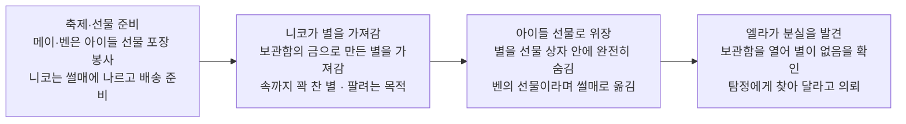

# 10 · B 사라진 크리스마스트리의 별 — 금으로 만든 별 절도안 전체 대본

**L1-05 현재진행형 · 2단계 대본 사용자 검토 대기 · 개발 미인계.** [장면별 기획](case-10-christmas-star.html)

사용자 요청으로 진짜 금으로 만든 별을 훔쳐 선물처럼 포장해 반출하려는 사건을 작성한다. **별 모양 물건은 도난당한 실제 금으로 만든 별 장식 하나만 나온다. 전구·전선·배터리는 없다.** 금색 칠을 한 물건이나 조명이 아니다. 메이는 쿠키, 벤은 책 선물을 포장하고, 니코는 포장을 맡지 않고 준비된 선물을 썰매에 나르고 배송하는 자원봉사자다. 별은 닫힌 선물 상자에 숨겨 정상 선물 사이에 섞는다.

사용자 결정은 마을의 큰 크리스마스 축제를 위해 어른들이 아이들 선물을 자원해서 준비하는 행사다. 니코는 완성된 선물을 썰매에 옮기고 마을 곳곳에 배송하는 역할만 맡는다. 별은 상자 안에 숨겨 다른 선물처럼 나르려 한다. 정상 업무로 포장을 겸한다는 이전 설정은 이번 사용자 결정으로 변경한다. 구체적인 동선·개별 대사·단서·장소 구성은 기획자 제안이다. 그림·음성은 생성하지 않았고 앱 사건 번호는 지정하지 않는다.

## 1. 제작자용 진실·행동 이유

이 크리스마스 파티는 마을의 큰 축제다. 엘라·메이·벤·니코는 모두 성인 동물이며 아이들을 위해 자진해서 준비를 돕는다. 메이·벤은 같은 천막에서 선물을 포장하고 니코는 준비된 선물을 썰매에 싣고 마을 곳곳에 배송하는 일만 맡는다. 조사 중의 니코는 바로 밖 썰매 앞에서 닫힌 상자를 옮겨 싣는 중이다. 벤이 이번 배송을 위해 준비하는 선물은 처음부터 끝까지 전부 작업대에 남아 있으며 니코에게 이미 건넨 별도 선물은 없다. 봉사 활동이나 배송 역할 자체는 의심의 근거가 아니다.

의뢰인은 엘라다. 해결할 의문은 **어느 꾸러미를 확인해야 하며, 별을 누가 어떤 목적으로 가져갔는가**다. 처음부터 절도나 후보를 확정하지 않는다.

1. 별은 마을이 해마다 쓰는, 금으로 만든 귀중한 장식이다. 별 몸체는 속까지 꽉 차 있고 뾰족한 끝 다섯 개와 평평한 뒷면이 있다. 관·구멍·빈 내부·전기 부품은 없다. 속이 꽉 찬 것은 사용자 결정이며 금의 순도·크기·무게·트리 고정 방식은 아직 정하지 않았다. 평소에는 잠가 보관한다.
2. 엘라가 설치 직전에 천막 옆 준비대에서 보관함을 연다. 입구의 어린 관람객을 잠깐 돕는 사이 별이 사라진다. 평소에 금으로 만든 별을 공공 탁자에 방치하는 설정은 아니다. 엘라는 재질·마을 소유·형태를 알고 있지만 별 사진을 미리 찍지 않는다. 준비 과정에서 알게 된 메이의 앞쪽 포장대는 입구에서도 보이나 천막 안쪽의 벤과 썰매 적재함은 보이지 않는다.
3. 공동 선물 포장 천막에서 메이는 쿠키 선물에 리본을 묶고, 벤은 자기 몫의 책 선물을 전부 작업대에 두고 아직 포장하고 있다. 니코는 완성된 선물을 나르고 배송하는 일에 자원했다. 포장을 도와주는 업무는 없다. 메이·벤은 각자 맡은 포장과 함께 정한 역할만 알며 별이 사라지는 순간이나 다른 상자 내부를 계속 지켜본 것은 아니다.
4. 니코는 선물 운반 때문에 천막 옆 탁자를 지나가다 열린 보관함의 별을 발견하고, 팔 목적으로 가져간다. 준비용 빈 선물 상자에 별을 넣고 뚜껑을 닫아 정상 선물 사이에 섞는다. 보관함도 닫고 그 상자를 썰매 앞으로 옮긴다. 상자에 별을 숨기는 것은 범행 행동이며 포장 업무를 담당하는 설정은 아니다. 포장지 조각을 별도 단서로 남기지 않는다.
5. 니코의 상자는 완전히 닫혀 있고 별은 안에 숨겨져 있다. 상자 밖이나 틈으로 별·금빛·뾰족한 끝은 전혀 보이지 않는다. 닫힌 상자는 썰매의 짐칸 앞에 두고 싣는 중이다. 니코는 무엇을 옮기는지 묻자 벤의 선물이라고 둘러댄다. 아직 천막의 선물이 모두 준비되지 않아 출발하지 않는다. 탐정이 오는 순간 범행을 중단하고 도주하는 설정이나 자동 출발·시간제한은 없다. 별을 새로 만드는 인물도 없다.
6. 엘라가 보관함을 다시 열어 별이 없음을 확인하고 탐정에게 부탁한다. 어린 친구들을 안내 중이어서 직접 여러 장소를 돌 수 없다. 탐정이 현장에 있어 도움을 부탁하는 규모이며 연락 수단이 전부 불가능하다고 설정하지 않는다.
7. 탐정은 니코의 벤 선물 운반 주장 뒤 벤을 다시 방문해 선물을 보내는 중인지 묻는다. 벤은 No. These are all my gifts. I'm still wrapping them.이라고 답한다. 계속 포장한다는 말만이 아니라 전부 여기 있다는 범위를 기록해야 출처 설명의 불일치가 드러난다. 탐정은 이 진술과 실제 책 선물·닫힌 상자를 대조해 출처를 재확인할 물건을 고른다. 귀중품 관련 꾸러미 확인을 돕도록 경사를 부른 뒤 니코에게 개봉 동의를 구한다. 이때 절도 확정·체포를 선언하지 않는다.
8. 벤의 진술을 제시하며 출처를 묻자 니코는 이번에는 자기 선물이라고 말을 바꾸고 아무것도 숨기지 않는다고 주장한다. 탐정이 처음에는 벤의 것이라고 했음을 짚고 열어 달라고 요청한다. 동의 뒤 처음으로 별을 발견하고, 니코에게 어디서 가져왔고 허락받았는지 묻는다. 니코가 천막 옆 보관함에서 무단으로 가져왔으며 팔려 했음을 인정한다. 경사는 현장 보존·동석·후속 처리를 맡고 탐정은 별을 엘라에게 반환한다.

유일한 혼동 장치는 **비슷해 보이는 선물 포장**이다. 종·성격·옷 색은 정답 근거가 아니다. 메이의 쿠키와 벤의 책은 현재 조사 물건을 구분할 뿐 과거 행동 전체의 알리바이가 아니다. 니코가 다른 이의 선물까지 운반하는 것은 맡은 봉사 일이므로 썰매에 물건이 있다는 사실만으로 범인이 되지 않는다. 벤의 선물이 전부 아직 작업대에 있다는 현재 사실과 니코의 운반 대상 설명을 함께 들어 출처를 확인한다. 이 불일치는 내용을 보여 달라고 요청할 이유이며, 별 발견·무허락 반출·판매 목적 확인 전에는 범행을 확정하지 않는다. 사진 한 장이나 작업이 다르다는 이유로 범행을 확정하지 않는다.

## 2. 장면별 스토리보드

### 사건 흐름도

제작자용으로 사건의 진실과 플레이 순서를 나눈다. 두 번째 흐름도는 의뢰부터 조사·개봉·심문·보고·반환까지 포함한다. 메이·벤 최초 방문은 자유이며 벤 b3 뒤 니코를 먼저 만날 수 있다. 니코의 벤 선물 운반 주장을 들은 뒤 벤에게 재확인한다. 모든 기록의 합류 지점은 추리 직전이다.

#### 01 · 사건이 벌어진 과정

제작자용 진실 · 탐정이 오기 전

#### 02 · 탐정이 해결하는 과정

플레이 순서 · 진술과 사진을 대조하고 의뢰인에게 반환

```mermaid
flowchart LR
    s1["엘라에게 질문<br/>별의 특징·마지막 위치를 들음<br/>아직 누가 가져갔는지는 모름"]
    s2["보관함 조사<br/>빈 보관함·별의 빈 자리를 촬영<br/>선물 포장 천막을 조사"]
    s3["메이의 쿠키 선물<br/>쿠키 포장·리본 작업을 듣고 촬영<br/>기록은 추리 전에 함께 모음"]
    s4["벤의 책 선물·니코 위치<br/>벤의 책 선물을 확인·촬영<br/>니코의 배송 역할·위치를 들음<br/>아직 발송 여부는 묻지 않음"]
    s6["니코의 운반 설명<br/>벤의 선물을 옮긴다고 주장<br/>완전히 닫힌 상자 겉면만 촬영<br/>그 말의 출처를 확인할 필요"]
    s7["벤에게 돌아가 재확인<br/>선물이 전부 여기 있다고 답함<br/>아직 그 선물들을 포장 중<br/>일부만 포장 중인 상황과 구별"]
    s8["진술·사진 대조 후 추리<br/>전부 여기 + 아직 포장 중<br/>니코의 벤 선물 설명과 맞지 않음<br/>상자 출처 재확인 대상만 고름"]
    s9["출처 재질문·개봉 동의<br/>경사 동석·벤의 진술 제시<br/>자기 선물이라고 설명을 바꿈<br/>앞선 말을 짚고 개봉 동의를 받음"]
    s10["상자 안에서 처음 별 발견<br/>개봉 뒤 별 전체를 보고 촬영<br/>그전까지 별·금빛은 보이지 않음<br/>엘라의 설명·빈 보관함과 대조"]
    s11["탐정이 출처·목적 질문<br/>보관함에서 가져왔다고 답함<br/>무허락 반출·판매 목적을 확인<br/>경사 허락 → 별 소지품으로 받기"]
    s12["엘라에게 확인·반환<br/>탐정이 직접 광장으로 돌아감<br/>엘라가 확인 → 결과 보고<br/>별 건네기 완료로 사건 해결"]
    s1 --> s2
    s2 --> s3
    s2 --> s4
    s4 --> s6
    s3 --> s8
    s6 --> s7
    s7 --> s8
    s8 --> s9
    s9 --> s10
    s10 --> s11
    s11 --> s12
```

조사 시점의 작업: **엘라 — 입구 안내 / 메이 — 쿠키 포장·리본 묶기 / 벤 — 책 선물 전부를 아직 작업대에서 포장 / 니코 — 선물을 썰매에 싣고 배송 준비 / 금으로 만든 별을 아이들 선물로 위장.**

### 장면 0 · 준비

기존 열쇠 카드로 현재진행형의 긍정·부정·확인·행동 질문을 준비한다. 예문은 8절을 쓴다. 자기소개 전에는 이름을 표시하지 않고 질문·단서 개수는 플레이 화면에 표시하지 않는다.

### 장면 1 · 트리 광장 — 의뢰와 실제 금으로 만든 별

이름 없는 사슴으로 만난 뒤 자기소개를 듣는다. e0만 첫 선택지로 표시하고 받아 적은 뒤 e1·e2가 열린다. e3는 e2에서 탁자 위치를 기록한 뒤 열린다. 엘라는 자신이 아는 특징과 마지막 위치만 답한다. 금이라는 재질은 진술로 듣는다.

- **ella:hello · 엘라 · 자동**
  - Hi, I'm Ella. Have you got a moment?
  - 안녕! 난 엘라야. 잠깐 시간 있어?

#### ella:e0 · 엘라

- **질문 선택지**: How can I help?
- 해석: 어떻게 도와줄까?
- **대답**: Our tree's star is missing. Can you help me find it?
- 해석: 우리 트리의 별이 없어졌어. 찾는 걸 도와줄래?
- **노트**: “Our tree's [star] is [missing]. Can you help me find it?”
- **보기**: star · string · missing · shining
- 조건: 인사 뒤 혼자 표시
- 채점 뒤: e1·e2. e3는 e2 기록 뒤

#### ella:e1 · 엘라

- **질문 선택지**: What does the star look like?
- 해석: 별은 어떻게 생겼어?
- **대답**: It's our town's star. It's real gold, with five sharp points and a flat back.
- 해석: 우리 마을의 별이야. 진짜 금으로 만들었고 뾰족한 끝이 다섯 개야. 뒷면은 평평해.
- **노트**: “It's our town's star. It's real [gold], with five sharp [points] and a flat [back].”
- **보기**: gold · glass · points · patterns · back · front
- 조건: e0 기록 뒤
- 채점 뒤: 재질·소유 배경·구조 기록. 사진으로 금을 판별하지 않음

#### ella:e2 · 엘라

- **질문 선택지**: Where did you leave it?
- 해석: 어디에 두었어?
- **대답**: I left it in the case on the table by the gift tent.
- 해석: 선물 포장 천막 옆 탁자의 보관함에 두었어.
- **노트**: “I left it in the [case] on the [table] by the [gift tent].”
- **보기**: case · vase · table · chair · gift tent · sleigh
- 조건: e0 기록 뒤
- 채점 뒤: 보관함 조사·c-case 촬영, 공동 선물 포장 천막

#### ella:e3 · 엘라

- **질문 선택지**: Who is working near the table?
- 해석: 탁자 근처에서 누가 일하고 있어?
- **대답**: Mae is wrapping gifts in the gift tent. I can't see the others.
- 해석: 메이가 선물 포장 천막에서 선물을 포장하고 있어. 다른 친구들은 보이지 않아.
- **노트**: “Mae is [wrapping] [gifts] in the gift tent. I can't see the others.”
- **보기**: wrapping · fixing · gifts · tools
- 조건: e2의 탁자 위치를 기록한 뒤
- 채점 뒤: 공동 선물 포장 천막·이름 없는 친구. 메이 이름 표시는 본인 인사 뒤

### 장면 2 · 준비대의 보관함

e2 기록 뒤 c-case를 직접 촬영한다. 빈 별 모양 받침과 보관함의 위치를 본다. 엘라는 질문받은 메이의 보이는 작업만 답한다. 그 밖의 후보나 행선지는 추측하지 않는다.

관찰: **An empty case on the table. / 탁자 위에 빈 보관함이 있어.**

- **det:paper-thought · 탐정 · 생각**
  - I should ask the people in the gift tent.
  - 선물 포장 천막의 친구들에게 물어봐야겠어.

- **move:gift · 이동 · 이동 버튼**
  - Go to the Gift Tent.
  - 선물 포장 천막으로 가기

### 장면 3 · 선물 포장 천막 — 메이의 쿠키 선물

메이는 동그란 쿠키를 선물 상자에 담고 리본을 묶는다. 탐정이 온 이유를 밝힌 뒤 무엇을 포장하는지 묻고 리본 작업으로 이어 간다. 메이의 선물에는 별 모양 물건이나 별 무늬가 없다.

- **mae:hello · 메이 · 자동**
  - Welcome! I'm Mae.
  - 어서 와! 난 메이야.

- **det:mae-intro · 탐정 · 자동**
  - I'm helping Ella find a missing star.
  - 엘라가 없어진 별을 찾는 걸 돕고 있어.

- **mae:ready · 메이 · 자동**
  - Oh! What would you like to know?
  - 아! 뭐가 궁금해?

#### mae:m1 · 메이

- **질문 선택지**: What are you wrapping?
- 해석: 무엇을 포장하고 있어?
- **대답**: I'm wrapping cookies. We're all volunteers for the Christmas party.
- 해석: 쿠키를 포장하고 있어. 우리 모두 크리스마스 파티를 돕는 자원봉사자야.
- **노트**: “I'm [wrapping] [cookies]. We're all volunteers for the Christmas party.”
- **보기**: wrapping · painting · cookies · toys
- 조건: 공동 선물 포장 천막 발견·메이 인사 뒤 첫 질문
- 채점 뒤: m2·m3

#### mae:m2 · 메이

- **질문 선택지**: Are you tying ribbons around the boxes?
- 해석: 상자에 리본을 묶고 있어?
- **대답**: Yes, I'm tying the ribbons to keep the boxes closed.
- 해석: 응, 상자가 열리지 않게 리본을 묶고 있어.
- **노트**: “Yes, I'm [tying] the [ribbons] to keep the boxes closed.”
- **보기**: tying · drying · ribbons · cookies
- 조건: m1 기록 뒤
- 채점 뒤: 현재 작업 기록

#### mae:m3 · 메이

- **질문 선택지**: Can I see the cookies?
- 해석: 쿠키를 봐도 돼?
- **대답**: Sure. They're round, with chocolate on the top.
- 해석: 물론이지. 동그랗고 위쪽에 초콜릿이 있어.
- **노트**: “Sure. They're [round], with [chocolate] on the [top].”
- **보기**: round · flat · chocolate · paper · top · bottom
- 조건: m1 기록 뒤
- 채점 뒤: c-cookies 촬영 허락

m3 기록 뒤 c-cookies를 촬영한다. 같은 천막 안쪽에는 벤이 책 선물을 포장한다. 천막 발견으로 두 인물을 만날 수 있고 각각 자기소개 뒤 이름이 표시된다. 메이와 벤은 어느 쪽부터 조사해도 된다. 두 사람 사이에 별도 장소 이동은 없다.

### 장면 4 · 같은 선물 포장 천막 — 벤의 책 선물

벤은 책을 포장하고 있다. b1의 These는 눈앞의 책들을 가리킨다. 처음에는 b1·b3·b4만 열리고 b2는 니코 n2를 들은 뒤 재방문할 때 열린다. 벤의 현재 진행 상황을 묻기 전에 출처 확인이 필요한 이유부터 알게 된다. 벤은 함께 봉사하며 니코가 선물 운반과 배송을 맡았음을 안다. 천막 옆 출구로 니코와 썰매가 보이지만 적재함 안 물건의 세부는 보이지 않는다.

- **ben:hello · 벤 · 자동**
  - Hello! I'm Ben. Getting ready for Christmas?
  - 안녕! 난 벤이야. 크리스마스 준비 중이야?

- **det:ben-intro · 탐정 · 자동**
  - I'm looking for the star for the big tree.
  - 큰 트리에 쓸 별을 찾고 있어.

#### ben:b1 · 벤

- **질문 선택지**: What are you doing?
- 해석: 뭐 하고 있어?
- **대답**: I'm wrapping books. These are gifts for the children.
- 해석: 책을 포장하고 있어. 어린 친구들에게 줄 선물이야.
- **노트**: “I'm [wrapping] [books]. These are gifts for the children.”
- **보기**: wrapping · carrying · books · cookies
- 조건: 공동 포장 천막 발견·벤 인사 뒤 첫 질문
- 채점 뒤: b3·b4. b2는 니코 n2 기록 뒤 재방문 때

#### ben:b3 · 벤

- **질문 선택지**: Who is helping with the deliveries?
- 해석: 배송은 누가 돕고 있어?
- **대답**: Nico is helping with deliveries. He's by his sleigh outside.
- 해석: 니코가 배송을 돕고 있어. 지금 밖에 있는 자기 썰매 옆에 있어.
- **노트**: “[Nico] is helping with deliveries. He's by his [sleigh] [outside].”
- **보기**: Nico · Mae · sleigh · tent · outside · inside
- 조건: b1 기록 뒤
- 채점 뒤: 썰매 앞·이름 없는 펭귄. 이름 표시는 본인 인사 뒤

#### ben:b4 · 벤

- **질문 선택지**: Can I look at the books?
- 해석: 책들을 봐도 돼?
- **대답**: Sure. The books have hard covers. You can take a photo.
- 해석: 물론이지. 책들은 단단한 표지로 되어 있어. 사진을 찍어도 돼.
- **노트**: “Sure. The [books] have hard [covers]. You can take a photo.”
- **보기**: books · boxes · covers · cookies
- 조건: b1 기록 뒤
- 채점 뒤: c-books 촬영 허락. 전체 물량·진행 상태는 재방문 b2 대답으로 확인

b4 기록 뒤 c-books를 촬영한다. b3는 함께 맡은 배송 역할과 지금 보이는 위치다. 배송할 선물 상자들이 보이므로 배송을 돕는 친구를 묻는다. 처음 방문에서는 지금 열린 질문만 마치고 떠날 수 있다. 잠긴 b2 때문에 대화에 갇히지 않는다. 벤이 절도 순간을 봤다거나 모든 출입을 감시했다고 바꾸지 않는다. 니코 이름을 기록해도 이름 표시는 본인 자기소개 뒤다.

- **det:sleigh-thought · 탐정 · 생각**
  - I should ask Nico about the deliveries.
  - 니코에게 배송에 관해 물어봐야겠어.

- **move:sleigh · 이동 · 이동 버튼**
  - Go to the Delivery Sleigh.
  - 썰매 앞으로 가기

### 장면 5 · 썰매 앞 — 니코의 운반 주장과 벤 재확인

니코는 열린 썰매 적재함 옆에 고정되고, 완전히 닫힌 선물 상자는 썰매의 짐칸 앞에 놓인다. 상자를 썰매에 싣는 상황이며 실제 운반 애니메이션은 요구하지 않는다. n1에서 선물을 싣는 중이며 아직 배송하러 출발하지 않았음을 듣는다. n2에서 벤의 선물을 옮긴다고 주장한다. n3의 that box는 조금 떨어진 썰매 짐칸 앞의 같은 상자다. 개봉 전에는 내용물이 보이지 않으며 상자의 외형에 주인 이름·단서를 적지 않는다. 탐정은 포장을 돕지 않는다.

- **nico:hello · 니코 · 자동**
  - Hi there. I'm Nico. What brings you here?
  - 안녕. 난 니코야. 무슨 일이야?

- **det:nico-intro · 탐정 · 자동**
  - I'm helping Ella find a missing star.
  - 엘라가 없어진 별을 찾는 걸 돕고 있어.

#### nico:n1 · 니코

- **질문 선택지**: What are you doing?
- 해석: 뭐 하고 있어?
- **대답**: I'm loading the gifts. I'm not delivering yet.
- 해석: 선물을 싣고 있어. 아직 배달하러 출발하지는 않았어.
- **노트**: “I'm [loading] the gifts. I'm not [delivering] yet.”
- **보기**: loading · opening · delivering · decorating
- 조건: 썰매 앞 발견·니코 인사 뒤 첫 질문
- 채점 뒤: n2. n3·n4는 n2 기록 뒤

#### nico:n2 · 니코

- **질문 선택지**: What are you carrying?
- 해석: 무엇을 옮기고 있어?
- **대답**: I'm taking Ben's gift to the sleigh.
- 해석: 벤의 선물을 썰매로 옮기고 있어.
- **노트**: “I'm [taking] Ben's [gift] to the [sleigh].”
- **보기**: taking · opening · gift · case · sleigh · tent
- 조건: n1 기록 뒤
- 채점 뒤: n3·n4·벤 b2 재확인 질문. 이 상자가 벤의 선물이라는 주장은 검증 전 기록

#### nico:n3 · 니코

- **질문 선택지**: Are you opening that box?
- 해석: 저 상자를 열고 있어?
- **대답**: No, I'm not opening it. I'm loading it for delivery.
- 해석: 아니, 여는 게 아니야. 배송하려고 싣고 있어.
- **노트**: “No, I'm [not] opening it. I'm [loading] it for [delivery].”
- **보기**: not · now · loading · opening · delivery · decoration
- 조건: n2 기록 뒤
- 채점 뒤: 개봉이 아니라 적재 중이라는 작업 기록. 내용물은 알 수 없음

#### nico:n4 · 니코

- **질문 선택지**: Can I look at the box?
- 해석: 그 상자를 살펴봐도 돼?
- **대답**: Yes. You can look at it. Please leave it here.
- 해석: 응. 살펴봐도 돼. 여기에 두고 가 줘.
- **노트**: “Yes. You can [look] at it. Please leave it [here].”
- **보기**: look · listen · here · there
- 조건: n2 기록 뒤
- 채점 뒤: c-parcel 닫힌 상자 겉면 촬영 허락. 개봉·습득 허락은 아님

n4 기록 뒤 c-parcel로 닫힌 상자 겉면을 촬영한다. 어떤 상자에 관한 진술인지 남기는 기록일 뿐 사진이 내용을 알려 주지 않는다. 니코의 열린 질문들을 마친 뒤 벤에게 확인하러 갈 수 있다. 이동은 자동이 아니다.

- **det:ben-check-thought · 탐정 · 생각**
  - I should ask Ben about his gifts.
  - 벤에게 자기 선물을 확인해 봐야겠어.

- **move:ben-check · 이동 · 이동 버튼**
  - Return to the Gift Tent.
  - 선물 포장 천막으로 돌아가기

#### 벤에게 다시 확인

같은 천막의 같은 작업대로 돌아온다. 니코 n2를 노트에 바르게 기록한 뒤에만 벤 b2가 열린다. 처음 만났을 때의 자기소개는 반복하지 않는다. These는 눈앞 작업대의 선물 전부를 가리킨다. 벤이 다른 선물을 이미 니코에게 줬을 가능성을 남기지 않도록, 이번 배송에 준비한 전체 선물이 여기 있다고 답한다. 사진에 전체 물량이라는 정보를 덧쓰지 않는다.

- **ben:return · 벤 · 자동**
  - Oh, you're back!
  - 아, 돌아왔네!

#### ben:b2 · 벤

- **질문 선택지**: Are you sending your gifts now?
- 해석: 지금 네 선물을 보내고 있어?
- **대답**: No. These are all my gifts. I'm still wrapping them.
- 해석: 아니. 이게 내가 보낼 선물 전부야. 아직 포장하고 있어.
- **노트**: “No. These are [all] my gifts. I'm [still] [wrapping] them.”
- **보기**: all · some · still · already · wrapping · delivering
- 조건: ben:b1·nico:n2 기록 뒤 포장 천막의 벤 재방문
- 채점 뒤: 벤 선물 전부가 현재 작업대에 있다는 범위·포장 중인 상태 기록. 벤의 배송 물건이라는 니코 주장과 대조

b2의 all·still·wrapping을 원문대로 기록한다. 벤이 계속 포장한다는 말만으로 일부 선물을 먼저 넘기지 않았다고 추측하지 않는다. 선물이 전부 여기 있다는 말과 실제 작업대의 선물을 함께 본다. c-books는 첫 방문 때 찍었어도 되고 재방문 때 찍어도 된다. 별도 중복 사진은 요구하지 않는다.

- **det:sleigh-return-thought · 탐정 · 생각**
  - I should check Nico's story.
  - 니코의 설명을 다시 확인해야겠어.

- **move:sleigh-return · 이동 · 이동 버튼**
  - Return to the Delivery Sleigh.
  - 썰매 앞으로 돌아가기

- **det:compare-thought · 탐정 · 생각**
  - I should compare the notes and the photos.
  - 기록과 사진을 비교해 봐야겠어.

행동 선택지: **Compare the clues. / 단서 비교하기**. 재방문 벤 b2를 포함한 면담15개와 개봉 전 사진 c-case·c-cookies·c-books·c-parcel이 모이면 추리를 연다. 메이·벤 최초 방문은 자유이며 벤 b3 뒤 니코를 먼저 만나도 된다. 메이의 남은 기록이 있으면 추리 전에 천막에서 마칠 수 있다. 개수는 제작 조건이며 플레이 화면에는 표시하지 않는다.

### 장면 6 · 추리 — 확인할 상자 선택

7절의 6문항을 푼다. 결론은 니코의 상자 출처 설명을 다시 확인해야 한다는 것이다. 아직 금으로 만든 별이나 범인을 찾았다고 단정하지 않는다. 완료 뒤 **Check the parcel. / 꾸러미 확인하기**를 고른다. 썰매 앞에 머물며 전체 후보를 소집하지 않는다.

### 장면 7 · 경사 합류·개봉 동의

별이 사라진 현장에서 조사하던 중 선물 출처 설명이 맞지 않아 귀중품 관련 확인을 도울 경사를 부른다. 신고 대사는 확인 요청이며 범행 확정이 아니다. 이 연락은 게임 안의 선택지다. 기다리기 선택 뒤 같은 썰매 앞에 경사가 합류한다. 실제 대기 시간·순찰 이동을 요구하지 않는다.

- **det:call-thought · 탐정 · 생각**
  - I should ask an officer to help check the parcel.
  - 경사에게 꾸러미 확인을 도와 달라고 해야겠어.

- **call:officer · 행동 · 연락 선택지**
  - Call an officer.
  - 경사에게 연락하기

- **det:call · 탐정 · 자동**
  - I need help checking a parcel for Ella's missing star.
  - 엘라의 없어진 별을 찾으려면 꾸러미를 확인하는 데 도움이 필요해.

- **badger:phone · 응답한 목소리 · 자동**
  - Keep the box there. Wait for me.
  - 상자는 거기에 둬. 내가 갈 때까지 기다려.

- **wait:officer · 행동 · 다음 장면 선택지**
  - Wait for the officer.
  - 경사 기다리기

- **badger:hello · 경사 · 자동**
  - Hello, I'm Officer Badger. Please stay here.
  - 안녕. 난 오소리 경사야. 여기에 있어 줘.

니코에게 질문하기 전에 벤 재방문 b2 진술을 제시한다. c-books는 실제 작업대 상태, nico:n2는 앞선 운반 주장으로 함께 확인할 수 있다. 니코는 상자 출처를 자기 것으로 바꾸며 부인한다. 오답 반응: **That doesn't explain whose gift it is. / 그건 누구의 선물인지 설명해 주지 않아.** 같은 단계로 돌아간다. 사람의 진술을 상자 사진으로 대신 제시하지 않는다.

- **det:open-q1 · 탐정 · 선택 질문**
  - Ben is still wrapping all his gifts. Whose gift is that?
  - 벤의 선물은 전부 아직 포장 중이야. 그럼 저건 누구의 선물이야?

- **nico:open-a1 · 니코 · 자동**
  - It's mine. I'm not hiding anything.
  - 내 거야. 아무것도 숨기고 있지 않아.

- **det:check-claim · 탐정 · 진술 제시 뒤 선택 질문**
  - You said it was Ben's gift. Can you open the box?
  - 벤의 선물이라고 했잖아. 상자를 열어 줄래?

- **nico:open-a2 · 니코 · 자동**
  - All right. You can look inside.
  - 알겠어. 안을 봐도 돼.

- **open:box · 행동 · 조사 행동**
  - Look inside the box.
  - 상자 안 살펴보기

동의 뒤 확대 조사에서 전체를 보고 c-open을 직접 촬영한다. 관찰: **A star with five sharp points and a flat back. / 뾰족한 끝 다섯 개와 평평한 뒷면이 있는 별이야.** 사진은 성분 검사를 하지 않는다. 엘라 설명과 비슷한 별을 확인한 상태이며 출처·허락·목적은 더 물어야 한다.

### 장면 8 · 탐정의 짧은 심문

c-open 촬영 뒤 문답이 열린다. 질문·증거 제시·추궁은 탐정이 하고 경사는 동석한다. 아래 질문은 모두 선택지이며 추가 받아쓰기는 없다.

- **det:origin-q · 탐정 · 선택 질문**
  - Where did the star come from?
  - 별은 어디서 가져온 거야?

- **nico:origin-a · 니코 · 자동**
  - From the case by the tent.
  - 천막 옆 보관함에서.

니코가 직접 천막 옆 보관함을 출처로 말한 뒤 c-case를 제시하고 엘라 e1·e2와 c-open을 대조한다. 일반적인 별 모양만으로 같은 물건이나 범행을 확정하지 않는다. 출처 답변 뒤 허락 여부를 묻는다. 오답 반응: **That doesn't match the case. / 그건 보관함과 맞지 않아.** 같은 단계로 돌아간다.

- **det:permission-q · 탐정 · 증거 제시 뒤 선택 질문**
  - Did Ella ask you to take it?
  - 엘라가 가져가 달라고 부탁한 거야?

- **nico:admit · 니코 · 자동**
  - No. I took it without asking.
  - 아니. 물어보지 않고 가져왔어.

- **det:motive-q · 탐정 · 선택 질문**
  - Why do you want the star?
  - 왜 그 별을 원하는 거야?

- **nico:motive · 니코 · 자동**
  - I want to sell it.
  - 팔려고 해.

- **badger:keep · 경사 · 자동**
  - I'll stay with Nico.
  - 난 니코와 함께 있을게.

- **det:take-q · 탐정 · 선택 질문**
  - May I take the star back?
  - 별을 돌려주러 가져가도 돼?

- **badger:take-a · 경사 · 자동**
  - Yes. Take it back. I'll stay here.
  - 응. 돌려줘. 난 여기 있을게.

- **take:star · 행동 · 소지품 받기**
  - Take the star.
  - 별 받기

천막 옆 보관함에서 가져왔고 허락받지 않았으며 팔려 했다는 진술을 모두 들은 뒤 절도로 확정한다. 경사 허락 뒤 별 받기를 고르면 소지품 **별 장식**을 얻는다. 경사는 니코와 남는다. 현실의 강제 수색·체포 법률 규칙을 게임에서 판정하지 않는다.

- **det:return-thought · 탐정 · 생각**
  - I should take the star back to Ella.
  - 별을 엘라에게 돌려줘야겠어.

- **move:tree · 이동 · 이동 버튼**
  - Return to the Tree Square.
  - 트리 광장으로 돌아가기

### 장면 9 · 트리 광장 — 확인·보고·반환

탐정만 돌아온다. 소지품 별을 손에 든 상태에서 this로 확인한다. 엘라가 실제 물건을 확인하고 결과를 들은 뒤 별을 건넨다.

- **ella:return · 엘라 · 자동**
  - Oh, you're back!
  - 아, 돌아왔네!

- **det:confirm-owner · 탐정 · 선택 질문**
  - Is this the town's star?
  - 이게 마을의 별이야?

- **ella:confirm-owner · 엘라 · 자동**
  - Yes. It's our gold star, with five points and a flat back.
  - 응. 뾰족한 끝 다섯 개와 평평한 뒷면이 있는 우리 마을의 금으로 만든 별이야.

- **det:report · 탐정 · 보고 선택지**
  - Nico took it. The officer is with him now.
  - 니코가 가져갔어. 지금 경사가 함께 있어.

- **ella:thanks · 엘라 · 자동**
  - Thank you for finding it. Please give it to me.
  - 찾아줘서 고마워. 나에게 건네줘.

- **give:star · 행동 · 소지품 건네기**
  - Give the star to Ella.
  - 엘라에게 별 건네기

- **ella:end · 엘라 · 자동**
  - Now we can put it on the tree.
  - 이제 트리에 달 수 있겠어.

건네기 완료로 소지품에서 빠진다. 높은 트리에 올라가는 동작은 요구하지 않는다. 마무리 정지 그림을 만든다면 별 자체의 발광·전구·전선은 넣지 않는다. 해명하지 않고 남긴 실마리는 없다.

## 3. 사진·실물·증거의 역할

### c-case · 보관함

| 항목 | 내용 |
|---|---|
| 열리는 때 | e2 기록 뒤 광장 가장자리의 선물 포장 천막 옆 준비대 조사 |
| 촬영 그림 | 천막 옆 탁자에 놓인 열린 보관함의 빈 별 모양 받침. 빈 내부·관을 뜻하는 별 구조는 없다. 사람·이름·범행·담당자 표시는 없음. |
| 관찰 음성 | An empty case on the table. |
| 해석 | 탁자 위에 빈 보관함이 있어. |
| 쓰임 | e1·e2의 마지막 위치를 기록하고 개봉 뒤 니코가 말한 출처와 대조. 주인·범인·포장자를 특정하는 사진 아님. |

### c-cookies · 쿠키 선물

| 항목 | 내용 |
|---|---|
| 열리는 때 | 같은 선물 포장 천막에서 mae:m3 기록 뒤 직접 촬영 |
| 촬영 그림 | 열린 선물 상자에 동그란 쿠키와 초콜릿 윗면이 보임. 평범한 리본과 포장지. 사람·작업 동작·소유 이름·별 모양 쿠키나 무늬는 없음. |
| 관찰 음성 | Round cookies, with chocolate on the top. |
| 해석 | 위쪽에 초콜릿이 있는 동그란 쿠키들이야. |
| 쓰임 | 메이가 포장하는 실제 물건과 m1·m2·m3을 비교. 금으로 만든 별과 같은 별 모양을 반복하지 않으며 과거 행동 전체의 알리바이로 삼지 않음. |

### c-books · 책 선물

| 항목 | 내용 |
|---|---|
| 열리는 때 | 선물 포장 천막에서 ben:b4 기록 뒤 직접 촬영 |
| 촬영 그림 | 같은 작업대에 놓인 아직 포장 중인 책 선물들. 벤이 준비한 물량은 모두 여기에 있고 카메라에는 그 작업대만 보인다. 사람·소유자 이름·전체 물량이라고 단정하는 캡션은 없다. 별 모양 소품·무늬 없음. |
| 관찰 음성 | Books in partly wrapped boxes. |
| 해석 | 포장이 덜 끝난 상자 안의 책들이야. |
| 쓰임 | b1·b4로 실제 물건을 확인하고 b2의 all·still wrapping을 기록해 전체 선물이 아직 여기 있다는 범위와 상태를 대조. 전체 물량이라는 정보는 사진만으로 얻지 않음. |

### c-parcel · 꾸러미

| 항목 | 내용 |
|---|---|
| 열리는 때 | 썰매 앞에서 nico:n4 기록 뒤 허용한 겉면만 직접 촬영 |
| 촬영 그림 | 썰매의 짐칸 앞에 놓인 완전히 닫힌 선물 상자. 별·금빛·뾰족한 끝·내용물은 전혀 보이지 않는다. 이름·소유·수취인·범인 정보를 적지 않는다. |
| 관찰 음성 | A closed box beside the sleigh. |
| 해석 | 썰매 옆에 닫힌 상자가 있어. |
| 쓰임 | 어느 상자에 관한 진술인지 대조할 물건 기록. 겉모습은 내용·주인·범행을 증명하지 않는다. 개봉 요청 근거는 n2와 벤 재방문 b2의 불일치다. |

### c-open · 상자 안

| 항목 | 내용 |
|---|---|
| 열리는 때 | 벤 b2 기록·추리 완료→진술 대조·출처 재질문→경사 동석·니코의 개봉 동의→안 조사·촬영 |
| 촬영 그림 | 상자 안에 별 장식이 뒷면을 위로 향해 놓여 전체 외형·다섯 끝·평평한 뒷면이 한 사진에 보인다. 속까지 꽉 찬 별로 그리며 빈 내부·관·구멍·전기 부품은 없다. 인물·자백 글자·범인 표시 없음. 사진은 금빛 외관을 기록할 뿐 성분이나 속 구조를 검사하지 않음. |
| 관찰 음성 | A star with five sharp points and a flat back. |
| 해석 | 뾰족한 끝 다섯 개와 평평한 뒷면이 있는 별이야. |
| 쓰임 | 별이 처음 보이는 장면. e1·c-case와 외형을 대조하고 니코에게 출처·허락·목적을 묻는다. 금 성분·소유는 사진만으로 확정하지 않음. 별 습득은 경사 허락 뒤. |

필수 사진은 5장이다. 추리 전 4장과 개봉 뒤 1장이며 사전 별 사진은 없다. 증거 제목에 주인·범인·진짜 금 판정을 넣지 않는다. c-books는 아직 포장 중인 책 선물 사진이다. 전체 물량이라는 범위는 b2의 all로 듣는다. c-parcel은 완전히 닫힌 상자 사진이며 별은 c-open에서 처음 보인다.

물건·흔적은 사진, 작업·운반 대상·전체 물량 진술은 질문과 받아쓰기로 얻는다. 재질·마을 소유는 엘라의 말, 출처·판매 목적은 니코의 심문에서 듣는다. 금빛 사진으로 진위를 판정하지 않는다. 소지품은 별 장식 1종이고 경사 허락·수령 뒤 생겨 엘라에게 직접 건넨다. 상자·종이·쿠키·책을 가져가지 않는다.

## 4. 배경과 선택 클릭 TTS

장소당 2개·총6개다. 미재생이어도 완료할 수 있으며 사람의 진술·정답을 대신하지 않는다.

| ID | 장소 | 물건 | 영어 | 반말 해석 |
|---|---|---|---|---|
| tree:bell | 트리 광장 | 안내대 종 | A small bell. | 작은 종이야. |
| tree:ornaments | 트리 광장 | 낮은 가지 장식 | Round ornaments. | 둥근 장식 공들이야. |
| gift:scissors | 선물 포장 천막 | 가위 | A pair of scissors. | 가위 한 자루야. |
| gift:ribbon | 선물 포장 천막 | 리본 바구니 | A basket of ribbon. | 리본이 든 바구니야. |
| sleigh:sack | 썰매 앞 | 큰 선물 자루 | A large gift sack. | 큰 선물 자루야. |
| sleigh:empty-box | 썰매 앞 | 빈 상자 | An empty box. | 빈 상자야. |

## 5. 한눈에·인물·장소

엘라 의뢰 → 보관함 → 메이·벤 조사 → 니코의 벤 선물 운반 주장 → 벤 재방문(전부 여기·아직 포장 중) → 기록 대조·추리 → 경사 동석·출처 재질문·동의 후 개봉 → 탐정 심문 → 엘라 확인·반환이다.

| 인물 | 재사용·신규 | 위치 | 아는 범위·역할 |
|---|---|---|---|
| 엘라 · 사슴 · 성인 | 우산 인물 재사용 | 트리 광장 | 금으로 만든 별의 재질·소유·구조·마지막 위치와 현재 보이는 메이의 작업만 앎 |
| 메이 · 생쥐 · 성인 | 신규 | 선물 포장 천막 앞쪽 | 자신이 포장하는 쿠키·리본 작업만 설명 |
| 벤 · 비버 · 성인 | 소풍 인물 재사용 | 같은 선물 포장 천막 안쪽 | 이번 배송의 자기 선물 전부를 작업대에서 포장. 함께 정한 배송 역할과 지금 보이는 니코 위치만 앎 |
| 니코 · 펭귄 · 성인 | 신규 | 천막 밖 썰매 앞 | 포장을 맡지 않고 선물 운반·썰매 배송만 담당. 별을 닫힌 상자에 숨겨 섞음 |
| 오소리 경사 | 기존 재사용 | 연락 뒤 같은 썰매 앞 | 동석·현장 보존·후속 처리. 탐정 대신 심문하지 않음 |

NPC5명·장소3곳이다. 면담은4명이고 경사는 결말에만 등장한다. 경사의 받아쓰기0개는 역할을 억지로 학습량으로 늘리지 않기 위한 예외다. 재사용3명·신규2명이며 탐정은 기존 다람쥐다.

광장 준비대는 천막 옆 경계다. 메이·벤은 공동 천막의 서로 다른 포장대, 니코는 바로 밖 썰매 앞에 배치한다. 천막에서는 적재 준비만 보인다. 별은 상자 안에 완전히 가려져 가까이 가도 개봉 전에는 보이지 않는다. 광장 입구의 엘라는 앞쪽 포장대의 메이만 보고 벤의 작업대·썰매 적재함·보관함 안은 못 본다. 인물 이름은 자기소개 뒤에 표시하고 의상·색·종을 단서로 쓰지 않는다.

## 6. 질문·해금·진행 조건

| 기록 | 조건 | 기록 뒤 |
|---|---|---|
| ella:e0 | 인사 뒤 혼자 표시 | e1·e2. e3는 e2 기록 뒤 |
| ella:e1 | e0 기록 뒤 | 재질·소유 배경·구조 기록. 사진으로 금을 판별하지 않음 |
| ella:e2 | e0 기록 뒤 | 보관함 조사·c-case 촬영, 공동 선물 포장 천막 |
| ella:e3 | e2의 탁자 위치를 기록한 뒤 | 공동 선물 포장 천막·이름 없는 친구. 메이 이름 표시는 본인 인사 뒤 |
| mae:m1 | 공동 선물 포장 천막 발견·메이 인사 뒤 첫 질문 | m2·m3 |
| mae:m2 | m1 기록 뒤 | 현재 작업 기록 |
| mae:m3 | m1 기록 뒤 | c-cookies 촬영 허락 |
| ben:b1 | 공동 포장 천막 발견·벤 인사 뒤 첫 질문 | b3·b4. b2는 니코 n2 기록 뒤 재방문 때 |
| ben:b2 | ben:b1·nico:n2 기록 뒤 포장 천막의 벤 재방문 | 벤 선물 전부가 현재 작업대에 있다는 범위·포장 중인 상태 기록. 벤의 배송 물건이라는 니코 주장과 대조 |
| ben:b3 | b1 기록 뒤 | 썰매 앞·이름 없는 펭귄. 이름 표시는 본인 인사 뒤 |
| ben:b4 | b1 기록 뒤 | c-books 촬영 허락. 전체 물량·진행 상태는 재방문 b2 대답으로 확인 |
| nico:n1 | 썰매 앞 발견·니코 인사 뒤 첫 질문 | n2. n3·n4는 n2 기록 뒤 |
| nico:n2 | n1 기록 뒤 | n3·n4·벤 b2 재확인 질문. 이 상자가 벤의 선물이라는 주장은 검증 전 기록 |
| nico:n3 | n2 기록 뒤 | 개봉이 아니라 적재 중이라는 작업 기록. 내용물은 알 수 없음 |
| nico:n4 | n2 기록 뒤 | c-parcel 닫힌 상자 겉면 촬영 허락. 개봉·습득 허락은 아님 |

e2 기록으로 공동 선물 포장 천막을 발견하고 보관함은 별도 촬영한다. 천막의 두 포장대는 함께 발견한다. 메이는 m1 뒤 m2·m3, 벤은 b1 뒤 b3·b4가 열린다. 벤 b3 기록 뒤 니코에게 갈 수 있으므로 메이를 먼저 조사하도록 강제하지 않는다. 벤 b2는 nico:n2 기록 뒤에만 열리며 그전의 벤 방문에서는 열린 질문만 마치고 떠날 수 있다. 니코는 n1 뒤 n2, n2 뒤 n3·n4가 열린다. 니코의 열린 질문을 마친 뒤 생각·이동 버튼으로 벤을 재방문해 b2를 기록한다. 벤 기록 뒤 생각·이동 버튼으로 썰매 앞에 돌아온다. 메이의 기록도 추리 전에는 모두 모아야 한다. 따라서 흐름도의 기록 합류 지점은 니코 방문 전이 아니라 추리 직전이다.

면담은 엘라·메이·벤·니코 합계15문항이다. 모든 질문(벤 재방문 b2 포함)·개봉 전 사진4장 → 추리 → 경사 연락·합류 → 벤 진술 제시·상자 출처 재질문 → 니코 설명 변경 → 개봉 요청·동의 → c-open → 출처·허락·판매 목적 → 별 수령 → 엘라 확인·보고·반환이다. b2가 없어도 추리가 열리거나, 개봉 동의 전에 별 사진을 얻을 수 없게 한다. 실제 엔진 지원은 검증 안 함이다.

## 7. 추리 6문항

사진에 작업 동작·이름을 캡션으로 쓰지 않는다. 니코의 내용물은 주장으로 표시하고, 두 답변 요약을 실제 한 문장인 것처럼 따옴표로 만들지 않는다. 완성 문장은 들은 범위의 요약이다. 질문·맞장구·힌트는 음성 대상이고 완성 문장 별도 음성은 가정하지 않는다.

### deduction:q1

| 항목 | 내용 |
|---|---|
| 질문 | What is Mae doing? |
| 해석 | 메이는 무엇을 하고 있어? |
| 완성 | Mae is [wrapping cookies]. |
| 해석 | 메이는 쿠키를 포장하고 있어. |
| 보기 | wrapping cookies · wrapping books · loading a sleigh · helping at the gate · painting boxes · tying shoelaces |
| 맞장구 | The cookies are on her table. |
| 해석 | 쿠키는 메이의 탁자에 있어. |
| 힌트 | Listen to Mae's answers and look at the cookies. |
| 해석 | 메이의 대답을 듣고 쿠키를 봐. |
| 근거 | mae:m1·m2·m3 + c-cookies. 메이가 현재 포장하는 것은 쿠키라는 확인이며 과거 행동 전체의 알리바이는 아님 |

### deduction:q2

| 항목 | 내용 |
|---|---|
| 질문 | Whose gift does Nico say he is taking? |
| 해석 | 니코는 누구의 선물을 옮기고 있다고 말해? |
| 완성 | Nico says he is taking [Ben's gift]. |
| 해석 | 니코는 벤의 선물을 옮기고 있다고 말해. |
| 보기 | Ben's gift · Mae's gift · Ella's case · his own gift · a ribbon basket · an empty box |
| 맞장구 | That's his explanation of the box. |
| 해석 | 그 상자에 대한 니코의 설명이야. |
| 힌트 | Listen to Nico's answer about what he is carrying. |
| 해석 | 무엇을 옮기는지에 대한 니코의 대답을 들어 봐. |
| 근거 | nico:n2 + c-parcel. 주장으로 기록하며 실제 주인으로 확정하지 않음 |

### deduction:q3

| 항목 | 내용 |
|---|---|
| 질문 | What is Ben still doing? |
| 해석 | 벤은 아직 무엇을 하고 있어? |
| 완성 | Ben is still [wrapping his gifts]. |
| 해석 | 벤은 자기 선물을 아직 포장하고 있어. |
| 보기 | wrapping his gifts · delivering his gifts · loading the sleigh · opening the case · carrying Nico's box · wrapping cookies |
| 맞장구 | The wrapping is still in progress. |
| 해석 | 포장이 아직 진행 중이야. |
| 힌트 | Listen to Ben's answer when you return. |
| 해석 | 다시 방문했을 때 벤의 대답을 들어 봐. |
| 근거 | ben:b2 + c-books. 과거 알리바이가 아니라 현재 물건 상태를 확인 |

### deduction:q4

| 항목 | 내용 |
|---|---|
| 질문 | Which of Ben's gifts are still here? |
| 해석 | 벤의 선물 중 어떤 것들이 아직 여기 있어? |
| 완성 | Ben says [all his gifts] are here. |
| 해석 | 벤은 자기 선물이 전부 여기 있다고 말해. |
| 보기 | all his gifts · some of his gifts · one of his gifts · only the cookies · only the empty boxes · Nico's own gift |
| 맞장구 | The word “all” tells us the full group. |
| 해석 | all은 그 선물 전부를 뜻해. |
| 힌트 | Listen to the first part of Ben's answer and look at his table. |
| 해석 | 벤의 대답 앞부분을 듣고 작업대를 봐. |
| 근거 | ben:b2: These are all my gifts. + c-books. 작업 중인 선물 일부만 본 것이 아님을 진술로 확인 |

### deduction:q5

| 항목 | 내용 |
|---|---|
| 질문 | What should we check about Nico's box? |
| 해석 | 니코의 상자에 관해 무엇을 확인해야 할까? |
| 완성 | We should check [where the box came from]. |
| 해석 | 그 상자가 어디서 온 것인지 확인해야 해. |
| 보기 | where the box came from · whether the cookies are round · how to tie a ribbon · how many points a star has · where to put an empty box · which books have hard covers |
| 맞장구 | The two accounts do not match. |
| 해석 | 두 설명이 맞지 않아. |
| 힌트 | Compare Nico's carrying answer with Ben's full answer. |
| 해석 | 니코의 운반 대답과 벤의 대답 전체를 비교해 봐. |
| 근거 | nico:n2 + ben:b2 + c-books·c-parcel. 계속 포장 중이라는 말만이 아니라 all 범위를 함께 들어야 불일치가 성립. 별이나 범인을 확정하는 문항 아님 |

### deduction:q6

| 항목 | 내용 |
|---|---|
| 질문 | Who should we ask about the box? |
| 해석 | 누구에게 그 상자에 관해 다시 물어봐야 할까? |
| 완성 | We should ask [Nico] about the box. |
| 해석 | 니코에게 그 상자에 관해 다시 물어봐야 해. |
| 보기 | Mae · Ben · Nico |
| 맞장구 | Let's check the box's source. |
| 해석 | 상자의 출처를 확인하자. |
| 힌트 | Look at the notes about the two sets of gifts. |
| 해석 | 두 곳의 선물에 관한 기록을 봐. |
| 근거 | nico:n2·ben:b2·c-books·c-parcel. 배송 담당이기 때문이 아니라 출처 설명이 맞지 않아 재확인. 범행 확정 아님 |

공통 오답: **That doesn't match the notes. Let's listen again. / 기록과 맞지 않아. 다시 들어 보자.** 같은 문항을 유지한다. 동작은 대답을 다시 듣고 형태는 사진·설명을 비교하도록 안내한다. 힌트는 답이나 다음 결론을 먼저 말하지 않는다. 이 추리는 현재 확인할 꾸러미를 좁히는 단계이며 과거 행동 전체의 무죄·유죄를 판정하지 않는다.

## 8. 학습·복습·집계

새 의미 대조는 현재 하는 일과 하지 않는 일이다. 현재진행형 한 묶음 안에 긍정·부정·확인·행동 질문을 둔다. 재질은 It's real gold처럼 설명해 made of 수동태를 새로 도입하지 않는다. 물건 위치·소유는 기존 표현을 쓴다. 니코 문장의 문법이 맞아도 내용은 거짓일 수 있다.

| 들어야 할 대답 | 판단 |
|---|---|
| m1·m2 wrapping cookies / tying ribbons | 쿠키 선물의 실제 작업·내용을 대조 |
| b3 Nico is helping with deliveries / by his sleigh outside | 함께 맡은 배송 역할과 현재 위치로 장소 발견 |
| n1·n2 loading the gifts / not delivering yet / taking Ben's gift | 선물을 싣는 중이고 아직 출발하지 않았다는 대답·벤 선물 운반 주장 기록 |
| b2 all my gifts / still wrapping them | 일부가 아닌 선물 전부가 작업대에 있고 아직 포장 중임을 듣는다. 니코 운반 주장과 불일치 |
| n3 not opening / loading | 여는 행동과 차에 싣는 행동 구별. 내용물은 알 수 없음 |
| e1 real gold / five sharp points / a flat back | 개봉 후 외형을 확인하고 재질은 엘라 말로 듣는다 |
| 심문 case by the tent / without asking / sell | 실제 출처·허락·목적을 듣고 확인. 현재 행동을 과거 알리바이로 쓰지 않음 |

### 열쇠 형태·실제 복습 발화·사건 밖 예문

#### 긍정 · be + -ing

지금 하는 일을 말한다.

실제 발화: **I'm wrapping cookies. We're all volunteers for the Christmas party.** · mae:m1

| 사건 밖 예문 | 반말 해석 |
|---|---|
| I'm reading a book. | 난 책을 읽고 있어. |
| She's washing a cup. | 그 애는 컵을 씻고 있어. |
| They're drawing maps. | 그 애들은 지도를 그리고 있어. |

#### 부정 · be not + -ing

not을 놓치면 반대 행동으로 기록한다.

실제 발화: **No, I'm not opening it. I'm loading it for delivery.** · nico:n3

| 사건 밖 예문 | 반말 해석 |
|---|---|
| I'm not sleeping. | 난 자고 있지 않아. |
| He isn't cooking. | 그 애는 요리하고 있지 않아. |
| We aren't running. | 우리는 달리고 있지 않아. |

#### 확인 · be + 주어 + -ing?

상대의 현재 행동을 확인한다. Are you로 물으면 자기 행동을 I am으로 답한다.

실제 발화: **Are you tying ribbons around the boxes?** · mae:m2 질문

| 사건 밖 예문 | 반말 해석 |
|---|---|
| Are you reading? | 너 읽고 있어? |
| Is she dancing? | 그 애는 춤추고 있어? |
| Are they swimming? | 그 애들은 수영하고 있어? |

#### 행동·대상 질문 · What + be + 주어 + -ing?

지금 하는 행동이나 포장하는 대상을 묻는다.

실제 발화: **What are you carrying?** · nico:n2 질문

| 사건 밖 예문 | 반말 해석 |
|---|---|
| What are you reading? | 무엇을 읽고 있어? |
| What is he drawing? | 그 애는 무엇을 그리고 있어? |
| What are they carrying? | 그 애들은 무엇을 들고 있어? |

look for·put on·give back은 표현 목록이지 새 문법이 아니다. did·was·took는 마지막 위치·출처 확인·결말의 짧은 고정 설명에 쓴다. 과거 동선·과거진행 알리바이 학습으로 늘리지 않는다. 현재진행형을 듣지 않아도 사진만으로 답을 추측할 수 있는지는 실제 플레이로 확인해야 한다.

### 복습 단어

| 단어·어구 | 뜻 | 빈칸 출처 |
|---|---|---|
| gold | 금 · 여기서는 색이 아닌 재질 | ella:e1 |
| points | 뾰족한 끝들 | ella:e1 |
| back | 뒷면 | ella:e1 |
| case | 보관함 | ella:e2 |
| wrapping | 감싸 포장하고 있는 | ella:e3·mae:m1·ben:b2·nico:n1 |
| covers | 표지들 | ben:b4 |
| cookies | 쿠키들 | mae:m1 |
| round | 동그란 | mae:m3 |
| chocolate | 초콜릿 | mae:m3 |
| books | 책들 | ben:b1·b4 |
| sleigh | 썰매 | ben:b3 |
| tying | 묶고 있는 | mae:m2 |
| ribbons | 리본들 | mae:m2 |
| all | 전부 | ben:b2 |
| still | 아직 계속 | ben:b2 |
| taking | 가져가고 있는 | nico:n2 |
| delivering | 배달하고 있는 | nico:n1 |
| loading | 싣고 있는 | nico:n3 |
| delivery | 배송 | nico:n3 |

인물 이름은 단어 목록에서 제외한다. 추가 제안: volunteers / 자원봉사자들(mae:m1: We're all volunteers for the Christmas party.), sharp / 뾰족한(ella:e1·c-open), flat / 평평한(ella:e1·c-open), hiding / 숨기고 있는(nico:open-a1)·sell / 팔다(nico:motive). 빈칸 목록과 구분하고 실제 대사를 출처로 붙인다.

해결 뒤 복습 요약: **Nico took the town's gold star. He hid it in a gift box to sell it. The detective found it and brought it back. / 니코가 마을의 금으로 만든 별을 가져갔어. 팔려고 선물 상자에 숨겼어. 탐정이 찾아서 돌려줬어.** 범인·피해자 표시는 복습에서만 쓰며 니코 기존 외형을 재사용하는 제안이다.

### 새 상황 확인·지연 복습

- 질문: **Are you washing the cup? / 컵을 씻고 있어?**
- 대답: **No, I'm not washing it. I'm drying it. / 아니, 씻는 게 아니야. 말리고 있어.**
- 확인: **What is the speaker doing? / 말하는 사람은 무엇을 하고 있어?**
- 보기: drying the cup · washing the cup · painting the cup · filling the cup · buying the cup · dropping the cup.
- 정답: **The speaker is drying the cup. / 말하는 사람은 컵을 말리고 있어.**
- 피드백: **Listen for “not washing” and “drying.” / “not washing”과 “drying”을 들어 봐.**
- 다른 날 질문: **Are you cutting the paper? / 종이를 자르고 있어?**
- 대답: **No, I'm not cutting it. I'm folding it. / 아니, 자르는 게 아니야. 접고 있어.**
- 확인: **What is the speaker doing? / 말하는 사람은 무엇을 하고 있어?**
- 보기: folding the paper · cutting the paper · drawing on the paper · gluing the paper · tearing the paper · carrying the paper.
- 정답: **The speaker is folding the paper. / 말하는 사람은 종이를 접고 있어.**

학생의 직접 표현은 새 그림을 보고 I'm …ing / I'm not …ing로 짧게 말하기다. 이 추가 활동의 실행·평가는 하지 않았다.

### 균형표·문서 집계

| 항목 | L1 기본 | 이번 대본 |
|---|---|---|
| NPC / 장소 | 4–5 / 3–4 | 5 / 3 · 면담4명·결말 경사1명 |
| 면담 / 빈칸 | 12–15 / 30–38 | 15 / 37 |
| 인물당 질문 | 2–5 | 엘라4·메이3·벤4·니코4. 경사0은 결말 역할 예외 |
| 빈칸 비중 | 한 명40% 이하 | 엘라10·메이7·벤10·니코10. 최대27.0% |
| 질문당 빈칸 | 1–3 | 2–3 |
| 대답 길이 | 평균8–12·최장18·3문장≤3 | 평균10.3·최장15단어·면담3문장3개/후속답변0개 |
| 필수 사진 | 3–5 | 5 · 추리 전4·개봉 뒤1 |
| 선택 클릭 TTS | 장소당2–3 | 각2 · 총6 |
| 추리 | 5–7 | 6 · 후보 보기3, 나머지6 |
| 결말 차례 | 2–3 | 3 · 합류/동의/개봉, 심문/수령, 확인/반환 |
| 열쇠 형태 | 각3회 이상·Q/A최소1 | 면담 긍정9·부정2·확인3·What질문4. 부정은 개봉 대답1회 추가로 기본3회 |
| 후속 선택 질문 | 별도 공개 | 결말 7개 · 연락·기다리기·조사·수령·건네기 행동/이동 버튼 별도 |

긍정9회는 면담 대답의 현재진행형을 센 값이다. 면담 부정은 nico:n1의 not delivering과 nico:n3의 not opening 2회이며, 개봉 앞의 I'm not hiding anything.까지 기본3회다. 확인 질문은 메이의 리본 묶기·벤의 선물 발송·니코의 상자 개봉 여부3회, What 현재진행 질문은 메이의 포장 대상·벤과 니코의 현재 행동·니코의 운반 대상4회다. missing은 형용사라 현재진행으로 세지 않는다. 예습·보기·추리 완성 문장·생각·선택 TTS·복습·다시 듣기는 제외했다. 핵심 판단은 all과 still wrapping을 함께 듣는 것이다. 포장 중이라는 말만으로 이미 건넨 다른 선물이 없다고 단정하지 않는다.

경사는 경찰이 필요한 절도 확인의 결말 인물이어서 받아쓰기를 추가하지 않았다. 발화량·길이는 L1 범위이고 입력 도움·직접 표현 분량은 높이지 않았다. 실제 학생 난도는 검증 전이다.

| 비교 | 소풍 가방 · 인계 MD | 우산 · 인계 MD | 금으로 만든 별 |
|---|---|---|---|
| NPC / 장소 | 6 / 5 | 4 / 3 | 5 / 3 |
| 면담 / 빈칸 | 15 / 39 | 14 / 33 | 15 / 37 |
| 사진 | 필수2 | 필수5·선택1 | 필수5 |
| 추리 | 9 | 5 | 6 |

기준 사건 수치는 이전 인계 MD 질문표·사진표를 읽어 센 값으로 실제 게임 소요 시간·학습 난도 비교 검증은 아니다. 인계 설계서는 고치지 않는다.

## 9. 제작 범위·검토할 지점

같은 엔진·화면의 질문/받아쓰기·사진·확대 조사·추리·증거 제시 심문·소지품 받기/건네기를 사용한다. 전용 화면·코드 구현 방식은 정하지 않는다.

| 장면 | 신규 그림·녹음 | 재사용 제안 | 동작·지원 확인 |
|---|---|---|---|
| 광장 | 겨울 배경·금으로 만든 별·보관함 증거 | 엘라·탐정 외형 | 특징·마지막 위치 기록. 사전 사진 없음 |
| 선물 포장 천막 | 메이 전신·공동 천막·쿠키/책 선물 사진 | 벤 외형·기존 대화/사진 화면 | 두 포장대 자유 조사·허락 뒤 촬영·n2 뒤 벤 b2 재방문 |
| 썰매 앞 | 니코 전신·멈춰 있는 썰매·짐칸 앞의 완전히 닫힌 상자·개봉 그림·별 소지품 | 추리·심문·경사 외형 | 동의 뒤 조사·사진 추가·동석·증거 제시. 썰매 이동 애니메이션은 없음 |
| 반환·복습 | 확인·보고·감사·예문 음성, 축제 마무리 그림 선택 | 엘라·광장·복습 화면 | 실물 확인·보고·건네기. 별에 전기 부품·자체 발광 없음 |

기존 동작의 조합으로 계획한다. **다른 인물 진술 뒤 재방문 질문 해금·이미 열린 질문만 마치고 떠나기**, **추리 뒤 개봉 조사·새 사진 수집·심문 조건 갱신**, **연락 뒤 같은 썰매 앞에 경사 합류**는 실제 지원을 확인해야 하며 미지원이면 엔진 추가 필요로 개발 점검에 남긴다. 타이머·생중계·추적·새 법률 판단 시스템은 요구하지 않는다. 그림·음성 생성 없음. 현재안의 포장지·장식·쿠키·배경에는 금으로 만든 별 외의 별 모양이나 별 무늬를 넣지 않는다.

사용자 결정: 진짜 금으로 만든 별 절도 방향으로 우선 대본 작성, 속까지 꽉 찬 별, 현재진행형 중심, 기존 인물 재등장, 사전 별 사진 삭제. 현재 시나리오만 유지한다. 별이 밖으로 보이는 설정 삭제, 니코의 벤 선물 운반 주장과 벤의 전체 선물이 아직 여기 있다는 진술을 대조하는 흐름 승인. 마을의 큰 크리스마스 축제를 위해 성인 동물들이 아이들 선물을 자원해서 준비한다. 니코는 선물을 썰매에 나르고 배송하는 역할만 맡으며 별을 닫힌 상자에 숨겨 나른다.

기획자가 구체화: 같은 천막에서 썰매 앞으로 나오는 니코의 동선, 메이는 쿠키·벤은 책 포장, 공동 천막·썰매의3장소, 벤 재방문 b2·닫힌 상자 기록·사진5장·경사 동석과 탐정 심문이다. 이를 사용자 지정으로 적지 않는다.

대본 검토에서 볼 것: 출처 설명이 달라진 뒤 니코가 개봉에 동의하는 전환, 재방문의 자연스러움과 해금 지원, 축제 선물을 어느 곳으로 보내는지의 배경이다. 배송 목적은 여전히 미정이며 이번 흐름 승인으로 새로 확정하지 않았다. 실제 학습 효과도 검증 전이다.

작성 중 확인: 대답–노트·보기·해금·문항·단어 수·핵심 형태와 MD/HTML을 맞춘다. 이는 사용자 승인 뒤의 정식 3단계 규칙별 점검을 대신하지 않는다.

검증 안 함: 실제 플레이·소요 시간·학습 효과, 실제 음성·낭독 속도·학생의 부정/동작 구별, 실제 원화 시인성, 엔진 실행 지원. 텍스트 리듬은 검토했지만 실제 소리 내어 읽기나 녹음 시험을 했다고 주장하지 않는다.

## 10. 다음 단계

현재는 금으로 만든 별 절도안 2단계 대본 검토 대기다. 합의한 수정과 대본 승인 뒤 3단계의 지킴/어김/판단 필요·근거 대사·실제 균형표를 제출한다. 개발 인계는 별도 사용자 지시 때만 한다.
