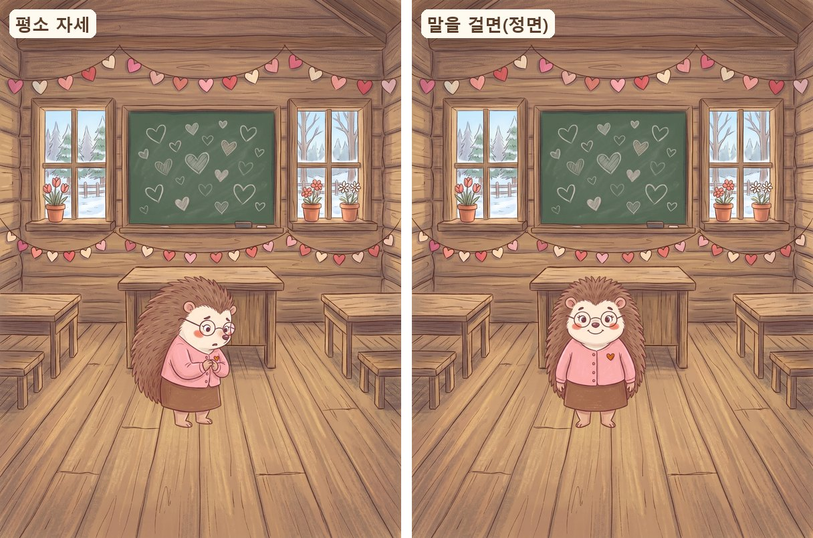
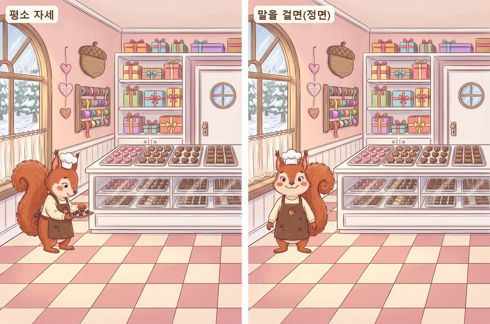
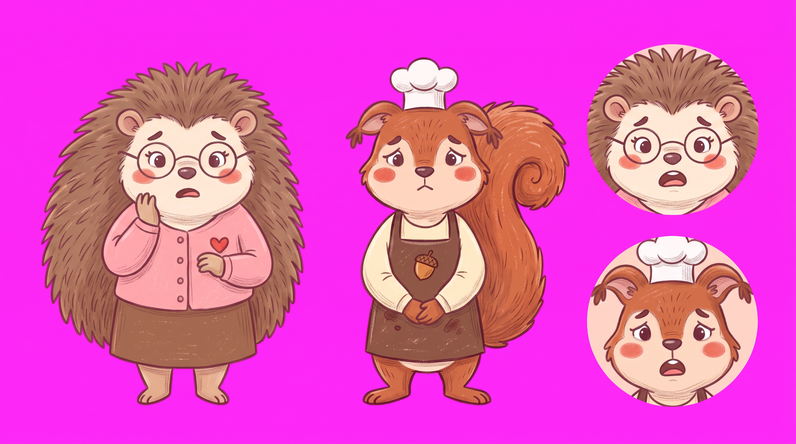

# 초콜릿이 몇 개 틀렸을까? — 발렌타인 주문 확인

**2026-11-26 · Case 05(Case 04 뒤) · L1-04 수량 표현 · 쉬운 사건 · Claude Code가 사용자와 기획(Codex 거치지 않음, 사용자 결정) · 개발 쪽 파일 · 사용자 검토 중 · 개발 전.** 보기 쉬운 판: [case-valentine-chocolate.html](case-valentine-chocolate.html) · 학습 지도: [learning-plan-app.html](learning-plan-app.html)

> 사용자 결정(2026-11-26): **쉬운 난이도**(Case 01–04 정도). 선생님은 **새 인물 고슴도치 페니**(펭귄은 크리스마스의 니코와 겹쳐 바꿈). 가게 주인은 **새 인물 다람쥐 수지의 초콜릿 가게**(빵집은 초콜릿을 보통 팔지 않음). 이 사건의 기획은 Codex가 아니라 Claude Code가 사용자와 함께 한다. 범인 없는 사건. 발렌타인데이에 **선생님이 학생들에게** 줄 초콜릿. 탐정의 일은 **주문한 개수를 듣고, 온 개수를 세어, 몇 개가 틀렸는지 찾는 것**. 초콜릿 모양은 **3가지**(하트·꽃·네모).
>
> **모자라는 개수는 새 게임마다(사용자 결정 2026-11-27):** 꽃이 1·2·3개 중 하나로 모자라고 분홍 하트가 그만큼 남는다(종류는 늘 분홍 하트 ↔ 꽃). 이 문서의 숫자는 3개일 때다. 바뀌는 것: 수지가 포장한 개수(분홍 하트 8+n · 꽃 8−n), 포장 결과(다 찬 상자 8−n · 꽃이 빈 상자 n), 쪽지 How many? 정답, 수지 "Here are three flower chocolates."(1개면 "Here is one flower chocolate."), 탐정 끝 장면 "Suzy gave me three flower chocolates."(앞 문장과 나눔), 소지품 대사와 그림(낱개 초콜릿), 복습 요약. 녹음은 이 네 줄을 개수마다(3개 기준 +8줄).

> **메인 표현(사용자 결정 2026-11-26, ①안):** 숫자 세기와 How many는 초등 수준이라 메인으로 삼지 않는다. 메인은 **수량을 말하는 표현 too many / not enough / enough · a lot of / a few · some / any**. 숫자 세기는 퍼즐을 푸는 도구로만 쓴다.

## 사건 한눈에

발렌타인데이 아침, 고슴도치 페니 선생님이 반 학생 8명에게 하나씩 줄 초콜릿을 다람쥐 수지의 초콜릿 가게에서 받아 왔다. 학생마다 분홍 하트·갈색 하트·꽃·네모 하나씩, **종류마다 8개, 모두 32개**를 주문했다. 선물 상자 하나에 초콜릿 4개다. 선생님은 네모 초콜릿부터 학생별 선물 상자에 넣었는데, 남은 하트와 꽃을 보니 뭔가 이상하다. 수업이 곧 시작해서 선생님은 탐정에게 나머지 포장을 부탁한다.

플레이어는 선생님에게서 주문과 "모양이 좀 이상하다"는 말을 듣고 기록한다. 큰 상자의 분홍 하트·갈색 하트·꽃을 **하나씩 끌어 선물 상자 8개에 담으면** 꽃 홈이 빈 상자 3개와 갈 곳 없는 분홍 하트 3개가 드러난다. 수지에게 주문이 맞았는지 묻고(a lot of), **주문 확인 쪽지에 too many / not enough를 직접 채워** 알린다. 그 뒤 남은 꽃 초콜릿을 묻고(some / a few / any) 바꿔 받아, 선생님에게 가져다주면 끝난다.

| 인물 | 자리 | 역할 |
|---|---|---|
| 페니 · 고슴도치 | 숲속 학교 교실 | 의뢰인, 선생님. 학생 8명. 분홍 하트·갈색 하트·꽃·네모를 8개씩 주문했다. **새 인물** |
| 수지 · 다람쥐 | 초콜릿 가게 | 가게 주인. 손이 빠르고 늘 바쁘다. 간판과 상자에 도토리 무늬. **새 인물** |

**제작자용 전말.** 수지는 주문 메모대로 8개씩 담으려 했다. 그런데 분홍 하트 쟁반과 꽃 쟁반이 나란히 있어서 꽃 3개 자리에 분홍 하트 3개를 담았다. 그래서 상자에는 **분홍 하트 11, 갈색 하트 8, 꽃 5, 네모 8**(합계는 32로 맞음)이 들어 있다. 누가 훔치거나 먹은 것은 없다.

**정답(플레이어가 채움)** · too many **분홍 하트** · not enough **꽃** · How many **3**.

## 메인 표현이 나오는 곳

| 표현 | 누가, 어디서 | 플레이어가 하는 일 |
|---|---|---|
| **a lot of** | 수지 s1 "I made a lot of pink heart chocolates this morning." | 듣고 노트에 기록 |
| **too many / not enough** | 주문 확인 쪽지의 두 칸, 정답 뒤 수지의 확인 | 쪽지에 직접 골라 씀(결론) |
| **some / a few / any** | 수지 s2(쪽지 뒤) "Yes, I have some! There are a few in the kitchen. But I don't have any square chocolates today." | 듣고 노트에 기록 |
| **enough** | 결말 페니 "Now there are enough flower chocolates for everyone!" | 듣기 |

- 페니는 **이상하다는 것만** 말한다("Some shapes look wrong."). 어느 모양이 많고 모자란지는 플레이어가 포장해 보고 정한다(점검 1A).
- 수지의 s1은 **주문은 맞았다**는 확인이다. 주문 실수가 아니라 담을 때 틀렸다는 단서가 되고, a lot of가 여기서 들린다(점검 3). 오늘 분홍 하트를 많이 만들었다는 말은 가게 사정일 뿐, 상자 속 개수를 말하지 않는다.
- 포장하면 메인 표현이 눈으로 보인다: **갈 곳 없는 분홍 하트 = too many**, **비어 있는 꽃 홈 = not enough**.
- too many / not enough는 플레이어가 쪽지에서 먼저 쓰고, 수지가 그 말을 받아 확인한다. 탐정이 먼저 말하지 않는다.
- 남은 초콜릿(s2)은 **무엇이 모자란지 알게 된 뒤**에 묻는다(점검 2).

## 쉬운 난도로 맞춘 점

- **장소 2곳, 인물 2명**(교실의 페니, 초콜릿 가게의 수지). 지도는 두 곳만.
- **받아쓰기 6문항, 빈칸 14칸 안팎.** 한 줄에 빈칸 1–3개.
- **숫자는 두 개만:** eight와 thirty-two. 계산은 없다(가격 없음).
- **세지 않아도 보임:** 포장하면 빈 꽃 홈 3개와 남은 분홍 하트 3개가 그대로 보인다. 11, 5 같은 수를 셀 필요가 없다.
- **넣을 것은 24개, 상자에 끌어 놓기만 하면 됨:** 네모 8개는 페니가 미리 넣어 두었다. 분홍 하트 11 + 갈색 하트 8 + 꽃 5를 선물 상자 위 아무 데나 놓으면 그 상자의 맞는 빈 홈으로 들어간다. 작은 홈을 겨냥하지 않아도 된다(사용자 결정 2026-11-26).
- **차이는 한 가지 숫자(3):** 많은 것 하나, 모자란 것 하나, 맞는 것 하나. 쪽지는 모양 둘과 숫자 하나만 고른다.
- **추리 보드·심문·사진 없음.**

## 장면별 대본

영문 질문은 플레이어가 고르는 선택지다. 답을 듣고 노트에 기록한다. `{{ }}`는 빈칸이고, 한국어는 `해석`을 눌렀을 때만 보인다. 받아쓰기는 **6문항**(t0–t3, s1, 쪽지 뒤 s2)이다.

### 장면 1 · 교실, 페니 선생님의 의뢰

**페니 · 인사** — Oh, Detective! I'm so glad you're here. / 아, 탐정! 와 줘서 정말 다행이야.

#### penny:t0 · 이상한 상자
- **질문** · How can I help you? / 무엇을 도와줄까?
- **대답** · I ordered chocolates for my students. But something is wrong with the box. / 학생들에게 줄 초콜릿을 주문했어. 그런데 상자가 뭔가 이상해.
- **노트** · I ordered {{chocolates}} for my {{students}}. / Something is {{wrong}} with the box.

#### penny:t1 · 주문한 것
- **질문** · What did you order? / 무엇을 주문했어?
- **대답** · There are eight students. Each student gets one pink heart, one brown heart, one flower and one square. / 학생이 여덟 명이야. 학생마다 분홍 하트 하나, 갈색 하트 하나, 꽃 하나, 네모 하나씩 받아.
- **노트** · There are {{eight}} students. / {{Each}} student gets one {{pink}} heart, one {{brown}} heart, one flower and one square.
- 이 말이 포장 규칙이 된다(한 상자에 분홍 하트 하나, 갈색 하트 하나).
- 선택지에 thirty를 둔다(-teen과 -ty).

#### penny:t2 · 무엇이 이상한지
- **질문** · What's wrong with the box? / 상자가 뭐가 이상해?
- **대답** · I'm not sure. Some shapes look wrong. I packed all the squares, but I didn't have time to pack the others. / 잘 모르겠어. 모양이 좀 이상해 보여. 네모는 다 넣었는데, 나머지는 포장할 시간이 없었어.
- **노트** · {{Some}} shapes look wrong. / I packed all the {{squares}}, but I didn't have time to pack the {{others}}.
- 어느 모양이 많고 모자란지는 말하지 않는다(점검 1A).

#### penny:t3 · 산 곳
- **질문** · Where did you buy them? / 어디서 샀어?
- **대답** · At Suzy's Chocolate Shop. She makes chocolates for Valentine's Day. / 수지의 초콜릿 가게에서. 발렌타인데이 초콜릿을 만들거든.
- **노트** · At {{Suzy's}} Chocolate Shop.
- **해금** · 초콜릿 가게, 수지(지도에 나타남).

**t0–t3을 모두 기록하고 노트를 닫으면**(점검 2: 수지와 가게가 해금된 뒤)
- 페니 — Can you pack the others for me? One box for each student. / 나머지 포장 좀 해 줄래? 학생마다 한 상자씩.
- 페니 — I have to teach now, so I can't go to the shop. If something is wrong, please talk to Suzy for me. / 이제 수업을 해야 해서 가게에 못 가. 뭔가 잘못됐으면 나 대신 수지에게 말해 줘.
- → 페니는 다른 반 수업하러 교실을 나가고(화면에서 빠짐, 사용자 결정), 교실 책상의 초콜릿 상자를 누를 수 있다. 탐정이 가게에 가는 이유와 시간 흐름(점검 5)이 이 대사로 정해진다. 노트에는 적지 않는다.
- 페니가 없는 동안 교실에는 초콜릿 상자만 누를 수 있다. 꽃을 받아 오면 페니가 돌아와 다시 말을 걸 수 있다.

### 장면 2 · 선물 상자 포장하기 (새 찾고 조립하기)

교실 책상 위 큰 상자를 누르면 확대 화면이 열리고 뚜껑이 열린다. 사용자 결정(2026-11-26): 쟁반에 나눠 세기 대신 **학생별 선물 상자에 하나씩 포장**한다.

- **큰 상자:** 분홍 하트·갈색 하트·꽃 초콜릿 24개가 섞여 있다(분홍 하트 11 · 갈색 하트 8 · 꽃 5, 화면에 숫자는 없음). 네모 8개는 페니가 이미 선물 상자에 넣었다.
- **선물 상자 8개:** 학생 한 명에 한 상자, 작은 선물 상자 8개가 놓여 있다. 상자 안쪽 받침에 **하트·하트·꽃·네모 모양 홈 4개**가 파여 있다. 네모 홈은 모두 차 있다.
- **화면 구성(사용자 결정 2026-11-27, 시안 B):** 확대 화면 위쪽 말풍선 자리(비워 둠) 아래에 선물 상자 8개를 **4×2로 한꺼번에**(84px), 아래쪽 엄지 가까이에 큰 상자(초콜릿 24개를 흩어 놓음, 44px). 뒤는 다른 확대 화면처럼 흐린 교실. 시안 `design/valentine-packing-layout.html`(직접 끌어 볼 수 있음).
- **포장(상자에 끌어 놓기, 사용자 결정 2026-11-26):** 초콜릿을 끌어서 **선물 상자 위 아무 데나** 놓는다. 상자(84px)는 홈보다 훨씬 커서 폰에서도 놓기 쉽다. 어느 상자에 먼저 넣어도 된다.
  - 누르면 살짝 커지며(44→52px) 손가락보다 약 30px 위에 떠서 따라온다(손가락에 가리지 않게). 상자 위로 가면 그 상자 테두리에 흰 빛(들어갈지 말지는 미리 알려 주지 않음).
  - 놓은 상자에 **맞는 빈 홈**이 있으면 그 홈으로 쏙 들어간다(하트는 하트 홈, 꽃은 꽃 홈; 0.25초, "톡").
  - **한 상자에 같은 색 하트는 둘 들어가지 않는다.** 분홍 하트가 이미 든 상자에 분홍 하트를 놓으면 튕긴다.
  - 그 상자에 넣을 자리가 없으면(같은 색 하트가 이미 있음, 꽃 홈이 이미 참) 그 상자가 좌우로 흔들리고 초콜릿은 큰 상자의 제자리로 돌아온다(0.3초, 낮은 "뚱").
  - **같은 색 하트로 처음 튕길 때** 탐정이 말한다: "Ms. Penny said one pink heart and one brown heart." / 페니 선생님이 분홍 하트 하나, 갈색 하트 하나라고 했어. (t1에서 들은 말을 다시 말함. 그 뒤로는 튕기기만.)
  - 상자 밖(빈 곳)에 놓으면 그냥 큰 상자로 돌아온다.
  - 다 찬 상자는 그 자리에서 뚜껑이 닫히고 리본이 묶여("딩") 더는 받지 않는다.
  - 마지막에 남는 분홍 하트 3개는 어느 상자에 놓아도 튕긴다(모든 상자에 분홍 하트가 있음).
  - 벌점이나 도토리 차감은 없다.
- **다 포장하면:**
  - 5상자는 분홍 하트·갈색 하트·꽃·네모가 다 찬다(뚜껑이 닫히고 리본이 묶임).
  - **3상자는 꽃 홈이 비어 있다**(뚜껑이 열린 채).
  - **큰 상자에 분홍 하트 3개가 남는다.** 어느 상자에 놓아도 튕겨 나온다.
  - 탐정은 비교하거나 결론을 말하지 않는다. 화면에 보이는 그대로다.
  - 어느 상자에도 넣을 초콜릿이 없으면 포장이 끝난다. 0.6초 뒤 단서 카드·소지품 알림(아래).
- **소지품:** 남은 분홍 하트 3개(`pink-hearts-3`)를 챙긴다. 포장 결과가 `포장한 상자` 단서 카드로 남는다(다 찬 상자 5 · 꽃이 빈 상자 3 · 남은 분홍 하트 3).
- **탐정 생각** · s1을 아직 안 들었으면 Let's ask Suzy about the order. / 수지에게 주문을 물어보자. 이미 들었으면 Let's tell Suzy. / 수지에게 알리자. (갈 곳만 알려 줌)

### 장면 3 · 초콜릿 가게, 수지

**수지 · 인사** — Hello, Detective! Happy Valentine's Day! / 안녕, 탐정! 발렌타인데이 축하해!

#### suzy:s1 · 주문이 맞았는지 (메인 표현)
- **질문** · Was Ms. Penny's order right? / 페니 선생님의 주문은 맞았어?
- **대답** · Yes, it was. Let me see my note… Eight of each. That's thirty-two chocolates. I made a lot of pink heart chocolates this morning! / 응, 맞았어. 메모를 볼게… 종류마다 여덟. 모두 서른두 개야. 오늘 아침에 분홍 하트 초콜릿을 많이 만들었거든!
- **노트** · {{Eight}} of each. That's {{thirty-two}} chocolates. / I made {{a lot of}} pink heart chocolates this morning.
- 주문은 맞았다는 확인(점검 3). 상자 속 개수는 말하지 않는다.

### 장면 4 · 주문 확인 쪽지 (플레이어가 결론)

s1을 기록하고 포장을 마쳤으면, 수지 앞에 탐정의 선택 대사가 생긴다. **Ms. Penny's box is not right.** / 페니 선생님의 상자가 맞지 않아.

누르면 **주문 확인 쪽지**가 열린다. 추리 보드가 아니라 쪽지 한 장, 칸은 셋이다(쉬운 난도: 모양 둘과 숫자 하나만 고름). 쪽지 문장이 메인 표현이라, 플레이어가 too many / not enough를 직접 쓰는 셈이다.

> There are too many ( 분홍 하트 / 갈색 하트 / 꽃 / 네모 ). · There are not enough ( 분홍 하트 / 갈색 하트 / 꽃 / 네모 ). · How many? ( 1 / 2 / 3 / 4 )

| 칸 | 정답 |
|---|---|
| too many | 분홍 하트 |
| not enough | 꽃 |
| How many? | 3 |

- 노트와 `포장한 상자` 카드(꽃이 빈 상자 3 · 남은 분홍 하트 3)를 열어 보며 채운다.
- **틀리면:** 쪽지가 흔들리고 탐정이 본 것만 다시 말한다. "Let's look at the gift boxes again." / 선물 상자를 다시 보자. 정답은 알려 주지 않는다.
- **맞으면** 수지 — Oh no! You're right. There are too many pink hearts and not enough flowers. The pink heart tray and the flower tray were next to each other. I'm sorry! / 이런! 맞아. 분홍 하트는 너무 많고 꽃은 모자라. 분홍 하트 쟁반과 꽃 쟁반이 나란히 있었어. 미안해!

#### suzy:s2 · 남은 꽃 초콜릿 (쪽지 뒤 받아쓰기, 메인 표현)
- **질문** · Do you have any flower chocolates? / 꽃 초콜릿 있어?
- **대답** · Yes, I have some! There are a few in the kitchen. But I don't have any square chocolates today. / 응, 좀 있어! 주방에 몇 개 있어. 그런데 오늘 네모 초콜릿은 하나도 없어.
- **노트** · Yes, I have {{some}}! There are {{a few}} in the kitchen. / But I don't have {{any}} square chocolates today.
- 쪽지를 맞힌 뒤에만 열린다(점검 2).

- **수지** — Here are three flower chocolates. / 여기 꽃 초콜릿 세 개야.
- **건네기 / 받기** · 남은 분홍 하트 3개를 수지에게 건네고, 꽃 3개를 받는다(소풍 가방의 건네기·받기 그대로).

### 장면 5 · 교실, 선생님에게 돌려주기

- 꽃을 받으면 페니가 수업을 마치고 교실로 돌아와 책상 옆에 선다. 교실에 가서 말을 걸면 이 대사로 시작한다.
- **페니** · Oh, Detective! My class is over. / 아, 탐정! 수업 끝났어.
- **마지막 포장** · 교실에서 꽃이 빈 선물 상자 3개에 받아 온 꽃을 하나씩 끌어 놓는다(들어가면 뚜껑·리본). 8상자가 모두 찬다.
- **건네기** · 선물 상자들을 페니에게 건넨다.
- **탐정** · There were too many pink hearts and not enough flowers. Suzy gave me three flower chocolates. / 분홍 하트는 너무 많고 꽃은 모자랐어. 수지가 꽃 초콜릿 세 개를 줬어. (플레이어가 쪽지로 정한 사실을 다시 말함)
- **탐정** · Here you go. One box for each student. / 여기 있어. 학생마다 한 상자씩.
- **페니** · Now there are enough flower chocolates for everyone! / 이제 모두에게 줄 꽃 초콜릿이 충분해!
- **페니** · Thank you, Detective. Happy Valentine's Day! / 고마워, 탐정. 발렌타인데이 축하해!
- → 복습.

## 조사와 해금

| 순서 | 조건 | 열리는 것 |
|---|---|---|
| 1 | 시작 | 교실, 페니 |
| 2 | t3 기록 | 초콜릿 가게, 수지 |
| 3 | t0–t3 기록, 노트 닫기 | 페니의 부탁 → 페니는 교실을 나감(수업), 교실의 초콜릿 상자(확대·선물 상자 포장) |
| 4 | 포장 완료 + s1 기록 | 수지 앞 선택 대사, 주문 확인 쪽지 |
| 5 | 쪽지 정답 | 수지의 확인, s2 질문 |
| 6 | s2 기록 | 분홍 하트·꽃 바꾸기 |
| 7 | 꽃을 받음 | 페니가 책상 쪽으로 돌아옴 → 교실에서 빈 자리 3개에 꽃 넣기 → 페니에게 건네기 → 복습 |

- 현장 사진은 없다. 포장 결과만 단서 카드 하나로 남는다(사진은 심문 증거만이라는 규칙. 이 사건은 심문이 없음).
- 추리 보드 없음(`noBoard`). 주문 확인 쪽지가 풀이다.
- 순서 자유: 포장 전에 가게에 가서 s1을 먼저 들어도 된다. 쪽지는 포장과 s1이 모두 끝나야 열린다.
- **도토리 힌트**(점검 6): 포장 중 막히면 1번째는 꽃 홈이 빈 상자를, 2번째는 남은 분홍 하트를 반짝인다. 쪽지에서는 노트와 `포장한 상자` 카드를 반짝인다. 결론은 말하지 않는다(녹음 없음).

## 예습과 복습

- **이번 사건의 열쇠(새 문법 카드):** `수량 표현`
  - **too many / not enough** · 필요한 것보다 많다 / 모자라다. There are too many pink hearts. There are not enough flowers.
  - **enough** · 충분하다. There are enough flower chocolates for everyone.
  - **a lot of / a few** · 많은 / 몇 개의(셀 수 있는 것). I made a lot of pink heart chocolates. There are a few in the kitchen.
  - **some / any** · 긍정문은 some, 부정문·의문문은 any. Yes, I have some! I don't have any square chocolates. Do you have any flower chocolates?
- **같이 나오는 문법:** 복수형 -s(hearts, flowers, squares), There are ~, each + 단수 명사.
- **사건 단어:** chocolate, heart, pink, brown, flower, square, shape, student, order, pack, others, gift box, each, enough, a lot of, a few, some, any, too many, eight, thirty-two, kitchen, wrong, Valentine's Day.
- **다시 들을 문장 후보:** s1(a lot of), s2(some / a few / any), t1(eight).

## 새로 만들 엔진 기능

| 기능 | 내용 | 비슷한 기존 기능 |
|---|---|---|
| 선물 상자 포장 | 확대 화면의 초콜릿을 끌어 선물 상자 위에 놓으면 그 상자의 맞는 빈 홈으로 들어감(한 상자에 같은 색 하트 둘은 안 됨). 넣을 자리가 없으면 튕겨 돌아오고, 같은 색 하트로 처음 튕길 때 탐정 대사. 상자 밖이면 그냥 돌아옴. 다 찬 상자는 뚜껑·리본. 끝나면 남은 것을 소지품으로, 결과를 단서 카드로. 받아 온 꽃으로 빈 홈 채우기. 시작할 때 네모 홈은 이미 차 있음 | 연 사건의 덮개 치우기(누르면 움직임), 확대 조사 `inspect`. 끌기는 새 조작(터치·마우스 모두), 튕기는 움직임은 미니게임 자물쇠 흔들림을 참고 |
| 주문 확인 쪽지 | 쪽지 한 장의 고르기 칸 3개. 틀리면 흔들림, 맞으면 다음 대사와 s2 질문(쪽지를 맞힌 뒤 열리는 질문 조건) | 추리 보드의 빈칸 드롭다운(`#deduceDrop`) |
| 건네고 받기 | 남은 분홍 하트 3 → 꽃 3 | 소풍 가방 `give` / `take` |
| 새 문법 카드 | `quantity`(too many / not enough / enough / a lot of / a few / some / any) | `GRAMMAR`의 다른 카드 |

## 그림·녹음 한눈에 (자세한 방법은 아래 "그림 제작 계획")

| 무엇 | 새로·재사용 | 비율 | 메모 |
|---|---|---|---|
| 페니 선생님(고슴도치) | 새로 | 인물 시트 | 기본·걱정·기쁨 + 말하는 입 |
| 수지(다람쥐) | 새로 | 인물 시트 | 기본·미안·기쁨 + 말하는 입 |
| 교실 | 새로 | **3:4 세로** | 칠판에 하트 장식, 책상 위 상자. 띠 + 바닥으로 자름 |
| 초콜릿 가게 | 새로 | **3:4 세로** | 계산대 위에 분홍 하트·갈색 하트·꽃·네모 쟁반이 나란히, 도토리 간판. 띠 + 바닥으로 자름 |
| 초콜릿 시트 | 새로 | 16:9 한 장 | 분홍 하트·갈색 하트·꽃·네모 초콜릿(장식은 아래 "초콜릿 그림 방향"), 큰 상자(닫힘·열림), 작은 선물 상자(안쪽 받침에 하트·하트·꽃·네모 모양 홈 4개, 뚜껑 닫고 리본 묶은 것) |
| 녹음 | 새로 | — | 페니 약 10줄, 수지 약 7줄, 탐정 약 10줄. 그림·녹음 크레딧은 만들기 전에 견적을 알림 |

### 초콜릿 그림 방향 (사용자 요청 2026-11-26: 단순하게 말고 예쁘게, 레퍼런스는 실제 봉봉 초콜릿)

기본 실루엣은 **하트 · 꽃 · 네모** 세 가지로 또렷이 다르게 두고(하트는 분홍·갈색 두 색), 그 위의 **장식은 공들여** 그린다. 작은 선물 상자 칸에서도 모양으로 구별되도록, 장식은 모양마다 한 가지 스타일로 통일한다(같은 모양끼리 장식이 달라 헷갈리지 않게).

| 모양 | 바탕 | 장식 |
|---|---|---|
| 분홍 하트 | 딸기 분홍 초콜릿, 윤기 | 흰 초콜릿 드리즐 줄무늬, 작은 금빛 하트 토퍼, 가장자리 하이라이트 |
| 갈색 하트 | 윤기 나는 밀크 초콜릿 | 분홍 드리즐 줄무늬, 작은 흰 진주 알갱이 몇 개 |
| 꽃 | 연한 밀크 초콜릿, 꽃잎 5장이 도톰하게 | 가운데에 흰 초콜릿 동그라미와 분홍 스프링클, 꽃잎마다 결 무늬 |
| 네모 | 진한 다크 초콜릿, 모서리가 살짝 둥근 사각 | 흰 초콜릿 지그재그 드리즐, 한쪽 모서리에 금박 조각이나 아몬드 반쪽 |

- 선물 상자 받침의 홈은 초콜릿 실루엣과 똑같은 모양으로, 비어 있을 때도 무슨 모양 자리인지 보이게 그린다.
- 공통: 동화풍 손그림 톤(게임 그림과 같은 연필 외곽선), 윤기와 하이라이트, 아래 종이 컵(주름 컵) 받침은 넣지 않음(선물 상자 칸에 넣을 때 겹치지 않게). 위에서 내려다본 각도(아래 그림 제작 계획 6번).
- 분홍 하트와 갈색 하트는 작은 칸에서도 한눈에 구별되게 색을 확실히 다르게.
- 시트에 함께: 큰 초콜릿 상자(닫힘: 리본·도토리 무늬 / 열림: 안쪽 칸막이), 작은 선물 상자(안쪽 받침에 하트·하트·꽃·네모 모양 홈 4개 / 뚜껑 닫고 리본 묶은 것), 남은 분홍 하트 3개를 담을 작은 봉투(소지품 그림).
- 만들기 전에 프롬프트와 크레딧 견적을 먼저 보여 준다.

## 그림 제작 계획 (상세)

사용자 요청(2026-11-26): 견적보다 **어떻게 만들지**를 먼저 정한다. 모든 그림은 Higgsfield Nano Banana 2.1로 만들고, 원본 시트(`*-higgsfield-original.png`)를 남긴 뒤 스크립트로 잘라 쓴다(기존 사건과 같은 방식, `HANDOFF.md` 7절).

### 공통 원칙

- **화풍 맞추기:** 참조 그림으로 화단 사건의 `characters/gus-ollie-higgsfield-original.png`(인물)과 `places/flowerbed/garden.webp`(장소)를 넣고 프롬프트에 "drawing style only"라고 적는다. 동화풍 손그림, 크레용 결, 갈색 연필 외곽선, 따뜻한 색. 살아 있는 작가 이름은 쓰지 않는다.
- **글자 없음:** 간판·칠판·포스터에 글자를 그리지 않는다(그림 속 글자는 깨지기 쉽고 해석 규칙과도 겹침). 하트·도토리 같은 그림 기호만.
- **배경 분리:** 인물·물건 시트는 **마젠타 단색 배경**(#FF00FF)으로 그려 스크립트로 뺀다(화단·우산 사건과 같음). 가장자리가 지저분하면 Higgsfield `remove_background`를 쓴다.
- **장소는 3:4 세로 2K**(규칙): 1376 폭으로 줄여 위 768을 조사 화면 띠, 아래를 대화 화면 바닥(`ART_FLOOR`)으로 자른다. 인물이 설 자리는 가운데쯤, 빈 바닥이 그림 아래 끝까지.
- **움직이는 것은 따로:** 장면에서 상태가 바뀌는 것(큰 상자, 선물 상자, 초콜릿, 페니가 자리를 비움)은 배경에 그리지 않고 따로 그려 위에 얹는다.
- **한 단계씩 사용자 확인:** 아래 순서대로 한 장 만들 때마다 보여 주고, 승인받은 뒤 다음 장으로 간다.

### 만드는 순서와 각 그림

**배경을 먼저 만든다**(사용자 결정 2026-11-26): 인물의 평소 자세·크기·빛을 그 장소에 맞춰야 하므로 교실 → 가게 → 인물 시트 순서. 인물 시트에는 그 인물이 서는 배경을 참조로 넣고, 배경을 본 뒤 인물 시트의 자세(책상·계산대 높이 등)를 고칠 수 있다.

| 순서 | 그림 | 비율·크기 | 참조 | 나오는 파일 |
|---|---|---|---|---|
| 1 | 교실 | 3:4 2K | `flowerbed/garden.webp`(인물 없이) | `places/valentine/classroom.webp`, `classroom-floor.jpg` |
| 2 | 초콜릿 가게 | 3:4 2K | 1번 교실 | `places/valentine/shop.webp`, `shop-floor.jpg` |
| 3 | 인물 시트 2장(페니 한 장, 수지 한 장: 평소 자세·정면·말하는 입) | 16:9 2K, 마젠타, 각 한 장 | `gus-ollie-higgsfield-original.png` + 그 인물의 배경(페니 = 교실, 수지 = 가게, + 페니 장) | `characters/penny-work`·`penny-higgsfield`, `suzy-work`·`suzy-higgsfield`, 입 `mouths/penny·suzy-closed·open`, 얼굴 `ui/icons-v2/penny·suzy` |
| 4 | 인물 표정 시트 | 16:9 2K, 마젠타 | 3번 결과 | `penny-worried`, `penny-happy`, `suzy-sorry`, `suzy-happy` |
| 5 | (입은 3번에 함께) | — | — | — |
| 6 | 초콜릿·상자 시트 | 16:9 2K, 마젠타 | 사용자 레퍼런스 3장(봉봉 초콜릿) | `places/valentine/choc-pink-heart·brown-heart·flower·square`, `bigbox-closed·open`, `gift-open·gift-closed`, `bag-pink-hearts·bag-flowers`, `desk-boxes`(교실 책상용) |
| 7 | 작은 지도 | 1:1 1K | 1·2번 결과 | `places/valentine/map.webp` |
| 8 | 사건 목록 표지·복습 사진 | 새로 안 만듦 | — | 교실 그림 + 6번 선물 상자를 합성(스크립트) |

#### 1. 교실 (3:4 세로)
- **배치:** 숲속 학교 교실. 뒤쪽 벽에 초록 칠판(분필로 그린 하트들, 글자 없음), 나무 창문 밖 숲. 가운데 앞쪽에 **선생님 책상**(위는 비워 둠: 큰 상자와 선물 상자는 따로 얹음). 책상 왼쪽에 페니가 설 빈 바닥. 작은 학생 책상들은 양옆 뒤쪽에 조금만. 벽에 종이 하트 장식 줄.
- **학생은 그리지 않는다**(아래 "정할 것" 1).
- **살펴볼 것 — 탐정 한마디**(사용자 요청 2026-11-26: 배경마다 미리 정함, 단서가 아닌 물건 `prop:true`, 사진 없이 나레이션만, 누르면 별빛이 꺼짐). 그림에 꼭 들어가야 한다.

| 물건 | 탐정 | 해석 | 들리는 표현 |
|---|---|---|---|
| 칠판의 하트 | There are a lot of hearts on the board. | 칠판에 하트가 많이 그려져 있어. | a lot of |
| 창가 화분 | There are some flowers by the window. | 창가에 꽃이 좀 있네. | some |
| 종이 하트 장식 줄 | Pretty paper hearts! It's Valentine's Day. | 예쁜 종이 하트야! 오늘은 발렌타인데이구나. | — |
- 책상 위 **큰 초콜릿 상자**는 물건이 아니라 포장 확대로 들어가는 곳(위 장면별 대본).
- **잘라 쓰기:** `scripts/cut-valentine-places.py`(새로) — 1376 폭, 띠 시작 위치는 그림을 보고 정함(칠판과 책상이 띠 안에), 아래는 바닥.
- **프롬프트 초안:** "A cozy forest school classroom on Valentine's Day morning, vertical 3:4, children's storybook illustration, crayon texture, soft pencil outlines. A green chalkboard on the back wall with chalk-drawn hearts (no letters), wooden windows showing the forest with a small pot of flowers on the windowsill, paper heart garlands. A teacher's wooden desk in the front center with an empty top. A few small student desks at the back sides. Empty wooden floor continuing to the bottom edge. No characters, no text."

#### 2. 초콜릿 가게 (3:4 세로)
- **소재는 교실과 다르게**(사용자 요청 2026-11-26: 둘 다 나무면 같아 보임): 분홍 회벽 + 흰 징두리판, 분홍·크림 체크 타일 바닥, 레이스 커튼 아치 창. 그린 그림 `assets/places/valentine/shop-v2-higgsfield-original.png`.
- **배치:** 작은 나무 가게. 가운데 유리 진열 계산대, 그 위에 **분홍 하트·갈색 하트·꽃·네모 쟁반 네 개가 나란히**(분홍 하트와 꽃 쟁반이 바로 붙어 있게: 사건의 원인이 그림으로 보임). 뒤쪽 선반에 선물 상자들, 오른쪽 뒤에 **주방 문**(수지가 "in the kitchen"이라고 할 곳). 처마 밑에 도토리 모양 간판(글자 없음). 계산대 옆에 수지가 설 빈 바닥.
- 1번 교실을 참조로 넣어 빛·색을 맞춘다.
- **살펴볼 것 — 탐정 한마디**(사용자 요청 2026-11-26: 배경마다 미리 정함, 단서가 아닌 물건 `prop:true`, 사진 없이 나레이션만, 누르면 별빛이 꺼짐). 그림에 꼭 들어가야 한다.

| 물건 | 탐정 | 해석 | 들리는 표현 |
|---|---|---|---|
| 선반의 선물 상자 | There are a lot of gift boxes on the shelf. | 선반에 선물 상자가 많아. | a lot of |
| 주방 문 | The kitchen is behind this door. | 이 문 뒤가 주방이야. | — (s2 "in the kitchen"의 자리) |
| 도토리 간판 | The sign looks like an acorn! | 간판이 도토리 모양이야! | — |
- 계산대의 **쟁반 네 개**는 누를 수 없게 둔다(분홍 하트 쟁반과 꽃 쟁반이 붙어 있는 것은 수지가 쪽지 뒤에 말하는 원인이라, 탐정이 먼저 말하면 답을 알려 줌). 그림으로만 보인다.
- **프롬프트 초안:** "A small wooden chocolate shop run by a squirrel, vertical 3:4, children's storybook illustration, crayon texture, soft pencil outlines, warm light. A glass display counter in the center with four trays side by side on top: pink heart chocolates, brown heart chocolates, flower-shaped chocolates and square chocolates; the pink heart tray and the flower tray touch each other. Shelves with ribbon gift boxes behind, a kitchen door at the back right, an acorn-shaped sign with no letters, Valentine decorations. Empty floor beside the counter and down to the bottom edge. No characters, no text."

#### 3. 인물 시트 — 한 사람에 한 장(사용자 결정 2026-11-26: 평소 자세·정면·말하는 입을 한 장에)
- **페니 한 장, 수지 한 장**(16:9 2K, 마젠타). 참조: 화풍 `gus-ollie-higgsfield-original.png` + **그 인물이 서는 배경**(페니 = 1번 교실, 수지 = 2번 가게: 크기·빛·색과 평소 자세를 책상·계산대에 맞춤). 수지 장에는 페니 장도 넣어 크기·선·색을 맞춘다. 한 장에 셋:
  - **왼쪽 — 평소 자세**(탐정이 말을 걸기 전, 장소에 서 있을 때, `:work` 그림): 페니는 책상 위 큰 초콜릿 상자를 들여다보며 초콜릿 하나를 들고 고개를 갸웃(살짝 옆모습). 수지는 계산대 쪽을 향해 쟁반에 초콜릿을 가지런히 놓는 중(살짝 옆모습, 꼬리가 보이게).
  - **가운데 — 정면**(말을 걸면 나오는 대화 그림): 전신, 정면에서 살짝 비스듬히, 서 있는 기본 자세, 입은 다문 기본 표정.
  - **오른쪽 — 말하는 입**: 가운데 정면 얼굴과 같은 크기의 입 부분 둥근 털 조각 두 개(위 다문 입, 아래 벌린 입). `make-flowerbed-mouths.py`처럼 잘라 정면 그림 위에 얹는다.
- 크기 비율은 숲속 마을 인물들과 같게(다른 인물 옆에 세워도 어색하지 않게).
- **페니:** 작고 동그란 고슴도치, 부드러운 갈색 가시. 둥근 안경, 연한 분홍 카디건과 무릎길이 치마, 가슴에 작은 하트 브로치. 다정하고 조금 바쁜 표정.
- **수지:** 날씬한 다람쥐, 크고 폭신한 꼬리. 초콜릿색 앞치마에 도토리 무늬 하나, 작은 흰 요리 모자. 앞치마에 초콜릿 얼룩 한두 점. 손이 빠른 느낌의 밝은 표정.
- **잘라 쓰기:** `scripts/cut-valentine-characters.py`(새로) — 마젠타를 빼고 알파 경계 + 3% 여백, 높이 700px: `penny-work`·`penny-higgsfield`, `suzy-work`·`suzy-higgsfield`, 얼굴 아이콘 160×160(흰 테두리), 입 `mouths/penny·suzy-closed·open`. `SPRITES`(`:work` 포함)·`MOUTHS` 값을 출력.
- **프롬프트 초안(페니):** "Character sheet of one forest animal on a flat magenta (#FF00FF) background, children's storybook illustration, crayon texture, soft brown pencil outlines, warm colors. A small round hedgehog teacher with soft brown spines, round glasses, a light pink cardigan and knee-length skirt, a tiny heart brooch. Left: full body in a slight side view, looking down at a chocolate she holds, head tilted, puzzled. Center: the same teacher full body, standing, facing the viewer in a slight three-quarter view, kind, mouth closed. Right: two round close-up patches of her face around the mouth at the same scale as the center figure, top with the mouth closed, bottom with the mouth open as if talking. Well separated, no text. Drawing style only from the reference."
- **프롬프트 초안(수지):** 같은 틀에 "a slim squirrel chocolatier with a big fluffy tail, a chocolate-brown apron with one acorn emblem, a small white chef hat, one or two chocolate smudges on the apron. Left: slight side view, placing chocolates neatly on a tray she holds, tail visible. Center: facing the viewer, cheerful, mouth closed." 참조에 페니 장 추가("same size and line weight as the hedgehog").

#### 그린 그림 — 배경에 세워 보기(2026-11-26)
배경·인물 시트는 만들었고 아직 게임에는 넣지 않았다. 인물은 `scripts/cut-valentine-characters.py`로 잘랐고(평소 자세 `penny-work`·`suzy-work`, 정면 `penny-higgsfield`·`suzy-higgsfield`, 입 조각 `mouths/<id>-patch-closed·open.png`), 세워 본 그림은 `scripts/make-valentine-preview.py`(자리·크기는 시험값).

- 페니가 책상 바로 앞에 서면 책상(큰 초콜릿 상자를 얹을 곳)을 가린다. 게임에서는 책상 옆으로 비켜 세우는 것이 좋다.
- 원본: 교실 `assets/places/valentine/classroom-higgsfield-original.png`, 가게 `shop-v2-higgsfield-original.png`, 인물 시트 `assets/characters/penny-sheet-v3-higgsfield-original.png`·`suzy-sheet-higgsfield-original.png`.

#### 4. 표정 시트
- **만든 것**(사용자 요청 2026-11-26: 한 장에 둘, 정면으로는 어색한 표정만): 페니 걱정(볼에 손, t0–t2)·수지 미안(귀가 처지고 두 손을 모음, 쪽지 정답 뒤) + 각자 벌린 입 조각. 기쁨 표정은 정면이 이미 웃는 얼굴이라 만들지 않음. `assets/characters/valentine-moods-higgsfield-original.png` → `penny-worried.webp`·`suzy-sorry.webp`.

- (처음 계획)
- 3번 인물 시트를 참조로 넣고 **얼굴과 손만 바꾼 4가지**를 한 장에: 페니 걱정(손을 볼에, t0–t2), 페니 기쁨(두 손을 모음, 결말), 수지 미안(귀가 처지고 손을 모음, 쪽지 정답 뒤), 수지 기쁨(꽃 초콜릿 세 개를 내밂).
- 옷·크기·선 굵기는 3번과 똑같이. 자르기는 같은 스크립트.

#### 5. 입 — 3번 인물 시트에 함께 그림(따로 만들지 않음)

#### 6. 초콜릿·상자 시트 (가장 중요, 예쁘게)
- **보는 각도: 위에서 내려다본 모습(flat lay).** 퍼즐에서 초콜릿을 선물 상자 홈에 겹쳐 놓아야 하므로, 초콜릿·홈·상자가 모두 같은 각도여야 딱 맞는다. 위에서 봐도 장식이 잘 보인다.
- **초콜릿 4개(각 1개):** 위 "초콜릿 그림 방향"의 장식 그대로. 분홍 하트(딸기 분홍, 흰 드리즐, 금빛 작은 하트), 갈색 하트(밀크, 분홍 드리즐, 흰 진주), 꽃(도톰한 꽃잎 5장, 가운데 흰 초콜릿과 분홍 스프링클), 네모(다크, 흰 지그재그, 금박 한 조각). 크기는 넷이 거의 같게.
- **게임에서의 크기(화면 구성 B):** 선물 상자 84px, 홈 안 초콜릿 약 31px, 큰 상자 안 초콜릿 44px, 큰 상자 약 366×340px. 장식은 31px로 줄어도 모양·색·장식이 읽히게 굵고 또렷하게(가는 선을 여러 개 그리지 않음). 연 선물 상자와 닫은 선물 상자는 외곽이 같게(바꿔치기). 테두리가 얇아야 홈이 커진다.
- **큰 상자:** 닫힌 것(리본, 도토리 무늬 뚜껑), 연 것(안쪽이 비어 있음, 위에서 본 거의 정사각, 안쪽 바닥은 밝게: 초콜릿 24개는 코드로 흩어 얹음).
- **선물 상자:** 연 것(받침에 하트·하트·꽃·네모 **모양 홈** 4개가 2×2, 홈은 초콜릿 실루엣과 같은 모양·크기, 비어 있어도 모양이 보이게 살짝 그늘), 닫은 것(뚜껑 + 분홍 리본).
- **소지품용:** 분홍 하트 세 개가 든 작은 비닐 봉투, 꽃 세 개가 든 작은 봉투.
- **교실 책상용 한 칸(이것만 비스듬히, 사용자 결정 2026-11-27):** 교실 그림과 같은 각도(정면에서 약간 위)로 본 닫힌 큰 상자 + 옆에 리본 묶은 작은 선물 상자 몇 개. 교실 책상 위에 얹는 물건이고 누르면 포장 확대 화면이 열린다. 교실 그림은 다시 그리지 않는다.
- **잘라 쓰기:** `scripts/cut-valentine-props.py` — 칸마다 잘라 투명 webp. 선물 상자 연 것에서 **홈 네 곳의 가운데 좌표**를 재서 출력(코드가 초콜릿을 얹을 자리). 만든 그림(2026-11-27, job `e932dd09`): `assets/places/valentine/choc-sheet-higgsfield-original.png` → 잘라 낸 파일과 홈 좌표는 `assets/places/valentine/README.md`(홈 가운데 0.262/0.735, 홈 칸 폭 0.473).
- **프롬프트 초안:** "Item sheet on a flat magenta (#FF00FF) background, top-down flat-lay view, children's storybook illustration with crayon texture and soft pencil outlines, glossy and pretty, bold readable decorations that still read when shown small. Row 1: four bonbon chocolates of the same size — a glossy strawberry-pink chocolate heart with white drizzle and a tiny gold heart topper; a glossy milk-chocolate heart with pink drizzle and a few white pearls; a plump five-petal milk-chocolate flower with a white-chocolate center and pink sprinkles; a dark-chocolate square with rounded corners, a white zigzag drizzle and a small gold-leaf flake. Row 2: a large chocolate box closed with a ribbon and an acorn pattern lid, and the same box open and empty inside (nearly square, light lining). Row 3: a small square gift box with a thin rim, open, showing a tray with four large molded cavities in a 2x2 grid shaped exactly like a heart, a heart, the flower and the square; the same gift box closed with a pink ribbon. Row 4: a small clear bag with three pink heart chocolates, a small clear bag with three flower chocolates. Row 5, the only item not seen from the top: the same large closed chocolate box seen from the front and slightly above, as it would sit on a teacher's desk, with a few small ribbon-tied gift boxes stacked beside it. Items well separated, no paper cups, no text. Use the reference photos only for chocolate shapes and decorations."
- 사용자 레퍼런스 3장은 "모양과 장식 참고"로만 넣는다(사진풍이 섞이지 않게 화풍은 3번 인물 시트 참조로 고정).

#### 7. 작은 지도 (1:1)
- 교실이 있는 숲속 학교와 초콜릿 가게, 둘을 잇는 오솔길. 다른 사건의 사건별 지도(바이올린 `map-hall`, 크리스마스 `map-festival`)와 같은 크기·방식. 글자 없음. 핀은 `PLACES[].x/y`로 건물 위에.

#### 8. 사건 목록 표지·복습 사진 (새로 안 만듦)
- **표지:** 교실 그림의 책상 부분에 리본 묶은 선물 상자 몇 개와 큰 상자를 얹어 합성(`scripts/make-valentine-cover.py`, 4:3 800×563, 우산 표지처럼).
- **복습 사진:** 8상자가 다 찬 모습(선물 상자 닫은 그림 8개를 나란히 합성). 만든 것(2026-11-27): `assets/places/valentine/cover.webp`(800×563)·`review-boxes.webp`(840×360), `scripts/make-valentine-cover.py`.

### 그림과 엔진이 맞물리는 곳

| 장면 | 쓰는 그림 | 코드가 하는 일 |
|---|---|---|
| 교실 대화 | 교실 띠·바닥, 페니(기본·걱정) | 페니 위치 `NPC_POSITIONS`, 말할 때 입 |
| 포장 확대 | 흐린 교실(다른 확대 화면처럼) + 큰 상자(연 것) + 선물 상자 8개 + 초콜릿 | 초콜릿 24개를 큰 상자 안에 흩어 얹음, 끌어 놓은 상자의 맞는 홈 좌표로 쏙 넣음, 넣을 자리가 없으면 튕김, 다 찬 상자는 닫은 그림으로 바꿈 |
| 가게 대화·쪽지 | 가게 띠·바닥, 수지(기본·미안·기쁨) | 쪽지는 코드로 그림(종이 질감은 기존 노트 종이) |
| 바꾸기·결말 | 봉투(분홍 하트·꽃), 페니(기쁨) | 소지품 건네기·받기 |

### 정할 것(그림)

정한 것(사용자 2026-11-26, 셋 다 추천대로):
1. **페니가 수업하는 동안:** 교실을 나간다(다른 반 수업, 화면에서 빠짐). 꽃을 받아 오면 돌아온다. 학생을 그리지 않아도 되고 탐정 혼자 포장하는 장면이 자연스럽다. "I have to teach now"는 그대로.
2. **초콜릿 시트 각도:** 위에서 내려다본 모습(flat lay). 홈에 겹쳐 놓기 쉽다.
3. **수지의 요리 모자:** 작은 흰 요리 모자를 쓴다(가게 주인이 한눈에).

정한 것(사용자 2026-11-27, 화면 구성 B와 함께, 둘 다 추천대로):
4. **교실 책상 위 큰 상자:** 초콜릿 시트에 비스듬히 본 큰 상자(닫힘 + 작은 선물 상자 몇 개) 한 칸을 더 넣는다(`desk-boxes`). 교실 그림은 다시 그리지 않고 크레딧도 그대로.
5. **포장 확대 화면 뒤:** 다른 확대 화면처럼 흐리게 한 교실(엔진의 `closeLookBg`). 따로 그리지 않음(0크레딧).

**크레딧 견적**(Higgsfield `nano_banana_2_1`, 2026-11-26 조회): 2K 한 장 2크레딧, 1K 한 장 1.5크레딧. 1 교실 2 · 2 가게 2 · 3 인물 2장 4 · 4 표정 2 · 5 입 0(3번에 함께) · 6 초콜릿·상자 2 · 7 지도 1.5 = **13.5크레딧**(다시 그리기 한두 번을 더하면 약 15–17크레딧). 8 표지·복습 사진은 합성이라 0. 한 장씩 사용자 확인 뒤 다음 장. 녹음은 따로 견적.

## 정할 것

그림 쪽 3가지는 정함(위 "그림 제작 계획 → 정할 것(그림)"). 남은 것: 사용자 승인 뒤 1번 교실부터 한 장씩(배경 먼저, 사용자 결정).

정한 것(사용자 2026-11-26): 쉬운 난도, 선생님은 새 인물 고슴도치 페니, 가게 주인은 새 인물 다람쥐 수지(초콜릿 가게), 기획은 Claude Code, **사건 번호는 Case 04(화단) 바로 뒤 = 새 Case 05**(개발할 때 지금의 Case 05–09는 06–10으로 밀리고 훈련 게임 자리도 따라 바뀜, 사건 id·저장 키는 번호와 상관없어 진행 기록은 그대로), **메인 표현은 수량 표현(①안)**. 가격 듣기(How much, 하나에 얼마, 거스름돈)는 이 사건에서 빼고 다음 수량·가격 사건 후보로 둔다. some / any 문장은 결말이 아니라 쪽지 앞의 받아쓰기(s2)로 옮겨 정함. 퍼즐은 쟁반에 나눠 세기 대신 **학생별 선물 상자 13개에 하나씩 포장하기**(남은 하트 = too many, 빈 꽃 자리 = not enough가 눈으로 보임). 선물 상자 받침에는 하트·꽃·네모 **모양 홈**이 있어 맞는 모양만 들어가고 다른 모양은 튕겨 나온다.

점검 반영(사용자 2026-11-26, 1A·2·3·4A): 페니는 "Some shapes look wrong."만 말함(어느 모양인지 말하지 않음) · s2(some / a few / any)는 쪽지를 맞힌 뒤 열림 · s1은 "주문이 맞았는지" 확인 + a lot of · 네모 13개는 페니가 미리 넣어 두어 플레이어는 하트·꽃 26개만 넣음. 페니가 수업 때문에 가게에 못 간다는 대사를 부탁 대사에 붙이고("I have to teach now, so I can't go to the shop. If something is wrong, please talk to Suzy for me."), 결말 첫마디를 "Oh, Detective! My class is over."로(점검 5 해결).

2차 점검 반영(사용자 2026-11-26, 1–6 전부): 결말에서 탐정이 무슨 일이었는지 알림(too many / not enough 한 번 더) · 페니의 부탁은 t0–t3 모두 기록 뒤 · 수업 중 페니는 토스트(그 뒤 그림 결정으로 교실을 나가는 것으로 바뀜) · 가게를 먼저 갔으면 탐정 생각 "Let's tell Suzy." · 꽃을 받으면 페니가 돌아옴 · 도토리 힌트(빈 꽃 홈, 남은 하트, 쪽지는 노트·카드).

학생 수 줄임(사용자 2026-11-27): 상자가 너무 많아 13명 → **8명**. 종류마다 8개 · 모두 32개(thirty-two) · 상자에는 분홍 하트 11 · 갈색 하트 8 · 꽃 5 · 네모 8 · 플레이어가 넣는 것 24개 · 결과는 다 찬 상자 5 · 꽃이 빈 상자 3 · 남은 분홍 하트 3(틀린 개수 3은 그대로라 꽃 3개 바꾸기·쪽지 정답은 같음). 아래 기록의 13·52·39는 그 전 숫자.

4칸 상자 반영(사용자 2026-11-26): 선물 상자에 분홍 하트·갈색 하트·꽃·네모 4개(모두 52개, fifty-two) · 한 상자에 같은 색 하트는 둘 못 넣음(넣을 곳이 없으면 튕기고 처음 한 번 탐정이 "Ms. Penny said one pink heart and one brown heart.") · 조작은 **상자에 끌어 놓기**(놓은 상자의 맞는 빈 홈으로 들어감, 작은 홈을 겨냥하지 않음) · 네모만 페니가 미리 넣어 플레이어는 39개 · 잘못 담긴 것은 분홍 하트 3개(too many 분홍 하트, not enough 꽃).
